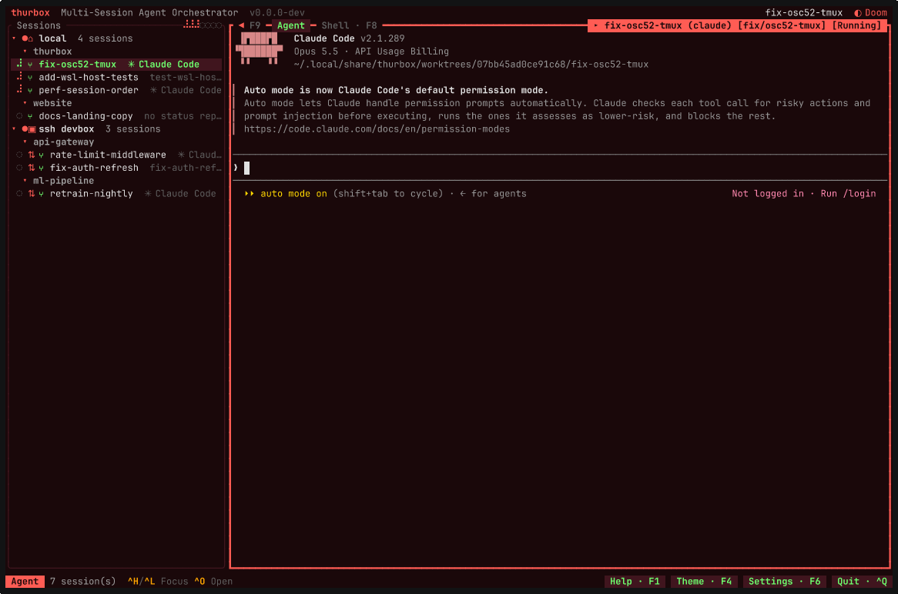
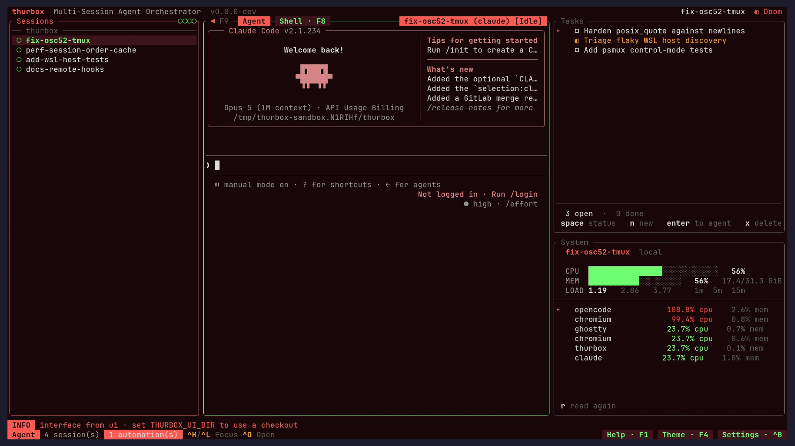
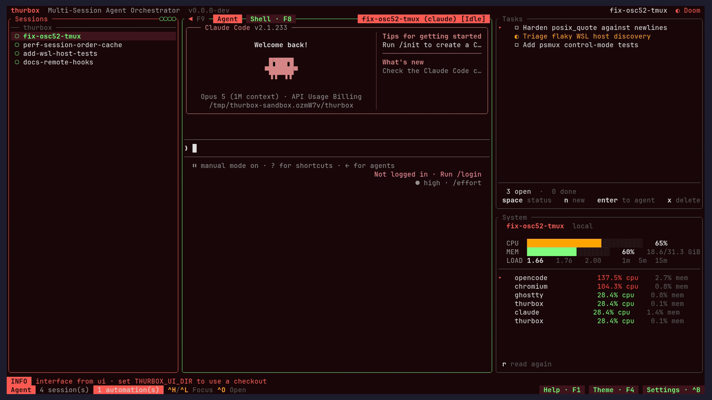

# Thurbox

<div align="center">
  
</div>

[](https://github.com/Thurbeen/thurbox/actions)
[](https://opensource.org/licenses/MIT)
[](https://thurbox.thurbeen.eu/)
[](https://discord.gg/fGumcHaxFY)
[](https://sonarcloud.io/summary/new_code?id=Thurbeen_thurbox)



- **Several coding agents at once**, side by side in one terminal — Claude Code and Codex
  today, and any agent Fleet gains a harness profile for.
- **A persistent multiplexer session behind every agent** — they survive crashes, restarts
  and reboots, so quit thurbox and every agent keeps working.
- **Agents on other machines too** — sessions on a remote host over SSH, or in a WSL
  distro, sit in the same list under their own host, beside the ones running here.
- **Sessions in your repositories** — a session runs in the repository you pick, as it is; a
  Task started with `fleet` can ask Fleet for a git worktree of its own instead.
- **Agent-neutral** — thurbox launches the vendor CLI unmodified and knows nothing about its
  model, prompts or tools, so new agent features arrive the day that CLI ships them.
- **An interface that is not compiled in** — every pane, the session list included, is a Lua
  file in a directory you own; move it, turn it off, rewrite it, or install one somebody else
  wrote.

## Installation

**Linux / macOS:**

```bash
curl -fsSL https://raw.githubusercontent.com/Thurbeen/thurbox/main/scripts/install.sh | sh
```

**Windows (PowerShell):**

```powershell
irm https://raw.githubusercontent.com/Thurbeen/thurbox/main/scripts/install.ps1 | iex
```

That installs both binaries — `thurbox` (the TUI) and `thurbox-cli` (the
headless one) — with checksum verification and platform auto-detection.

You also need **tmux ≥ 3.2** (or [psmux](https://github.com/psmux/psmux) ≥ 3.3.8
on native Windows), **git**, and at least one coding-agent CLI.
[RMUX](https://github.com/Helvesec/rmux) **≥ 0.10.0** is an opt-in alternative,
tested with thurbox on Linux. Install it separately, then select **RMUX**
after tmux in the new-session picker (**Ctrl+N**); it appears locally when
`rmux` is on `PATH`. See [multiplexer requirements and setup](docs/thurbox/config.md#multiplexer-requirements-and-rmux-setup)
for verified versions, config defaults, host support, and limits.

**Nix / NixOS:**

```bash
nix run github:Thurbeen/thurbox                # try it
nix profile install github:Thurbeen/thurbox    # install it
```

On NixOS, add `github:Thurbeen/thurbox` as a flake input and import
`thurbox.nixosModules.default` with `programs.thurbox.enable = true;`. The
[Installation page](https://thurbox.thurbeen.eu/docs/installation.html#nix)
has the full snippet, the overlay and the Home Manager module.

Homebrew, the AUR, winget, Chocolatey, building from source, pinning a version
and changing the install directory are all on the
[Installation page](https://thurbox.thurbeen.eu/docs/installation.html).

**Uninstall:** removing the binaries is not enough — sessions keep running in
the selected multiplexer. Follow the
[uninstall steps](https://thurbox.thurbeen.eu/docs/installation.html#uninstall).

## Your first session

```bash
thurbox
```

First launch seeds `~/.config/thurbox/` — the themes and the interface itself —
and starts Fleet, which runs every session. It then draws a session list on the left and an agent
terminal on the right.

1. **`Ctrl+N`** opens the new-session flow. Pick a repository, name the
   session, then pick an agent from the harnesses Fleet offers. The agent runs
   in that repository.
2. **Talk to it.** The right pane is a live agent CLI; every key goes to it.
3. **`Ctrl+N` again** for a second agent, on the same repository or another. `Ctrl+J` / `Ctrl+K`
   move between sessions — the one you are not looking at keeps working.
4. **`Ctrl+Q`** leaves the TUI without killing anything. Run `thurbox` again and
   both agents are still mid-task, or attach to one with `fleet attach <task>`.

That is the whole product in four steps: parallel work that keeps going when you
stop watching it.

`F1` lists every key and is rendered from the live registry, so it cannot drift
from what is running; `Ctrl+P` is a command palette over the same actions.
For the same walkthrough with screenshots, see the
[tutorial](https://thurbox.thurbeen.eu/docs/tutorial.html).



## What else it does

- **[Global search](https://thurbox.thurbeen.eu/docs/features.html#global-search)**
  (`Ctrl+/`) — find a session by name, agent, branch or repo, *and* by the text
  on its screen, which is the half that finds it by the error in it.
- **[Remote SSH and WSL sessions](https://thurbox.thurbeen.eu/docs/features.html#remote-ssh-sessions)**
  — declare hosts in `hosts.toml` and sessions run there while the TUI stays
  local.
- **[A headless CLI](https://thurbox.thurbeen.eu/docs/features.html#headless-cli)**
  — every session is a Fleet Task, so `fleet` creates, drives and deletes
  sessions from a script while the TUI shows them. `thurbox-cli` covers the
  interface's own files.
- **[Automations](https://thurbox.thurbeen.eu/docs/features.html#automations)**
  — scheduled sends, spawns and commands in `automations.json`, fired by the
  interface or by `thurbox-cli automation tick` from an OS timer.
- **[Messages between sessions](https://thurbox.thurbeen.eu/docs/features.html#inter-session-messages)**
  — `fleet send` queues a message for a session's agent, and Fleet delivers it,
  so one agent hands another a payload instead of scraping its terminal.
- **[OS notifications](https://thurbox.thurbeen.eu/docs/configuration.html#notifications)**,
  **[36 themes](https://thurbox.thurbeen.eu/docs/features.html#themes)**
  (`Ctrl+Y`) and full mouse support.

Starting a session per package of a monorepo from one script is the
[monorepo recipe](https://thurbox.thurbeen.eu/docs/recipes.html#monorepo).

## Make it yours

The binary boots a kernel, reads a directory, and draws whatever Lua it finds
there. Panes live in `ui/plugins/*.lua`, the arrangement in `ui/layout.lua`, and
`F10` reloads both from disk. Hosts, themes, chords and settings
are each a file under `~/.config/thurbox/`.

You do not have to learn Lua for any of it. The interface directory ships an
`AGENTS.md` that teaches whichever CLI you run how the interface is put
together, so from a session opened there you can just ask:

> *Add a pane on the left with CPU and RAM usage. Move the search strip to the
> bottom and make the session column 30% wide.*

Press `F10` and the change is on your screen. If a pane breaks, `Ctrl+,` then
`]` is chrome rather than a pane, so it cannot be edited away — `r` restores a
shipped file, `space` turns yours off.

[The Interface →](https://thurbox.thurbeen.eu/docs/interface.html) ·
[Writing a pane →](docs/thurbox/plugins.md) ·
[Configuration →](https://thurbox.thurbeen.eu/docs/configuration.html)



[**Plugins →**](https://thurbox.thurbeen.eu/plugins.html) — official and community
panes and other add-ons, with install commands and submission details.

## Documentation

[**thurbox.thurbeen.eu/docs**](https://thurbox.thurbeen.eu/docs/) is the manual:
[installation](https://thurbox.thurbeen.eu/docs/installation.html),
[tutorial](https://thurbox.thurbeen.eu/docs/tutorial.html),
[features](https://thurbox.thurbeen.eu/docs/features.html),
[keybindings](https://thurbox.thurbeen.eu/docs/keybindings.html),
[configuration](https://thurbox.thurbeen.eu/docs/configuration.html),
[agents](https://thurbox.thurbeen.eu/docs/agents.html),
[the interface](https://thurbox.thurbeen.eu/docs/interface.html),
[orchestration](https://thurbox.thurbeen.eu/docs/orchestration.html),
[architecture](https://thurbox.thurbeen.eu/docs/architecture.html),
[a comparison with similar tools](https://thurbox.thurbeen.eu/docs/comparison.html)
and an [FAQ](https://thurbox.thurbeen.eu/docs/faq.html).

The rationale behind the decisions is in this repository, under
[`docs/`](docs/): [constitution](docs/constitution.md) (non-negotiable
principles), [ARCHITECTURE](docs/thurbox/architecture.md), [FEATURES](docs/thurbox/features.md),
[CONFIG](docs/thurbox/config.md), [KERNEL](docs/thurbox/kernel.md),
[PLUGINS](docs/thurbox/plugins.md), [ORCHESTRATION](docs/thurbox/orchestration.md),
[DEVELOPMENT](docs/thurbox/development.md) and [RELEASING](docs/thurbox/releasing.md).

## Contributing

[`CONTRIBUTING.md`](CONTRIBUTING.md) is the full guide — the Nix dev shell, the
`just` tasks, the test discipline, and the conventional-commit rules that decide
what gets released.

```bash
git clone https://github.com/Thurbeen/thurbox.git
cd thurbox
nix develop          # or ./scripts/install-dev-tools.sh
just build && just test && just lint
```

## Community

- **[Discord](https://discord.gg/fGumcHaxFY)** — questions, setup help, and
  showing off your interface. Ask in `#help`, one thread per problem.
- **[GitHub Issues](https://github.com/Thurbeen/thurbox/issues)** — confirmed
  bugs and concrete feature requests.

## License

MIT — see [LICENSE](LICENSE). Built on
[ratatui](https://github.com/ratatui-org/ratatui),
[tui-term](https://github.com/a-kenji/tui-term),
[vt100](https://github.com/doy/vt100-rust) and
[tmux](https://github.com/tmux/tmux).
