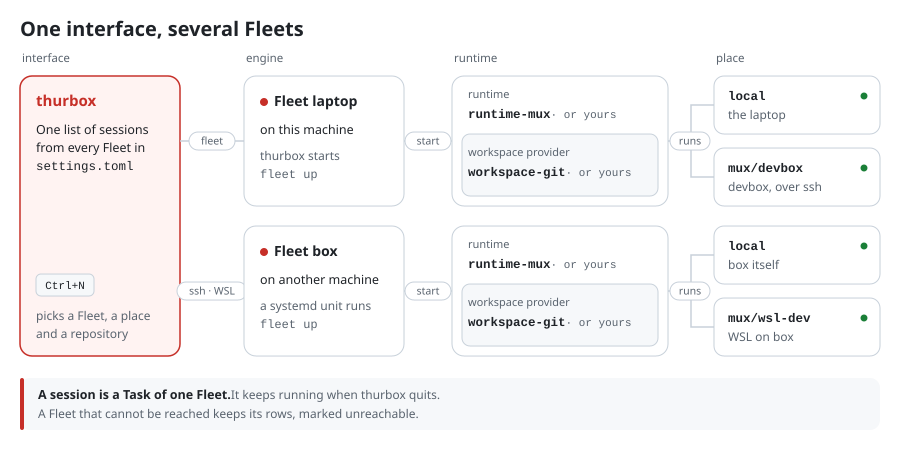
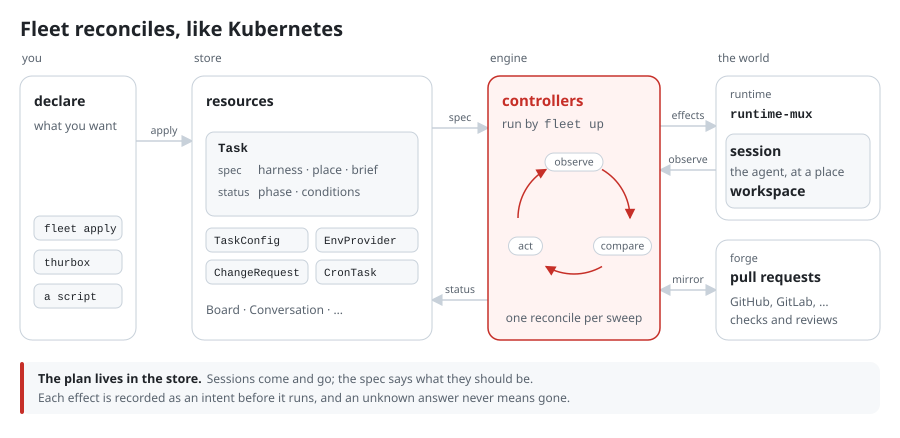

# Thurbox

<div align="center">
  
</div>

[](https://github.com/Thurbeen/thurbox/actions)
[](https://opensource.org/licenses/MIT)
[](https://thurbox.thurbeen.eu/)
[](https://discord.gg/fGumcHaxFY)
[](https://sonarcloud.io/summary/new_code?id=Thurbeen_thurbox)


Thurbox runs coding agents side by side in one terminal. Each agent is a session
that keeps working when you quit thurbox, and every pane of the interface is a Lua
file you can change.

- **Several coding agents at once**: Claude Code, Codex, pi, opencode, kilo, omp,
  Qwen Code, Copilot CLI and Kimi Code, launched unmodified.
- **Sessions that outlive the interface**: Fleet runs each session in a
  multiplexer, so a crash, a restart or `Ctrl+Q` stops nothing.
- **One list for every machine**: follow the Fleet on your laptop and a Fleet on
  another machine, over ssh or in WSL, in the same session list.
- **A worktree per session**, so agents never fight over your checkout.
- **An interface you own**: every pane, the session list included, is a Lua file
  in a directory you can edit.

<picture>
  <source media="(prefers-color-scheme: dark)" srcset="website/assets/overview-dark.svg">
  
</picture>

## How Fleet works

Fleet is the engine under thurbox, and it orchestrates like Kubernetes. You
declare what you want as resources; controllers make it so and write back what
is.

<picture>
  <source media="(prefers-color-scheme: dark)" srcset="website/assets/fleet-loop-dark.svg">
  
</picture>

- **Resources.** Each one has a `spec`, what you want, and a `status`, what is.
  A **Task** is one agent session doing one brief at one place.
  **TaskConfig** and **EnvProvider** hold the launch defaults and environment
  Tasks share. A **ChangeRequest** mirrors a pull or merge request a worker
  declares. A **CronTask** creates Tasks on a schedule, like a CronJob.
  Conversation, Listener, Board and plugin kinds complete the set.
- **The store** keeps each resource as a file. Every write is compare-and-swap.
- **Controllers reconcile.** `fleet up`, the manager, runs them in sweeps. Each
  compares a resource's spec with what it observes and plans effects: make the
  workspace, start the session, type the brief, deliver review feedback,
  pause, revive or release the session. It writes the phase and conditions
  back to the status.
- **Crash-safe.** The manager records an effect's intent before it runs it. An
  observation it cannot read never counts as the session being gone.

thurbox is one client of this model. It keeps no database: every session in
its list is a Task, and the agents it offers are the Fleet's harness profiles.
Scripts drive the same Tasks with `fleet apply`, `fleet send` and
`fleet delete`. [Fleet's documentation](docs/fleet/README.md) covers every
kind, every controller and one reconcile step by step.

<a id="install"></a>

## Install

**Linux / macOS:**

```bash
curl -fsSL https://raw.githubusercontent.com/Thurbeen/thurbox/main/scripts/install.sh | sh
```

**Windows (PowerShell):**

```powershell
irm https://raw.githubusercontent.com/Thurbeen/thurbox/main/scripts/install.ps1 | iex
```

The installer puts `thurbox` (the interface), `thurbox-cli`, `fleet`,
`runtime-mux` and `workspace-git` on your `PATH`. You also need:

- **tmux ≥ 3.2**, or [psmux](https://github.com/psmux/psmux) ≥ 3.3.8 on native Windows
- **git**
- at least one coding-agent CLI

**Fleet on its own** needs no thurbox. The installer's fleet-only mode installs
`fleet`, `runtime-mux` and `workspace-git`, and nothing else:

```bash
curl -fsSL https://raw.githubusercontent.com/Thurbeen/thurbox/main/scripts/install.sh | sh -s -- --fleet-only
```

On Windows:

```powershell
& ([scriptblock]::Create((irm https://raw.githubusercontent.com/Thurbeen/thurbox/main/scripts/install.ps1))) -FleetOnly
```

Then run `fleet init`, `fleet doctor` and `fleet up`
([Fleet's install](https://thurbox.thurbeen.eu/docs/fleet-install.html)).

`cargo build --release` in a clone builds every program from source. Homebrew,
the AUR, Nix, winget, Chocolatey and uninstalling are on the
[Installation page](https://thurbox.thurbeen.eu/docs/installation.html).
Homebrew, the AUR, winget and Chocolatey ship thurbox 2.x, without Fleet, and
Nix gives `thurbox` and `thurbox-cli` only: install with the script. Coming
from 2.x? Follow the [migration guide](docs/migrating-to-v3.md).

## First steps

```bash
fleet init                    # writes Fleet's config
fleet service install --now   # Fleet's manager, `fleet up`, as a user service
thurbox-cli doctor            # checks each Fleet, its runtime and its agents
thurbox
```

On Linux the install script runs the first two. thurbox never starts,
restarts or sets up Fleet's manager: a user service runs `fleet up`
([the unit](docs/where-sessions-run.md#2-laptop-thurbox-fleet-on-a-remote-box)).
While none runs, the status line says which command starts it. thurbox draws
the session list on the left and an agent terminal on the right.

1. **`Ctrl+N`** opens the new-session flow: a place, a repository (with
   `Alt+W` for a worktree of its own), a name and a branch, then an agent.
2. **Talk to it.** The right pane is the live agent CLI; every key goes to it.
3. **`Ctrl+N` again** for a second agent. `Ctrl+J` / `Ctrl+K` move between
   sessions; the one you are not looking at keeps working.
4. **`Ctrl+Q`** leaves the interface and stops nothing. Run `thurbox` again and
   both agents are still mid-task. `fleet list task` lists them from any shell.

`F1` lists every key, and `Ctrl+P` is a command palette over the same actions.
The [tutorial](https://thurbox.thurbeen.eu/docs/tutorial.html) walks through it
with screenshots.

To follow a Fleet on another machine, run `fleet service install --now` there and
list it in `~/.config/thurbox/settings.toml`:

```toml
[fleets.laptop]
transport = "local"

[fleets.box]
transport = { ssh = "me@box" }
program = "/home/me/.local/bin/fleet"   # ssh does not read your login PATH
```

[Where sessions run](docs/where-sessions-run.md) explains Fleets and places and
shows how to set up the user service. [`[fleets]`](docs/thurbox/config.md#fleets--the-fleets-that-manage-sessions)
lists every key, the WSL form included.

## Make it yours

Panes live in `ui/mods/*.lua`, the arrangement in `ui/layout.lua`, and `F10`
reloads both from disk. The interface directory ships an `AGENTS.md`, so from a
session opened there you can just ask your agent:

> *Add a pane on the left with CPU and RAM usage. Move the search strip to the
> bottom and make the session column 30% wide.*

[The interface](https://thurbox.thurbeen.eu/docs/interface.html) ·
[Writing a pane](docs/thurbox/mods.md) ·
[Mods](https://thurbox.thurbeen.eu/mods.html)

## Documentation

[**thurbox.thurbeen.eu/docs**](https://thurbox.thurbeen.eu/docs/) is the manual:
[Fleet](https://thurbox.thurbeen.eu/docs/fleet.html) and its
[features](https://thurbox.thurbeen.eu/docs/fleet-features.html),
[installation](https://thurbox.thurbeen.eu/docs/installation.html),
[tutorial](https://thurbox.thurbeen.eu/docs/tutorial.html),
[thurbox's features](https://thurbox.thurbeen.eu/docs/thurbox-features.html),
[keybindings](https://thurbox.thurbeen.eu/docs/keybindings.html),
[configuration](https://thurbox.thurbeen.eu/docs/configuration.html),
[agents](https://thurbox.thurbeen.eu/docs/agents.html),
[the interface](https://thurbox.thurbeen.eu/docs/interface.html) and
[architecture](https://thurbox.thurbeen.eu/docs/architecture.html).

In this repository, [`docs/`](docs/README.md) covers the whole system: thurbox
([`docs/thurbox/`](docs/thurbox/README.md)), Fleet
([`docs/fleet/`](docs/fleet/README.md)), the runtimes
([`docs/runtime/`](docs/runtime/README.md)), [where sessions
run](docs/where-sessions-run.md) and the [constitution](docs/constitution.md).

## Contributing

[`CONTRIBUTING.md`](CONTRIBUTING.md) is the full guide — the Nix dev shell, the
`just` tasks, the test discipline, and the conventional-commit rules that decide
what gets released.

```bash
git clone https://github.com/Thurbeen/thurbox.git
cd thurbox
nix develop          # or ./scripts/install-dev-tools.sh
just build && just test && just lint
```

## Community

- **[Discord](https://discord.gg/fGumcHaxFY)** — questions, setup help, and
  showing off your interface. Ask in `#help`, one thread per problem.
- **[GitHub Issues](https://github.com/Thurbeen/thurbox/issues)** — confirmed
  bugs and concrete feature requests.

## License

MIT — see [LICENSE](LICENSE). Built on
[ratatui](https://github.com/ratatui-org/ratatui),
[tui-term](https://github.com/a-kenji/tui-term),
[vt100](https://github.com/doy/vt100-rust) and
[tmux](https://github.com/tmux/tmux).
