<!-- rumdl-disable MD041 -->
<!-- The banner is the first line by design; MD041 wants a level-1 heading. -->

![Fleet: operators at consoles in a red mission control room, a squadron of fighter craft above them, powered by thurbox][banner]

[banner]: media/fleet-banner.jpg

# Fleet

Fleet runs one AI agent session per Task. A Task is a JSON resource that
names a harness, a host, a workspace and a brief. Fleet spawns the session,
sends the brief once, records the worker's result, and releases the session
when you delete the Task. Fleet v2 is one Linux binary with a bundled
[VEGA](https://github.com/Thurbeen/vega) starter.



## Setup

```sh
curl -fsSL https://github.com/Thurbeen/fleet/releases/latest/download/install-release.sh | sh
```

The command installs the latest release into `~/.local/bin` on Linux x86_64
or aarch64. Add that directory to PATH if the installer asks you to. Rust,
Cargo and Git are not needed. Then create the config and the VEGA workspace,
offline:

```sh
fleet version
fleet init --harness claude   # or codex; the default is codex
```

`--harness` chooses the coding agent for VEGA and, by default, its workers.
Without it, `fleet init` asks in a terminal. To run real sessions, install
[Thurbox](https://github.com/Thurbeen/thurbox) with `thurbox-cli` on PATH,
and install and log in to the chosen harness.
Fleet installs neither. Then start the manager and keep it running in its
own terminal:

```sh
fleet up
```

`fleet up` starts VEGA and keeps every Task moving until Ctrl-C.
[Initialization and the VEGA starter](docs/configuration/init.md) covers the
config, the workspace and `fleet up` in detail.

Fleet starts a `codex` session that trusts its workspace for that session
only. It writes nothing to Codex's configuration. Claude Code has no
per-session trust interface, so a `claude` Task waits at Claude's trust dialog
with `NeedsAttention/WorkspaceUntrusted` until a person trusts the folder.
Fleet never answers a trust or permission dialog. See
[workspace trust](crates/CONTRACTS.md#workspace-trust).

## First steps

Save a Task as `task.json`. Set `workspace.dir` to an absolute directory that
exists on the host. `dispatch: true` lets the Task start.

```json
{
  "apiVersion": "fleet/v1alpha1",
  "kind": "Task",
  "metadata": { "name": "hello" },
  "spec": {
    "harness": "codex",
    "host": "local",
    "workspace": { "dir": "/path/to/project" },
    "brief": "Read the README and summarise the project.",
    "dispatch": true
  }
}
```

Drive it with the CLI while `fleet up` runs:

```sh
fleet apply -f task.json                   # create or update the Task
fleet list task                            # every Task and its phase
fleet status task hello                    # conditions: Spawned, Briefed, Concluded
fleet get task hello                       # the whole resource as JSON
fleet send hello "Also list the open TODOs."   # message the running session
fleet delete task hello                    # release the session, then remove the Task
```

`list`, `status` and `version` take `--json`. The worker answers with
`fleet result hello --generation N --outcome shipped --summary TEXT`, where
`N` is `brief.generation` in `fleet status task hello --json`. Run
`fleet --help` or `fleet COMMAND --help` for every command and flag.

To try the flow without an agent, use the fake runtime from a checkout. It
records simulated sessions and runs no external tool:

```sh
fleet --config examples/fleet.toml apply -f examples/resources.json
fleet --config examples/fleet.toml reconcile
fleet --config examples/fleet.toml list task
```

## Learn more

- [Architecture](docs/ARCHITECTURE.md): components, boundaries and execution
  flow.
- [Controllers](docs/controllers/README.md): each resource, state machine and
  interface, such as the [Task controller](docs/controllers/task/README.md).
- [Task resource](docs/resources/task.md): every Task field, including
  repository workspaces and structured outputs.
- [Native Fleet TOML](docs/configuration/fleet-toml.md): config fields, the
  thurbox runtime, forges and plugins.
- [Initialization and the VEGA starter](docs/configuration/init.md): config
  selection, workspace updates, execution defaults and external controllers.
- [OpenTelemetry export](docs/configuration/telemetry.md): the `OTEL_*`
  variables, and the spans and metrics Fleet exports.
- [Contracts](crates/CONTRACTS.md): the integration guarantees.

## Install, update and uninstall

Supported release targets are Linux x86_64 and aarch64 (musl). Windows and
macOS have no binary release.

The installer that each release publishes installs that release. The
one-line setup fetches the latest release's installer. To pin a release, set
`FLEET_VERSION` to its tag:

```sh
curl -fsSL https://github.com/Thurbeen/fleet/releases/latest/download/install-release.sh | FLEET_VERSION=v2.2.1 sh
```

To inspect before you run it, download `install-release.sh` from the
[release assets](https://github.com/Thurbeen/fleet/releases) into a new
directory. The assets also hold the archives, checksums, the VEGA manifest and
provenance, and GitHub build attestations. The repository's
`scripts/install-release.sh` has no default release and requires
`FLEET_VERSION`.

```sh
sh install-release.sh
sh install-release.sh --uninstall
```

Run the setup command again to update; then run `fleet init --update`.
`FLEET_INSTALL_DIR` chooses the binary directory; the default is
`~/.local/bin`. The installer verifies the archive checksum and the binary's
version before it replaces the binary. A failed update preserves the old
binary. A second installer that finds `.fleet-install.lock` refuses to run.
Before you remove a stale lock, make sure its installer is gone.

`FLEET_RELEASE_BASE` may name an HTTPS release download base or an offline
directory laid out as `<base>/<tag>/<archive-and-checksums>`. The installer
never starts services, installs an extension, configures credentials or
alters data. Uninstall removes the binary only. Stop managers deliberately
before you update or uninstall an operational deployment; changing an
executable does not transfer its manager lease.

## Build and try it

Install the toolchain in [rust-toolchain.toml](rust-toolchain.toml) through
rustup, then build the binary from the committed dependency lock:

```sh
cargo build --release --locked -p fleet-cli --bin fleet
```

The binary embeds the pinned VEGA starter, so `fleet init` needs neither Git
nor a Fleet checkout.

## Data and deliberate cutover

The default resource store is fresh: `$XDG_DATA_HOME/fleet` or
`~/.local/share/fleet`. An explicit `--data-dir` wins over `[data] dir` for
resource commands. For `up`, persist that directory in `[data] dir` first: a
differing runtime override is refused so the VEGA brief and workers use the
same store. A nonempty directory without this build's store marker, an
unsupported schema, or corrupt data is refused. Keep private config and
resources outside a public checkout. Fleet v2 passes no environment to a
session besides the model variable; credentials stay with the agent and its
host, never in manifests or briefs.

To switch an existing deployment deliberately:

1. Preserve its checkout, configuration, records, services and active sessions.
   Complete or explicitly retain every child before stopping its manager.
2. Back up its private state. Disable its automatic service and hook starts at
   the chosen no-child boundary; verify its old manager has stopped.
3. Install the accepted Rust binary into a separate directory. Choose a fresh
   data directory and apply freshly authored resources. There is no automatic
   parser, importer, live-data reset, or migration of old queue records.
4. Run `fleet version --json`, inspect resources and their schema versions,
   then start the new manager explicitly. Never point two implementations at
   the same data or run both as owners of the same work.
5. If acceptance fails, stop the new manager before restoring the preserved
   deployment. Preserve its new store for diagnosis. Installer rollback alone
   does not downgrade a store schema.

Release acceptance is independent of these operator actions. Changing
it requires combined tests and review. Nothing in CI or installation performs
a live cutover.

## Frozen Python v1.0.0

**Existing Python users stay on pinned v1.0.0.** V2 has different CLI,
configuration and data formats. There is no automatic v1 migration; installing
v2 is a separate, deliberate choice. Preserve the v1 checkout and data, and
keep v2 configuration and data separate from v1.

For a frozen v1 installation, install git and
[uv](https://docs.astral.sh/uv/getting-started/installation/), then run:

```text
git clone --branch v1.0.0 --single-branch https://github.com/Thurbeen/fleet.git fleet-v1
uv run --project fleet-v1 fleet install
```

The tag checkout is detached deliberately: it stays at the frozen Python
release rather than following `main`. Keep this directory; the extension
records its path.

**Existing users following `main` must pin v1 before updating.** In your
existing Python Fleet checkout, preserve your operator state and resolve any
tracked edits before switching; do not force the checkout:

```text
git fetch origin tag v1.0.0
git switch --detach v1.0.0
uv run fleet install
```

These commands keep the checkout in place and do not migrate its queue or
configuration. The root `FLEET_MAJOR` file says `2`. A v1 checkout that
contains the freeze guard reads it before updating and refuses to move onto
v2: SessionStart and reconciler sync, and both v1 installers, inspect the
fetched candidate before checkout or fast-forward. They refuse a missing or
non-v1 `FLEET_MAJOR` marker, or missing Python entry points, and leave the
existing checkout and data unchanged. A fresh v1 installer also checks before
writing candidate files. To reinstall a pinned checkout, use
`uv run fleet install` there rather than the branch-tracking bootstrap.

**Unpatched clients must install this freeze before updating.** They can
otherwise pull v2 through their old automatic sync or installer.
Documentation alone cannot protect old code, and a manual `git pull` bypasses
the guard. Pin the tag explicitly using the commands above; do not run
development installers over a stable checkout. Binary installation does not
change a running Python checkout.

## Contribute

See [CONTRIBUTING.md](CONTRIBUTING.md) for the native gate, release dry runs,
and architecture tests. [AGENTS.md](AGENTS.md) holds agent working rules.
