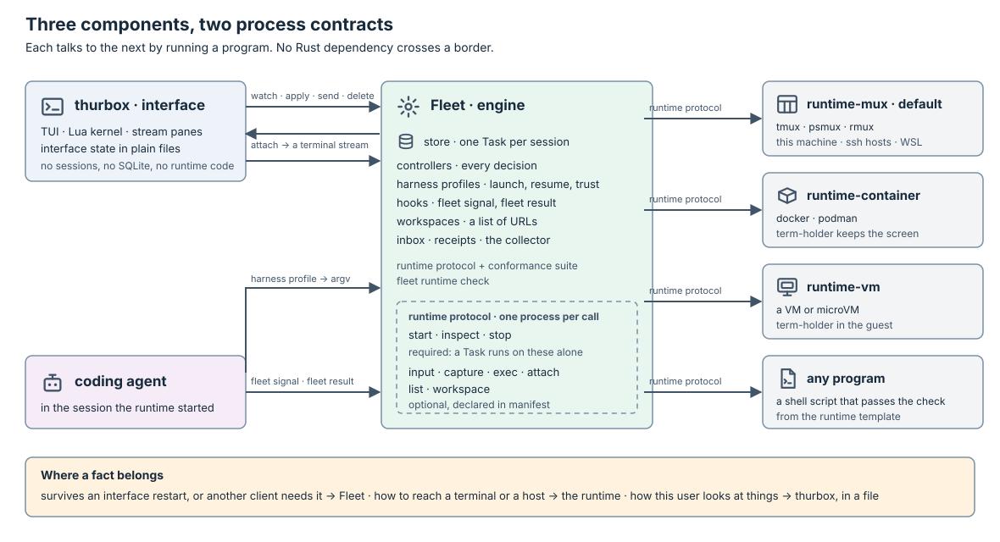
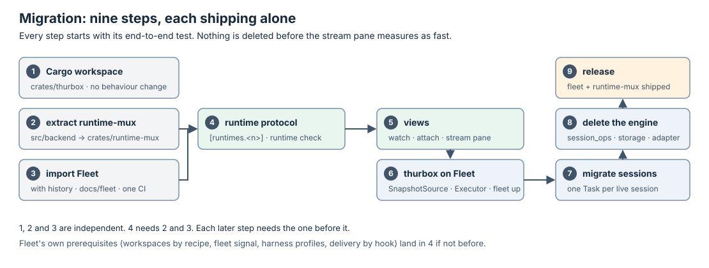

# Documentation

thurbox, Fleet and the runtimes are three components that talk only by
running each other's programs. Each has its own directory here, and this page
is the whole system: what each owns, how they meet, and the migration that
gets there. The direction is tracked in
[#1688](https://github.com/Thurbeen/thurbox/issues/1688) and recorded as
[ADR-41](thurbox/architecture.md#adr-41-fleet-is-thurboxs-engine-sessions-run-on-runtimes);
it is accepted and not yet implemented.

| Component | Directory | Start at |
| --- | --- | --- |
| thurbox, the interface | [`thurbox/`](thurbox/README.md) | its index: architecture decisions, features, kernel, plugins, configuration |
| Fleet, the engine | [`fleet/`](fleet/README.md) | its index: architecture, contracts, controllers, resources, configuration |
| runtimes | [`runtime/`](runtime/README.md) | the runtime protocol and the terminal stream |

One [constitution](constitution.md) holds for all three: shared rules first,
then each component's own.

## Decision

1. **This repository becomes the one repository** for thurbox, Fleet and the
   multiplexer runtime. Fleet is imported here with its history. The stars,
   the issue tracker and the release channels (Homebrew, AUR, Chocolatey,
   winget) stay with `Thurbeen/thurbox`. Breaking Fleet's current install
   path is accepted: its use is small.
2. **thurbox requires Fleet.** Fleet is thurbox's orchestration core: every
   session is a Fleet Task. thurbox keeps no session state and no SQLite
   database.
3. **Fleet does not require thurbox.** Fleet reaches sessions only through a
   process protocol that any runtime can implement, down to a shell script.
4. **A runtime is the abstraction**, not a multiplexer. Fleet and thurbox
   know only "a runtime": a program that runs one keyed process somewhere.
   A multiplexer is one way to do that, a container or a VM another.
   `runtime-mux`, extracted from `src/backend`, is the first runtime and the
   one thurbox ships by default; it is not special.

## Components



```text
thurbox (interface) ──process: fleet watch / apply / send / delete / attach──▶ Fleet (engine)
   │                                                                             │
   │ starts the stream fleet attach names                                        │ process: runtime protocol
   ▼                                                                             ▼
 stream pane ◀──── terminal stream frames, whatever the runtime ──── a runtime: runtime-mux,
                                                                      runtime-container, runtime-vm, …
 coding agent ── fleet signal / fleet result ──▶ Fleet
```

| Component | Owns | Never owns |
| --- | --- | --- |
| Fleet (`crates/fleet-*`) | Tasks (one per session), the store, every decision, harness profiles (launch, resume, trust), agent hooks through `fleet signal`, every decision about workspaces (what, when, whether to clean), the inbox, receipts, the runtime protocol and its conformance suite | Any runtime's code; any Rust dependency on a `runtime-*` crate or `thurbox` |
| A runtime (`crates/runtime-*`, or any program) | Processes by key on its places, running workspace recipes there, its own place config (hosts, images, VM definitions), sources and credentials, bounded `exec`, the attach command, whatever keeps a terminal alive there | Tasks, agents, journals, delivery, the interface |
| thurbox (`crates/thurbox`) | The TUI, the Lua kernel, rendering, stream panes, interface state in plain files (order, seen marks, bookmarks, review notes, settings, keybindings) | Sessions, SQLite, any runtime code, any Rust dependency on `fleet-*` or `runtime-*` |

Where a fact belongs:

- It must survive an interface restart, or a client other than this interface
  may need it: **Fleet**.
- It is how to reach a terminal or a host: **the runtime**.
- It is how this user looks at things: **thurbox**, in a file.

### Enforcement

One `architecture.toml` covers the whole workspace and `fleet-arch` checks it
on every build, the way it checks Fleet's crates today:

| Crate | May depend on | Must not depend on |
| --- | --- | --- |
| `fleet-*` | `fleet-*`, `term-stream`, crates.io | `runtime-*`, `thurbox` |
| each `runtime-*` | `term-stream`, crates.io | `fleet-*`, `thurbox`, every other `runtime-*` |
| `term-stream` | crates.io | everything else |
| `term-holder` | `term-stream`, crates.io | everything else |
| `workspace-git` (the default recipe) | crates.io | everything else |
| `thurbox` | `term-stream`, crates.io | `fleet-*`, `runtime-*`, `term-holder` |

Components talk only through processes; `term-stream` is a wire format, not
a component. A component can therefore later move
to a repository of its own with nothing to untangle.

### The contracts

| Contract | Between | Owner |
| --- | --- | --- |
| Views | thurbox (or any client) → Fleet: `fleet watch`, `apply`, `send`, `delete`, `attach` | [Fleet architecture](fleet/architecture.md#views) |
| The runtime protocol | Fleet → a runtime: `start`, `inspect`, `stop` and the optional verbs | [Runtimes](runtime/README.md#the-runtime-protocol) |
| The terminal stream | a view ↔ the process `fleet attach` names | [Runtimes](runtime/README.md#the-terminal-stream) |
| Recipes | Fleet → a workspace recipe, run by the runtime's `workspace.run` | [Fleet architecture](fleet/architecture.md#workspaces-by-recipe) |

## Where the SQLite tables go

| Table | Destination |
| --- | --- |
| `sessions`: identity, `backend_id`, `backend_type`, `key` | Task `status.session` |
| `sessions`: `launch_*`, `agent_args`, `agent_session_id` | Fleet harness profiles |
| `sessions`: `hook_state`, `hook_state_at` | `fleet signal`, then `status.sessionState` |
| `sessions`: `stopped_at`, `lost_at`, `teardown_owed`, `relaunch_held_at` | Task conditions, receipts, finalizers |
| `sessions`: `parent_session_id` | a parent label on the Task |
| `sessions`: `display_order`, `seen_at` | thurbox interface file |
| `worktrees` | Fleet's workspace port (see Workspaces) |
| `session_meta`, `session_events`, `session_relaunches`, `session_intents`, `session_loss_suspects`, `session_lifecycle_clock` | dropped: Fleet's receipts and Known/Unknown observation |
| `session_messages` | `status.inbox`, `fleet send` |
| `tasks` | Tasks with `dispatch: false` |
| `automations`, `automation_runs`, `automation_suspensions` | a Fleet schedule kind, to design |
| `event_cursors`, `snapshot_versions` | `fleet watch --since` |
| `audit_log`, `telemetry_export` | Fleet's store history and `fleet-telemetry` |
| `repo_bookmarks`, `review_comments`, `review_marks`, settings, keybindings | thurbox interface files |

`rusqlite` then leaves the dependency tree.

## Migration



Each step ships alone and starts with its end-to-end test.

1. **Workspace.** Turn this repository into a Cargo workspace, the current
   code as `crates/thurbox`. No behaviour change.
2. **Extract `runtime-mux`.** Move all of `src/backend`, control mode and
   the tmux/psmux/rmux dialects included, into `crates/runtime-mux` with
   `config::hosts`, `agent::host_path` and `agent::preflight`; inject what it
   reads from `session::settings`. Add the `architecture.toml` rule. thurbox
   keeps linking it only until step 5 gives it the `view` process.
3. **Import Fleet** with its history under `crates/fleet-*`, its docs under
   `docs/fleet/`. Pin one toolchain (Fleet's); editions may differ per crate.
   One CI with path filters; component-scoped tags (`thurbox-v*`, `fleet-v*`,
   `runtime-mux-v*`) with cocogitto's monorepo mode. Transfer Fleet's open issues.
4. **Runtime protocol.** `runtime-mux` binary; Fleet's generic `exec` runtime
   kind, `[runtimes.<name>]`, `fleet runtime check`, the reference script.
   Fleet's P1 to P4 (workspaces, `fleet signal`, harness profiles, delivery by
   hook) land here if not before.
5. **Views.** `fleet watch`, `fleet attach`, interactive Tasks without a brief;
   `term-stream`, `runtime-mux view`, `fleet term-bridge`; thurbox's stream
   pane beside the control-mode pane, behind a setting, until it measures as
   fast. `term-holder` and `runtime-container` follow.
6. **thurbox on Fleet.** `SnapshotSource` and `Executor` traits, then their
   Fleet implementations; thurbox starts `fleet up`.
7. **Migrate.** `thurbox-cli migrate fleet`: one Task per live session,
   adopting its window by stamp and its worktree by path; `agents.toml` into
   harness profiles. Automations move once the schedule kind exists.
8. **Delete.** `session_ops`, `storage`, the engine half of `thurbox-cli`, and
   Fleet's thurbox session adapter.
9. **Release.** thurbox's archive and packages carry `fleet` and
   `runtime-mux`; Fleet keeps a standalone archive. Fleet's old install URL
   and `FLEET_MAJOR` guard point here or are retired.

## Open

- A schedule kind in Fleet to replace automations.
- Fork and `restart --fresh`: a conversation field on the Task, or dropped.
- `hooks.toml` beyond `pre_launch`: harness settings or a Fleet plugin.
- Shared hosts (ADR-24): one Fleet store per operator is assumed.
- The tmux server `runtime-mux`'s windows live on: its own socket, since the
  interface no longer connects to it.
- Latency of the `view` bridge against today's in-process control mode, to
  measure in step 5 against [performance](thurbox/performance.md)'s frame floors.
- Windows (psmux) at the cutover, or after Linux and macOS.
- VEGA stays a separate starter repository; Fleetlens moves under
  `extensions/`.

## Layout

```text
docs/
├── README.md                  the system: this page
├── constitution.md            the rules for every component, and each one's own
├── components.svg · migration.svg
├── thurbox/                   the interface
│   ├── README.md              its index
│   ├── architecture.md        decisions, ADR-1 … ADR-41
│   ├── features.md · performance.md · kernel.md · plugins.md
│   ├── agents.md · config.md · orchestration.md · releasing.md · review.md
│   ├── development.md · tutorial.md
│   └── benchmark-multiplexers.md + benchmark-multiplexers/
├── fleet/                     the engine
│   ├── README.md              its index
│   ├── architecture.md        components, ports, flow, and the target (+ .svg)
│   ├── contracts.md           guarantees and their tests
│   ├── configuration.md       init, fleet.toml, environment, telemetry
│   ├── migrating-from-v1.md
│   ├── controllers/           one page per controller (+ its state-machine .svg)
│   └── resources/             one page per resource kind
└── runtime/                   the runtimes
    └── README.md              protocol, terminal stream, workspace.run (+ .svg)
```

Naming: one directory per component, each with a `README.md` index. Pages are
lower-case and hyphenated, one per subject; a subject gets a directory only
when it has several pages of one kind (`controllers/`, `resources/`) or data
(`benchmark-multiplexers/`). A diagram is an SVG with light and dark palettes,
named after the page or section that embeds it and kept beside it. A new
component joins as a directory beside these three.

## Keeping docs current

**Rule**: if a change invalidates or extends a documented decision, update the
owning page in the same change. [Review](thurbox/review.md#documentation-ownership)
says which page owns which class of fact.

- Operational changes (new commands, module moves) go in `AGENTS.md` or the
  per-subsystem skill under `.agents/skills/` that owns the subject.
- Decisional changes (why we chose X over Y) go in `docs/`.
- Don't duplicate content between the two: a duplicate becomes a pointer.
