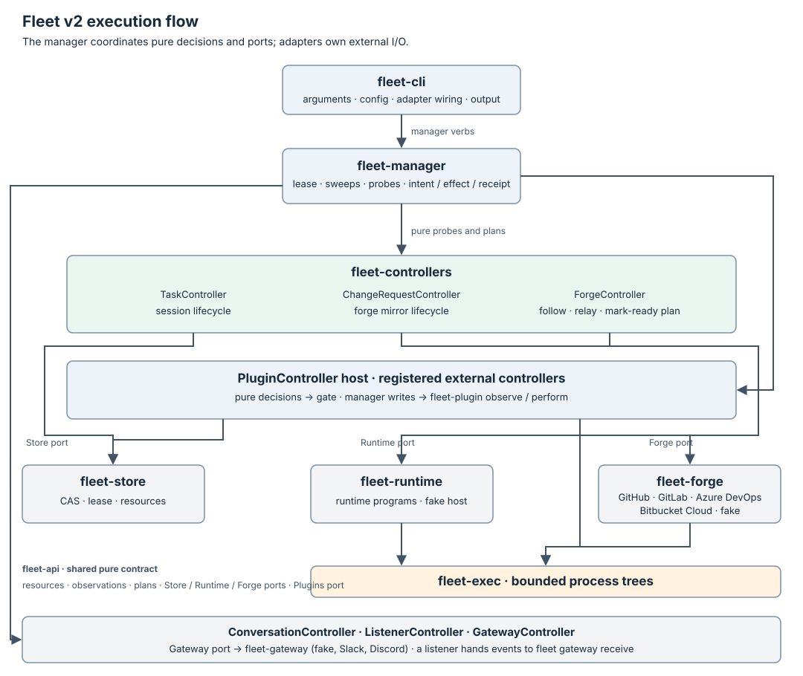

# Fleet architecture

Fleet v2 is a Rust command-line program that persists Tasks, ChangeRequests
and the other resource kinds, and drives their controllers. A Task contains
the execution inputs for one agent session: harness, host, workspace, brief
and expected outputs; the worker reports its own result. A ChangeRequest
mirrors one change on a forge, read through a Forge port and numbered so
consumers diff it by one cursor.



Arrows show calls during execution, not Cargo dependencies. `fleet-cli`
constructs the adapters; `fleet-manager` depends on API traits rather than
concrete store, runtime or forge crates. The
[ChangeRequest controller](controllers/change-request/README.md) runs in the
same sweep as the Task controller, through the Forge port.

## Components and boundaries

| Crate | Owns | Boundary |
| --- | --- | --- |
| [fleet-cli](https://github.com/Thurbeen/fleet/blob/961da39903338f3fb0493ec5a34aa8417cb98d89/crates/fleet-cli/src/main.rs) | Parse arguments, load config, construct adapters, print results | Calls manager verbs; does not write resources or run controller effects directly. |
| [fleet-manager](https://github.com/Thurbeen/fleet/blob/961da39903338f3fb0493ec5a34aa8417cb98d89/crates/fleet-manager/src/lib.rs) | Reconcile loop, lease renewal, plan execution, apply/delete/send/result/declare verbs | Reads and writes through `Store`; observes and performs effects through `Runtime`; reads changes and logins and performs the one forge write, mark-ready, through `Forge`. |
| [fleet-controllers](https://github.com/Thurbeen/fleet/blob/961da39903338f3fb0493ec5a34aa8417cb98d89/crates/fleet-controllers/src/lib.rs) | Pure Task, ChangeRequest, Forge, Gateway, Conversation and Listener decisions, and the plugin admission gate | Receives time and observations as values; returns probes and a plan without I/O. |
| [fleet-api](https://github.com/Thurbeen/fleet/blob/961da39903338f3fb0493ec5a34aa8417cb98d89/crates/fleet-api/src/lib.rs) | Task, ChangeRequest, plan, observation, result and port types | Pure shared contract; no adapter dependencies. |
| [fleet-store](https://github.com/Thurbeen/fleet/blob/961da39903338f3fb0493ec5a34aa8417cb98d89/crates/fleet-store/src/lib.rs) | File persistence, CAS, write ownership and lease fencing | A corrupt or unreadable record is Unknown; only proven absence is not-found. |
| [fleet-runtime](https://github.com/Thurbeen/fleet/blob/961da39903338f3fb0493ec5a34aa8417cb98d89/crates/fleet-runtime/src/lib.rs) | Session operations through thurbox, or the file-backed fake host | Converts external answers to Known/Unknown; retains identity and delivery keys. |
| [fleet-forge](https://github.com/Thurbeen/fleet/blob/961da39903338f3fb0493ec5a34aa8417cb98d89/crates/fleet-forge/src/lib.rs) | Reading one change through `gh`, `glab`, `az`, externally authenticated `curl`, or the file-backed fake forge, and taking a supported draft out of draft after a fresh read | One bounded observation is complete or Unknown; a write either preserves the head/state guard or fails closed; the only crate that knows a forge CLI's name. |
| [fleet-gateway](https://github.com/Thurbeen/fleet/blob/961da39903338f3fb0493ec5a34aa8417cb98d89/crates/fleet-gateway/src/lib.rs) | Reading and writing one chat thread through Slack's Web API or Discord's REST API by `curl`, or through the file-backed fake platform | Every answer is Known or Unknown; a refused write fails closed; the only crate that knows a chat client's name. |
| [fleet-plugin](https://github.com/Thurbeen/fleet/blob/961da39903338f3fb0493ec5a34aa8417cb98d89/crates/fleet-plugin/src/lib.rs) | Bounded calls to a registered plugin process through the `Plugins` port | The only crate that runs a plugin; every call is one bounded process through fleet-exec. |
| [fleet-exec](https://github.com/Thurbeen/fleet/blob/961da39903338f3fb0493ec5a34aa8417cb98d89/crates/fleet-exec/src/lib.rs) | Bounded process execution | The only production process spawner; timeout/unwind kills the process tree. |
| [fleet-telemetry](https://github.com/Thurbeen/fleet/blob/961da39903338f3fb0493ec5a34aa8417cb98d89/crates/fleet-telemetry/src/lib.rs) | The OpenTelemetry SDK and its OTLP/HTTP exporter, installed when the `OTEL_*` variables ask | The only crate that names the SDK or the exporter; export never changes a command's outcome, and shutdown is bounded. |

The manager records spans and metrics through the `opentelemetry` API,
which does nothing until `fleet-telemetry` installs a provider. The CLI
asks `fleet-telemetry` for each command's root span.
[OpenTelemetry export](configuration/telemetry.md) owns the variables, spans
and metrics.

`fleet-arch` and `fleet-dev` are repository tooling: architecture enforcement,
validation and release packaging. They are not controllers or services in the
installed `fleet` runtime.

The executable dependency graph is [crates/architecture.toml](https://github.com/Thurbeen/fleet/blob/961da39903338f3fb0493ec5a34aa8417cb98d89/crates/architecture.toml).
The [architecture suite](https://github.com/Thurbeen/fleet/blob/961da39903338f3fb0493ec5a34aa8417cb98d89/crates/fleet-arch/tests/architecture.rs) checks crate
edges, purity, restricted process and telemetry APIs, permitted status
writers and the holders of the Forge port, including negative fixtures. The
CLI may wire adapters, but only manager verbs may perform resource
mutations, and only the manager performs the mark-ready effect.

## Desired state, observations and effects

The [controller index](controllers/README.md) links the controller
guides. The
[Task controller documentation](controllers/task/README.md) defines
the [resource](resources/task.md),
[state machine](controllers/task/state-machine.md) and
[interface](controllers/task/interface.md).

One reconcile of a due Task follows this protocol:

```text
read Task + resourceVersion
  -> resolve/freeze referenced execution in private store before first effect
  -> ask pure controller for probes
  -> renew lease before each runtime probe
  -> pass observations + time to pure controller
  -> CAS-write planned status, including effect intent
  -> renew lease before effect -> perform effect -> persist receipt
  -> remove finalizer if requested
```

The controller owns Task status except `status.result`, written through the
worker verb, and `status.inbox`, which nobody owns: `fleet send` appends to
it and the controller's delivery write removes from it, each through a
typed store mutation that changes nothing else. `fleet amend`, and a
plugin's `amends[]` verb, append to `spec.amendments` and queue the
amendment's inbox entry in one such mutation. A status conflict before an
effect drops the plan and retries from fresh state. A receipt conflict
rereads the object and retries the receipt write, preserving concurrent
worker changes. Expired or superseded leases refuse controller writes. An
effect already started cannot be fenced by the file store; deterministic keys
and runtime observation recover that gap.

## Resource representation

[fleet-api](https://github.com/Thurbeen/fleet/blob/961da39903338f3fb0493ec5a34aa8417cb98d89/crates/fleet-api/src/meta.rs) defines Fleet's resource envelope
and metadata as native Rust types. Manifests use `apiVersion`, `kind`,
`metadata`, `spec` and `status`; typed Task views validate spec and status.
Unknown fields are refused. The store assigns identity, generation, resource
version, timestamps and finalizers, and treats incomplete persisted metadata
as Unknown rather than repairing it with defaults.

The file-store format is version 1. Resource versions are store-wide numeric
write counters used for compare-and-swap; timestamps are Unix milliseconds.
The resource API version is separately `fleet/v1alpha1`. These contracts do
not imply compatibility with Kubernetes metadata or APIs.

The workspace has no kube dependencies. Fleet's current consumers use its
own Store and Runtime ports, so resource validation, persistence, lease
fencing and effect recovery remain explicit Fleet contracts. A familiar
manifest shape does not require a Kubernetes resource library. The bounded
manager's scheduling behavior is defined below, independently of the
resource representation.

## Persistence and execution

The store uses a fresh versioned data directory with a format marker, resource
files, a sequence counter, a lock and the manager lease. Writes use synced
temporary files and atomic publication under an OS file lock. Generation
tracks spec changes; resourceVersion tracks store writes. See the
[store contract](CONTRACTS.md#store) for durability and deletion rules.

There is one lease for manager reconciliation. `fleet reconcile` renews it
before Tasks, probes and effects, and releases it on exit when still owned.
A bounded `reconcile` run ends when a pass makes no change or reaches its pass
limit. `fleet up` instead keeps that same manager lease across periodic sweeps,
renewing before each sweep, Task, probe and effect. Retry eligibility remains
persisted as `status.notBefore`; due Tasks progress without agent activity.
Shutdown releases the lease and retains sessions; crash recovery waits for
lease expiry and observes deterministic session/effect keys.

The CLI's `init` installs the embedded, pinned VEGA workspace and a local
config without Git or network. Bootstrap file ownership and conflict copies
are local file concerns, separate from resource writes. `up` asks the manager
to create `Task/vega` only when absent, then runs the ordinary Task controller
for every due Task. VEGA has no extra resource kind, controller or privileges.
The [initialization guide](configuration/init.md#configuration-and-customization) owns config precedence,
managed/editable files, source provenance and startup/recovery instructions.

The runtime is chosen in versioned TOML config, not a separate resource.
Thurbox owns host connections and session execution. Fleet calls it through
bounded processes; the fake runtime provides persisted fault injection for
isolated tests. Runtime operations report their worst-case duration so the
CLI can reject a lease too short to outlast them.

The runtime reports what an agent is doing, Active or Idle, and pauses or
resumes a session on request. It decides nothing. TaskController decides
when to pause an idle session and when to resume it. A runtime that cannot
pause answers Unknown, and Unknown never pauses. See
[pausing an idle session](controllers/task/state-machine.md#pausing-an-idle-session).

TaskConfig and EnvProvider are passive data; the manager resolves providers
through the existing runtime port and bounded executor before freezing a
private launch snapshot. TaskController stays pure and owns the lifecycle.
See [execution configuration](resources/task-config.md).

## Sessions and the runtime port

A Session is one running agent: the unit the runtime port starts,
observes, briefs, sends to and releases. Fleet defines it in
[fleet-api's session module](https://github.com/Thurbeen/fleet/blob/961da39903338f3fb0493ec5a34aa8417cb98d89/crates/fleet-api/src/session.rs) and
documents it on the [Session page](resources/session.md). A
Session is not a stored kind. One Task owns at most one Session, from the
Task's spawn to the Task's release, and names it in `status.session`.

A Session has two parts:

- an identity, `SessionRef`: the runtime's `id`, the `host` and Fleet's
  `key`. The key is deterministic per Task and carries the Task's uid, so a
  second spawn finds the first Session and a recreated Task adopts nothing
  it never owned.
- a lifecycle, `SessionState`: `Running`, `Idle`, `Paused`, `Lost` or
  `Gone`, folded from the runtime's Known answers. TaskController records
  it in `status.sessionState` on every pass that proved something. Unknown
  never changes it. Nothing decides on it; a view reads it.

The runtime port is the only way Fleet reaches a Session. Fleet owns the
Session's identity, its lifecycle record and every decision about it. The
runtime owns the agent process, its window and its conversation, and
answers what it can prove. The runtime also owns the workspace, unless
Fleet made it through the workspace port.

This split is the first step toward the
[target architecture](media/fleet-architecture-doom.svg), where Thurbox
is one view among others and Fleet runs Sessions behind the runtime port.
The next steps move the remaining Session responsibilities out of the
Thurbox runtime adapter, one port call at a time: workspace materialization,
the agent's lifecycle hooks, and attaching a live terminal.

## Workspaces and the workspace port

A Workspace is the set of files one Session works in. Fleet defines it in
[fleet-api's workspace module](https://github.com/Thurbeen/fleet/blob/961da39903338f3fb0493ec5a34aa8417cb98d89/crates/fleet-api/src/workspace.rs). A
Workspace is not a stored kind.

```text
Task ──owns──▶ Workspace {key, host, dir} ◀──runs in── Session
  spec.workspace     status.workspace                status.session
```

- A Task names what its Session works in, in `spec.workspace`.
- A Task owns at most one Workspace, and its one Session runs in it.
- The Workspace key is the Session key, `<name>.<uid>`.
- TaskController is the only writer of `status.workspace`.

The `[workspaces]` section of `fleet.toml` selects who makes a
`repositories` workspace:

- With the section, Fleet makes it through the workspace port.
- Without the section, the runtime makes it, as before.

A `dir` workspace exists before the Task. Nothing makes or cleans it.

When Fleet makes the Workspace, its lifecycle follows the Task:

1. TaskController plans `Materialize` under the workspace key, before the
   spawn.
2. The spawn gets the ready `{host, dir}`, and the other directories the
   Session spans. The runtime runs the Session there and makes nothing.
3. After the release, TaskController plans `CleanWorkspace`. The release
   finalizer goes only after the clean has a receipt.

The workspace port keeps the rules of the runtime port:

- Every call answers Known or Unknown. Unknown never concludes.
- A lost materialize is settled by `find` under the key, never by a second
  blind materialize.
- A materialize is whole or nothing. A partial Workspace is not found, and
  the next materialize rolls it back.

The host of a Workspace is observed. `status.workspace.host` is the host
the adapter reports. Credentials stay with the host and the adapter, and
Fleet sends none. Each adapter runs bounded commands on its host, so one
adapter shape can serve a local, SSH, container or VM host.

`fleet-runtime` has two adapters:

- `worktree`: git worktrees on the local host, through `fleet-exec`.
- `fake`: records on the fake host, for tests and trials.

## Forge integration

[ChangeRequest](resources/change-request.md) and its
[controller](controllers/change-request/README.md) mirror one change on a
forge through the `Forge` port, with adapters in `fleet-forge` (`github` via
`gh`, `gitlab` via `glab`, Azure DevOps Services via `az`, Bitbucket Cloud via
externally authenticated `curl`, and a fake), and
number every item they see so
consumers diff by one cursor. A ChangeRequest belongs to no Task; it outlives
its followers and is removed by its own controller after a retention period,
by a delete fenced on its `uid`, its `resourceVersion` and the lease. The
crate graph has `fleet-forge` beside `fleet-runtime`, an adapter depending
on `fleet-api` and `fleet-exec`, and the manager a third port. The purity and
process rules above are unchanged: every forge call is one bounded process
through `fleet-exec`, and no forge-specific name appears above the port.

### The Forge controller

The [Forge controller](controllers/forge/README.md) is a second controller
over the Task. When a worker declares the change it opened, `fleet declare`
ensures the ChangeRequest exists, and the controller follows it: it joins at
the present with one message holding the whole snapshot, then relays what is
new into the Task's inbox by a cursor kept on the Task. It owns
`status.forge` and appends to the Task's inbox through one typed store
mutation that lands the cursor and the entries together; it writes nothing
else of the Task and no ChangeRequest, and the relay is a status write, not
an effect. The manager runs it after the Task controller on each sweep,
under its own due gate, from a fresh read of the Task, answering its object
probes from the store, its login probe through the Forge port and, last,
its at-rest probe through the runtime. The Task inbox the relay lands in,
`status.inbox`, is the one field with no single owner: the write-ownership
rule has that typed exception, and every other field keeps one owner.

Its one effect, and Fleet's one forge write, is mark-ready: when a
configured ready policy holds on a draft change that was never seen ready,
the worker has reported, the session is at rest and the mirror is fresh,
the controller writes the intent on the entry with its status and the
manager performs `MarkReady` through the Forge port, which re-reads the
head and the draft state immediately before the mutation and refuses when
either moved; the receipt lands on the entry, attempts are bounded at three
with the wait on the entry's own `notBefore`, and an unknown outcome is
answered by the change's next fresh observation, never by repeating the
effect. Policies are named sets of a fixed predicate vocabulary in the
native config, selected per Task or by a default. Fleet never puts a change
back into draft and never merges: the forge's mergeability answer is
reported, not acted on.

### The Plugin controller

The [Plugin controller](controllers/plugin/README.md), a host for controllers
written outside this repository as scripts. A plugin registered under
`[plugins.<name>]` declares its own kinds with a JSON Schema each, which the
store then serves. For each due object of those kinds the manager runs the
plugin's pure `probes` and `reconcile` functions as bounded processes
through the `Plugins` port and a `fleet-plugin` adapter crate, answers
store probes itself and plugin probes through the plugin's bounded `observe`
call, and admits the returned plan through a pure gate in
`fleet-controllers` before writing the plugin's status under field manager
`plugin/<name>`, performing its Task verbs (create, patch `dispatch` and
`forge`, send, declare, delete) and running its keyed effects through the
plugin's `perform` call with intent before and receipt after. The purity and
process rules above are unchanged: the plugin decides, the manager performs,
and every plugin process is one bounded call through `fleet-exec`.

### The Gateway controller

The [Gateway controller](controllers/gateway/README.md) is the Forge
controller's pattern applied to chat. A listener outside the manager holds a
chat platform's connection and hands each raw event to `fleet gateway
receive`, a bounded manager verb that reads it through the adapter and spools
it on a [Conversation](resources/conversation.md), the mirror of one thread.
ConversationController numbers its messages, applies the route's admission
rules, creates one Task per thread in the thread's own directory, and retires
an idle thread with its Task and that directory; GatewayController, a third
controller over the Task, owns `status.gateway`, relays new messages into the
inbox under a cursor through `record_relay`, and posts what the Task declares
as keyed effects through a `Gateway` port, with adapters in the
`fleet-gateway` crate, for Slack and Discord. The port, the crate with its
fake, Slack and Discord adapters, the `[gateway]` section, the two kinds, the
receive verb, ConversationController, ListenerController, and
GatewayController's tie, join and relay, with `status.answered` and the parent
labels, and GatewayController's posting, are built. ListenerController reports
each account's inbound health from the listener's own beats, on a
[Listener](resources/listener.md). The purity and process rules above are
unchanged: the Gateway runs no model, every adapter call is bounded, and no
platform name appears above the port.

## Scope and compatibility

The Task controller runs sessions and records worker claims. It does not
verify that an artifact merged, conduct reviews, manage a forge or dispatch
a hierarchy. Registered [controller plugins](controllers/plugin/README.md) define their
own kinds and act through admitted plans. Connection details stay with thurbox;
credentials stay with the agent and host.

V2 does not read or migrate v1 queue records or configuration. Root
`FLEET_MAJOR=2` is the boundary checked by v1 installations containing the
freeze guard; unpatched clients need the pinned release first. The
[README](https://github.com/Thurbeen/fleet/blob/961da39903338f3fb0493ec5a34aa8417cb98d89/README.md) owns frozen v1 installation, explicit v2 installation
and the deliberate cutover procedure.
[Migrating from v1](migrating-from-v1.md) maps v1 concepts, configuration and
commands to v2. Release publication requires native tests
and installed offline bootstrap acceptance.
