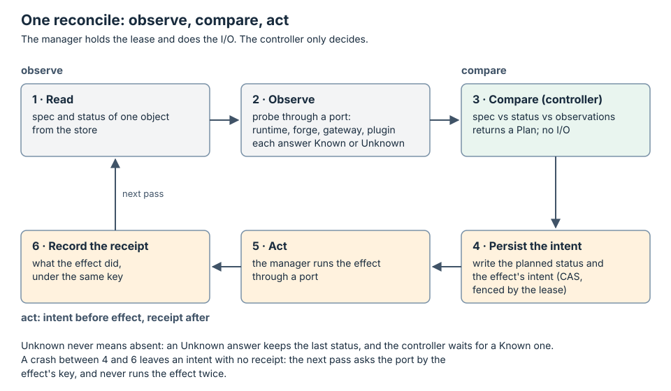
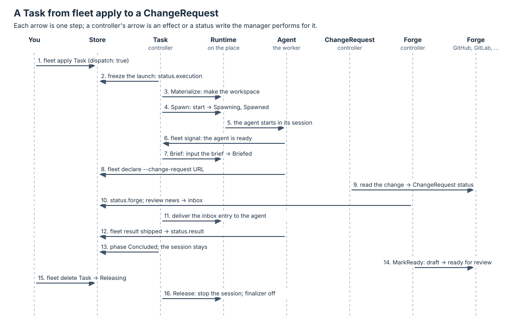

# Fleet

Fleet is the engine behind thurbox. It runs agent sessions on places and
keeps a record of each one. Its crates are `crates/fleet-*` in this
repository. [The overview](../README.md) says how Fleet fits between
thurbox and the runtimes.

This page explains the model, every resource kind, every controller and
how they fit together. Each linked page is a reference for one subject.

## Install

Fleet runs headless, without thurbox. The installers' fleet-only mode
installs `fleet`, `runtime-mux` and `workspace-git`, and nothing else:

```bash
curl -fsSL https://raw.githubusercontent.com/Thurbeen/thurbox/main/scripts/install.sh | sh -s -- --fleet-only
```

On Windows, pass `-FleetOnly` to the installer through a script block. This
form leaves no `THURBOX_FLEET_ONLY` variable behind in the session:

```powershell
& ([scriptblock]::Create((irm https://raw.githubusercontent.com/Thurbeen/thurbox/main/scripts/install.ps1))) -FleetOnly
```

A `THURBOX_FLEET_ONLY` variable stays set in the session. A later install in
that session then skips thurbox, and the installer warns about it.
Then run `fleet init`, `fleet doctor` and `fleet up`.
[configuration.md](configuration.md) owns these commands. Nothing updates a
fleet-only install: to update it, run the installer again.

## The model

Fleet is declarative, like Kubernetes:

- You describe what you want as a resource, `apiVersion: fleet/v1alpha1`,
  and write it with `fleet apply -f FILE`.
- Each resource has a `spec`, what you want, and a `status`, what is.
- A controller compares the spec with the status and the outside world.
  Then it acts to bring the status to the spec. This is a reconcile.
- `fleet up` is the manager. It holds one lease and runs every controller
  in periodic sweeps. `fleet reconcile` runs the same sweeps until nothing
  changes, then exits.
- The store keeps each resource as a file under the data directory. Every
  write is compare-and-swap. The lease also fences each controller write.

```json
{
  "apiVersion": "fleet/v1alpha1",
  "kind": "Task",
  "metadata": {"name": "fix-login"},
  "spec": {
    "harness": "claude-code",
    "host": "local",
    "brief": "Fix the login redirect and open a pull request.",
    "workspace": ["git+https://github.com/example/app.git#main"],
    "dispatch": true
  }
}
```

`spec.host` names the place the session runs on: `<runtime>/<place>`, or
`local`, the default runtime's `local` place. `fleet runtime places` lists
the places of every configured runtime.

## Resource kinds

Each kind has one row here and one page. `fleet version` lists the kinds
that this build serves, from
[`kinds::BUILT_IN`](../../crates/fleet-api/src/kinds.rs). A kind added
there fails [`docs_index`](../../crates/fleet-api/tests/docs_index.rs)
until it has its row here.

| Kind | What it is for | Who writes the spec | Who writes the status |
| --- | --- | --- | --- |
| [Task](resources/task.md) | One agent session doing one brief on one place. | You, with `fleet apply`; `fleet amend` appends to `amendments`. ConversationController, for a chat thread that starts a Task. CronTaskController, at each scheduled time. | TaskController, except the fields in [Who owns a Task's status](#who-owns-a-tasks-status). |
| [TaskConfig](resources/task-config.md) | Execution defaults that Tasks share: harness, place, model, environment, idle pause. | You, with `fleet apply`. | Nobody: it has no controller. |
| [EnvProvider](resources/env-provider.md) | Environment values for a launch: stored data, a file or a command. | You, with `fleet apply`. | Nobody: it has no controller. |
| [ChangeRequest](resources/change-request.md) | A mirror of one change on a forge (a pull or merge request), numbered so that a reader diffs it with one integer. | The worker, with `fleet declare --change-request URL`; or you, with `fleet apply`. | ChangeRequestController. |
| [Conversation](resources/conversation.md) | A mirror of one chat thread, and the Task that the thread is tied to. | The account's listener, with `fleet gateway receive`; GatewayController, for a thread that Fleet opens; or you, with `fleet apply`. | ConversationController. The listener spools deliveries on `received`. |
| [Listener](resources/listener.md) | The inbound health of one chat account. | The manager, one per `[gateway.accounts]` entry, or `fleet gateway receive` at a first beat. `fleet apply` refuses it. | ListenerController. The listener records `beats`, `refused` and `beatRevision`. |
| [Board](resources/board.md) | A log of events that every Task can read, in one order per board. `fleet init` makes `shared`, and `fleet`, where TaskController publishes `fleet.task.*`. | You, with `fleet apply`; `fleet init`, for `shared` and `fleet`. | Nobody: the store's append moves `head` and `oldest` when it appends events. |
| [CronTask](resources/cron-task.md) | A Task created from a template at each time of a cron schedule, like a Kubernetes CronJob. | You, with `fleet apply`. | CronTaskController. |
| [Plugin kinds](resources/plugin-kinds.md) | Kinds that a registered plugin defines and reconciles. [Write a plugin](plugins.md) shows how. | You, with `fleet apply`; the plugin, through its plan. | The plugin, as `plugin/<name>`, through the manager. |

A Session is not a kind. It is the running agent that a Task owns, from
spawn to release. The Task's `status.session` names it, and
`status.sessionState` says what the runtime last proved about it. See
[Session](resources/session.md). A Workspace is not a kind either: it is the
directories the session works in, which the place's runtime makes from the
Task's `spec.workspace`. See [Workspace](resources/workspace.md).

TaskConfig and EnvProvider are passive. A Task names a TaskConfig in
`spec.configRef`. Before the first effect, the manager resolves the
TaskConfig and its EnvProviders. It freezes the result in the Task's
`status.execution`, so a later change to them does not change a Task that
already started.

## Controllers

A controller is a pure function in
[fleet-controllers](../../crates/fleet-controllers/src/lib.rs). It gets the
object, the observations and the time. It returns a plan: the status to
write and the effects to run. The manager does every read, write and
effect.

| Controller | Watches | Does | Writes |
| --- | --- | --- | --- |
| [TaskController](controllers/task.md) | A Task; its session through the runtime port; the agent's signals. | Makes the workspace, spawns the session on the place, sends the brief, delivers the inbox, pauses and resumes an idle session, revives a lost one, releases the session on delete. | Task status: `phase`, `session`, `conditions`, intents and receipts, deliveries. |
| [ChangeRequestController](controllers/change-request.md) | A ChangeRequest; the change through the forge port. | Mirrors the change's state, checks, reviews and notes. Deletes the object when its retention ends. | ChangeRequest status. |
| [ForgeController](controllers/forge.md) | A Task's `status.declared`, and the ChangeRequests it names. | Relays new review feedback into the Task's inbox. Takes a draft out of draft when its ready policy holds. | Task `status.forge`; inbox entries. |
| [ConversationController](controllers/gateway.md#conversationcontroller) | A Conversation's spool; the thread through the gateway port; its tied Task. | Numbers new messages, creates the Task that a thread starts, posts a refusal or a busy notice. Deletes the object when its retention ends. | Conversation status; a new Task. |
| [ListenerController](controllers/gateway.md#listenercontroller) | A Listener's beats and refusals; the account through the gateway port. | Says whether the account's listener is alive. Deletes the object when the account leaves the config. | Listener status. |
| [CronTaskController](controllers/cron-task.md) | A CronTask; the Tasks that carry its uid label. | Creates a Task at each scheduled time, unless the CronTask is suspended, the time is past its deadline, or its policy forbids it. Deletes the Concluded Tasks beyond its history limit. | CronTask status; a new Task. |
| [GatewayController](controllers/gateway.md#gatewaycontroller) | A Task tied to a Conversation; its child Tasks. | Relays the thread into the Task's inbox. Posts the worker's declarations, logs and reactions to the thread. | Task `status.gateway`; inbox entries. |
| [Plugin controller](controllers/plugin.md) | The objects of a plugin kind. | Asks the plugin program what to probe and what to plan. A pure gate admits the plan. | The plugin kind's status, as `plugin/<name>`. |

TaskController, ForgeController and GatewayController all act on a Task.
Each one owns a different part of its status, so no two of them write the
same field.

## One reconcile



Three rules apply to every controller:

1. **Intent before effect.** The manager writes the planned status, with
   the effect's intent, before it runs the effect. It writes the receipt
   after. Each effect has a deterministic key. After a crash, an intent
   with no receipt is a question. For an effect that is not safe to
   repeat, such as `Spawn`, the next pass looks the result up by the key
   before it acts again. An effect that is safe to repeat, such as
   `CleanWorkspace`, runs again after a wait.
2. **Unknown never means absent.** Every observation is Known or Unknown.
   An Unknown answer (a timeout, an unreadable file, a corrupt record)
   keeps the last status. Only a Known answer can say that a session or a
   change is gone.
3. **One owner per status field.** The store refuses a status write from a
   writer that does not own the field.

### Who owns a Task's status

| Field | Writer |
| --- | --- |
| `result`, `declared` | The worker, with `fleet result` and `fleet declare`. |
| `forge` | ForgeController. |
| `gateway` | GatewayController. |
| `inbox`, `answered` | Nobody. `fleet send`, `fleet amend` and the Forge and Gateway relays append through a typed store mutation. TaskController removes an entry after it delivers it. `fleet send --retry` and `--drop` remove an entry given up on. |
| `wakeRequestedAt` | Nobody. `fleet attach` and `fleet shell` set it through a typed store mutation: with `--wake` for a paused Task, and for a lost session. |
| `pauseRequestedAt` | Nobody. `fleet pause` sets it through a typed store mutation. |
| `restartRequested` | Nobody. `fleet restart` sets it through a typed store mutation. |
| Every other field | TaskController. |

The source of this table is
[`kinds::status_owner`](../../crates/fleet-api/src/kinds.rs).

## From `fleet apply` to a ChangeRequest



The steps for the Task in [The model](#the-model), with `fleet up`
running:

1. You run `fleet apply -f fix-login.json`. The store creates the Task in
   phase `Pending`, with the `fleet.dev/release` finalizer.
2. This Task names no `configRef` and no `env`, so the manager has no
   launch to freeze. A Task with either gets its launch frozen into
   `status.execution` before the first effect.
3. TaskController plans `Materialize`. The runtime's `workspace` call
   makes the workspace on the place.
4. TaskController plans `Spawn`, and the phase is `Spawning`. The
   runtime's `start` call starts the agent. The receipt names the session
   in `status.session`, and the phase is `Spawned`.
5. The agent starts in its session.
6. The agent's hooks run `fleet signal`, which appends to the session's
   signal file. TaskController reads it, and learns that the agent is
   ready.
7. TaskController plans `Brief`. The runtime's `input` call types the
   brief. The agent's prompt hook proves the delivery, and the phase is
   `Briefed`.
8. The worker opens a pull request and runs
   `fleet declare fix-login --change-request URL`. Fleet creates a
   ChangeRequest for the URL and appends it to `status.declared`.
9. ChangeRequestController reads the change through the forge port and
   writes the ChangeRequest's status.
10. ForgeController reads the ChangeRequest. It writes `status.forge` and
    appends new review feedback to the Task's inbox.
11. TaskController delivers the inbox entry to the agent's own inbox
    (Claude Code's messaging socket, `codex queue`) through the runtime's
    `exec` call, or types it through `input` for an agent without one. It
    then removes the entry from the inbox.
12. The worker runs
    `fleet result fix-login --generation 1 --outcome shipped`. This
    writes `status.result`.
13. TaskController sets the phase to `Concluded`. The session stays, and
    later inbox entries still reach it.
14. When a ready policy is selected and holds, ForgeController plans
    `MarkReady`. The forge port takes the draft out of draft. No policy is
    selected by default: `fleet init` writes three policies but no
    `forge.draftPolicy`. Set `draftPolicy = "checks"` under `[forge]`, or
    `spec.forge.draft.policy` on the Task. See
    [ready policies](controllers/forge.md#ready-policies) for the checks
    that each policy adds to "the worker is done and idle".
15. You run `fleet delete task fix-login`. The phase is `Releasing`.
16. TaskController plans `Release` once the agent is at rest, or at most 5
    minutes after the delete. The runtime's `stop` call ends the session.
17. TaskController plans `CleanWorkspace`. The runtime's `stop` call with
    `release` removes the workspace, and the receipt says `Deleted`. Then
    the finalizer goes, and the store deletes the Task.

## Reference pages

| Page | Answers |
| --- | --- |
| [architecture.md](architecture.md) | The crates, their boundaries and ports, persistence, workspaces, views |
| [contracts.md](contracts.md) | What each part guarantees, and which tests hold it to that |
| [configuration.md](configuration.md) | `fleet init`, `fleet up`, every `fleet.toml` field, the environment file |
| [integration.md](integration.md) | `fleet integration`: the hooks Fleet installs for an agent that takes none at launch |
| [plugins.md](plugins.md) | Write a plugin: a new kind and its controller, step by step, with a working example |
| [signal-contract.md](signal-contract.md) | For an agent vendor: how an agent reports its state through `fleet signal` |
| [gateway-adapters.md](controllers/gateway-adapters.md) | The Slack and Discord adapters of the gateway port |

Each controller page has its state machine, with the SVG of the same name
beside it, and its interface. [architecture.svg](architecture.svg) shows
the crates during execution.
