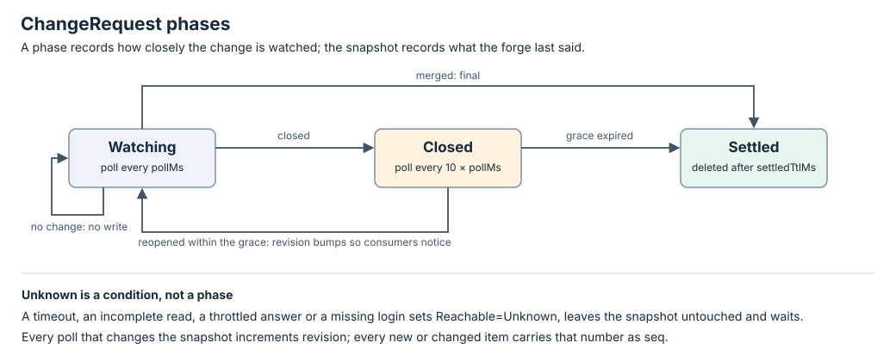

# ChangeRequest controller

A ChangeRequest mirrors one change on a forge. Its controller decides, from
the stored snapshot and one forge observation, whether anything changed and
when to look again. It performs no effect: the forge is read, never written,
from here.

| Read | Answers |
| --- | --- |
| [ChangeRequest](../resources/change-request.md) | What do I apply, and what does the snapshot contain? |
| [State machine](#changerequest-state-machine) | How does a change move between Watching, Closed and Settled? |
| [Interface](#changerequest-controller-interface) | What are the probes, the Forge port and the write rules? |
| [Forge controller](forge.md) | Who consumes the snapshot, and how? |
| [Native config](../configuration.md#the-forge-section) | How are forge hosts and adapters configured? |
| [Overall architecture](../architecture.md) | Where does this controller fit in Fleet? |

## One run

1. A ChangeRequest is applied, by a person or by `fleet declare` for the
   change a worker opened. The adapter for its host
   parses the URL at apply, and again before the first poll, when the
   controller records it as `status.ref`.
2. On each due pass the controller asks one probe, `Change { change }`. The
   manager answers it through the Forge port with one complete observation
   or Unknown.
3. A Known answer is compared with the stored snapshot. If anything differs,
   `revision` is incremented, every new or changed item gets that `seq`, and
   the snapshot is written. If nothing differs, only the bookkeeping fields,
   `observedAt` and `notBefore`, are written.
4. An Unknown answer sets `Reachable=Unknown`, leaves the snapshot untouched
   and waits one poll interval, or the `retryAfter` the forge gave. Unknown
   never means closed, merged or empty.
5. A merged change settles. A closed change is watched more slowly for a
   grace period, then settles; reopened within it, it is watched again.
6. A settled ChangeRequest is retained for `settledTtlMs`, then the
   controller deletes it. A person may delete one at any time. There is no
   finalizer and no owner: no Task's deletion reaches it.

Polling cadence is `status.notBefore`, which the manager already honours for
Tasks. One ChangeRequest costs one bounded observation per interval, a few
forge calls when the change has many notes, and one small bookkeeping write.

## Why a resource of its own

- One poller per change, however many consumers care. The Forge controller,
  a reviewer and a conductor read the same snapshot instead of each calling
  the forge.
- The forge's vocabulary is translated once, in the adapter. No consumer sees
  a GitHub or GitLab field.
- An unreachable forge is this controller's condition. No consumer can
  mistake it for a state of the change.
- It outlives its followers. A Task that declared the change can be deleted
  and another can take over on a different host; the mirror and its
  sequence numbers stay, so the newcomer's cursor means the same thing.

## Implementation and evidence

| Responsibility | Source | Tests |
| --- | --- | --- |
| Pure decisions, numbering, cadence and retention | [ChangeRequestController](https://github.com/Thurbeen/fleet/blob/961da39903338f3fb0493ec5a34aa8417cb98d89/crates/fleet-controllers/src/change_request.rs) | [Controller transitions](https://github.com/Thurbeen/fleet/blob/961da39903338f3fb0493ec5a34aa8417cb98d89/crates/fleet-controllers/tests/change_request_controller.rs) |
| Resource, status and port types | [ChangeRequest types](https://github.com/Thurbeen/fleet/blob/961da39903338f3fb0493ec5a34aa8417cb98d89/crates/fleet-api/src/change_request.rs), [Forge port](https://github.com/Thurbeen/fleet/blob/961da39903338f3fb0493ec5a34aa8417cb98d89/crates/fleet-api/src/forge.rs), [plans](https://github.com/Thurbeen/fleet/blob/961da39903338f3fb0493ec5a34aa8417cb98d89/crates/fleet-api/src/plan.rs) | [Forge E2E](https://github.com/Thurbeen/fleet/blob/961da39903338f3fb0493ec5a34aa8417cb98d89/crates/fleet-cli/tests/e2e_forge.rs) |
| Sweep by kind, host-ordered deferral, fenced delete | [Manager](https://github.com/Thurbeen/fleet/blob/961da39903338f3fb0493ec5a34aa8417cb98d89/crates/fleet-manager/src/lib.rs) | [Forge E2E](https://github.com/Thurbeen/fleet/blob/961da39903338f3fb0493ec5a34aa8417cb98d89/crates/fleet-cli/tests/e2e_forge.rs), [Store contract](https://github.com/Thurbeen/fleet/blob/961da39903338f3fb0493ec5a34aa8417cb98d89/crates/fleet-store/tests/store_contract.rs) |
| Apply by URL, the derived name, ref verification | [Verbs](https://github.com/Thurbeen/fleet/blob/961da39903338f3fb0493ec5a34aa8417cb98d89/crates/fleet-manager/src/verbs.rs) | [Forge E2E](https://github.com/Thurbeen/fleet/blob/961da39903338f3fb0493ec5a34aa8417cb98d89/crates/fleet-cli/tests/e2e_forge.rs) |
| GitHub through `gh`, GitLab through `glab`, Azure DevOps Services through `az`, Bitbucket Cloud through authenticated `curl`, the fake | [fleet-forge](https://github.com/Thurbeen/fleet/blob/961da39903338f3fb0493ec5a34aa8417cb98d89/crates/fleet-forge/src/lib.rs): [github](https://github.com/Thurbeen/fleet/blob/961da39903338f3fb0493ec5a34aa8417cb98d89/crates/fleet-forge/src/github.rs), [gitlab](https://github.com/Thurbeen/fleet/blob/961da39903338f3fb0493ec5a34aa8417cb98d89/crates/fleet-forge/src/gitlab.rs), [azure-devops](https://github.com/Thurbeen/fleet/blob/961da39903338f3fb0493ec5a34aa8417cb98d89/crates/fleet-forge/src/azure_devops.rs), [bitbucket-cloud](https://github.com/Thurbeen/fleet/blob/961da39903338f3fb0493ec5a34aa8417cb98d89/crates/fleet-forge/src/bitbucket.rs), [fake](https://github.com/Thurbeen/fleet/blob/961da39903338f3fb0493ec5a34aa8417cb98d89/crates/fleet-forge/src/fake.rs) | Truth tables in each adapter's unit tests; [Forge E2E](https://github.com/Thurbeen/fleet/blob/961da39903338f3fb0493ec5a34aa8417cb98d89/crates/fleet-cli/tests/e2e_forge.rs) against the stub CLIs |
| `[forge]` configuration | [CLI config](https://github.com/Thurbeen/fleet/blob/961da39903338f3fb0493ec5a34aa8417cb98d89/crates/fleet-cli/src/config.rs) | [Forge E2E](https://github.com/Thurbeen/fleet/blob/961da39903338f3fb0493ec5a34aa8417cb98d89/crates/fleet-cli/tests/e2e_forge.rs) |
| Crate edges and the field manager | [architecture.toml](https://github.com/Thurbeen/fleet/blob/961da39903338f3fb0493ec5a34aa8417cb98d89/crates/architecture.toml) | [Architecture suite](https://github.com/Thurbeen/fleet/blob/961da39903338f3fb0493ec5a34aa8417cb98d89/crates/fleet-arch/tests/architecture.rs) |

The forge E2E suite drives the built CLI through apply by URL, idempotent
re-apply, the aliasing refusal, bookkeeping-only polls, numbering of notes,
edits, unresolves, head and state transitions, the 100-note cap, Unknown
answers and `retryAfter`, host-wide deferral, the closed grace and reopen,
merged settling, retention and the fenced delete, against the fake forge; and
pagination, truth tables, rate limits, missing logins, a hung CLI's killed
process tree and proven absence against the stub `gh`, `glab`, `az` and
authenticated HTTP client. The
[Forge controller guide](forge.md#implementation-and-evidence)
lists the steps that follow this one.

## ChangeRequest state machine

`status.phase` records how closely the change is watched. The snapshot fields
record what the forge last said. The [interface](#changerequest-controller-interface) defines the one
probe used here.



### Transition rules

The manager only reconciles a ChangeRequest whose `notBefore` is absent or
due. Deletion by a person removes the record from any phase. Every poll
writes the bookkeeping fields, `observedAt` and `notBefore`; only a changed
snapshot moves `revision`.

| Current phase | Observation | Next phase | Decision |
| --- | --- | --- | --- |
| Watching | Known, nothing differs from the snapshot | Watching | Bookkeeping only; `notBefore = now + pollMs`. |
| Watching | Known, something differs; state draft or open | Watching | `revision += 1`; assign `seq` to what changed; set `everReady` if the state is not draft; write; wait `pollMs`. |
| Watching | Known, state merged | Settled | Write the final snapshot; `settledAt = now`; `Settled=True/Merged`; no further polls. |
| Watching | Known, state closed | Closed | Write the snapshot; `closedAt = now`; wait `10 × pollMs`. |
| Watching or Closed | Known, the change is proven absent | Settled | `Settled=True/Gone`; no further polls. |
| Watching or Closed | Unknown | unchanged | `Reachable=Unknown` with the reason; snapshot untouched; wait the phase's interval, or the answer's `retryAfter` when it carries one. |
| Watching, no `status.ref` yet | The URL could not be parsed by the configured adapter | Watching | `Reachable=Unknown/UrlNotParsed`; wait `pollMs`. |
| Closed | Known, state draft or open | Watching | `revision += 1` through `state.seq` even if nothing else differs; clear `closedAt`; wait `pollMs`. |
| Closed | Known, state merged | Settled | As from Watching. |
| Closed | Known, still closed, within `closedGraceMs` of `closedAt` | Closed | Write only if something differs; wait `10 × pollMs`. |
| Closed | Known, still closed, past `closedGraceMs` | Settled | `settledAt = now`; `Settled=True/ClosedGraceExpired`; no further polls. |
| Settled | none asked; `settledTtlMs` not yet passed since `settledAt` | Settled | Wait until it has. |
| Settled | none asked; `settledTtlMs` passed | Record removed | Request deletion of this object. A change reopened after the grace is a new ChangeRequest. |

Proven absence is the port's `Known(None)`: the forge answered and said the
change does not exist. A refused login, a missing permission, a partial
answer or an ambiguous not-found is Unknown, never gone.

### Sequence numbers

`revision` only moves when the snapshot changes, so a quiet change costs no
snapshot writes. Each note carries the `revision` that first showed it, moved
again by an edit or an unresolve; `state`, `reviewDecision` and `head` carry
the `revision` at which their value last changed. The newest 100 notes are
kept; `droppedBefore` rises to the `seq` of any note rotated out, so a
consumer whose cursor is below it knows it has a gap rather than silently
missing a note. The [ChangeRequest resource](../resources/change-request.md#sequence-numbers)
says why the counter is Fleet's and not the forge's clock, and what makes an
observation complete.

### Conditions

| Type | True means / relevant reason |
| --- | --- |
| Reachable | The last poll read the change completely (`Observed`). Unknown with the reason after a timeout (`Timeout`), an incomplete read (`Incomplete`), an unparseable answer (`Unreadable`), a throttled answer (`Throttled`), a missing login (`NotLoggedIn`), a refusal that is not proven absence (`Refused`), a CLI that could not start (`CliUnavailable`) or a URL the adapter could not place (`UrlNotParsed`). |
| Mergeable | The forge's own answer, as `status.mergeable`: True (`Mergeable`) when the forge says the change can be merged now, False with the forge's reason as a CamelCase word (`Conflicts`, `Blocked`, `CiMustPass`, `Draft`, ...; `NotMergeable` when the forge gives none) and the raw reason in the message, Unknown (`Computing`) while the forge is still computing it or has no such answer. Fleet reports it and never acts on it. |
| Settled | `Merged`, `ClosedGraceExpired` or `Gone`. |

Conditions keep their `lastTransitionTime` unless their status changes, so a
pass that sees nothing new writes nothing to them.

### Retention

A ChangeRequest is tied to no Task. Settled ones would otherwise accumulate
one per change ever opened, so the controller deletes its own object once
`settledTtlMs` has passed since `settledAt`, thirty days by default. This is
the pattern of a Kubernetes Job with a TTL after finishing: the object's own
controller removes it a configured time after it is done, and nothing else
has to know. The delete is fenced like every controller write: it names the
object's `uid` and `resourceVersion` and runs under the lease, so a stale
plan cannot remove a recreated mirror. A follower that still names a deleted
ChangeRequest sees readable absence and raises `ChangeGone`.

An open ChangeRequest nobody follows, such as one left by a crash between
the two steps of `fleet declare`, is polled until it settles like any other,
then retained and removed. Nothing collects open orphans; they cost one
bounded call per interval and are visible in `fleet list changerequest`.

### Deletion

`fleet delete changerequest NAME` removes the record on the next pass, at any
phase. There is no finalizer because nothing on the forge is held, and no
owner, so no other object's deletion reaches a ChangeRequest.

## ChangeRequest controller interface

The controller is a pure decision function, like
[TaskController](task.md#task-controller-interface). The manager owns I/O. The
[state machine](#changerequest-state-machine) defines how the values below change the
ChangeRequest; the [resource](../resources/change-request.md) defines the
external JSON fields.

### Controller API

Source: [ChangeRequestController](https://github.com/Thurbeen/fleet/blob/961da39903338f3fb0493ec5a34aa8417cb98d89/crates/fleet-controllers/src/change_request.rs)
and [plan types](https://github.com/Thurbeen/fleet/blob/961da39903338f3fb0493ec5a34aa8417cb98d89/crates/fleet-api/src/plan.rs).

```rust
pub struct ChangeRequestInput<'a> {
    pub object: &'a Object,
    pub observations: ChangeRequestObservations,
    pub now: Millis,
    pub defaults: ChangeRequestDefaults,
}

pub fn probes(&self, input: &ChangeRequestInput<'_>) -> Result<Vec<Probe>, StoreError>;
pub fn reconcile(&self, input: &ChangeRequestInput<'_>) -> Result<Plan, StoreError>;
```

`object` is the stored ChangeRequest. `now` comes from the manager's `Clock`.
`defaults` carries `forge.closedGraceMs` and `forge.settledTtlMs` from the
native config, as values, for a spec that names neither. Missing status
decodes to the default Watching state with `revision: 0`; malformed typed
spec or status returns `StoreError::Invalid`. Neither method reads the
clock, disk, environment, configuration, forge or runtime itself.

#### Requested probes

| State | Probes |
| --- | --- |
| Watching or Closed, due | `Change { change }`, carrying the `ChangeRef`. |
| Settled | None. |
| Deleting | None. |

`ChangeRequestObservations` holds two optional answers. `change`, a
[`ChangeObservation`](https://github.com/Thurbeen/fleet/blob/961da39903338f3fb0493ec5a34aa8417cb98d89/crates/fleet-api/src/forge.rs): `Known(Some)`
carries the adapter's complete, forge-neutral reading of the change;
`Known(None)` says the forge answered that the change does not exist;
`Unknown { kind, why, retryAfter }` carries the reason, as the
`Uncertainty` the `Reachable` condition is named from, and, when the forge
said so, how long to wait. `None` means the probe was not asked. `parsed`,
an `Observation<ChangeRef>`, is the manager's parse of `spec.url`, supplied
only while `status.ref` is absent: the probe names the ref, so the first
poll needs it before `probes` is asked, and the controller records it as
`status.ref` in the same write as that poll's result.

#### Returned plan

The plan carries `status`, and once a Settled object's retention has passed,
`delete: true` with no status, which asks the manager to delete this object
by `uid` and `resourceVersion` under the lease. `effects` is always empty
and `remove_finalizer` is always `None`: this controller writes its own
object and touches nothing else.

### Forge port

Source: [`fleet_api::forge::Forge`](https://github.com/Thurbeen/fleet/blob/961da39903338f3fb0493ec5a34aa8417cb98d89/crates/fleet-api/src/forge.rs). Every answer is Known or Unknown;
a refused write is `Known(EffectOutcome::Failed { why })`. A host is always
a forge hostname, never a runtime host, and every call runs on the machine
the manager runs on, with that machine's CLI logins.

| Method | Input | Answer |
| --- | --- | --- |
| `operation_bound` | None | Worst-case duration of one call, in milliseconds. The lease is sized to outlast it. |
| `parse` | A URL | The `ChangeRef` for it, normalised, using the adapter `[forge.hosts]` names for the host. Unknown for a host not configured. |
| `whoami` | A host | Fleet's login on that host, or Unknown. |
| `change` | A `ChangeRef` | `Some(ChangeSnapshot)`, complete; `None` for proven absence; Unknown on timeout, an incomplete read, a throttled answer or an unreadable answer, with `retryAfter` when the forge gave one. |
| `mark_ready` | A `ChangeRef`, the expected `head.id` and state, and an intent key | `MarkedReady { already }` once the change is out of draft, after a fresh read proved it still had the expected head and state; `Moved { head, state }` when either differed, nothing mutated; Failed when the forge answered no; Unknown when the answer could not be read, since the mutation may have landed. The [Forge controller](forge.md#forge-controller-interface)'s one effect, and Fleet's one forge write. |

The port has no merge method.

**One bounded observation, not one process.** `change` may make several
calls, paginating notes, threads and reviews, within `operation_bound`. It
answers Known only when it read everything the forge holds for the change;
if the bound runs out first it answers Unknown with `Incomplete`. The
controller never numbers a partial read.

Adapters live in the [`fleet-forge`](https://github.com/Thurbeen/fleet/blob/961da39903338f3fb0493ec5a34aa8417cb98d89/crates/fleet-forge/src/lib.rs)
crate, which depends on `fleet-api` and `fleet-exec`. The crate also holds
`ForgeHosts`, the adapters of a configuration's `[forge.hosts]`, which answers
the port by the host a URL or a ref names. Each observation spends at most
six bounded calls, each of `forge.callTimeoutMs`; the port's
`operation_bound` is six worst-case calls.

- **github:** bounded `gh api graphql --hostname <host> --include` processes
  read the pull request, its reviews, comments and review threads with
  pagination, each author's `__typename` to tell an app from a person,
  `mergeable` and `mergeStateStatus`, and the check runs and statuses of the
  head. A `Retry-After` or rate-limit reset header becomes `retryAfter`. A
  head with more than 100 checks or a thread with more than 100 comments is
  Unknown, never a partial read. `mark_ready` reads `isDraft`, `state` and
  `headRefOid` afresh in one call, then runs `markPullRequestReadyForReview`
  with the intent key as `clientMutationId`; the forge answering that the
  pull request is no longer a draft is `MarkedReady { already: true }`.
- **gitlab:** bounded `glab api --hostname <host> --include` processes read
  the merge request, its discussions with pagination, its approvals,
  `detailed_merge_status` and the head pipeline. A 404 of the merge request
  is proven absence only when the project itself answers. `mark_ready` reads
  the merge request afresh, then updates its title with the draft marker
  removed (`Draft:`, `[Draft]`, `(Draft)`, `Draft -`, or the legacy `WIP`
  forms, however cased), which is how GitLab takes a merge request out of
  draft; a draft whose title carries no such marker is a Known refusal.
- **azure-devops:** bounded `az devops invoke` processes read the pull request,
  its iterations, latest-iteration statuses, blocking policy evaluations and
  threads from Azure DevOps Services REST 7.1 (policy evaluations use the
  documented `7.1-preview.1`). The current head is the newest iteration's
  `sourceRefCommit`, never `lastMergeSourceCommit`. Collection counts must
  match the returned values; a partial or malformed collection is Unknown.
  Reviewer votes set the aggregate review decision, but produce no `Review`
  entries because a vote does not identify the head on which it was cast.
  Policy evaluation reads use the documented CodeReview artifact identity and
  an explicit 1,000-record page; a full page is Unknown rather than silently
  truncated. `mark_ready` fails closed: Azure DevOps can publish a draft, but
  exposes no atomic head-and-state precondition for that update, so Fleet
  cannot provide the port's optimistic-concurrency guarantee. Azure DevOps
  Server is not served by this adapter.
  The mappings follow Microsoft's REST 7.1 references for
  [pull requests](https://learn.microsoft.com/en-us/rest/api/azure/devops/git/pull-requests/get-pull-request?view=azure-devops-rest-7.1),
  [iterations](https://learn.microsoft.com/en-us/rest/api/azure/devops/git/pull-request-iterations/list?view=azure-devops-rest-7.1),
  [statuses](https://learn.microsoft.com/en-us/rest/api/azure/devops/git/pull-request-iteration-statuses/list?view=azure-devops-rest-7.1),
  [threads](https://learn.microsoft.com/en-us/rest/api/azure/devops/git/pull-request-threads/list?view=azure-devops-rest-7.1),
  [policies](https://learn.microsoft.com/en-us/rest/api/azure/devops/policy/evaluations/list?view=azure-devops-rest-7.1)
  and the documented [`az repos pr update --draft false`](https://learn.microsoft.com/en-us/cli/azure/repos/pr?view=azure-cli-latest#az-repos-pr-update).
- **bitbucket-cloud:** bounded `curl` processes read hosted `bitbucket.org`
  REST 2.0. Fleet sends only HTTPS URLs and Accept headers and uses
  `--netrc-optional`; curl's config, netrc or credential helper owns
  authentication. The pull request is read before and after its paginated
  comments, commit statuses and mergeability checks; each collection follows
  the API's opaque `next` links. A moved head or
  repository UUID makes the whole observation Unknown. Every pull-request
  commit status must link to that exact head. Pipelines are not read separately
  because they have a separate permission and duplicate pipeline-produced commit
  statuses. Participant votes set the aggregate decision but create no
  head-bound `Review`. Inline root comments must carry the API's `resolution`
  field; missing resolution evidence is Unknown, never zero unresolved
  threads. `account_id`, falling back to UUID, is the user identity.
  `mark_ready` fails closed: the documented draft update has no atomic
  head-and-state precondition. Bitbucket Server/Data Center is not served.
  These mappings follow Atlassian's references for
  [pull requests](https://developer.atlassian.com/cloud/bitbucket/rest/api-group-pullrequests/),
  [commit statuses](https://developer.atlassian.com/cloud/bitbucket/rest/api-group-commit-statuses/),
  [users](https://developer.atlassian.com/cloud/bitbucket/rest/api-group-users/),
  [pagination](https://developer.atlassian.com/cloud/bitbucket/rest/intro/#pagination),
  [API request limits](https://support.atlassian.com/bitbucket-cloud/docs/api-request-limits/)
  and [draft semantics](https://support.atlassian.com/bitbucket-cloud/docs/draft-pull-requests/).
- **fake:** a file-backed forge for tests and trials, with injectable faults
  (lost answers, timeouts, throttling with `retryAfter`, incomplete reads,
  malformed answers, proven absence; and for `mark_ready`, `moved`,
  `failed`, `lost` and `lost-applied`, the last two Unknown with the
  mutation not landed and landed). It runs no process, and records the
  intent key of every mark-ready that mutated a change. Its URLs take any
  shape a real forge uses (`/pull/N`, `/-/merge_requests/N`, `/changes/N`).

Credentials stay with each CLI or authenticated client's own configuration.
Fleet passes none and stores none.

#### Adapter truth tables

Each adapter maps the forge's answer onto the vocabulary by these rules; an
answer the rule cannot place is Unknown for the whole observation, never a
guess.

A terminal forge state wins over the draft flag. Only an open change can be
`draft`. A forge can close a draft without marking it ready, and the draft
flag then stays set. The GitHub and GitLab `mark_ready` fresh reads use the
same rule. A closed draft is therefore `Moved` with state `closed`, and Fleet
never marks it ready.

| Field | GitHub | GitLab | Azure DevOps Services | Bitbucket Cloud |
| --- | --- | --- | --- | --- |
| `state` | `state` OPEN, CLOSED, MERGED map to open, closed, merged; OPEN with `isDraft` is `draft`. | `state` opened, closed, merged map to open, closed, merged; opened with `draft` or `work_in_progress` is `draft`. | `status` active, abandoned, completed map to open, closed, merged; active with `isDraft` is `draft`. | `state` OPEN, DECLINED/SUPERSEDED, MERGED map to open, closed, merged; OPEN with `draft` is `draft`. |
| `head.checks` | Over check runs and commit statuses of the head: any failed or errored is `failed`; else any queued, in progress or pending is `pending`; else any success is `passed`; none at all is `none`. Skipped and neutral count as absent. | Over the head pipeline: failed or canceled is `failed`; running, pending, created or manual is `pending`; success is `passed`; no pipeline is `none`. Skipped is absent. | Over latest-iteration statuses and enabled blocking policy evaluations: failed, error, rejected or broken is `failed`; pending, notSet, queued or running is `pending`; succeeded or approved is `passed`; notApplicable and nonblocking policies are absent. | Over paginated pull-request commit statuses bracketed by, and linked to, the same `source.commit.hash`: FAILED or STOPPED is `failed`; INPROGRESS is `pending`; SUCCESSFUL is `passed`; none is `none`. Pipelines are not read separately. |
| `reviewDecision` | `reviewDecision` APPROVED, CHANGES_REQUESTED, else `none`. | Approved when the approval rules are satisfied; `changes-requested` is not a GitLab concept and is never produced; else `none`. | Any reject (-10) or wait-for-author (-5) vote is `changes-requested`; otherwise any approve (10) or approve-with-suggestions (5) vote is `approved`; else `none`. | Any participant `changes_requested` wins; otherwise any `approved` participant is approved; else `none`. |
| `mergeable` | `mergeable` MERGEABLE is `true`; CONFLICTING is `false` with `conflicts`; UNKNOWN is `null`. `mergeStateStatus` BLOCKED, BEHIND, UNSTABLE, DRAFT give `false` with that word. | `detailed_merge_status` mergeable is `true`; `checking` and `unchecked` are `null`; every other value is `false` with that value. | Draft is `false`; `mergeStatus` succeeded is `true`; conflicts, rejectedByPolicy and failure are `false`; queued, notSet or absent is `null`. | Draft is `false`; a blocking FAILED mergeability check is `false` with its type; any UNKNOWN or a blocking PENDING check is `null`; PASSED, SKIPPED, and other non-blocking checks do not block merging. |
| `threads.unresolved` | Review threads with `isResolved` false, over all pages. | Resolvable discussions with `resolved` false, over all pages. | Inline threads in active or pending state. Fixed, won't-fix, closed and by-design are resolved; an unknown state makes the observation Unknown. | Inline root comments whose `resolution` is null, over every comments page. Deleted roots remain structural for visible replies; a missing root or resolution field makes the observation Unknown. |
| `reviews` | Submitted reviews on the head commit, state APPROVED, CHANGES_REQUESTED, COMMENTED; dismissed reviews are omitted. | Approvals as `approved` reviews; there are no others. | Empty: reviewer votes carry no head identity. | Empty: participant votes carry no head identity. |
| `bot` | `__typename` is `Bot`. | The user is a bot or a project access token user. | `false`: the thread identity does not make a reliable bot assertion. | User is false; the documented app-user type is true; any unknown type makes the observation Unknown. |

Azure DevOps URL identity is
`azure-devops/{organization}.visualstudio.com/{project}/{repository}/{id}`.
Both `https://dev.azure.com/{organization}/{project}/_git/{repository}/pullrequest/{id}`
and the legacy `{organization}.visualstudio.com` form parse to that identity.
The organization-specific canonical host also scopes `whoami`; equal project,
repository and pull-request numbers in different organizations cannot collide.

Bitbucket Cloud URL identity is
`bitbucket-cloud/bitbucket.org/{workspace}/{repository}/{id}`. Workspace and
repository slugs are lowercased; each observation verifies the destination's
`full_name`, immutable repository UUID, and source and destination commit hashes
before and after collecting evidence.

### Manager execution protocol

Source: [Manager](https://github.com/Thurbeen/fleet/blob/961da39903338f3fb0493ec5a34aa8417cb98d89/crates/fleet-manager/src/lib.rs).

1. For each due ChangeRequest, renew the lease. When `status.ref` is absent,
   parse `spec.url` through the Forge port and hand the answer in as
   `parsed`. Ask `probes`, perform the `Change` probe through the Forge
   port, renewing before it.
2. Call `reconcile` with the answers, the time and the configured defaults.
3. CAS-write the planned status against the resourceVersion read. A conflict
   drops the plan; the next pass rereads.
4. When the plan says `delete`, delete the object by `uid` and
   `resourceVersion` under the lease (`Store::delete_fenced`). A conflict
   means it was rewritten or recreated since: nothing is removed.

There are no effects and no receipts. `fleet up` sweeps ChangeRequests in the
same loop as Tasks, after them; a ChangeRequest is due when `notBefore` is
absent or past, like a Task. ChangeRequests of one host are swept in a stable
order, by host then name, so that a `retryAfter` from the forge defers all of
them together: the ones after it in the order are not asked and take the same
Unknown answer with the same wait. A sweep spends no more than its bounded
run on them, so forge polling cannot starve Task delivery, deletion or lease
renewal. A store without a `[forge]` section reports each ChangeRequest as
an error and polls nothing.

### Store port and write ownership

| Writer | May change | Required fencing |
| --- | --- | --- |
| `apply` | New ChangeRequest and labels; request deletion | Store validation, exclusive creation. |
| `apply`, through `fleet declare` | A new ChangeRequest named from the canonical ref, on a Task's behalf | Exclusive creation; an existing object is reused unchanged after its `status.ref` is verified against the URL. |
| `change-request-controller` | All of `status`; deletion of its own object after retention | Current resourceVersion, the object's `uid` and the live manager lease. |

The spec is immutable: any change to it is refused. `ownerReferences` is
refused, as on every kind: a ChangeRequest belongs to nobody.
