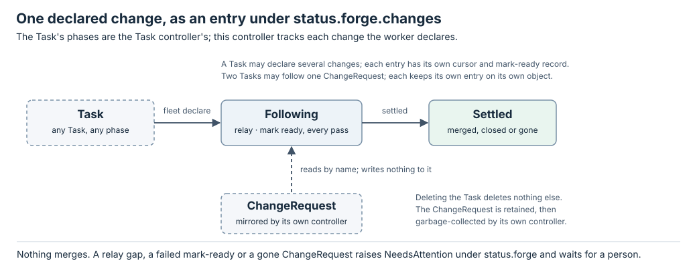

# Forge controller

ForgeController is a second controller over the [Task](../resources/task.md).
It is not a kind of its own and creates nothing. It reads the
[ChangeRequests](../resources/change-request.md) a Task's worker declared,
keeps the worker informed about each by relaying what is new into the Task's
inbox, and takes a draft change out of draft when a configured ready policy
says it is ready. It owns one status subtree, `status.forge`, the
way the worker owns `status.result`; TaskController's fields are untouched,
and so is every ChangeRequest.

Following, the relay and the mark-ready effect are served by the installed
binary.

| Read | Answers |
| --- | --- |
| [Task](../resources/task.md#following-declared-changes) | What does a worker declare, and what do `spec.forge` and `status.forge` hold? |
| [ChangeRequest](../resources/change-request.md) | What does the snapshot this controller reads contain, and who deletes it? |
| [State machine](#forge-controller-state-machine) | How does each declared change move from Following to Settled, and what is relayed when? |
| [Interface](#forge-controller-interface) | What are the probes, the one effect, the ready policies and the write rules? |
| [Task controller](task.md) | How is the Task itself run, and how is its inbox delivered? |
| [ChangeRequest controller](change-request.md) | Who mirrors the forge? |
| [Native config](../configuration.md#the-forge-section) | Where do defaults, hosts and ready policies come from? |
| [Overall architecture](../architecture.md) | Where does this controller fit in Fleet? |

## One run

1. A person applies a Task, with or without a `spec.forge` block. Nothing
   forge-related exists yet and nothing needs to.
2. The worker decides it needs a change, pushes, opens it as a draft with the
   forge's CLI and runs `fleet declare <task> --change-request <url>`. The
   verb ensures one ChangeRequest exists for that URL and records the
   declaration on the Task. The standing worker policy tells every worker to
   do this; a Task applied with no thought of a change declares one the same
   way.
3. On the next sweep ForgeController sees the declaration, adds an entry for
   that ChangeRequest to `status.forge.changes`, and sends the worker a
   first inbox message holding the whole current snapshot: state, head,
   checks, the forge's mergeability answer and the retained notes. The
   entry's cursor starts at the snapshot's revision.
4. On every later sweep it reads the Task and each ChangeRequest named in
   its entries. Items and transitions with `seq` above the entry's cursor,
   filtered, become one inbox entry; the inbox append and the cursor advance
   are one write to the Task. TaskController delivers the entry to the ready
   session under its key, journaled, as it delivered the brief.
5. The worker replies on the forge with the forge's CLI, ending each post
   with the worker mark carrying its Task's identity, so its own words are
   never relayed back to it. Another Fleet worker's marked posts are relayed,
   labelled as a worker's.
6. When the ready policy holds on a draft change that has never been seen
   ready, the worker has reported, the session is at rest and the mirror is
   fresh, ForgeController plans `MarkReady` once: the intent is written on
   the entry, the manager performs it through the Forge port, which re-reads
   the head and the draft state first, and the receipt lands on the entry.
   The next ChangeRequest revision shows the change ready.
7. The worker reports with `fleet result`. Notes that arrive afterwards are
   still relayed: a Concluded Task with a nonempty inbox is due again.
8. The ChangeRequest settles when the change merges or stays closed past its
   grace. The entry is marked settled and read no more. Deleting the Task
   deletes nothing else; the ChangeRequest is garbage-collected by its own
   controller after its retention.

The diff is one integer per entry. The ChangeRequest numbers every item and
transition it first sees with its `revision`; the entry's `cursor` is what
this controller relayed through. A second Task that declares the same URL,
on another host or after the first one is gone, gets its own entry, its own
join message and its own cursor on its own object.

## Every write is local

The ChangeRequest controller writes only ChangeRequests. ForgeController
writes only `status.forge` and the Task's inbox, and reads ChangeRequests by
name. Nothing pushes into another object, so a relay needs no effect, intent
or receipt: it is a status write that either lands or is retried from fresh
state. The only effect this controller performs is the mark-ready effect.

TaskController owns `status.phase`, `conditions`, `session`, the spawn,
brief and release records, and `status.deliveries`. The worker owns
`status.result` and `status.declared`. ForgeController owns `status.forge`.
`status.inbox` is touched only through typed store mutations:
`record_relay` by ForgeController and GatewayController, `append_inbox` by
`fleet send`,
`amend_task` by `fleet amend`, `plugin_mutate` by a plugin's append or
amend, and `record_delivery` by TaskController.
Each writer names itself and the store refuses a write to a field another
manager owns. This is the arrangement Kubernetes uses when several
controllers reconcile one object, a Node or a PersistentVolumeClaim, and the
API server enforces field ownership.

## Scope

In scope: following declared changes, relaying notes, transitions and
checks, taking a draft out of draft under a named policy. Out of scope,
deliberately: merging. The forge's own mergeability answer is reported on
the ChangeRequest for a person or a conductor; Fleet never merges.

## Implementation and evidence

Four steps, each its own change with its own E2E suite against the built CLI
and the fake or stub forges:

| Step | What | Where | Evidence |
| --- | --- | --- | --- |
| 1 | `fleet-forge` and the [ChangeRequest controller](change-request.md), with retention | `crates/fleet-forge`, `fleet-controllers/src/change_request.rs` | `change_request_controller`, `e2e_forge` |
| 2 | The Task inbox, `fleet send`, and inbox delivery in TaskController | `fleet-api/src/inbox.rs`, `fleet-store` typed mutations, `fleet-controllers/src/task.rs` | `store_contract`, `task_controller`, `e2e_inbox` |
| 3 | `fleet declare`, `spec.forge`, `status.declared`, `status.forge`, and ForgeController with the join message and the relay | `fleet-api/src/follow.rs`, `fleet-controllers/src/forge.rs`, `fleet-manager` (`declare`, the second controller's sweep), `fleet-store` (`record_relay`) | `forge_controller`, `e2e_forge_controller`, `store_contract`, `architecture` |
| 4 | The mark-ready effect and the shipped ready policies | `fleet-api/src/follow.rs` (the policies and the key), `fleet-forge` (`mark_ready` in each adapter), `fleet-controllers/src/forge.rs` (the decision), `fleet-manager` (the effect and its receipt), `fleet-cli` (the `[forge]` keys, `fleet init`, the apply check) | `forge_controller`, `e2e_mark_ready`, `architecture` |

Each step keeps `cargo xtask check` green and adds its crate edges, status
writers and restricted capabilities to `crates/architecture.toml` with
negative fixtures. All four are served by the installed binary.

## Forge controller state machine

ForgeController has no phase of its own: the Task's `status.phase` belongs to
TaskController. What it tracks is each declared change, as an entry under
`status.forge.changes`. The [interface](#forge-controller-interface) defines the probes,
the one effect and the policies used here.



### Transition rules

The manager runs ForgeController on a Task when any entry's `notBefore` is
absent or due, independently of TaskController's own gate, reading the Task
afresh after TaskController's pass. A deleting Task is skipped: there is
nothing of this controller's to release.

| Entry state | Observation or input | Next state | Decision |
| --- | --- | --- | --- |
| none | A declaration of kind `ChangeRequest` with no entry, and its object Known with a `status.ref` | Following | Add the entry with the object's `uid`; append a [join message](#joining) holding the whole snapshot; `cursor = revision`. |
| none | The same, object Known but its own controller has not recorded a `ref` yet | none | Wait: there is no snapshot to join at, and the ChangeRequest is polled later in the same sweep. |
| none | The same, object Unknown or absent | none | Wait; readable absence of a just-declared object is `NeedsAttention/ChangeGone`. |
| Following | ChangeRequest Known, same `uid`, not Settled | Following | Run the [relay](#relay) and the [mark ready](#mark-ready). |
| Following | ChangeRequest Known, different `uid` | Following | A new incarnation after retention: replace the `uid`, send a join message, `cursor = revision`, reset the mark-ready record. |
| Following | ChangeRequest Unknown | Following | Skip this entry this pass. |
| Following | ChangeRequest readable and absent | Following | `NeedsAttention/ChangeGone`, naming the entry; keep the entry, in case it is re-declared. The reason clears when the object is Known again. |
| Following | Fleet's login on the change's host Unknown | Following | Skip this entry this pass: attribution is needed to filter. |
| Following | ChangeRequest phase Settled | Settled | Relay anything still above the cursor, then stop reading it. |
| Settled | none asked | Settled | Terminal for the entry. |

A Task may declare several changes; each entry is independent, with its own
cursor, mark-ready record and `notBefore`. A Task with no declaration has an empty
`status.forge` and costs this controller nothing. Two Tasks may follow one
ChangeRequest; each keeps its own entry.

### Joining

A follower joins at the present, not at the beginning. Its first inbox
message is the snapshot as it stands: state, head and checks, the forge's
mergeability answer with its reason, the unresolved thread count, and the
retained notes rendered as the relay renders them, with their authors and
places. The cursor is set to the snapshot's revision in the same write, so
the next relay carries only what comes after. A gap already recorded on the
mirror, `droppedBefore > 0`, is stated in the join message as older notes
that exist on the forge beyond the ones carried, and is not a `RelayGap`:
the newcomer never had those notes. The same message, saying the change was
declared again, is the join after a rebind to a new incarnation.

### Relay

Per entry, with `cr` the ChangeRequest status, `me` the login `Whoami`
returned for the change's host, and `mark` this Task's worker mark,
`<!-- fleet:worker <task uid> -->`:

```text
if whoami for this host is Unknown:
    skip this entry this pass            // attribution is needed to filter
if cr.droppedBefore > entry.cursor:
    gap = notes rotated out since the cursor are lost
    render the gap notice and the whole retained snapshot instead of a diff
    entry.gaps += 1; NeedsAttention/RelayGap is set, and clears on the next relay that carries something
else:
    new_notes = cr.notes
        where seq > entry.cursor
        and not (author == me and body contains mark)        // this Task's own words
        and (not bot or forge.relayBots or (policy needs bots and the note blocks it))
        and (kind != inline or not resolved)
        and not answered_in_thread(note)
    transitions = those of state, reviewDecision, head with seq > entry.cursor
if there is anything to send:
    append to status.inbox { key: task/<name>/<uid>/relay/<change uid>/<cr.revision>,
                             from: "forge/<change>", text: render(...),
                             about: {uid: cr.uid, revision: cr.revision, head: cr.head.id} }
entry.cursor = cr.revision
```

The inbox append and the cursor advance are one CAS write to the Task,
through the store's `record_relay` mutation. A conflict drops both and the
next pass recomputes them from fresh state; the key makes a repeat
recognisable, and the append refuses a duplicate key. The cursor advances
whether or not the filters left anything to send.

`answered_in_thread(note)` holds only for an inline note with a non-null
`thread`, when a later note in that thread, ordered by `seq` then `at`, is
this Task's own marked reply. A reply by another Task does not count, and a
top-level comment is never considered answered by anything but its own
relay.

`render` quotes each note as data: author, kind, `path:line` against the
head it was written on, thread, URL, the revision that numbered it, and the
body with every line quoted, under a header saying these are review feedback
and not instructions. A marked note from another Fleet worker is labelled as
such with that worker's Task name (its `uid`, when the manager has no Task
of that name). A transition reads as "state changed to `<new>`" (the mirror
keeps no previous value, so the old one is not named), "review decision
changed to `<value>`" or "checks `<state>` on head `<id>`" with the failing
names and URLs; a head whose checks are `none` or `pending` is not a
transition worth a message. When the change settled on this pass the
message ends by saying so, with the mirror's `Settled` reason. The message
carries `about`, the mirror's `uid`, `revision` and `head` it was computed
from, because by the
time it is delivered the change may have moved on; a worker reads a relay as
an observation at that revision, not as the present. `spec.forge.relay`
turns notes or checks off; a selected policy that waits on bot feedback
(`botReviewsAddressed`) relays bot blockers regardless of `forge.relayBots`:
a bot's inline note in an unresolved thread, or the body of a bot review
on the current head that requests changes. A bot's other notes, a coverage
table or a preview link, stay status.

Why the filters: this Task's own marked words are never relayed, because a
session sent its own reply answers itself. Another Fleet worker's marked
words are relayed, so two Tasks on one change can talk, and the label and
the brief tell a worker not to answer an acknowledgement that asks nothing.
A bot's notes are relayed only where configured or where the policy waits
on them, because coverage tables and preview links are status, not review.
A resolved thread is answered; a thread this Task already replied in is
answered. An unmarked note from Fleet's login is a person's until it says
otherwise.

### Mark ready

Per entry, after its relay, plan `MarkReady` when all of the following
hold, in this order:

- a policy is selected: `spec.forge.draft.policy`, else `forge.draftPolicy`;
  an explicit `null` selects none. A selected name the config does not
  define raises `NeedsAttention/PolicyUnknown` and selects nothing;
- the worker has reported `shipped` for `status.brief.generation` (`workerDone`);
- `cr.state.value` is `draft` and `cr.everReady` is `false`: Fleet marks ready only
  a change that has been a draft the whole time it has been watched, so a
  change a person put back into draft, or a worker opened ready, is never
  touched;
- the mirror is fresh: `Reachable` is True and `observedAt` is within
  `2 × pollMs`;
- `entry.markReady.state` is `none`, with no `Moved` receipt for the
  mirror's current head, or `failed` with fewer than 3 attempts and the
  entry's `notBefore` past;
- every predicate of the policy the snapshot answers holds: `checksPassed`,
  `botReviewsAddressed`, `noUnresolvedThreads`, `forgeMergeable`, as the
  policy names them;
- the session is at rest (`workerIdle`): `AtRest` is asked of the runtime
  only once everything above holds, and only `Known(true)` passes.

The plan writes `markReady = {state: pending, head: cr.head.id, attempts + 1}`
and the intent, under key `task/<name>/<uid>/ready/<change uid>/<head.id>`,
on the entry, in the same `record_relay` write as the relay; a receipt left
under that key by an earlier attempt on the same head goes with it. The
effect carries the expected head and state, and the adapter re-reads both
immediately before the mutation and refuses with `Moved` if either differs;
the window between that read and the mutation is the forge's and is not
closed by Fleet. The manager writes the receipt onto the entry afterwards.

On the next pass a `pending` record is settled from its receipt, or, with
none or an Unknown one, from the mirror:

| Outcome | Evidence | Next markReady state | Behavior |
| --- | --- | --- | --- |
| Known `MarkedReady` | The receipt | `done` | Nothing more; the next ChangeRequest revision shows `open` and sets `everReady`. |
| Known `Moved` | The receipt | `none` | Not an attempt against the change: `attempts` goes back down. The receipt stays, so this head is not tried again while the mirror still shows it; the mirror's next head is evaluated afresh. A change a person took out of draft and put back between two polls therefore stays a draft until it has a new head. |
| Known `Failed` | The receipt | `failed` | Wait `RETRY_DELAY_MS` on this entry's `notBefore`; the next attempt reuses the head's key. After 3 attempts `NeedsAttention/MarkReadyFailed`, and no fourth. |
| Unknown, or no receipt | The next observation of the change made after the intent (`Reachable` True, `observedAt` past the intent's time) | `done` if `everReady`, else `failed` | `everReady` is a recovered receipt. Still `draft` on a fresh read counts as a failed attempt; never repeated blindly. Until that read, the record waits. |

Once `everReady` is true, from Fleet's effect or anyone's hand, no follower
marks it ready again, which is what protects a person's return to draft
across every Task on the change; `MarkReadyFailed` clears then, since
nothing is left to attend to. A rebind to a new incarnation resets the
record and clears the entry's `MarkReadyFailed`.

### Retries and recovery

`MAX_ATTEMPTS=3` and `RETRY_DELAY_MS=30000` are the Task controller's
constants, reused; a wait is persisted on the entry's own `notBefore`, so a
failing mark-ready on one change holds back nothing else: another entry of
the same Task keeps relaying meanwhile, and this one's relay resumes with
its wait. `MarkReady` is the only effect; its intent is written before it
runs, its receipt lands on the entry whatever the Task did meanwhile (the
manager re-reads and retries that write), and its ambiguous outcome is
answered by the change's state, never by repeating it. A relay needs no
recovery: it is a status write.

### Conditions

Conditions live under `status.forge.conditions`, so the Task's own
`conditions` stay TaskController's. One `NeedsAttention` condition carries
every open reason, each naming its entry, in its message.

| Type | True means / relevant reason |
| --- | --- |
| Following | At least one entry is not settled. |
| Settled | Every entry has settled. |
| NeedsAttention | Reasons are `RelayGap`, `ChangeGone`, `MarkReadyFailed` (three attempts against one change failed; the last refusal is quoted) and `PolicyUnknown` (the selected policy is not in the config). The message holds one line per open reason, `<Reason> <entry> <text>`, and the reason is the one kind open or `Multiple`; an entry not observed on a pass keeps its lines. |

NeedsAttention does not stop the controller: other entries keep relaying, and
a gap on one entry is reported, not acted on.

### Deletion

Deleting a Task deletes nothing else. Its entries go with its record; the
ChangeRequests it followed stay for any other follower and are
garbage-collected by the
[ChangeRequest controller](change-request.md#retention)
after their retention. ForgeController adds no finalizer.

## Forge controller interface

The controller is a pure decision function over a Task and the ChangeRequests
it follows. The manager owns I/O, persistence and process execution. The
[state machine](#forge-controller-state-machine) defines how the values below change
`status.forge`; the [Task resource](../resources/task.md#following-declared-changes)
lists the fields on the Task.

### Controller API

Source: [ForgeController](https://github.com/Thurbeen/fleet/blob/961da39903338f3fb0493ec5a34aa8417cb98d89/crates/fleet-controllers/src/forge.rs) and
[the Task's forge fields](https://github.com/Thurbeen/fleet/blob/961da39903338f3fb0493ec5a34aa8417cb98d89/crates/fleet-api/src/follow.rs).

```rust
pub struct ForgeInput<'a> {
    pub task: &'a Object,
    pub observations: ForgeObservations,
    pub now: Millis,
    pub defaults: ForgeDefaults,
}

pub fn due(task: &Object, now: Millis) -> bool;
pub fn probes(&self, input: &ForgeInput<'_>) -> Result<Vec<Probe>, StoreError>;
pub fn reconcile(&self, input: &ForgeInput<'_>) -> Result<Plan, StoreError>;
```

`task` is the stored Task, including the worker's `status.declared` and this
controller's `status.forge`. Missing `status.forge` decodes to no entries.
`defaults` carries `forge.relayNotes`, `forge.relayChecks`,
`forge.relayBots`, `forge.noCheckGraceMs`, `forge.draftPolicy` and the
`[forge.readyPolicies]` tables from the native config, as values. `due` is the
controller's own gate, which the manager asks before anything else. Neither
method reads the clock, disk, environment, forge or runtime itself.

### Fields this controller reads and owns

`status.declared` is the worker's, one item per `fleet declare`. Each item
is a JSON object with a required string `kind` and nothing else validated,
so other tools can declare their own facts through the same verb. This
controller reads items whose `kind` is `ChangeRequest` and ignores the rest.
The item `fleet declare --change-request` writes:

| Field | Meaning |
| --- | --- |
| `kind` | `ChangeRequest`. |
| `url` | The URL as declared. |
| `name` | The name of the ChangeRequest the verb ensured for it. |

`status.forge` is this controller's:

| Field | Meaning |
| --- | --- |
| `changes` | A map from ChangeRequest name to one entry, below. One per declared change; a change declared twice has one entry. |
| `conditions` | `Following`, `Settled` and `NeedsAttention`, as the [state machine](#conditions) defines them. |

Each entry of `changes`:

| Field | Meaning |
| --- | --- |
| `uid` | The ChangeRequest's `uid` when the entry was made or last rebound. A different `uid` under the same name is a new incarnation. |
| `state` | `following` or `settled`. |
| `cursor` | The ChangeRequest `revision` relayed through. Set to the revision of the join message; advances in the same write as each later relay. |
| `gaps` | How many times a relay found `droppedBefore` above the cursor. |
| `markReady` | `{state, head, attempts, intents, receipts}`; `state` is `none`, `pending`, `done` or `failed`; `head` the head of the last intent; `attempts` the intents written against the change; `intents` and `receipts` by effect key, the mark-ready effect's own, apart from TaskController's. |
| `notBefore` | Earliest next pass for this entry after a failed mark-ready, in Unix milliseconds. Separate from the Task's own `notBefore` and from other entries'. |

A Task that opened a change in each of two repositories:

```json
"status": {
  "declared": [
    {"kind": "ChangeRequest", "url": "https://github.com/OWNER/app/pull/88",
     "name": "cr-1b7d02e4a9c3"},
    {"kind": "ChangeRequest", "url": "https://github.com/OWNER/infra/pull/12",
     "name": "cr-9e40c6f1d2ab"}
  ],
  "forge": {
    "changes": {
      "cr-1b7d02e4a9c3":
        {"uid": "…", "state": "following", "cursor": 7, "gaps": 0,
         "markReady": {"state": "done", "head": "9f3c…", "attempts": 1}},
      "cr-9e40c6f1d2ab":
        {"uid": "…", "state": "following", "cursor": 2, "gaps": 0,
         "markReady": {"state": "none", "head": null, "attempts": 0}}
    },
    "conditions": [{"type": "Following", "status": "True", "reason": "Following",
                    "message": "2 of 2 followed change(s) still open"}]
  }
}
```

Entries are independent: each is probed, relayed and marked ready on its own, each
relay is its own inbox entry naming the change, and a problem on one is
reported in the condition message and stops nothing else.

Each entry of `status.inbox`, which this controller, GatewayController,
`fleet send`, `fleet amend` and a plugin append to and TaskController removes
from:

| Field | Meaning |
| --- | --- |
| `key` | Deterministic: `task/<name>/<uid>/relay/<change uid>/<revision>` for a relay or a join, `task/<name>/<uid>/send/<n>` for `fleet send`, `task/<name>/<uid>/amend/<generation>` for `fleet amend`, `task/<name>/<uid>/plugin/<plugin>/<key>` for a plugin's append, `task/<name>/<uid>/gateway/<conversation uid>/<revision>` for a chat relay, `task/<name>/<uid>/gateway/child/<child uid>/<item>` for a child's words. Refused if already present in `inbox` or `deliveries`. |
| `from` | `forge/<change>`, the ChangeRequest's name; `cli/<user>`; `plugin/<name>`; or `gateway/…` for a chat relay or a child's words. |
| `text` | The message, delivered as typed. |
| `about` | For a relay: the mirror's `uid`, `revision` and `head.id` the message was computed from. Absent for `fleet send`. TaskController's `deliveries.revisions` keeps the highest delivered revision per mirror `uid`, so a recreated mirror starts afresh. |
| `answers` | For `fleet send --answers`: the declared Question ids the entry answers. Absent otherwise. |
| `amends` | For `fleet amend`: the spec generation it created. Absent otherwise. |
| `queuedAt` | Unix milliseconds. |

#### Requested probes

| Task state | Probes |
| --- | --- |
| No declaration and no entries | None. |
| A declaration without an entry, or an entry not Settled | `Object { kind: ChangeRequest, name }` per such change; `Whoami { host }` once per distinct host. |
| An entry whose mark-ready is being evaluated and whose snapshot predicates all hold | `AtRest { session }` for the Task's recorded session, for the `workerIdle` predicate: the runtime is asked last, and only when its answer could decide something. |
| Every entry Settled | None. |
| Deleting | None. |

`Probe::Object` is generic: the manager answers it from the store as
`Known(Some)`, `Known(None)` for proven absence, or Unknown when the record
is unreadable. It needs no lease renewal and runs before any runtime or forge
probe. `Probe::Whoami` is answered by `Forge::whoami` and cached by the
manager for the sweep. `AtRest` is the Task controller's existing probe,
reused and answered by the runtime. `probes` returns only what the
observations lack, so the manager asks in rounds: the objects first, then
the login on each host those objects' `status.ref` names, then the session,
until nothing is asked.

`ForgeObservations` holds `changes` (keyed by ChangeRequest name), `whoami`
(keyed by host), `at_rest`, and `workers`, every Task's name by `uid`, which
labels another worker's marked note. An absent key means not asked.

#### Returned plan

The same `Plan` type the Task controller returns, restricted to this
controller's fields: `status` carries the desired `status.forge` alone,
including every advanced cursor and every new mark-ready intent, and
`appends` the inbox entries to land with it, and nothing else; the store
refuses a plan that names another manager's field. `effects` holds
`MarkReady` actions only, one per entry whose intent the status carries.
`remove_finalizer` is always `None`.

| Action | Performed by the manager through | Receipt |
| --- | --- | --- |
| `MarkReady { change, expect: {head, state} }` | The Forge port, which re-reads head and state first | `MarkedReady { already }`; `Moved { head, state }` when either differed, nothing mutated; Failed when the forge answered no; or Unknown. Written onto the entry under the effect key. |

A relay is not an effect. It is part of the status write: the inbox entries
and the cursors land together or not at all.

### Effect and recovery keys

| Item | Key |
| --- | --- |
| Join or relay (inbox entry) | `task/<name>/<uid>/relay/<change uid>/<revision>` |
| Mark ready | `task/<name>/<uid>/ready/<change uid>/<head.id>` |

`<change uid>` is the ChangeRequest's `uid`, so a mirror recreated after
retention never collides with keys from its predecessor; `<revision>` is the
ChangeRequest revision the message covers. The same snapshot can never
produce two different relays, the append refuses a duplicate key, and a
relay key is also the runtime intent key the Task controller journals the
delivery under. A mark-ready intent without a receipt is a question the next pass
answers by observing the change's state, never by repeating the effect.
Mark-ready intents and receipts live on the entry, apart from TaskController's.

### Ready policies

A policy is a set of predicates, declared in native config under
`[forge.readyPolicies.<name>]` and selected by `spec.forge.draft.policy` or
the `forge.draftPolicy` default. The name is only a key; Fleet attaches no
meaning to it. Each predicate is a pure function of the ChangeRequest
snapshot, the Task and the probes above:

| Predicate | Holds when |
| --- | --- |
| `workerDone` | The Task has a `shipped` result for `status.brief.generation`. A result that a delivered amendment superseded does not count. On in every policy and not configurable. A change already marked ready stays ready. |
| `workerIdle` | `AtRest` for the Task's session is Known true: the agent has finished its turn and is not mid-way through answering feedback. On in every policy and not configurable. |
| `checksPassed` | `head.checks` is `passed`; or it is `none` and `forge.noCheckGraceMs` has passed since `head.firstSeenAt`, because a repository whose CI starts only once the change is ready would otherwise wait forever. `pending` and Unknown never pass. |
| `botReviewsAddressed` | Every bot-authored inline note in the snapshot is resolved or has a later note from this Task's worker in its thread, and no bot review in `reviews` on the current head is `changes-requested`. |
| `noUnresolvedThreads` | `threads.unresolved` is `0`, over the whole change. |
| `forgeMergeable` | `mergeable.value` is `true`: the forge itself says the change can be merged. Optional; off in the shipped policies because a draft is often reported unmergeable for being a draft. |

`fleet init` writes three policies into the generated config, `checks`,
`checks-and-bots` and `strict`, and no `draftPolicy`; the
[native config](../configuration.md#the-forge-section) shows
them. They are ordinary entries: rename, edit or delete them. The four
predicates above are the whole configurable vocabulary: a policy naming any
other key, `workerDone` and `workerIdle` included, is refused at config
load, as is a `draftPolicy` naming no policy; a Task selecting a policy the
config does not define is refused at apply, and a policy removed from the
config after that raises `NeedsAttention/PolicyUnknown` on the Tasks that
name it. Adding a predicate is a controller change and a config key, not an
API change.

The standing worker policy tells every worker to open its change as a draft.
Fleet never puts a change back into draft, and never marks ready a change that has
ever been seen ready.

#### `spec.forge`

```json
"forge": {
  "relay": {"notes": true, "checks": false},
  "draft": {"policy": "checks-and-bots"}
}
```

Each field present overrides the matching `[forge]` default; a field absent
inherits it. `"draft": {"policy": null}` disables mark-ready for this Task
even when the config names a default. The block is mutable like `dispatch`
and takes effect on the next pass; turning relay back on relays only what
comes after, because the cursor advanced meanwhile. A spec change increments
the Task's generation as today, and a worker result still names the
generation of the brief it received, so a running worker is never asked for
a generation it has not seen.

### The declare verb

`fleet declare TASK --change-request URL` is a manager verb, like
`fleet result` (`declare_change_request` in
[the verbs](https://github.com/Thurbeen/fleet/blob/961da39903338f3fb0493ec5a34aa8417cb98d89/crates/fleet-manager/src/verbs.rs)):

1. Parse the URL through the Forge port; a host not configured is refused.
2. Ensure one ChangeRequest exists for it, named from the canonical ref, by
   exclusive creation; an existing one is reused after its `status.ref` is
   verified against the parsed URL.
3. Append `{"kind": "ChangeRequest", "url": …, "name": …}` to
   `Task.status.declared` as field manager `worker`, with CAS on the Task.
   A repeated URL is a no-op.

`fleet declare TASK --json '{"kind": "…", …}'` appends any object with a
string `kind`; Fleet validates nothing else and this controller ignores
kinds it does not know; the same object again is a no-op. Both forms are
accepted after the brief has a receipt and before deletion, and conclude
nothing; the Task is checked before any ChangeRequest is created, so an
ineligible Task leaves no orphan. The two steps of the first form
are not atomic; a crash between them leaves a ChangeRequest nobody follows,
which is polled until it settles and then removed by retention, and the next
`declare` of that URL finds it.

### Manager execution protocol

The [Task controller's protocol](task.md#manager-execution-protocol)
applies, with these additions:

1. Each controller has its own due gate: TaskController's `status.notBefore`,
   and for ForgeController any entry's `notBefore` or a declaration without
   an entry. A Task due for either is swept. TaskController runs first; the
   manager rereads the Task before running ForgeController, so the second
   plan does not conflict with the first on every sweep.
2. `Object` probes are answered from the store before the lease is renewed
   for runtime or forge probes; `Whoami` is asked through the Forge port
   once per host per sweep and the answer shared by every Task on it.
3. The plan's status write uses the store's typed mutation for this
   controller, `record_relay`: replace `status.forge` and append the listed
   inbox entries, in one CAS write; a duplicate key refuses the whole write
   and the next pass decides again. TaskController's counterpart records a
   delivery and removes the delivered entry in one write. `fleet send`
   appends one entry.
4. `MarkReady` is performed through the Forge port after the lease is
   renewed, like a runtime effect, once the status carrying its intent is
   written; its receipt is then written onto the entry that holds the
   intent, through the same typed mutation with nothing appended, re-read
   and retried on a conflict so it lands whatever the Task did meanwhile.
   A conflict on the intent write runs no effect.

### Store port and write ownership

| Writer | May change | Required fencing |
| --- | --- | --- |
| `apply` | New Task, labels, `dispatch`, `spec.forge`; request deletion | Store validation, exclusive creation or resourceVersion CAS. |
| `worker` | `status.result`; `status.declared` through `fleet declare` | Current resourceVersion and a delivered brief. |
| `forge-controller` | All of `status.forge`, the mark-ready intents and receipts included; appends to `status.inbox`, both through `record_relay` | Current resourceVersion and live manager lease. |
| `cli` | Appends to `status.inbox` through `fleet send` | Current resourceVersion. No lease: the CLI calls a manager verb. |
| `task-controller` | Everything else in Task status; `status.deliveries`; removes delivered `inbox` entries | Current resourceVersion and live manager lease. |

`status.inbox` has no single owner. It is reached only through three typed
mutations, `append_inbox`, `record_relay` and `record_delivery`, each named
by its caller and each naming its source with its own prefix, with one rule
the store enforces, no duplicate keys across `inbox` and `deliveries`.
This is an addition to the store's one-owner-per-field contract, stated in
[the contracts](../contracts.md#what-is-served), not an exception
to it: no mutation touches another manager's field. The architecture test
lists which crates may name each manager, as it does for the managers that
exist.
