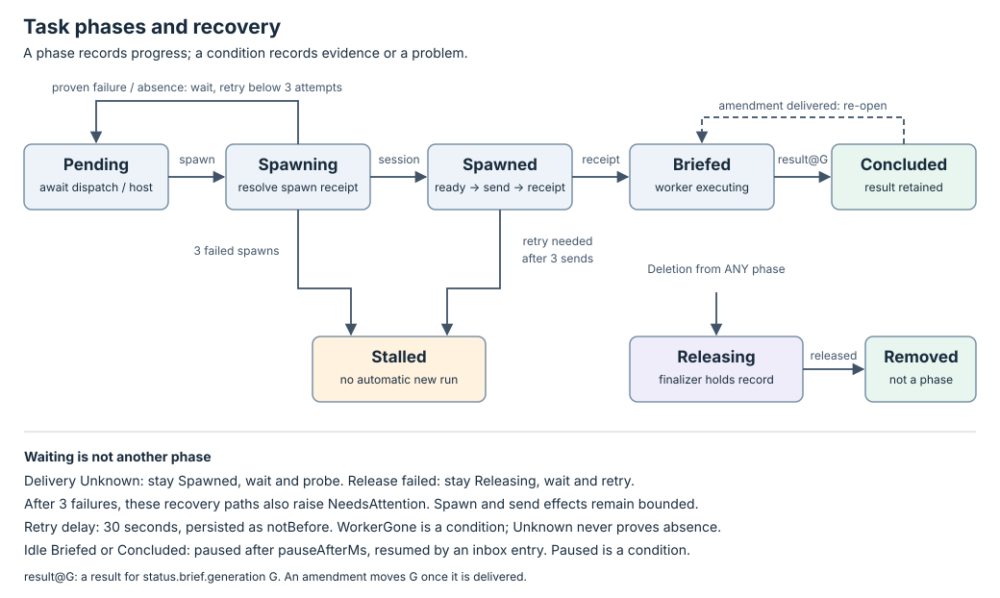

# Task controller

A Task runs one agent session for one brief. Its controller decides the next
step from stored Task state and explicit observations. The manager performs
that decision through the store and runtime ports.

| Read | Answers |
| --- | --- |
| [Task](../resources/task.md) | What do I apply, inspect and report as a worker? |
| [Session](../resources/session.md) | What is the agent a Task runs, and what does `sessionState` say about it? |
| [TaskConfig](../resources/task-config.md) | How do reusable defaults and frozen launches work? |
| [EnvProvider](../resources/env-provider.md) | How do stored/file/command environment sources work? |
| [Native config](../configuration.md#native-fleet-configuration-fleettoml) | How do I configure the store, runtime and model variables? |
| [State machine](#task-state-machine) | Which transitions, retries and recovery paths are possible? |
| [Interface](#task-controller-interface) | What are the inputs, outputs, ports and write ordering? |
| [Overall architecture](../architecture.md) | Where does this controller fit in Fleet? |

## One run

1. A person applies a Task. `dispatch: false` keeps it Pending.
2. A caller runs `fleet reconcile`. For a dispatched Task on a reachable host,
   the controller plans a spawn under a deterministic session key.
3. The manager persists the intent, runs the effect and persists its receipt.
   Later passes recover ambiguous effects by their keys.
4. A ready session receives its brief in its agent's own inbox. It counts
   as delivered once the agent's prompt hook reports it through
   `fleet signal`; a lost answer waits for that report and is never sent
   again ([proven delivery](#proven-delivery)). Messages
   queued with `fleet send` follow the same way, oldest first, one per pass,
   each under its own key. A working turn receives them too.
5. The worker reports through `fleet result`. The controller concludes the
   Task, retaining the session until deletion; messages sent afterwards are
   still delivered.
6. With `pauseAfterMs` set, the controller pauses an idle session through
   the runtime. The next inbox entry resumes it. See
   [pausing an idle session](#pausing-an-idle-session).
7. Deletion enters Releasing. The finalizer holds the record until the
   recorded session is released, once proven at rest or gone.

`fleet reconcile` is a bounded command. It repeats passes while changes are
made, then exits at a fixed point or `--max-passes`. It does not sleep until a
retry deadline or run a background watch; the caller invokes it again.
`fleet up` is the resident alternative: it retains the manager lease and
periodically invokes bounded sweeps for all due Tasks, independently of agent
activity. Its default VEGA session is an ordinary Task from the bundled
starter. See [bootstrap and recovery](../configuration.md).
`NeedsAttention` is a condition, not a phase: delivery reads and releases can
recover while attention is raised. See the [state machine](#task-state-machine)
for the distinction between bounded sends and continuing recovery attempts.

## Implementation and evidence

| Responsibility | Source | Tests |
| --- | --- | --- |
| Pure decisions and requested probes | [TaskController](../../../crates/fleet-controllers/src/task.rs) | [Controller transitions](../../../crates/fleet-controllers/tests/task_controller.rs) |
| Resource and effect types | [Task types](../../../crates/fleet-api/src/task.rs), [plans](../../../crates/fleet-api/src/plan.rs) | [CLI lifecycle](../../../crates/fleet-cli/tests/e2e_task_lifecycle.rs) |
| Lease, status, intent and receipt ordering | [Manager](../../../crates/fleet-manager/src/lib.rs) | [Store contract](../../../crates/fleet-store/tests/store_contract.rs), [CLI lifecycle](../../../crates/fleet-cli/tests/e2e_task_lifecycle.rs) |
| Session definition and observed state | [Session](../../../crates/fleet-api/src/session.rs), [TaskController](../../../crates/fleet-controllers/src/task.rs) | [Session unit tests](../../../crates/fleet-api/src/session.rs), [Controller transitions](../../../crates/fleet-controllers/tests/task_controller.rs), [CLI lifecycle](../../../crates/fleet-cli/tests/e2e_task_lifecycle.rs) |
| Session identity and the runtime protocol | [Exec runtime](../../../crates/fleet-runtime/src/exec.rs) | [Exec runtime E2E](../../../crates/fleet-cli/tests/e2e_runtime_exec.rs) |
| Workspace trust before the brief | [Runtime port](../../../crates/fleet-api/src/runtime.rs), [Exec runtime](../../../crates/fleet-runtime/src/exec.rs), [harness profiles](../../../crates/fleet-api/src/harness.rs) | [Workspace trust E2E](../../../crates/fleet-cli/tests/e2e_workspace_trust.rs), [Controller transitions](../../../crates/fleet-controllers/tests/task_controller.rs) |
| Pausing an idle session and resuming it | [TaskController](../../../crates/fleet-controllers/src/task.rs), [runtime port](../../../crates/fleet-api/src/runtime.rs), [Fake runtime](../../../crates/fleet-runtime/src/fake.rs) | [Pause E2E](../../../crates/fleet-cli/tests/e2e_task_pause.rs), [Controller transitions](../../../crates/fleet-controllers/tests/task_controller.rs) |
| Inbox: `fleet send`, typed mutations and delivery | [Inbox types](../../../crates/fleet-api/src/inbox.rs), [verbs](../../../crates/fleet-manager/src/verbs.rs), [store](../../../crates/fleet-store/src/lib.rs) | [Inbox E2E](../../../crates/fleet-cli/tests/e2e_inbox.rs), [Store contract](../../../crates/fleet-store/tests/store_contract.rs), [Controller transitions](../../../crates/fleet-controllers/tests/task_controller.rs) |

The lifecycle E2E suite drives the built CLI from apply to result and release,
including crashes, failed attempts and Unknown observations. The exec runtime
E2E suite drives `runtime-mux` and a reference script: start and release,
signals, a revive on the reported conversation, and brief delivery.

## Task state machine

`status.phase` records execution progress. Conditions describe facts and
problems within that phase; an effect intent or a worker's result is not
proof of an external artifact landing. The
[controller interface](#task-controller-interface) defines the probes and effects used here.



### Transition rules

The manager only reconciles Tasks whose `notBefore` is absent or due. It
reconciles a Concluded Task only in these cases:

- Its inbox is nonempty.
- It is being deleted.
- Its session recheck is due: `status.sessionCheckedAt` is absent or 5
  minutes old.
- Its session may be paused: see
  [pausing an idle session](#pausing-an-idle-session). The manager then
  reconciles it on every sweep, so that its activity is watched.

Deletion takes precedence over normal progress, including Stalled and
Concluded. With no deletion, Stalled is terminal. Concluded is terminal
until a delivered amendment re-opens it. A Concluded Task is due again for
delivery and for the session recheck only.
A recorded worker result for `status.brief.generation` concludes an active
Task before its ordinary phase logic runs. A result for an older generation
concludes nothing.

| Current phase | Observation or input | Next phase | Decision |
| --- | --- | --- | --- |
| Pending | `dispatch: false` | Pending | Set `Spawned=False/AwaitingDispatch`; do not spawn. |
| Pending | Dispatched; host false, Unknown or unanswered | Pending | Report host condition; do not spawn. |
| Pending | Dispatched; host reachable; Fleet makes the workspace and `status.workspace` is empty; no materialize in flight | Pending | Increment materialize attempt; set `WorkspaceReady=Unknown/Materializing`; persist the intent and plan `Materialize` under the workspace key. |
| Pending | Known `Materialized` receipt, or a missing/Unknown receipt with the workspace key found | Spawning | Record `status.workspace`; set `WorkspaceReady=True` (`Materialized` or `Adopted`); plan Spawn with the workspace as `ready`. |
| Pending | Known failure, or a missing/Unknown receipt with the workspace key proven absent; attempts below 3 | Pending | Set `WorkspaceReady=False/MaterializeRetry`; wait, then materialize again under the next key. |
| Pending | Known `Unmapped` materialize receipt | Pending | Give the attempt back; raise `NeedsAttention/RepositoryUnmapped`; wait, then materialize again. |
| Pending | Same failure with 3 materialize attempts spent | Stalled | Set `WorkspaceReady=False/MaterializeFailed`; raise `Stalled/MaterializeAttemptsExhausted` and NeedsAttention. |
| Pending | Missing/Unknown materialize receipt; workspace key unreadable | Pending | Set `WorkspaceReady=Unknown/WorkspaceUnreadable`; never materialize again blindly. |
| Pending | Dispatched; host reachable | Spawning | Increment spawn attempt; persist spawn intent and plan Spawn. |
| Spawning | Known Spawned receipt | Spawned | Record returned SessionRef. |
| Spawning | Missing/Unknown receipt; session key found | Spawned | Adopt the session and recover its receipt. |
| Spawning | Known failure, or ambiguous outcome with key proven absent; attempts below 3 | Pending | Schedule a wait before another spawn. |
| Spawning | Known `Unmapped` receipt | Pending | Give the attempt back; set `Spawned=False` and NeedsAttention, both `RepositoryUnmapped`; schedule a wait, then spawn again under the same key. |
| Spawning | Known `TrustUnmapped` receipt | Pending | As for `Unmapped`, with reason `TrustUnmapped`. |
| Spawning | Same failure with 3 spawn attempts spent | Stalled | Raise `Stalled/SpawnAttemptsExhausted` and NeedsAttention. |
| Spawning | Missing/Unknown receipt; session list unreadable | Spawning | Report Unknown; never infer absence or respawn blindly. |
| Spawned | Readable lookup lacks the recorded session identity | Spawned | Raise WorkerGone and NeedsAttention; do not send. |
| Spawned | `spec.brief` is empty: an interactive Task | Spawned | Set `Briefed=False/Interactive`; send nothing, deliver the inbox, and wait for the user. The Task stays Spawned. |
| Spawned | Known Queued receipt for the brief | Spawned | Set `Briefed=False/BriefUndelivered` and raise `NeedsAttention/BriefUndelivered` with the runtime's note. Never send the brief again, and deliver no inbox entry. |
| Spawned | Known Delivered receipt, and the agent's prompt hook reported the brief (or its harness has none); or, with the answer lost, the hook reported it, or for a harness with no prompt hook the journal proves it | Briefed | Record the brief key and the generation of the brief intent; a recovered delivery becomes a receipt. |
| Spawned | The brief was sent, or may have been, and the agent's prompt hook has not reported it, or its report cannot be read | Spawned | Set `Briefed=Unknown/AwaitingPrompt`. Never send it again; read the hook's report on the next pass. |
| Spawned | Workspace trust Known untrusted | Spawned | Set `WorkspaceTrusted=False` with the gap as reason, raise `NeedsAttention/WorkspaceUntrusted`, wait, then probe again. Do not send. |
| Spawned | Workspace trust Unknown | Spawned | Set `WorkspaceTrusted=Unknown/TrustUnknown`. Do not send and raise no attention. Probe again on the next pass, without a wait. |
| Spawned | Workspace trust unanswered | Spawned | Do not send. Change nothing. |
| Spawned | No brief intent yet, or delivery proven absent; workspace trusted; fresh readiness true; fewer than 3 sends spent | Spawned | Set `WorkspaceTrusted=True/Trusted` and clear its attention. Persist brief intent and plan Brief, with the brief and every amendment so far as one message, for the current generation. A later pass consumes its receipt. |
| Spawned | Session not ready or readiness Unknown | Spawned | Do not send, including on a retry. Receipt recovery may still proceed. |
| Spawned | Delivery unreadable after an ambiguous send | Spawned | Wait, then probe again; after 3 unreadable probes raise NeedsAttention. |
| Spawned | Another send would exceed the 3-send bound | Stalled | Raise `Stalled/BriefAttemptsExhausted` and NeedsAttention. |
| Briefed | No result for `status.brief.generation`; recorded session present or lookup unreadable | Briefed | Wait for result; Unknown does not mean WorkerGone. |
| Briefed | No result for `status.brief.generation`; readable lookup lacks recorded identity | Briefed | Raise WorkerGone and NeedsAttention; never abandon or respawn. |
| Spawned, Briefed, or Concluded with a delivery due | Session lost: the runtime holds the session, but its agent's window is gone | unchanged | Set `SessionLost=True/WindowGone`. Send nothing. With `dispatch: true`, persist a revive intent and plan `Revive` under `revive/<n>`. A held Task is not revived. |
| Spawned, Briefed, or Concluded with a delivery due | Still lost after a revive | unchanged | Wait 30 seconds from the last revive, then revive again. After three revives have left the session lost, each further revive also raises `NeedsAttention/ReviveFailed`. |
| Spawned, Briefed, or Concluded with a delivery due | Not lost while `SessionLost` is True | unchanged | Set `SessionLost=False/Revived`. When the brief has a receipt, owe a catch-up note under `catchup/<n>`. In Spawned, the brief protocol continues. |
| Briefed or Concluded | A catch-up note is owed | unchanged | Send the note as an inbox entry is sent, before any inbox entry. In Briefed, the note repeats the brief, the amendments the worker has, and their generation. |
| Briefed, or Concluded and watched | A pause setting; the agent's hooks report Idle without a break for `pauseAfterMs`; the session observed running and not known lost; nothing to deliver or in flight | unchanged | Persist a pause intent and plan `Pause` under `pause/<n>`. See [pausing an idle session](#pausing-an-idle-session). |
| Briefed or Concluded | Known Paused receipt, or a missing/Unknown receipt with the session observed stopped | unchanged | Set `Paused=True/Idle`. Raise no WorkerGone, SessionLost or revive. |
| Briefed or Concluded | Failed pause receipt, or a missing/Unknown receipt with the session observed running | unchanged | Set `Paused=False/PauseFailed`. The idle time starts again. |
| Briefed, or Concluded with a delivery due or watched | Session observed stopped and Fleet did not stop it | unchanged | Set `Paused=True/External`. |
| Briefed or Concluded | Paused; an inbox entry to deliver; `dispatch: true` | unchanged | Persist a resume intent and plan `Resume` under `resume/<n>`. Send nothing. |
| Briefed or Concluded | Known Resumed receipt, a missing/Unknown receipt with the session observed running, or a paused session observed running | unchanged | Set `Paused=False/Resumed`. When the brief has a receipt, owe a catch-up note under `catchup/<n>`. |
| Briefed or Concluded | Failed resume receipt, or a missing/Unknown receipt with the session observed stopped | unchanged | Wait 30 seconds from the last resume, then resume again. After three resumes have left the session stopped, each further resume also raises `NeedsAttention/ResumeFailed`. |
| Active phase | Accepted worker result for `status.brief.generation` is stored | Concluded | Set `Concluded=True/ResultRecorded`; keep the session. |
| Spawned, Briefed or Concluded | Oldest inbox entry has no receipt; session ready; nothing else sent this pass | unchanged | Persist the entry's intent and plan `Brief` under its key; one entry per pass. In Spawned the brief goes first: nothing is delivered before the brief was sent, or while a brief send is unconfirmed. |
| Spawned, Briefed or Concluded | Oldest inbox entry; session not ready or Unknown | unchanged | Do not send. Receipt recovery through `BriefDelivered` may still proceed. |
| Spawned, Briefed or Concluded | Known Delivered receipt and the agent's prompt hook reported the entry (or its harness has none); or, with the answer lost, the hook reported it, or for a harness with no prompt hook the journal proves it | unchanged | Record the receipt in `status.deliveries` with the runtime's route, and remove the entry, in one write; its intent, receipt and attempt records go with it. Until the hook reports it, the entry waits, is never sent again, and later entries wait behind it. |
| Spawned, Briefed or Concluded | Known Queued receipt for an entry or a catch-up note | unchanged | Mark it failed and raise `NeedsAttention/DeliveryQueued` with the runtime's note. Never send it again. The entry stays in `status.inbox`, and later entries are still delivered. |
| Spawned, Briefed or Concluded | Oldest entry is an amendment at or below `status.brief.generation`, or one never sent with a newer amendment queued behind it | unchanged | Record its receipt without a send. The worker has it already, or the newer message carries it. |
| Briefed | Amendment entry delivered | Briefed | Set `status.brief` to the entry's key and generation. |
| Concluded | Amendment entry delivered | Briefed | Set `status.brief` to the entry's key and generation, and `Concluded=False/Amended`. Keep the old result. |
| Spawned, Briefed or Concluded | Entry send refused (Known failure) | unchanged | Wait, then send again under the same key to a session observed ready; at most 3 sends. |
| Spawned, Briefed or Concluded | Entry delivery unreadable after an ambiguous send | unchanged | Wait, then read the journal again. After 3 unreadable reads, raise `NeedsAttention/DeliveryUnconfirmed` naming the entry. The entry stays, marked failed, and is never sent again. Later entries are still delivered. |
| Spawned, Briefed or Concluded | A fourth send of one entry would be needed | unchanged | `NeedsAttention/DeliveryFailed` naming the entry; the entry stays, marked failed, and later entries are still delivered. |
| Spawned, Briefed or Concluded | More than 20 entries still to deliver, not counting entries given up on | unchanged | `NeedsAttention/InboxFull`; cleared once the count is back within the bound. |
| Concluded | Empty inbox; session recheck due; lookup answered | Concluded | Record `sessionCheckedAt`; the next recheck is due 5 minutes later. |
| Concluded | Readable lookup lacks the recorded session | Concluded | `WorkerGone` and `NeedsAttention`; never a respawn. |
| Stalled | Any inbox entry | Stalled | Nothing is delivered; Stalled has no session to deliver to. |
| Any phase | Task marked deleting | Releasing | Resolve spawn ambiguity if needed; release only once at rest or proven absent. A deleting Task delivers nothing. |
| Releasing | Busy session or unreadable rest/lookup evidence | Releasing | Keep finalizer; wait for safe evidence. |
| Releasing | Failed, missing or Unknown release receipt | Releasing | Wait and retry; after 3 attempts also raise NeedsAttention. |
| Releasing | Known Released receipt, or nothing was spawned and nothing remains to release | Record removed | Remove finalizer; removal is not another phase. |

A Spawned phase without a SessionRef is an invalid internal combination; the
controller returns it to Pending instead of sending to nobody. Normal store
and controller paths record identity before entering Spawned.

### Retries and recovery

`MAX_ATTEMPTS=3` bounds spawn effects and brief sends. `RETRY_DELAY_MS=30000`
is a fixed wait, persisted as `status.notBefore` across process restarts.
These are controller constants, not extra configuration resources.

| Situation | Evidence required before proceeding | Wait and exhaustion behavior |
| --- | --- | --- |
| Spawn failed or was proven absent | A failure receipt, or readable key lookup after an ambiguous spawn | Wait before the next attempt; after the third failed attempt enter Stalled. |
| Workspace not trusted | A Trusted answer on a later pass | Wait before each probe. A held brief is not a send and spends no attempt; the Task never stalls on it. |
| Brief send refused | Known failure before confirmed delivery | Wait before retry; every retry needs fresh readiness; at most 3 sends. |
| Brief send answer missing/Unknown | The agent's prompt hook report of the brief's digest; for a harness with no prompt hook, the session's journal under the original brief key | Reported or Delivered recovers without sending; only a journal can prove it not delivered, which permits a ready-session send; an unreported or Unknown answer waits and reads again, never resends. |
| Delivery journal unreadable | A later readable journal answer | After 3 failures raise NeedsAttention, but keep probing after each wait. Recovery clears BriefUnconfirmed attention. |
| Release answer missing/Unknown or failed | Recorded session at rest, or key proven absent; adapter preserves exact identity | Wait once per failed attempt, then retry. After 3 attempts raise NeedsAttention but continue; success releases the finalizer. |
| Session lookup unreadable | A later readable lookup | Unknown is not absence and does not by itself trigger WorkerGone or permit a blind spawn. |
| Session lost | A Known lost answer; Unknown revives nothing | Revive at once, then wait before each further revive. After three revives have left the session lost, raise NeedsAttention, and continue: a revive leaves a running session alone. |
| Pause answer missing/Unknown | Whether the session is stopped | Stopped records the pause. Running records a failed pause. Unknown waits; the stop is never repeated blindly. |
| Resume refused, or answer missing/Unknown | Whether the session is stopped | Running records the resume. Stopped resumes again after a wait. Unknown waits. After three resumes have left the session stopped, raise NeedsAttention, and continue: a resume leaves a running session alone. |
| Catch-up note send refused or answer missing/Unknown | As for an inbox entry, under the note's key | At most 3 sends, then `DeliveryFailed` naming the note. After 3 unreadable reads, `DeliveryUnconfirmed` naming it. Either way the inbox goes next. |
| Inbox entry send refused or answer missing/Unknown | As for the brief, under the entry's key: a failure receipt, or the journal's answer | Wait before retry; every retry needs fresh readiness; at most 3 sends per entry, then `DeliveryFailed` and the next entry. Unknown journal reads continue after each wait; the third raises `DeliveryUnconfirmed` and the next entry goes. |

A single brief key is reused so retrying a proven-undelivered brief does not
create a new delivery identity, and each inbox entry's key is reused the same
way. A send whose answer is lost is never repeated until a proof says that
the text did not arrive. A key reused by a different
session is not proof that the original worker is alive and does not transfer
at-rest proof to that replacement.

`fleet reconcile` exits at a fixed point; it does not wait for `notBefore`.
Invoke it again after the deadline. Stalled Tasks do not retry automatically;
unreadable-delivery and release recovery continue on later due invocations.
A different brief or a fresh run requires a new Task. An addition to the
brief is an amendment, through `fleet amend`; a Stalled or deleting Task
refuses one. Changing `dispatch` does not clear attempt counters or revive a
Stalled Task.

### Conditions

Each condition carries `status` (True, False or Unknown), `reason`, `message`,
`observedGeneration` and `lastTransitionTime`. The transition timestamp is
retained when its status has not changed against stored state. Conditions
are last recorded observations; absence of a condition is not a True value.

| Type | True means / relevant reason |
| --- | --- |
| HostReachable | The host answered reachable during the dispatch check. |
| WorkspaceReady | The workspace Fleet makes is whole: `Materialized` or `Adopted`. Unknown while `Materializing`, `WorkspaceUnreadable`, `Cleaning` or `CleanRetry`. False with `MaterializeRetry`, `MaterializeFailed`, `RepositoryUnmapped` or, after the release, `Cleaned`. Absent for a `dir` workspace. |
| Spawned | The spawn returned a session or the controller adopted its key. |
| Briefed | The brief has a `ReceiptWritten` or `ReceiptRecovered` record. |
| Stalled | `MaterializeAttemptsExhausted`, `SpawnAttemptsExhausted` or `BriefAttemptsExhausted`. |
| WorkerGone | A readable lookup no longer shows the recorded identity under its key (`SessionGone`). |
| Concluded | A worker result for `status.brief.generation` was accepted and observed (`ResultRecorded`). False with `Amended` after a delivered amendment re-opened the Task. |
| Released | A known release completed, or there was nothing to release. |
| WorkspaceTrusted | The session's agent trusts its workspace (`Trusted`). False reasons are `Unsupported` and `Mismatch`; Unknown is `TrustUnknown`. |
| SessionLost | The runtime holds the session, but its agent's window is gone (`WindowGone`). False after a lost session is back (`Revived`). |
| Paused | The runtime holds the session with its agent stopped. `Idle` when Fleet paused it; `External` when Fleet found it stopped. False with `Resumed` once the agent runs again, and with `PauseFailed` after a pause that did not happen. The phase does not change. |
| NeedsAttention | Reason is Stalled, WorkerGone, BriefUnconfirmed, ReleaseFailed, DeliveryFailed, DeliveryUnconfirmed, DeliveryQueued, BriefUndelivered, InboxFull, RepositoryUnmapped, TrustUnmapped, WorkspaceUntrusted, ReviveFailed, ResumeFailed or CleanFailed. |

WorkerGone clears when the exact recorded session is seen again.
RepositoryUnmapped clears when a later spawn does not answer Unmapped.
TrustUnmapped clears when a later spawn does not answer TrustUnmapped. A successful
delivery recovery clears attention whose reason is BriefUnconfirmed. A
delivery clears attention whose reason is DeliveryUnconfirmed while no
entry is marked failed. An inbox drained back within its bound clears InboxFull.
A Trusted answer clears WorkspaceUntrusted.
BriefUndelivered and DeliveryQueued stay until a person acts on the Task.
ReviveFailed clears when the session is seen not lost.
ResumeFailed clears when the session is seen running.
DeliveryFailed and DeliveryUnconfirmed stay while a failed entry does. A
successful release removes the Task; a worker result alone is not a general
reset of previous conditions. NeedsAttention does not universally stop the
controller: its reason and phase determine what continues. Delivering an
inbox entry changes no phase and no condition other than `NeedsAttention`
(`InboxFull`, `DeliveryFailed`, `DeliveryUnconfirmed`, `DeliveryQueued`). A
delivered amendment also re-opens a Concluded Task, with `Concluded=False/Amended`.

### After a host reboot

A host reboot ends every agent process. The Task keeps its session, brief
record, counters and conversation. Its workspace stays on disk. When the
runtime still holds the session's key with its process exited, `lost`
answers true. Fleet then resumes the work in the same session:

```text
fleet up starts ──> sweep ──> Lost? ─yes─> Revive (same id, same worktree, conversation resumed)
                                │                │
                                no               v
                                │          next pass: not lost ──> SessionLost=False/Revived
                                v                                    │
                       normal protocol                 Briefed: catch-up note + brief, generation unchanged
                                                       Concluded: catch-up note, then the waiting inbox
```

- Spawned, Briefed and unconcluded Tasks are revived on the first sweep.
- A Concluded Task is revived only when its inbox has an entry for it.
  Change requests the worker declared are still followed. Their feedback
  arrives as inbox entries.
- A held Task (`dispatch: false`) is never revived.
- A revive never creates a second session. The brief key is never sent
  again. The catch-up note has its own key and journal entry.
- The brief record keeps its generation. A result for another generation is
  still refused. An amendment that waits is delivered after the catch-up
  note.
- A deleting Task is released, not revived. A session with no window is at
  rest.
- A Task whose session row was deleted is `WorkerGone`, as before. Fleet
  does not respawn it.

The manager must run again after the reboot. See
[running `fleet up`](../configuration.md#running-fleet-up).

### Pausing an idle session

An idle session costs a process and a terminal while its Task waits. Fleet
pauses the session through the runtime and resumes it when work arrives. The
Task, its workspace and the agent's conversation stay.

A pause ends background work in the agent. A resumed agent does not start
its background shells, Monitors or loops again. For this reason, Fleet
pauses only on a Known Idle answer from the runtime.

```text
Briefed/Concluded ──Idle for pauseAfterMs──> Pause ──> Paused=True/Idle
        ^                                                   │
        │                                            inbox entry
        │                                                   v
  catch-up note, then the inbox <── Paused=False/Resumed <── Resume
```

The controller plans a pause when all of these hold:

- `pauseAfterMs` is set, on the Task or on its TaskConfig.
- `dispatch` is true, and the Task is not deleting.
- The phase is Briefed, or Concluded.
- The inbox holds no entry to deliver, and no catch-up note is owed.
- No brief, revive or resume waits for its outcome.
- The runtime can pause. The fake runtime can. The exec runtime cannot.
- The agent's own hooks reported Idle (`fleet signal idle`) on every pass
  for `pauseAfterMs`, and on the pass that plans the pause. `status.idleSince`
  records the first Idle answer. Active, Unknown, a pass that sent something, a recorded result or
  a pass that does not watch the session clears it.
- On that pass, the session is observed running and is not known lost.

These rules apply to a paused session:

- An inbox entry plans one resume. Entries that arrive meanwhile wait in the
  inbox. Delivery then waits for readiness, as before.
- A resumed worker is owed the catch-up note that a revived worker gets,
  before its inbox.
- A session stopped outside Fleet sets `Paused=True/External`. The next
  inbox entry resumes it.
- A paused session found running again sets `Paused=False/Resumed`.
- A pause never raises WorkerGone or SessionLost, and never revives.
- Stalled, held and deleting Tasks are never resumed.
- Deleting a paused Task releases it: a stopped session is at rest.
- A Concluded Task owed a catch-up note is not paused again until its next
  inbox entry delivers the note. A revived Concluded Task behaves the same
  way.

`pauseAfterMs` absent means that Fleet never pauses the session.

Activity comes from the agent's hooks, never from the runtime: see
[signals](#signals). A session whose hooks reported nothing, or whose
report cannot be read, has Unknown activity, so Fleet never pauses it.

### Signals

The [signal port](../../../crates/fleet-api/src/signal.rs) is how an agent
reports its state. Each spawn gets `FLEET_SIGNAL_FILE` in its environment:
`<data dir>/signals/<session key>.jsonl` for a session on this machine. The
agent's [harness profile](#harness-profiles) installs hooks that run
`fleet signal <state>`, which appends one JSON line to that file and does
nothing when the variable is unset:

| State | Claude Code hook | Codex | Means |
| --- | --- | --- | --- |
| `prompt` | `UserPromptSubmit` | the turn's `input-messages` at `notify` | the agent was given a text: its digest is recorded |
| `working` | `PreToolUse` | none | a turn runs |
| `idle` | `Stop`, `SessionStart` | `notify` (turn complete) | the turn ended; the agent waits. A `Stop` whose `background_tasks` or `session_crons` is not empty is stored as `working`: a stop would end that work |
| `blocked` | none | none | the agent waits for a person: not idle |

The hook's JSON (stdin, or the last argument for Codex's `notify`) gives
the prompt and the conversation id (`session_id`, `thread-id`). The
`Activity` probe reads the file through the port and answers both the
activity and the whole report. A file never written is a report of nothing;
a file that cannot be read is Unknown. A session on another host gets no
file: reading one there takes the runtime's `exec`, so what Fleet would
learn from it stays Unknown, and Unknown never concludes.

The controller records the last reported conversation in
`status.conversation`. A revive or a resume names it, so the runtime starts
the harness profile's resume argv.

### Proven delivery

A brief, an inbox entry or a catch-up note counts as delivered only once
the agent's prompt hook reports it, not when the runtime typed it. When the
controller plans the send it records the text's digest in
`status.prompts` under the send key, in the same write as the intent. Then:

- A Known Delivered receipt waits for the hook: `Briefed=Unknown/AwaitingPrompt`
  for the brief; an entry stays first in line.
- A lost answer is settled by the hook's report alone, as a recovered
  delivery. It is never sent again, whatever the runtime's journal says.
- A proven key's digest is dropped; its receipt stands.

A harness with no prompt hook (any but Claude Code and Codex) keeps the
runtime's answer, and its journal for a lost one.

### Harness profiles

[Harness profiles](../../../crates/fleet-api/src/harness.rs) own how each
agent is launched, resumed and trusted, so a runtime only runs an argv:

| Harness | Launch argv | Resume argv | Trust |
| --- | --- | --- | --- |
| `claude-code`, `claude` | `claude --settings <hooks>` and `--add-dir` per extra directory | the launch argv, then `--resume <conversation>` | its dialog is read from the screen and never answered |
| `codex` | `codex -c notify=… -c projects=<root>` and `--add-dir` per extra directory | `codex resume <conversation>` and the launch arguments | the `projects=` launch override, for this session only |
| any other | the harness name | the launch argv: a fresh start | none Fleet knows |

Claude Code's hooks report its start (`SessionStart`, as `idle`), each
prompt, each tool use and each turn's end, all in one `--settings`: Claude
Code keeps the last of several `--settings` rather than merging them, so a
second one would drop Fleet's hooks or the other's.

Codex has no start hook: its `notify` runs only once a turn ends. Before
that report, the `exec` kind reads its screen: the empty composer under its
welcome screen, with Codex in the foreground, is ready and trusted (its
launch override trusts the workspace).

The `exec` runtime kind and the fake runtime run the profile's argv.

### Deletion protocol

The [store](../../../crates/fleet-store/src/lib.rs) adds `fleet.dev/release` at
Task creation. `fleet delete` marks the Task, then reconciliation takes over.
No session ever spawned means nothing needs releasing. If a spawn was
interrupted before its receipt, the controller first looks up its key so it
cannot orphan an unknown session.

For a recorded session, the controller requires Known at-rest or readable
absence before planning Release. The finalizer remains while release is failed or ambiguous. It is removed
only after Known Released, or when there is no session to release.

When Fleet made the workspace, the release is followed by `CleanWorkspace`:

- The finalizer stays until the clean has a `Deleted` receipt.
- A failed or unknown clean is repeated after each wait. Three raise
  `NeedsAttention/CleanFailed`.
- A Task deleted before its materialize has a Known receipt looks the
  workspace key up first. An unreadable key holds the finalizer. The
session and its conversation/workspace may be deleted by the runtime, so a
worker result does not itself authorize release before Task deletion.

See [implementation and tests](#implementation-and-evidence) for the
fault, lease-loss and identity regressions that exercise these paths.

## Task controller interface

The controller is a pure decision function. The manager owns I/O, persistence
and process execution. The [state machine](#task-state-machine) defines how the
values below change the Task; the [resource](../resources/task.md) defines the external
JSON fields.

### Controller API

Source: [TaskController](../../../crates/fleet-controllers/src/task.rs) and
[plan types](../../../crates/fleet-api/src/plan.rs).

```rust
pub struct TaskInput<'a> {
    pub task: &'a Object,
    pub observations: Observations,
    pub now: Millis,
}

pub fn probes(&self, input: &TaskInput<'_>) -> Result<Vec<Probe>, StoreError>;
pub fn reconcile(&self, input: &TaskInput<'_>) -> Result<Plan, StoreError>;
```

The two methods belong to `TaskController`. `task` is the stored object,
including metadata, spec and status. `now` is Unix time in milliseconds,
supplied by the manager's `Clock`. Missing status decodes to the default
Pending state; malformed typed spec or status returns `StoreError::Invalid`.
Neither method reads the clock, disk, environment or runtime itself.

The manager starts with empty observations, asks `probes`, performs those
probes through `Runtime`, then calls `reconcile` with their answers. It skips
Tasks with a future `status.notBefore` before asking for any probe. It also
skips a Concluded Task whose inbox is empty, unless one of these holds:

- The Task is being deleted.
- Its session recheck is due: `status.sessionCheckedAt` is absent or 5
  minutes old.
- Its session may be paused, or a pause or resume waits for its outcome.

#### Requested probes

| Task state | Probes |
| --- | --- |
| Pending, `dispatch: false` | None. |
| Pending, `dispatch: true` | `Host { host }`; `FindWorkspace { host, key }` while a materialize has no Known receipt. |
| Spawning | `Find { host, key }`. |
| Spawned | `Find`; `Lost`, `WorkspaceTrust` and `Ready` for the recorded session; `BriefDelivered` when a brief intent exists without a known receipt, else the inbox probes below. |
| Briefed, no worker result for `status.brief.generation` | `Find`; `Lost`; `Paused`; the delivery probes below; `Activity` when the session may be paused. |
| Concluded, an inbox entry to deliver | `Find`; `Lost`; `Paused`; the delivery probes below. |
| Concluded, session recheck due | `Find`. |
| Concluded, session may be paused or a pause or resume in flight | `Find` when the recheck is due; `Lost`; `Paused`; `Activity` when the session may be paused. |
| Concluded otherwise, or Stalled | None. |
| Deleting, regardless of phase | `Find`; `AtRest` when a session is recorded; `FindWorkspace` while a materialize has no Known receipt. |

The inbox probes, for the oldest entry not given up on: `Ready` for the
recorded session, and `BriefDelivered` under the entry's key when it was
sent without a known receipt. The delivery probes are the same probes for
the catch-up note while one is owed, and the inbox probes otherwise. A
session may be paused when the conditions in
[pausing an idle session](#pausing-an-idle-session) hold,
apart from its activity.

`Observations` holds `host`, `find`, `ready`, `workspace_trust`,
`brief_delivered`, `at_rest`, `lost`, `paused`, `activity`, `signals` and
`workspace`. The manager answers `Activity` from the signal port, with the
activity and the whole report (`signals`); the probe is also asked while a
send waits for its prompt proof.
Each is optional: `None` means no answer was supplied, not a negative answer.
Each supplied answer is an [Observation](../../../crates/fleet-api/src/observation.rs):

| Value | Meaning | Safe inference |
| --- | --- | --- |
| `Known(true)` / `Known(false)` | A probe answered yes / no. | Use that specific answer for that specific probe. |
| `Known(Some(SessionRef))` | A readable lookup found a session under the key. | Adopt it while spawning; afterward compare it with recorded identity. |
| `Known(None)` from `find` | A readable lookup proved the key absent. | Handle absence; do not confuse it with an unreadable lookup. |
| `Unknown { why }` | A timeout, unreadable answer or ambiguous outcome. | Retain uncertainty and report why; never infer absence or success. |

#### Returned plan

```rust
pub struct Plan {
    pub status: Option<serde_json::Value>,
    pub effects: Vec<Effect>,
    pub remove_finalizer: Option<String>,
    pub delete: bool,                 // other controllers; TaskController leaves it false
    pub delivery: Option<DeliveryReceipt>,
    pub appends: Vec<InboxEntry>,     // other controllers; TaskController leaves it empty
    pub creates: Vec<Create>,         // other controllers; TaskController leaves it empty
}
```

| Field | Contract |
| --- | --- |
| `status` | Desired typed Task status serialized as JSON, including every new effect intent; `None` means unchanged. The worker-owned `result` and the unowned `inbox` are passed back as read. |
| `effects` | Ordered effects, each with a deterministic key and `Action`. The controller does not execute them. |
| `remove_finalizer` | Request to remove `fleet.dev/release` after the status and effects; present only for a deleting Task whose release is established. |
| `delivery` | An inbox entry proven delivered: `{key, at, recovered, deliveredVia, mayHold}`. `deliveredVia` is the runtime's route, when the send named one. `mayHold` is true when that route can hold the text behind an approval dialog; it raises no attention. The manager writes it with `status` as one record-and-remove mutation: the receipt into `status.deliveries`, the entry out of `status.inbox`. |

TaskController plans the actions `Spawn(SpawnSpec)`, `Brief { session,
text }`, `Release { session }`, `Revive { session }`, `Pause { session }`
and `Resume { session }`. SpawnSpec carries `host`, `key`, `harness`,
`workspace` (the Task's `dir` or `repositories`), optional `model`, the
private environment map and `environmentFrozen`. The
manager injects frozen values and prevents model-variable remapping before
performing a spawn; environment values are not persisted in effect intents.
`SessionRef` carries `id`, `host` and `key`; a later session
reusing a key does not inherit readiness or at-rest proof for the recorded id.

### Manager execution protocol

Source: [Manager](../../../crates/fleet-manager/src/lib.rs).

1. Acquire the manager lease and list Tasks. A list that is Unknown is not
   treated as an empty list.
2. For each due Task, renew the lease. For a dispatched Task with reusable
   configuration/environment, resolve or recover its private launch snapshot
   and persist its public identity before runtime probes/effects. Request and
   perform probes, renewing before each probe, then call the pure controller.
3. CAS-write planned status against the resourceVersion read, through the
   record-and-remove mutation when the plan carries a delivery. This
   persists intents before effects. A conflict drops this plan; no effect
   runs from it.
4. Renew before each effect, perform it, then persist its receipt. On a
   receipt conflict, reread current status and retry that receipt write so a
   concurrent worker result is preserved.
5. If requested, remove the finalizer with CAS and the current lease. The
   store removes the deleting record when no finalizers remain.
6. Repeat passes while changes or conflicts occur, up to `max_passes`, then
   release the lease when still owned. An idle report means no change in the
   last pass; it is not proof that every Task concluded.

`Manager::run(RunOptions)` returns `Result<RunReport, StoreError>`.
`RunOptions` holds `max_passes` and `lease_ttl`. The report carries counts,
`idle`, per-Task `errors` and `unknowns`. Lease loss ends the run; other
per-Task errors are reported rather than counted as successful progress.

`Manager::serve(RunOptions, wait)` retains one lease across bounded sweeps.
The edge supplies the wait/shutdown callback; controller scheduling still uses
persisted `notBefore`. `fleet up` supplies native signal handling and polling,
prints changed errors/unknowns, and stops on lease loss. A normal stop releases
the lease; a crashed process leaves an expiring lease. Neither stop deletes
Tasks or sessions. Bootstrap Task creation uses the manager's `ensure_task`
verb, retaining an existing Task's immutable inputs and identity.

The CLI's default lease is at least 30 seconds and twice the longest
operation bound of the configured ports (runtime, forge, gateway, plugins).
An explicitly supplied lease must exceed that bound. A file-store
lease fences store writes and checks before effects; it cannot cancel an
external action already started. Recovery relies on stable runtime keys.

### Runtime port

Source: [Runtime](../../../crates/fleet-api/src/runtime.rs). Every call acts on
one Session, defined in [session](../../../crates/fleet-api/src/session.rs):
the agent a Task owns, named by `SessionRef`. All session operations
return `Observation<T>`; a refused effect is
`Known(EffectOutcome::Failed { why })`, distinct from an Unknown outcome.

| Method | Input | Answer |
| --- | --- | --- |
| `operation_bound` | None | Worst-case duration of one session operation, including timeout and cleanup grace, in milliseconds. |
| `prepare_execution` | Resolved execution | The execution to freeze, unchanged by default, or Unknown. |
| `env_source` | Explicit file/command source | Bounded manager-local JSON string map, or redacted Unknown. |
| `host` | Host name | Whether the runtime can reach it. |
| `spawn` | `SpawnSpec`, with `ready` when Fleet made the workspace | `Spawned { session, adopted }`, `Unmapped { url }` for a repository the runtime has no source for, `TrustUnmapped { harness }` for a harness it knows no workspace-trust interface for, or Failed/Unknown. |
| `find` | Host and session key | Optional session under that key, or Unknown. |
| `ready` | `SessionRef` | Whether the session's agent can take a message now. A working turn can take one; a dialog that holds the agent cannot. |
| `workspace_trust` | `SessionRef`, the Task's workspace and the `ready` workspace Fleet made, if any | `Trusted { how }`, `Untrusted { gap, why }` with gap `Unsupported` or `Mismatch`, or Unknown. |
| `brief` | Session, text and intent key | `Delivered { already, via, may_hold }`, `Queued { why }`, or Failed/Unknown. `via` names the runtime's route. `may_hold` is true when the route can hold the text behind an approval dialog. `Queued` means the runtime kept the text where its agent does not read it. |
| `brief_delivered` | Session and intent key | Whether that brief was delivered, or Unknown. |
| `at_rest` | `SessionRef` | Whether it is safe to release that recorded session, or Unknown. |
| `release` | `SessionRef` | `Released` if deleted or proven absent, or Failed/Unknown. Repeating a completed release is a no-op. |
| `lost` | `SessionRef` | Known true only when the runtime holds the session and proves its agent's window gone, and nobody stopped it. Known false for a running or stopped session. |
| `revive` | `SessionRef` and the reported conversation | `Revived` after the runtime started the lost session's agent again in its own workspace and conversation, under the same identity, or Failed/Unknown. A running session is left alone, so a repeat is harmless. |
| `can_pause` | None | Whether the runtime can pause and resume a session. False by default. Fleet never pauses on a runtime that cannot. |
| `paused` | `SessionRef` | Known true when the runtime holds the session with its agent stopped, by Fleet or anyone else. Known false for a running or lost session. |
| `pause` | `SessionRef` | `Paused` after the runtime stopped the agent and kept its row, workspace and conversation, or Failed/Unknown. A stopped session is left alone. |
| `resume` | `SessionRef` and the reported conversation | `Resumed` after the runtime started the stopped agent again in its own workspace and conversation, under the same identity, or Failed/Unknown. A running session is left alone, so a repeat is harmless. |
| `create_dir` | Host and directory | `Ok(true)` when made, `Ok(false)` when it existed, `Err` with why, or Unknown. Used for a conversation Task's thread directory. |
| `remove_dir` | Host and directory | `Ok(())` when removed or absent, `Err` with why, or Unknown. |

The exec adapter runs each call as one bounded `<program> <verb>` of the
[runtime protocol](../../runtime/README.md#the-runtime-protocol) through
`fleet-exec`. Its session key and id are `<keyPrefix>.<uid>`, so a restart
keeps the id. `brief` is `input` of the text with a submit, answered as
`Delivered` with the route `input`, which may hold the text behind a dialog.
The adapter cannot read a brief back: `brief_delivered` is Unknown, and the
agent's prompt hook proves the delivery. `lost` is a key whose process
exited. A key the runtime no longer holds is Unknown, since a `stop` also
leaves none. `revive` and `resume` start the harness profile's resume argv
under the same key. A running agent is at rest once its hooks last
reported idle. An exited or absent one is at rest. `release` is `stop` with
`release: true`. The adapter cannot pause.

The fake adapter provides persisted sessions and faults without starting an
agent. Explicit provider commands still run through the same bounded executor
with either adapter; command resolution requires a lease above 20000 ms and
renews it per source. Both implement the same port; neither is called from
pure code.

#### Workspace port

Source: [Workspaces](../../../crates/fleet-api/src/workspace.rs). The CLI
always wires this port: the `[workspaces]` section picks the adapter, and
without one it is the default (see the [workspace
contract](../contracts.md#workspace-contract), which states the adapter
rules). `TaskInput.materialize` is false only for a manager built without
the port, and the controller then plans no workspace effect.

| Method | Input | Answer |
| --- | --- | --- |
| `operation_bound` | None | Worst-case duration of one call, in milliseconds. The lease must outlast it. |
| `materialize` | Host, workspace key and the Task's repositories | `Materialized { workspace, adopted }`, `Unmapped { url }`, or Failed/Unknown. |
| `find` | Host and workspace key | The whole workspace under the key, `Known(None)` when none is whole, or Unknown. |
| `clean` | `WorkspaceRef` | `Deleted`, also for a workspace already gone, or Failed/Unknown. |

The controller asks `FindWorkspace` only while a materialize has no Known
receipt. The manager performs `Materialize` and `CleanWorkspace` as it
performs a spawn: intent first, then the effect, then the receipt.

#### Workspace trust

Workspace trust is an agent's own gate on a folder's project settings. It is
not a permission policy, and it approves no tool action. The controller sees
only the port's answer and knows no harness.

- `Trusted` lets the brief proceed to the readiness check.
- `Untrusted` holds the brief and asks a person, with the adapter's `why`.
- Unknown holds the brief. It asks nobody, because it proves nothing.

The exec adapter reads the agent's signals, then its screen. The
[runtime contract](../contracts.md#workspace-trust) lists what each answer
proves. The fake adapter answers from each session's
`trusted` flag and its `workspaceTrust` fault.

### Store port and write ownership

Source: [Store](../../../crates/fleet-api/src/store.rs) and
[worker verbs](../../../crates/fleet-manager/src/verbs.rs).

| Writer | May change | Required fencing |
| --- | --- | --- |
| `apply` | New served resources, labels and permitted spec changes; request deletion. Never `spec.amendments`. | Store validation, exclusive creation or resourceVersion CAS for spec updates. |
| `worker` | `status.result` through `record_result` | Current resourceVersion, `status.brief.generation`, no amendment waiting, and the output types declared up to that generation. |
| `cli` | Appends to `status.inbox` through `send`. Appends to `spec.amendments` and `status.inbox` together through `amend_task`. | Current resourceVersion. No lease: the CLI calls a manager verb. |
| `plugin/<name>` | Appends to `spec.amendments` and `status.inbox` together through a plan's `amends[]`, with `amend_task`'s checks. | The Task's `uid`, `ifGeneration`, the plugin's `tasks` scope and live manager lease. |
| `forge-controller` | `status.forge`; appends to `status.inbox`, both through `record_relay` | Current resourceVersion and live manager lease. |
| `task-controller` | Other Task status, `status.deliveries` and the release finalizer; removes delivered `inbox` entries | Current resourceVersion and live manager lease. |

The worker's `status.declared` is written through `declare`, with the same
fencing as `record_result`. `status.inbox` has no owner. It is reached only
through three typed mutations, `append_inbox`, `record_relay` and
`record_delivery`, each named by its caller (`kinds::may_append_inbox`,
`kinds::may_record_relay`, `kinds::may_record_delivery`), with the rules the
store enforces: no duplicate key across `inbox` and `deliveries`, no
`about.revision` at or below the mirror's highest delivered one, no append
while more than 20 entries are still to deliver (entries given up on do not
count) or the Task is deleting, and no
other field of the Task changed by any of them. A plain `update_status` that
changes `inbox` is refused whoever writes it.

The amend mutation is the only write to `spec.amendments` and the only write
that queues an entry with `amends`. `fleet amend` reaches it through
`amend_task`, and a plugin through its plan's `amends[]` verb. In one CAS
write it appends the amendment, increments `metadata.generation` to the
amendment's generation and queues the entry under
`task/<name>/<uid>/amend/<generation>`, with the inbox's checks. It
refuses a deleting or Stalled Task. `update_spec`, and so `apply` and a
plugin patch, refuses any change to `spec.amendments`, and a create refuses a
Task that carries any.

`Store` supplies `get`, `list`, `create`, `update_spec`, `update_status`,
`append_inbox`, `amend_task`, `record_relay`, `record_delivery`, `delete`, `delete_fenced`,
`remove_finalizer`, validation and lease acquire/renew/release.
Private `launch`/`freeze_launch` methods recover or exclusively freeze launch
data under Task UID, separately from resources. Freezing checks Task UID,
resourceVersion and manager lease; final Task deletion removes the snapshot.
Reads return Known/Unknown; writes return values or `StoreError`. The store
checks ownership, CAS and lease tokens at the write boundary, including when
a holder name is reused with a newer token. Lease-free worker writes do not
permit controller fields to change.

### Intent, receipt and recovery keys

| Item | Stable identity / stored fields |
| --- | --- |
| Session key | `<name>.<uid>`; the uid prevents a recreated Task adopting an earlier Task's session. |
| Spawn effect | `task/<name>/<uid>/spawn/<attempt>`. |
| Brief effect | `task/<name>/<uid>/brief`, reused for every permitted send of that one brief. |
| Inbox entry | Its own `key`, reused for every permitted send of it: `task/<name>/<uid>/send/<n>` for `fleet send`, `n` the resourceVersion the append was made against; `task/<name>/<uid>/amend/<generation>` for `fleet amend`; `task/<name>/<uid>/relay/<change uid>/<revision>` for a forge relay; `task/<name>/<uid>/plugin/<plugin>/<key>` for a plugin's append; `task/<name>/<uid>/gateway/<conversation uid>/<revision>` for a chat relay; `task/<name>/<uid>/gateway/child/<child uid>/<item>` for a child's words. |
| Release effect | `task/<name>/<uid>/release/<attempt>`. |
| Intent | Action name, timestamp and generation, stored under the effect key. The brief's receipt records the generation of its intent. |
| Receipt | Action name, timestamp and `Observation<EffectOutcome>`, stored under the effect key. |

An intent without a receipt means the action may have happened. Spawn looks
up its session key, brief and inbox delivery read the delivery journal under
their keys, and release confirms absence or retries after the persisted wait.
Once an inbox entry's receipt is recorded in `status.deliveries`, its
intent, effect receipt and attempt record are removed with it, so a Task's
status stays bounded however many messages it is sent. The
[state machine](#retries-and-recovery) defines each decision.

### The second controller over the Task

The [Forge controller](forge.md#forge-controller-interface) extends this
interface without changing what exists:

- ForgeController has its own due gate (`ForgeController::due`: a
  declaration without an entry, or a following entry whose `notBefore` is
  absent or due) and runs after this controller on each sweep, from a fresh
  read of the Task, owning `status.forge` and appending to `status.inbox`.
  Its plan names no other Task field and adds no finalizer; its one effect,
  `MarkReady`, carries its intent and receipt on the entry, apart from this
  controller's.
- `Probe::Object { kind, name }` is answered by the manager from the store
  before any runtime or forge probe, and `Probe::Whoami { host }` through
  the `Forge` port, cached for the sweep, as `Probe::Change { change }` is for
  the [ChangeRequest controller](change-request.md#changerequest-controller-interface).
  `AtRest` is reused by ForgeController's `workerIdle` predicate. The
  plan's `delete` field, by which that controller retires its own object,
  `creates`, the Tasks ConversationController creates, and `appends`, the
  inbox entries ForgeController lands with its status,
  exist.
- Field managers `ChangeRequestController` and `ForgeController` exist, and
  `Worker` owns `status.declared` as it owns `status.result`.
