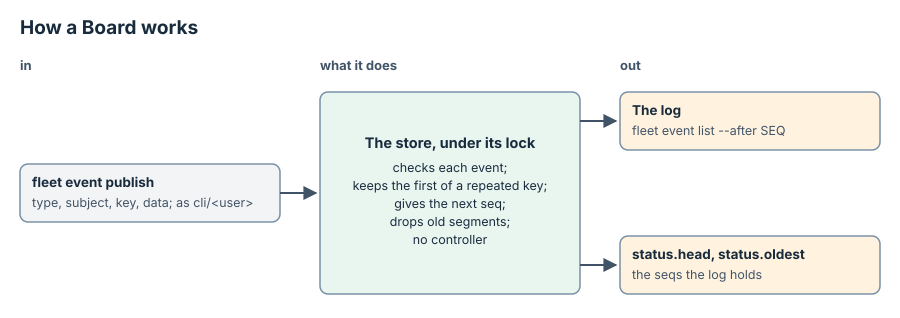

# Board resource



## What it is for

A Board is a log of events that every Task can read. A publisher adds an
event, and each reader reads the events after a cursor. The inbox of a
Task goes to one session. A Board is for everyone.

The events are not resources. The store keeps them in the Board's log,
and only the store's typed append writes the log.

## When you write one

`fleet init` makes the Board `shared`, and `fleet event` uses it when you
give no `--board`. Write a Board of your own when a group of events needs
other limits, or when its readers must not see other events.

## Example

```json
{
  "apiVersion": "fleet/v1alpha1",
  "kind": "Board",
  "metadata": {"name": "ci"},
  "spec": {
    "retention": {"maxAgeSeconds": 86400, "maxCount": 1000},
    "maxDataBytes": 4096
  }
}
```

After `fleet apply -f ci.json`, publish an event and read it back:

```sh
fleet event publish --board ci --type ci.job.done --subject app/main --data '{"ok": true}'
fleet event list --board ci --type 'ci.*' --json
```

The first command prints `ci/1 ci.job.done from cli/<user>`. The second
prints the event with its `seq`, `time` and `source`.

## Spec

You write the spec with `fleet apply`. You can change it at any time. A
change applies from the next append.

| Field | Type | Required | Meaning |
| --- | --- | --- | --- |
| `retention.maxAgeSeconds` | integer, at least 1 | no | When someone publishes, the log drops each whole segment whose events are all older than this. The default is 604800 (7 days). |
| `retention.maxCount` | integer, 1 to 1000000 | no | When someone publishes, the log drops whole segments from the oldest until it holds at most this many events. The default is 10000. |
| `maxDataBytes` | integer, 1 to 1048576 | no | The most bytes of an event's `data`, as JSON. The default is 16384. |

Retention runs only when someone publishes to the Board, and it drops whole
segments. Until the next publish, a read can still show events that are
older than `maxAgeSeconds`.

The `shared` Board that `fleet init` makes has the default values.

## Status

Nobody writes the status with `fleet apply` or a controller. The store's
append writes it in the same write as the events.

| Field | Meaning |
| --- | --- |
| `head` | The `seq` of the last event. It is 0 before the first event. |
| `oldest` | The first `seq` that a reader can still get. It is `head + 1` when the log is empty. |

A new Board has no status until its first event. Read that as `head` 0
and `oldest` 1.

## Events

Each event has these fields. Their names follow CloudEvents.

| Field | Set by | Meaning |
| --- | --- | --- |
| `board` | Fleet | The Board's name. |
| `seq` | Fleet | The event's place in the Board's order, from 1. Each event gets the next number. |
| `time` | Fleet | When the store appended the event, in Unix milliseconds. |
| `source` | Fleet | Who published the event: `cli/<user>` for `fleet event publish` outside a session, or the session's Task, `{task, uid, lineage}`. See [Publishing from a session](#publishing-from-a-session). |
| `type` | The publisher | Segments of `a-z`, `0-9`, `_` and `-`, joined by dots, at most 128 characters. `fleet.` is reserved for Fleet's controllers. |
| `subject` | The publisher | Optional. What the event is about, at most 256 characters. |
| `key` | The publisher | Optional. At most 256 characters. See [Lifecycle](#lifecycle). |
| `correlation` | The publisher | Optional. An id for the events of one piece of work, at most 256 characters. |
| `data` | The publisher | Any JSON value, at most `maxDataBytes` bytes. |

The store refuses an event that breaks one of these rules, and appends
nothing.

## Publishing from a session

Fleet gives each session an outbox. The outbox is a file beside the
session's signal file, on the same place. Fleet names it in
`FLEET_EVENT_FILE`.

```text
session:  fleet event publish ──▶ outbox (one JSON line)
Fleet:    TaskController reads the outbox ──▶ append as the Task ──▶ status.outbox
```

1. Inside a session, `fleet event publish` checks the event. It checks
   the Board's name, the type grammar, the `fleet.` prefix and the
   lengths. It does not open the store.
2. It appends one JSON line to the outbox and prints the line's offset,
   for example `shared git.push queued at outbox offset 0`. The Board does
   not have the event yet.
3. On each pass, TaskController reads the outbox of each Task that has a
   session. It reads from the offset in `status.outbox`. It reads only
   whole lines, at most 512 KiB per pass. It renews the lease before each
   read. A `Concluded` Task that is not being deleted has its outbox read
   only when the Task is due, as for its session recheck (every 5
   minutes).
4. TaskController appends each event to its Board, under the lease. The
   source is the Task: `{task, uid, lineage}`. Then it writes the new
   offset to `status.outbox`.

These rules apply:

- The source is always the Task whose outbox it is. A field in the line
  that names a source or another Task has no effect.
- `lineage` lists the Task's ancestors, nearest first, from the parent
  labels (`gateway.fleet.dev/parent` and `-uid`). It is empty for a Task
  without a parent.
- `fleet event list --source task/<name>` keeps the events of one Task.
- A line without a `key` gets the key `outbox-<generation>-<offset>`. When
  TaskController reads the same line again, the Board appends nothing.
- When the outbox is shorter than the offset, the file was made again.
  TaskController reads it from the start, and `generation` goes up by one.
- A line has at most 64 KiB. A line without its newline waits for it.
- The outbox holds event payloads, so it is private. On Unix, Fleet and
  `fleet event publish` make it with mode 0600, and its directory with
  mode 0700.
- TaskController skips a line that does not parse, or that the Board
  refuses, such as a Board that does not exist. It counts it in
  `status.outbox.skipped` and writes why in `status.outbox.lastSkipped`.
  The next lines continue.
- When the session is `Gone`, TaskController reads its outbox until one
  read finds no whole line left. Then it sets `status.outbox.closed` and
  reads that outbox no more, unless the Task is being deleted. When the
  session runs again, `closed` goes.
- When TaskController cannot read the outbox, the offset stays. It
  concludes nothing.
- A deleted Task keeps its finalizer after the release until its outbox
  holds no whole line still to ingest. The release stops the session
  first, so no line comes after the last read.
- While lines are still to ingest, the `Released` condition is
  `False/OutboxDraining`, with no time limit.
- While the outbox cannot be read, the condition is `Unknown/OutboxUnread`.
  This lasts at most 5 minutes after the release. Then Fleet gives up the
  unread lines, and the release ends with `Released=True/OutboxGivenUp`.
  This happens on a place without `fleet` on its `PATH`, with a `fleet`
  older than this release, or where `exec` fails.
- A session that has `FLEET_SIGNAL_FILE` but no `FLEET_EVENT_FILE` refuses
  to publish. It never publishes as `cli/<user>`.

## Lifecycle

```text
publish ──▶ check ──▶ drop aged segments ──▶ key held? ──yes──▶ answer the first event
                                                │
                                                no
                                                ▼
                    next seq, append ──▶ drop past maxCount ──▶ status.head, oldest
```

- The log is a series of segments. Each segment holds a tenth of
  `maxCount` events, at least 1 and at most 1000.
- Each publish first drops, from the oldest, each segment whose events are
  all older than `maxAgeSeconds`. This can drop every segment. The `seq`
  does not go back: the next event gets `status.head + 1`.
- Then the store looks for keys. A publish with a `key` that the same
  `source` used before, on an event that the log still holds, appends
  nothing. The publisher gets the first event back. A retry is then safe.
  A key whose event the log dropped can be used again.
- After the append, the store drops the oldest segment while the log holds
  more than `maxCount` events. The segment with the newest event stays.
- `fleet event list` reads up to the last `seq` in the log when it starts.
  It does not stop at `status.head`, because a crash can leave the log
  ahead of the status. An event that someone publishes during the list is
  in the next list.
- A reader keeps its own cursor: the last `seq` it read. When the log no
  longer holds the event after the cursor, the read answers `Expired` with
  `oldest`. `fleet event list` then exits 5. The reader can continue from
  `oldest - 1`, and it knows that it missed events.
- A Board has no finalizer. A delete removes the Board and its log at
  once. A new Board with the same name starts at `seq` 1.

## Related kinds

- A [Task](task.md)'s session publishes through its outbox, and
  TaskController appends the events as the Task. People and scripts
  outside a session publish as `cli/<user>`.
- The [Task inbox](task.md) is different: it delivers each entry to one
  session.

## Commands

```sh
fleet apply -f ci.json
fleet get board ci
fleet list boards
fleet event publish --board ci --type ci.job.done --key run-42 --data '{"ok": true}'
fleet event list --board ci --after 10 --type 'ci.*' --limit 50
fleet delete board ci
```

`fleet event list` takes these filters. A value that ends in `*` matches a
prefix.

| Flag | Keeps |
| --- | --- |
| `--after SEQ` | Events with a `seq` above `SEQ`. The default is 0. |
| `--type T` | Events of type `T`. |
| `--subject S` | Events about `S`. |
| `--source S` | Events from `S`, such as `cli/alex` or `task/build`. |
| `--correlation C` | Events with the correlation id `C`. |
| `--limit N` | The first `N` events that match, 1 to 10000. The default is 100. |
