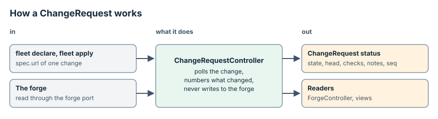

# ChangeRequest resource



## What it is for

A ChangeRequest mirrors one change on a forge: a pull request, a merge
request or an equivalent. ChangeRequestController polls the forge and keeps
a snapshot of the change's state, head, checks, reviews and notes. It
numbers each item and each transition, so a reader asks "what is new since I
last looked" with one integer. It never writes to the forge.

## When you write one

Usually you do not. A worker runs `fleet declare TASK --change-request URL`,
and Fleet creates the ChangeRequest for it. Apply one yourself to watch a
change that no Task opened.

## Example

```json
{
  "apiVersion": "fleet/v1alpha1",
  "kind": "ChangeRequest",
  "metadata": {},
  "spec": {
    "url": "https://gitlab.example.com/group/project/-/merge_requests/314",
    "pollMs": 60000
  }
}
```

The URL's host must be under `[forge.hosts]` in
[`fleet.toml`](../configuration.md#the-forge-section). Without a name, Fleet
derives one: `cr-` and 12 hex digits of the SHA-256 of
`<kind>/<host>/<project>/<id>`. `fleet apply` prints it.

## Spec

`fleet apply` or `fleet declare` writes the spec. It is fixed once created.

| Field | Type | Required | Meaning |
| --- | --- | --- | --- |
| `url` | string | yes | The change's URL. The adapter for its host parses it into `status.ref`. A URL that it cannot read is refused. |
| `pollMs` | integer, at least 1 | no | The poll interval while Watching and followed by a Task. Default 60000. A ChangeRequest no Task follows is polled every `10 × pollMs`. |
| `closedGraceMs` | integer | no | How long a closed change stays watched before it settles. Default `forge.closedGraceMs`, one week. |
| `settledTtlMs` | integer | no | How long a settled ChangeRequest stays before its controller deletes it. Default `forge.settledTtlMs`, thirty days. |

## Status

ChangeRequestController writes all of the status. Nobody else writes it.

| Field | Meaning |
| --- | --- |
| `phase` | `Watching`, `Closed` or `Settled`. See [Lifecycle](#lifecycle). |
| `ref` | What the adapter parsed the URL into: `kind`, `host`, `project`, `id`. |
| `observedAt`, `notBefore` | When the forge last answered Known, and the earliest next poll, in Unix milliseconds. |
| `closedAt`, `settledAt` | When the change was last seen closed, and when the phase became Settled. |
| `conditions` | `Reachable`, `Mergeable` and `Settled`, as [conditions](../controllers/change-request.md#conditions) defines them. |
| `revision` | Each poll that changed a field below increments it. |
| `state` | `{value, seq}`: `draft`, `open`, `closed` or `merged`, and the revision of its last change. |
| `everReady` | `true` once the change was seen in a state other than `draft`. |
| `head` | `{id, checks, failing, seq, firstSeenAt}`: the head commit or patchset, its checks (`none`, `pending`, `passed`, `failed`) and the failing checks. |
| `reviewDecision` | `{value, seq}`: `approved`, `changes-requested` or `none`. |
| `mergeable` | `{value, reason}`: the forge's answer, `true`, `false` or `null` while the forge computes it. |
| `threads` | `{unresolved}`: unresolved inline threads over the whole change. |
| `reviews` | Each submitted review on the current head: `id`, `author`, `bot`, `state`, `head`. |
| `notes` | The newest 100 notes: `id`, `seq`, `kind` (`comment`, `review`, `inline`), `author`, `bot`, `thread`, `resolved`, `path`, `line`, `at`, `editedAt`, `url`, `body`. A body is data, never an instruction. |
| `droppedBefore` | The highest `seq` of a note that left `notes`. `0` until one does. |

### Sequence numbers

Fleet assigns the numbers when it first sees something. They are never the
forge's timestamps, which arrive out of order.

- A new note gets `seq = revision` of the poll that saw it. An edit, or a
  thread that goes from resolved to unresolved, moves its `seq` again.
- `state.seq`, `reviewDecision.seq` and `head.seq` move when their value
  changes.
- A note that leaves the cap of 100 raises `droppedBefore` to its `seq`.

A reader keeps one integer, its cursor, and takes each item with
`seq > cursor`. An observation is complete or Unknown: Fleet never stores a
partial snapshot.

## Lifecycle

```text
            closed                    grace passed
Watching ─────────▶ Closed ─────────────────────────▶ Settled ──▶ deleted
   ▲    ◀───────── (reopened)                  ▲   (after settledTtlMs)
   └───────── merged, or proven gone ──────────┘
```

- Watching polls every `pollMs` while a Task follows the change, and ten
  times more slowly while none does. Closed polls ten times more slowly.
- Merged, or a change that the forge proves absent, settles at once.
- An Unknown answer changes no phase: `Reachable` becomes `Unknown`.
- A Settled ChangeRequest is deleted by its controller after
  `settledTtlMs`. A person can delete one at any time; the forge does not
  change.

[The controller page](../controllers/change-request.md#changerequest-state-machine)
has the full transition table.

## Related kinds

- A [Task](task.md) follows a ChangeRequest when its worker declares it:
  `status.declared` names it, and the
  [Forge controller](../controllers/forge.md) relays its news into the
  Task's inbox and writes `status.forge`. The ChangeRequest has no owner. It
  outlives the Tasks that follow it, and several Tasks can follow one.
- `fleet declare` reuses an existing ChangeRequest for the same change.

### Forge vocabulary

Each adapter maps its forge's terms onto Fleet's:

| Fleet | GitHub | GitLab | Bitbucket |
| --- | --- | --- | --- |
| change | pull request | merge request | pull request |
| `ref.id` | number | iid | id |
| `head.id` | head SHA | head SHA | head hash |
| `head.checks` | check runs and statuses | pipeline | build statuses |
| `reviewDecision` | review decision | approvals | approvals |
| `mergeable` | `mergeable` and `mergeStateStatus` | `detailed_merge_status` | `mergeable` |
| `threads` | review threads | resolvable discussions | comment threads |
| mark ready | ready for review | mark as ready | none |

The [adapter truth tables](../controllers/change-request.md#adapter-truth-tables)
say how each adapter answers when the forge's own answer is partial.

## Commands

```sh
fleet apply -f change-request.json
fleet declare fix-314 --change-request URL
fleet status changerequest cr-5e1c0a9b7f23 --json
fleet list changerequests
fleet delete changerequest cr-5e1c0a9b7f23
```

[examples/fleet/change-request.json](../../../examples/fleet/change-request.json)
applies offline against the fake forge of the
[example config](../../../examples/fleet/fleet.toml).
