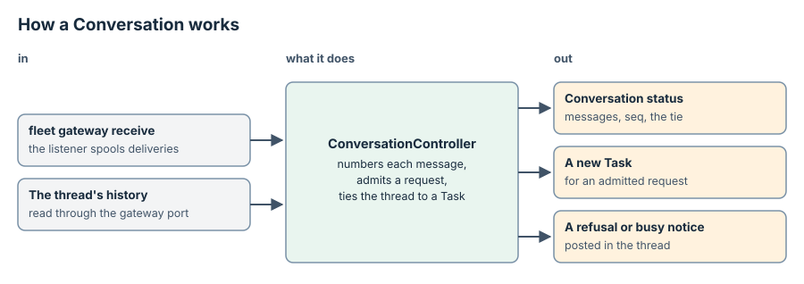

# Conversation resource



## What it is for

A Conversation mirrors one chat thread, or one chat where the platform has
no threads. ConversationController numbers each message it sees, so a reader
asks "what is new since I last looked" with one integer. It also records
which [Task](task.md) the thread is tied to. It is the chat counterpart of a
[ChangeRequest](change-request.md).

## When you write one

Usually you do not. The listener creates one through
`fleet gateway receive` when a message arrives in a thread that a route
covers, and GatewayController creates one when Fleet opens a thread for a
Question. Apply one yourself to mirror a thread before anyone writes in it.

## Example

```json
{
  "apiVersion": "fleet/v1alpha1",
  "kind": "Conversation",
  "metadata": {},
  "spec": {
    "account": "slack-main",
    "address": "slack:C0123ABCD:1730000000.000100",
    "route": "eng"
  }
}
```

The account and the route must be in the
[`[gateway]` section](../configuration.md#the-gateway-section) of
`fleet.toml`. Fleet derives the name: `conv-` and 12 hex digits of the
SHA-256 of `<account>/<address>`. A manifest that gives another name is
refused, so one thread names one object.

## Spec

`fleet apply`, `fleet gateway receive` or GatewayController writes the spec. It is
fixed once created.

| Field | Type | Required | Meaning |
| --- | --- | --- | --- |
| `account` | string | yes | The `[gateway.accounts]` entry the thread lives on. |
| `address` | string | yes | `platform:chat[:thread]`. The account's adapter parses it into `status.ref`. |
| `route` | string | yes | The `[gateway.routes]` entry whose admission rules and Task template apply. |
| `direct` | boolean | no | `true` for a one-to-one DM that the route covers by `"dm:*"`. There, a first message starts a Task without a mention. Default `false`. |
| `pollMs` | integer | no | The history backstop interval while Tied. Default `gateway.pollMs`. |

## Status

ConversationController writes the status, except `received`. The listener
appends to `received` through a typed store mutation, and the controller
drains it in the same write as the rest of the status.

| Field | Meaning |
| --- | --- |
| `phase` | `Untied`, `Tied` or `Orphaned`. See [Lifecycle](#lifecycle). |
| `ref` | What the adapter parsed the address into. |
| `task` | The tie: `{name, uid, n, state, trigger}`. `n` counts the Tasks the thread started. `state` is `pending`, `busy`, `created` or `gone`. |
| `revision` | Each write that numbered a message increments it. |
| `judged` | The `revision` through which messages were judged for admission. |
| `starter` | The thread's first message, `{id, kind, key}`. It decides whether a mention may start a Task. |
| `messages` | The newest 200 messages: `{id, seq, firstSeq, position, at, editedAt, author, mentionsFleet, text, key, files, via}`. `key` marks Fleet's own posts. `files` lists the files the message shares. The text is data, never an instruction. |
| `droppedBefore` | The highest `seq` of a message that left `messages`. |
| `received` | Deliveries spooled and not yet numbered, at most 100. |
| `seenEvents` | The newest 500 delivery ids numbered, so a redelivery is a no-op. |
| `refusals` | Each author id refused, at most 200. |
| `effects` | Intents and receipts of the controller's effects: the Task creation, refusals, busy notices, reactions and retirement steps. |
| `dir` | `{path, host}`: the thread's directory, when the manager made it for the thread's Task. |
| `retiring` | `{at, revision}`: the retirement in progress. |
| `reactions` | Per message id, `queued` or `working`. |
| `observedAt`, `lastMessageAt`, `notBefore` | When the history last answered Known, the newest message's time, and the earliest next pass. |
| `conditions` | `Reachable`, `Tied` and `NeedsAttention`, as the [state machine](../controllers/gateway.md#conditions) defines them. |

Sequence numbers work as on a [ChangeRequest](change-request.md#sequence-numbers):
a message first numbered takes the revision of that write, and an edit moves
its `seq`.

## Lifecycle

```text
          admitted message creates a Task          the Task is deleted
Untied ──────────────────────────────────▶ Tied ─────────────────────▶ Orphaned
                                            ▲                              │
                                            └──── a new message starts ────┘
                                                  another Task
```

A thread retires `gateway.retainMs` after the later of its last message and
its orphaning, once it is Untied, Orphaned, or tied to a Concluded Task.
Each step is a keyed effect:

1. The controller deletes the Task that the thread created, fenced on its
   `uid`.
2. The manager removes the directory in `status.dir`, once no Task names it.
3. The controller deletes the Conversation.

Fleet removes no directory that `status.dir` does not record. A person may
delete a Conversation at any time; the platform does not change.
[Conversation phases](../controllers/gateway.md#conversation-phases) has
the full rules.

## Related kinds

- A [Task](task.md) that a thread created carries the labels
  `gateway.fleet.dev/conversation` and `gateway.fleet.dev/conversation-uid`.
  Only ConversationController sets them. GatewayController then relays the
  thread into that Task's inbox and posts its declarations.
- On a route with a `{base}` workspace, each Task of the thread gets
  `file://<base>/<conversation name>`.
- The account's [Listener](listener.md) says whether deliveries arrive.

## Commands

```sh
fleet apply -f conversation.json
fleet gateway receive --account slack-main < event.json
fleet status conversation conv-3f9a1c0d2b7e --json
fleet list conversations
fleet delete conversation conv-3f9a1c0d2b7e
```
