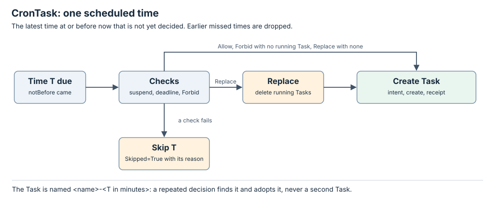

# CronTask resource



## What it is for

A CronTask creates a [Task](task.md) at each time of a schedule. It is the
Kubernetes CronJob for Fleet: the CronJob makes a Job, and the CronTask
makes a Task. The [CronTask controller](../controllers/cron-task.md) does
the work. The [Task controller](../controllers/task.md) then runs each Task
like any other Task.

## When you write one

Write a CronTask when the same brief must run again and again: a nightly
review, a weekly dependency update, a check every hour. To prompt one
long-lived session on a timer instead, use `fleet send TASK TEXT` from a
cron job or a systemd timer.

## Example

```json
{
  "apiVersion": "fleet/v1alpha1",
  "kind": "CronTask",
  "metadata": {"name": "nightly-review"},
  "spec": {
    "schedule": "0 3 * * 1-5",
    "concurrencyPolicy": "Forbid",
    "startingDeadlineSeconds": 600,
    "historyLimit": 3,
    "template": {
      "metadata": {"labels": {"team": "review"}},
      "spec": {
        "harness": "claude-code",
        "host": "local",
        "brief": "Review what landed today and report what needs attention.",
        "workspace": ["git+https://github.com/example/app.git#main"],
        "dispatch": true
      }
    }
  }
}
```

At 03:00 UTC on Monday 16 November 2026, this CronTask creates the Task
`nightly-review-29913300`. Its status then reads:

```text
phase: Scheduled
lastScheduleTime: 1794798000000      nextScheduleTime: 1794884400000
active: [nightly-review-29913300]
effects["create/29913300"]: intent, then receipt {known: {type: created, uid, adopted: false}}
conditions: Scheduled=True (Scheduled), Skipped=False (Created)
```

## Spec

You write the spec with `fleet apply`. You can change it at any time. A
change applies from the next reconcile.

| Field | Type | Required | Meaning |
| --- | --- | --- | --- |
| `schedule` | string | yes | Five cron fields (minute, hour, day of month, month, day of week), or `@hourly`, `@daily`, `@weekly`, `@monthly`, `@yearly`. Fleet evaluates it in UTC. A seconds field is refused. |
| `template.spec` | object | yes | The spec of each Task. `fleet apply` validates it as a Task spec. `amendments` is refused: `fleet amend` adds them to one Task. |
| `template.metadata.labels` | object of strings | no | Labels for each Task. The `crontask.fleet.dev/` and `gateway.fleet.dev/` labels are refused: only a controller sets them. |
| `concurrencyPolicy` | `Forbid`, `Allow` or `Replace` | no | What happens at a scheduled time while an earlier Task of this CronTask is not Concluded. `Forbid` (the default) skips the time. `Allow` creates the Task. `Replace` deletes the earlier Task, and creates the new one only when the earlier one is gone. |
| `startingDeadlineSeconds` | integer, at least 1 | no | A scheduled time that the controller sees more than this many seconds late is skipped. Without it, a late time is never skipped. |
| `suspend` | boolean | no | `true` stops new Tasks. The Tasks that run continue. |
| `historyLimit` | integer, 0 to 100 | no | How many Concluded Tasks to keep. The default is 3. The controller deletes the older ones. |

`concurrencyPolicy` defaults to `Forbid`, not to `Allow` as in a CronJob.
A Task is an agent session that often works in one directory. Two sessions
at once are seldom what you want, so you ask for them explicitly.

The name of a CronTask is at most 240 characters, so that the name of each
Task fits.

## Status

The CronTask controller writes all of the status.

| Field | Meaning |
| --- | --- |
| `phase` | `Scheduled`, or `Suspended` while `spec.suspend` is true. |
| `observedGeneration` | The spec generation of the last reconcile. |
| `lastScheduleTime` | The scheduled time of the last Task decided on for creation. |
| `lastConsidered` | The last scheduled time that the controller decided about: created, skipped or forbidden. |
| `nextScheduleTime` | The next scheduled time. |
| `notBefore` | When the manager reconciles the CronTask again. |
| `active` | The names of this CronTask's Tasks that are not Concluded, and of the creates still pending. |
| `effects` | Each create and each delete by key: its `intent`, written before the effect, and its `receipt`, written after. `task` names the Task, `scheduled` the time a create is for, and `unknowns` the attempts at a create whose outcome was never known. The controller keeps the newest 20 settled records. |
| `conditions` | `Scheduled`, `Skipped` and `NeedsAttention`. See [conditions](../controllers/cron-task.md#conditions). |

## Lifecycle

```text
apply ──▶ Scheduled ──(each scheduled time)──▶ create a Task, or skip the time
             ▲  │
  suspend:   │  ▼ suspend: true
  false      Suspended ──▶ no new Task; running Tasks go on
```

- The first reconcile writes `nextScheduleTime`. A CronTask creates no Task
  for a time before it existed.
- When the manager was down for several scheduled times, only the latest
  one is decided. The earlier ones are dropped.
- A CronTask has no finalizer. A delete removes it at once.
- The Tasks of a deleted CronTask stay. A Task holds a session and maybe
  work that is not merged, so Fleet does not delete it for you. Delete the
  Tasks with `fleet delete task NAME`.

[The controller page](../controllers/cron-task.md#crontask-state-machine)
has the full rules for one scheduled time.

## Related kinds

- Each [Task](task.md) that a CronTask creates is named
  `<cron-task>-<T / 60000>`, for the scheduled time `T` in Unix
  milliseconds. Each sweep computes the same name for the same time, so a
  repeated decision cannot make a second Task.
- Each Task has two labels that only the CronTask controller sets:
  `crontask.fleet.dev/name` (the CronTask's name) and
  `crontask.fleet.dev/uid` (its `uid`, which tells this CronTask's Tasks
  from those of an earlier CronTask with the same name). To list them,
  filter `fleet list tasks --json` on `crontask.fleet.dev/name`.
- A template can name a [TaskConfig](task-config.md) in
  `spec.configRef`, as any Task can.
- The CronTask controller never writes a Task's status.

## Commands

```sh
fleet apply -f nightly-review.json
fleet get crontask nightly-review
fleet list crontasks
fleet status crontask nightly-review
fleet delete crontask nightly-review
```
