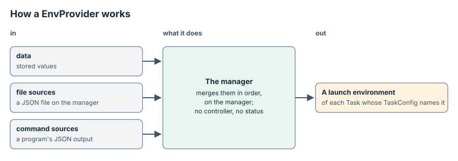

# EnvProvider resource



## What it is for

An EnvProvider supplies environment values for a session's launch: stored
data, a file, or the output of a command. It is passive data. It has no
controller and no status.

## When you write one

Write an EnvProvider when a session needs values that you want to keep out
of Task manifests, such as credentials from a helper program, or values that
several [TaskConfigs](task-config.md) share. A TaskConfig names it in
`spec.envFrom`. A Task cannot name an EnvProvider directly.

## Example

```json
{
  "apiVersion": "fleet/v1alpha1",
  "kind": "EnvProvider",
  "metadata": {"name": "project-env"},
  "spec": {
    "data": {"LANG": "C.UTF-8"},
    "sources": [{"type": "file", "path": "/work/config/agent-env.json"}]
  }
}
```

The file holds one JSON object of strings, such as
`{"PROJECT_MODE": "review"}`. `fleet apply` does not read it. The manager
reads it when it resolves a launch.

## Spec

You write the spec with `fleet apply`. You can change it at any time. A
change applies to Tasks that resolve their launch after it.

| Field | Type | Required | Meaning |
| --- | --- | --- | --- |
| `data` | object of strings | no | Stored values. Anyone who reads the resource sees them. |
| `sources` | array, at most 32 | no | File and command sources, in merge order. |
| `sources[].type` | `file` or `command` | yes | Selects the fields below. |
| `path` (file) | string | yes | Absolute path of a regular file on the manager. |
| `program` (command) | string | yes | Absolute path of a program on the manager. No shell and no PATH search. |
| `args` (command) | array of strings | no | The program's arguments. |
| `cwd` (command) | string | yes | Absolute working directory on the manager. |
| `timeoutMs` (command) | integer, 1 to 15000 | yes | Fleet kills the process tree after this time. |

A file or a command answers one JSON object of strings, in the
[environment JSON format](../configuration.md#environment-json-file-and-command-output),
at most 64 KiB. A command must exit 0. Its stderr never appears in an error.
A command source needs a manager lease above 20000 ms.

A command source:

```json
{"type": "command", "program": "/usr/local/bin/credential-helper",
 "args": ["environment", "--json"], "cwd": "/var/lib/fleet", "timeoutMs": 5000}
```

Sources run on the manager, also for a Task on another place. A command
inherits the manager's environment. Use only a helper that you trust and
that only reads: a resolution that fails before the snapshot is written can
run it again.

## Status

None. Nobody writes the status of an EnvProvider.

## Lifecycle

An EnvProvider has no phases. `data` merges first. Each source then
overrides the earlier values, in list order. A missing file, a nonzero exit,
a timeout or a malformed answer blocks the launch with an error in
`fleet reconcile`, and no session starts. Fleet checks every reference
before it runs a command.

Deletion removes the EnvProvider at once. A Task that already resolved its
launch keeps its private snapshot. [TaskConfig](task-config.md#resolution-and-freezing)
says how the snapshot is frozen and kept.

## Related kinds

- A [TaskConfig](task-config.md) names EnvProviders in `spec.envFrom`.
- A [plugin](../controllers/plugin.md) names EnvProviders in its
  `envFrom` config. Their values reach only its `observe` and `perform`
  calls.

## Commands

```sh
fleet apply -f env-provider.json
fleet get envprovider project-env
fleet list envproviders --json
fleet delete envprovider project-env
```
