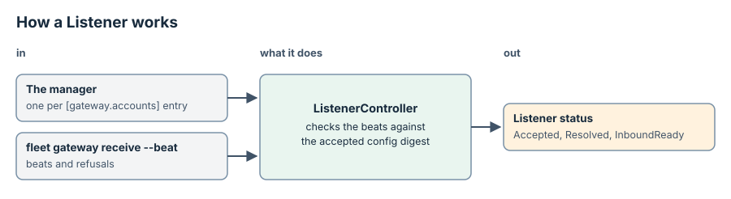

# Listener resource



## What it is for

A Listener records the inbound health of one chat account. Fleet makes no
inbound call itself: a separate listener program holds the platform's
connection and hands each delivery to `fleet gateway receive`. The program
reports here whether it runs, is connected and uses the current
configuration. ListenerController judges that report.

## When you write one

Never. The manager creates one Listener per `[gateway.accounts]` entry, and
`fleet gateway receive` creates it when a listener beats first. `fleet apply`
refuses a Listener.

## Example

The Listener that the manager creates for the account `slack-main`:

```json
{
  "apiVersion": "fleet/v1alpha1",
  "kind": "Listener",
  "metadata": {"name": "listener-slack-main"},
  "spec": {"account": "slack-main"}
}
```

`fleet apply` refuses this manifest: the config is the only source. Read it
with `fleet status listener listener-slack-main --json`.

## Spec

The manager writes the spec, by exclusive creation. It is fixed once
created.

| Field | Type | Required | Meaning |
| --- | --- | --- | --- |
| `account` | string | yes | The `[gateway.accounts]` entry. The name is `listener-<account>`. |

## Status

| Field | Writer | Meaning |
| --- | --- | --- |
| `accepted` | ListenerController | `{digest, at}`: the account's digest in the loaded config, the one `fleet gateway account NAME --json` prints, and when it was loaded. |
| `beats` | the listener, `fleet gateway receive --beat` | Per listener instance, its last beat: `{state, digest, at, sentAt, lastDeliveryAt}`. `state` is `connecting`, `connected` or `closing`. At most 8 instances. |
| `refused` | the listener, `fleet gateway receive` | `{counts, lastFaultAt}`: envelopes the verb refused, counted by reason, and the last one that was the listener's own fault. |
| `beatRevision` | the listener | Each beat and each refusal increments it. |
| `seen` | ListenerController | The `beatRevision` it last judged. A Listener is due when something new arrived. |
| `observedAt`, `notBefore` | ListenerController | When the platform last answered Known, and the earliest next pass. |
| `conditions` | ListenerController | `Accepted`, `Resolved` and `InboundReady`, as the [interface](../controllers/gateway.md#listenercontroller) defines them. |

The listener writes `beats`, `refused` and `beatRevision` through typed
store mutations that change nothing else. ListenerController owns the other
fields.

## Lifecycle

A Listener has no phases. Its condition `InboundReady` is the state to read:

- True while one instance's last beat is `connected`, carries the accepted
  digest, is younger than three `gateway.beatMs`, and no envelope was
  refused for the listener's own fault in that time.
- False within one sweep when the listener stops, stalls, runs an older
  configuration or sends envelopes that the verb refuses.

ListenerController deletes the Listener when its account leaves the config.
The manager creates it again if the account returns. A Listener deleted by
hand comes back at the next config load.

## Related kinds

- Each [Conversation](conversation.md) of an account gets its deliveries
  from that account's listener.
- The [Gateway controller](../controllers/gateway.md) page describes the
  listener program and the receive verb.

## Commands

```sh
fleet gateway account slack-main --json
fleet gateway receive --account slack-main --beat < beat.json
fleet gateway status
fleet status listener listener-slack-main --json
```
