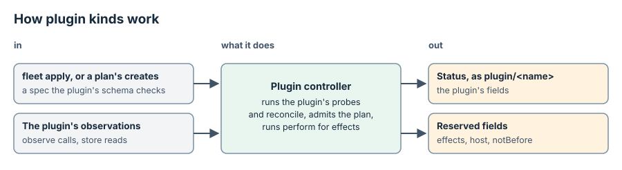

# Plugin kinds



## What it is for

A plugin kind is a resource kind that a registered plugin defines and
reconciles. The store serves it beside the built-in kinds while the plugin
is registered. It has Fleet's envelope, a spec that the plugin's JSON Schema
validates, and a status that the plugin owns.

## When you write one

Write objects of a plugin kind when a plugin you registered serves it. To
make a new kind, write a plugin: [Write a plugin](../plugins.md) is the
step-by-step guide.

## Example

An object of the `File` kind of the [example plugin](../plugins.md), which
keeps one file's content:

```json
{
  "apiVersion": "fleet/v1alpha1",
  "kind": "File",
  "metadata": {"name": "hello"},
  "spec": {"name": "hello.txt", "content": "Hello from Fleet.\n"}
}
```

## Spec

You write the spec with `fleet apply`, or the plugin writes it through the
`creates` of its plan. The store validates it against the kind's `spec`
schema on each write.

| Field | Type | Required | Meaning |
| --- | --- | --- | --- |
| any | as the schema says | as the schema says | The plugin's manifest defines the fields. For `File`: `name`, a file name, and `content`, a string. |

The spec can change, and each change increments `metadata.generation`. A
kind with `immutableSpec: true` refuses changes after creation.

## Status

The plugin writes the status, through the manager, as field manager
`plugin/<name>`. If the manifest gives a `status` schema, the manager checks
the plugin's fields against it. Three fields are reserved: the manager writes
them, and a plan that names one is refused.

| Field | Writer | Meaning |
| --- | --- | --- |
| the plugin's fields | the plugin | Anything the schema allows. `fleet status` shows `phase`, `conditions` and `observedGeneration` when present. |
| `notBefore` | the manager | The earliest next pass: the plan's `notBefore`, else `now + pollMs`. |
| `effects` | the manager | Per effect key, `intent {at, generation}` written before the effect and `receipt {at, outcome}` after it. `outcome` is `done`, `failed` or `unknown`. The newest 100 keys. |
| `host` | the manager | `observedAt`, the last pass; `generation`, the spec generation it read; `error`, why the last pass failed; `verbs`, the result of each `creates`, `amends`, `patches`, `appends`, `declares` and `deletes` entry. |

## Lifecycle

The plugin defines the phases. The manager makes an object due when its
`notBefore` passes, when its spec has a new generation, and while it is
deleting.

```text
fleet apply ──▶ due ──▶ probes / observe ──▶ reconcile ──▶ status, intents
                 ▲                                           │
                 └─── notBefore passes, or spec changes ◀── effects, receipts
```

Deletion:

- A kind without a finalizer is deleted at once.
- A kind with `finalizer: true` gets the finalizer `fleet.dev/plugin/<name>`.
  The plugin reconciles the deleting object until its plan says
  `removeFinalizer: true`.
- A plan with `delete: true` deletes the object itself.

An object of a kind whose plugin left the config stays readable. The manager
reports it and never reconciles it.

## Related kinds

A plugin can act on [Tasks](task.md) through its plan, as a person does:
create one, set `dispatch` and `forge`, amend it, send it a message, declare
a change for it, or delete it. With `tasks = "own"` it acts only on the
Tasks it created, which carry the label `fleet.dev/plugin: <name>`.
[Plugin operations](task.md#plugin-operations) lists each verb.

## Commands

```sh
fleet list plugins --json
fleet apply -f hello.json
fleet get file hello
fleet status file hello --json
fleet delete file hello
```

The command line takes a plugin kind lowercased, as it takes `task`.
