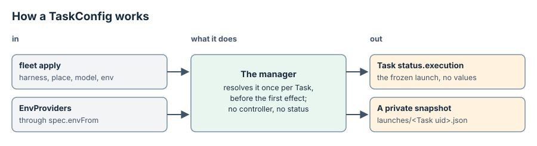

# TaskConfig resource



## What it is for

A TaskConfig holds execution defaults that many [Tasks](task.md) share: the
harness, the place, the model, the environment and the idle pause. It is
passive data. It has no controller and no status.

## When you write one

Write a TaskConfig when several Tasks run the same way. Each Task then names
it in `spec.configRef`, and keeps only its own brief, workspace and outputs.

### The default TaskConfig

A Task with no `configRef` takes its defaults from the TaskConfig named
`default`, when the store holds one. `fleet init` writes it:

```json
{
  "apiVersion": "fleet/v1alpha1",
  "kind": "TaskConfig",
  "metadata": {"name": "default"},
  "spec": {"pauseAfterMs": 1800000}
}
```

So an idle session pauses after 30 minutes
([pausing an idle session](../controllers/task.md#pausing-an-idle-session)).

- A Task's own field overrides it, as for any TaskConfig.
- A Task with a `configRef` takes that TaskConfig instead, and nothing from
  `default`.
- A repeated `fleet init` keeps `default` as it is, and writes it again when
  it is gone. To never pause, apply `default` with no `pauseAfterMs`.
- A Task takes `default` when it first launches. A Task launched before
  `default` existed keeps its launch.

## Example

```json
{
  "apiVersion": "fleet/v1alpha1",
  "kind": "TaskConfig",
  "metadata": {"name": "reviewer"},
  "spec": {
    "harness": "claude-code",
    "host": "local",
    "envFrom": [{"name": "project-env"}],
    "env": {"REVIEW_MODE": "careful"}
  }
}
```

A Task that uses it:

```json
{
  "apiVersion": "fleet/v1alpha1",
  "kind": "Task",
  "metadata": {"name": "review"},
  "spec": {
    "configRef": {"name": "reviewer"},
    "env": {"REVIEW_MODE": "focused"},
    "workspace": ["file:///work/project"],
    "brief": "Review the current change.",
    "dispatch": false
  }
}
```

`fleet apply` accepts a reference to a TaskConfig or an EnvProvider that
does not exist yet. The manager checks every reference when it resolves the
launch.

## Spec

You write the spec with `fleet apply`. You can change it at any time. A
change applies to Tasks that resolve their launch after it.

| Field | Type | Required | Meaning |
| --- | --- | --- | --- |
| `harness` | string | no | The default harness. The Task or this TaskConfig must give one. |
| `host` | string | no | The default place: `<runtime>/<place>`, or `local`. Without one, a Task runs on `local`. |
| `model` | string | no | The default model. A runtime under `[runtimes]` passes no model to its harness, and refuses a Task that has one. |
| `envFrom` | array of `{name}` | no | [EnvProviders](env-provider.md), in merge order. |
| `env` | object of strings | no | Environment values. They override every EnvProvider value. |
| `pauseAfterMs` | integer, at least 1 | no | Pause a Task's session once its agent was idle this long. Absent: never. A session on a runtime that cannot pause, of a harness Fleet cannot resume, or whose hooks report no activity never pauses either. See [pausing an idle session](../controllers/task.md#pausing-an-idle-session). |

`harness`, `host` and `model` may not be empty, contain NUL or start with
`-`. Any other field is refused.

A Task overrides a default when it gives the field itself. A Task with
`"model": null` drops an inherited model. A Task with `"host": "local"`
overrides another default place. The environment merges in this order, and
a later value wins, case variants included:

```text
EnvProvider data -> EnvProvider sources -> TaskConfig envFrom (in order)
  -> TaskConfig env -> Task env
```

`env` is visible to anyone who reads the resource. It is not a place for
secrets: use an EnvProvider file or command source.

## Status

None. Nobody writes the status of a TaskConfig.

## Lifecycle

A TaskConfig has no phases. Deletion removes it at once. A Task that has not
resolved its launch then blocks with an error in `fleet reconcile`. A Task
that already resolved it continues.

### Resolution and freezing

```text
Task with configRef, env or a default TaskConfig, dispatch: true
  -> check every TaskConfig and EnvProvider reference
  -> resolve the sources through the store and the runtime port
  -> write a private snapshot, launches/<Task uid>.json, under the lease
  -> write status.execution: harness, place, model, pauseAfterMs and the
     kind, name, uid and generation of each source, without values
  -> spawn and brief as usual
```

The first resolution that succeeds is frozen. Retries and manager restarts
reuse the snapshot. A later edit, deletion or recreation of a TaskConfig or
an EnvProvider never changes a Task that resolved its launch. A missing,
deleting or invalid reference blocks the launch with an error in
`fleet reconcile`. Fleet never starts a session with a partial launch.

The snapshot is plaintext. On Unix its directory and files are 0700 and
0600. On Windows it inherits the store's ACL. The store removes it when it
deletes the Task. A Task whose snapshot is missing after its launch was
frozen blocks: restore the snapshot from a protected backup, or delete and
recreate the Task. The environment reaches the session in the runtime's
`start` request on stdin. It never enters a status, an intent, an error or
an argument list.

## Related kinds

- A [Task](task.md) names a TaskConfig in `spec.configRef`.
- A TaskConfig names [EnvProviders](env-provider.md) in `spec.envFrom`.
- A TaskConfig is a resource, separate from
  [`fleet.toml`](../configuration.md#native-fleet-configuration-fleettoml).
  A Task with no `configRef` takes [the default TaskConfig](#the-default-taskconfig).

## Commands

```sh
fleet apply -f task-config.json
fleet get taskconfig reviewer
fleet list taskconfigs --json
fleet delete taskconfig reviewer
```
