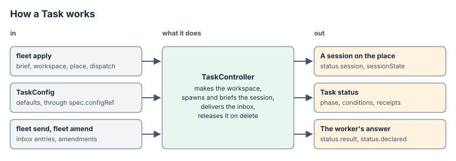
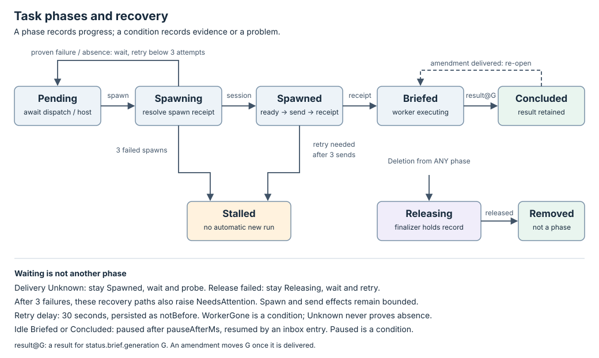

# Task resource



## What it is for

A Task is one agent session doing one brief on one place. TaskController
makes the workspace, starts the session, sends the brief, delivers the
messages queued for it, records the worker's answer, and releases the
session when you delete the Task.

## When you write one

Write a Task for each piece of work you hand to an agent. Write one with an
empty brief for an interactive session that waits for its user.

## Example

```json
{
  "apiVersion": "fleet/v1alpha1",
  "kind": "Task",
  "metadata": {"name": "design-305"},
  "spec": {
    "harness": "claude-code",
    "host": "local",
    "brief": "Write the controller design.",
    "workspace": ["git+https://github.com/example/app.git#main"],
    "dispatch": true,
    "outputs": {"prUrl": {"type": "string", "required": true}}
  }
}
```

## Spec

You write the spec with `fleet apply`. It is fixed once created, except
`dispatch` and `forge`. `fleet amend` appends to `amendments`; a manifest
cannot change them.

| Field | Type | Required | Meaning |
| --- | --- | --- | --- |
| `harness` | string | unless its TaskConfig, the `configRef` one or [`default`](task-config.md#the-default-taskconfig), gives it | The agent harness, such as `claude-code`, passed to the runtime as is. |
| `host` | string | no | The place the session runs on: `<runtime>/<place>`, or `local`, the default runtime's `local` place. Default `local`. |
| `model` | string | no | The model the harness runs. A runtime under `[runtimes]` passes no model to its harness and refuses a Task that has one. |
| `configRef` | `{name}` | no | A [TaskConfig](task-config.md) with execution defaults. |
| `env` | object of strings | no | Environment values. They override inherited ones. |
| `pauseAfterMs` | integer, at least 1 | no | Pause the session once its agent was idle this long. Overrides the TaskConfig's, including [the default TaskConfig](task-config.md#the-default-taskconfig)'s. Absent with no TaskConfig value: never. See [pausing an idle session](../controllers/task.md#pausing-an-idle-session). |
| `agentTelemetry` | boolean | no | `false`: the agent exports no telemetry of its own, also when Fleet exports. Overrides the TaskConfig's. Absent with no TaskConfig value: on. See [coding agents](../../observability.md#coding-agents). |
| `brief` | string | no | The brief, sent once to the ready session. Empty or absent: an interactive Task, which `fleet amend` refuses. A blank brief is refused. |
| `amendments` | array | no | Additions to the brief, oldest first. Only `fleet amend` appends one. See [Amendments](#amendments). |
| `workspace` | array of URLs | yes | What the session works in. `[]` is the runtime's default directory. See [Workspace](workspace.md). |
| `dispatch` | boolean | no | Nothing spawns while it is `false`, the default. Setting it back to `false` does not stop a session. |
| `outputs` | object | no | The structured outputs a result must carry, by name: each `{"type": T, "required": bool}`, where T is `string`, `integer`, `number`, `boolean`, `object` or `array`. |
| `forge` | object | no | Overrides of the `[forge]` defaults for the changes this Task's worker declares: `relay.notes`, `relay.checks`, `draft.policy` (a name under `[forge.readyPolicies]`, or `null` for no mark-ready). |

`harness`, `host` and `model` may not be empty, contain NUL or start with
`-`. Any other field is refused. The store assigns `uid`, `generation`,
`resourceVersion`, the creation time and the `fleet.dev/release` finalizer.
A manifest with a status, `ownerReferences` or a label that Fleet alone
writes is refused.

### Workspaces

`workspace` is a list of absolute URLs. The runtime of the place makes one
directory per URL before the session starts, and the agent starts in the
first. [Workspace](workspace.md) says who makes it, where it lives, what
happens to it when the Task is deleted, and how to span several
repositories.

## Status

| Field | Writer | Meaning |
| --- | --- | --- |
| `phase` | TaskController | See [Lifecycle](#lifecycle). |
| `conditions` | TaskController | One entry per [condition type](../controllers/task.md#conditions): `status`, `reason`, `message`, `lastTransitionTime`, `observedGeneration`. |
| `observedGeneration` | TaskController | The spec generation it last acted on. |
| `execution` | TaskController | The frozen launch: harness, place, model and the identity of each source, without values. Only for a Task with `configRef`, `env` or [the default TaskConfig](task-config.md#the-default-taskconfig). See [TaskConfig](task-config.md#resolution-and-freezing). |
| `session` | TaskController | `{id, host, key}`: the session's runtime id, place and Fleet's key. See [Session](session.md). |
| `sessionState` | TaskController | What the runtime last proved: `Running`, `Idle`, `Paused`, `Lost` or `Gone`. An Unknown answer keeps the last state. |
| `agentState`, `activity` | TaskController | What the agent does (`working`, `attention`, `idle`, `unknown`) and where that came from: its hooks or a screen rule. See [Session](session.md#agent-state). |
| `conversation` | TaskController | The harness's id of the session's conversation, as its hooks reported it. A revive or a resume names it. |
| `workspace` | TaskController | The workspace the runtime made: `key`, `host` and `dirs`, one per URL. See [Workspace](workspace.md). |
| `intents`, `receipts` | TaskController | Each effect's intent, written before it runs, and its outcome, written after. |
| `prompts` | TaskController | Per send key, the digest of the text sent, until the agent's prompt hook proves delivery. |
| `brief` | TaskController | `{key, generation, recovered}`: the newest brief or amendment the worker received. A result names this generation. |
| `spawnAttempts`, `briefSends`, `materializeAttempts`, `cleanAttempts`, `releaseAttempts`, `briefProbeFailures`, `revivals`, `reviveAttempts`, `pauses`, `resumes`, `resumeAttempts`, `catchUps`, `catchUp` | TaskController | Counters and keys of bounded retries. Three failures raise `NeedsAttention`. |
| `idleSince`, `notBefore`, `sessionCheckedAt` | TaskController | When the agent became idle, the earliest next reconcile after a failure (30 s later), and the last session lookup of a Concluded Task (repeated every 5 minutes). |
| `deliveries`, `deliveryAttempts` | TaskController | Receipts of delivered inbox entries, and sends and probes per entry in delivery. `otherPromptSeq` is the latest place in the agent's signal file of a report of another prompt when the entry's send was planned. |
| `outbox` | TaskController | `{offset, generation, skipped, lastSkipped, closed}`: how far the session's event outbox is ingested into the Boards. See [Board](board.md#publishing-from-a-session). |
| `result` | the worker, `fleet result` | The worker's claim: outcome, generation, summary, artifacts, outputs. See [Worker result](#worker-result). |
| `declared` | the worker, `fleet declare` | Facts the worker declared, each a JSON object with a string `kind`. |
| `forge` | ForgeController | One entry per declared change, and its conditions. See [Following declared changes](#following-declared-changes). |
| `gateway` | GatewayController | The tie to a chat thread, the relay cursor and the posts. See [Talking in a conversation](#talking-in-a-conversation). |
| `inbox` | nobody; typed appends | Messages queued for the session. See [Inbox](#inbox). |
| `answered` | nobody; inbox appends | Per Question id, the entry that answered it. First answer wins. |
| `wakeRequestedAt` | nobody; `fleet attach --wake` and `fleet shell --wake` | When a wake last asked for the session. TaskController resumes a paused session for a request made at or after its pause. See [Pausing an idle session](../controllers/task.md#pausing-an-idle-session). |

## Lifecycle



- `Pending`: nothing spawns until `dispatch` is `true`.
- `Spawning`, `Spawned`: the workspace is made and the session starts on
  the place.
- `Briefed`: the agent's prompt hook proved that the brief arrived.
- `Concluded`: a result for the current generation arrived. The session
  stays, and inbox entries still reach it. An amendment re-opens the Task.
- `Stalled`: spawn or brief attempts are exhausted.
- `Releasing`: the Task is deleting. TaskController releases the session
  and cleans the workspace. Then the finalizer goes.

`NeedsAttention` is a condition, not a phase.
[The Task state machine](../controllers/task.md#task-state-machine) has the
transition rules.

## Related kinds

- `spec.configRef` names a [TaskConfig](task-config.md), which names
  [EnvProviders](env-provider.md).
- A Task owns at most one [Session](session.md), from spawn to release, and
  at most one [Workspace](workspace.md).
- `fleet declare --change-request URL` makes the Task follow a
  [ChangeRequest](change-request.md).
- A [Conversation](conversation.md) can create a Task, and ties it to its
  thread.
- A [plugin](plugin-kinds.md) can create and act on Tasks.

## Worker result

`fleet result` writes `status.result`: `outcome` is `shipped`, `stuck`,
`failed` or `not-applicable`, and `generation` must match
`status.brief.generation`. Optional `summary`, `artifacts` (strings) and
`outputs` carry the answer. The declared outputs are `spec.outputs` plus the
outputs of each amendment at or below that generation. Required outputs must
be present with their declared JSON types; undeclared outputs and top-level
null output values are refused.
Nested object and
array contents have no additional schema validation.

A result is accepted only after a brief receipt exists and before deletion.
A result is refused while an amendment waits to be delivered, unless its
delivery was given up. Repeating the same result is a no-op. Within one
generation, replacing a result is refused. A result for a newer generation
replaces the result for an older one. `shipped` is a worker's claim: Fleet
does not verify a forge artifact.
A result for `status.brief.generation` changes the phase to `Concluded` on
the next reconcile. It does not release the session until the Task is
deleted.

## Amendments

`fleet amend TASK` adds to a Task's brief without a new Task. The worker keeps
its session, its conversation, its worktree, its branch and the changes it
declared. An amendment can give more context, add an ask, add a constraint or
ask the worker a question. `spec.brief` stays exactly as written.

```sh
fleet amend design-305 --text "Also cover the migration notes." \
  --reason "the requester asked for migration notes"
# Task/design-305 amended: amendment 1 appended, generation 1 → 2
fleet amend design-305 --file more.md --output notesUrl=string! --if-generation 2
```

| Option | Meaning |
| --- | --- |
| `--text TEXT` or `--file PATH` | What the amendment adds. `--file -` reads stdin. Empty text is refused. |
| `--reason TEXT` | Why, kept in the amendment. |
| `--output NAME=TYPE[!]` | A new output that a result must carry. A trailing `!` makes it required. A name already declared in `spec.outputs` or an earlier amendment is refused. Repeatable. |
| `--if-generation N` | A precondition: the amend is refused unless the Task is at generation N. Exit code 5, `Task/NAME is at generation M, not N`. |
| `--json` | Prints `{task, amendment, previousGeneration, generation, key, from}`. |

One compare-and-swap write does three things:

1. It appends `{text, reason, outputs, from, at, generation}` to
   `spec.amendments`. `from` is `cli/<user>`, or `plugin/<name>` for a
   plugin's amend.
2. It increments `metadata.generation` to the amendment's `generation`.
3. It queues an inbox entry under `task/<name>/<uid>/amend/<generation>` with
   `amends` set to that generation.

The caller does not need to know a generation. Without `--if-generation`,
the verb retries on a conflict, and two concurrent amends both land in order.
Two identical amendments are both kept. A script that retries uses
`--if-generation`, so that a retry cannot append twice.

An amend is refused for a missing Task, a Stalled Task, a deleting Task and a
full inbox. Nothing would deliver it. A plugin amends a Task through its plan's
`amends[]`, with the same checks and a required `ifGeneration`. See
[Plugin operations](#plugin-operations). An amend is accepted while `WorkerGone`
is True; it waits for the session, as `fleet send` does. Only the store's amend
mutation can queue an entry with `amends`, or append to `spec.amendments`. A
manifest that creates a Task with `amendments` is refused.

The worker's assignment is the brief plus every amendment, in order.
TaskController delivers an amendment as an inbox entry:

- An amendment written before the brief goes out is part of the brief's
  message. The brief is then sent for the newest generation. The amendment's
  entry is recorded without a send.
- An amendment to a briefed worker goes to the same session's agent inbox
  when the session is next ready. Its message names the generation that the worker's
  result must name.
- When a newer amendment is queued behind one that was never sent, the newer
  message carries both. The older entry is recorded without a send.
- Its receipt sets `status.brief` to the entry's key and generation.
- A delivered amendment re-opens a Concluded Task: the phase goes back to
  `Briefed` with `Concluded=False/Amended`. The old result stays until the
  worker records a result for the new generation.

`fleet send` is a conversational message. It changes no contract, leaves no
trace in the spec and does not re-open a Concluded Task. A different
deliverable, repository, harness or host, or a brief that is wrong, needs a
new Task.

## Inbox

`fleet send TASK TEXT` queues a message for the Task's session. It appends
one entry to `status.inbox` as `cli/<user>` under the key
`task/<name>/<uid>/send/<n>`, where `n` is the resourceVersion the append
was made against, so a key never repeats for the life of the Task. `--json`
prints the entry as appended.

| Field | Meaning |
| --- | --- |
| `key` | Deterministic and unique across `inbox` and `deliveries`; also the runtime intent key the delivery is journaled under. |
| `from` | `cli/<user>` for `fleet send` and `fleet amend`; `forge/<change>` for a relay, the ChangeRequest's name; `plugin/<name>` for a plugin's append or amend. |
| `text` | The message. The runtime can put its own header before it. For an amendment, the amendment's text; TaskController composes the delivered message from the spec. |
| `about` | For a relay: the mirror's `uid`, `revision` and `head`. Absent for `fleet send`. |
| `answers` | The declared Question ids this entry answers: `fleet send --answers ID`, or a plugin append's `answers`. Absent when empty. The store refuses an id that names no declared Question. |
| `amends` | For an amendment: the spec generation it created. Absent otherwise. |
| `queuedAt` | Unix milliseconds. |

An entry is given up on when TaskController stops sending it, as the
delivery rules below describe. An entry is still to deliver when it is not
given up on.

`status.inbox` has no owner. The store reaches it through typed mutations,
each named by its caller: append (`fleet send`, and the Forge controller's
relay write, which also replaces `status.forge`), which refuses a key
already in `inbox` or `deliveries`, an `about.revision` not above the
mirror's highest delivered one, an append while more than 20 entries are
still to deliver, and a deleting Task; and record-and-remove, TaskController's
status write that also moves one entry's receipt into `deliveries` and the
entry out of `inbox`. No manager may replace the list.

TaskController delivers inbox entries as it delivers the brief, oldest first,
one per pass: only to a session observed ready on that pass, under the entry's
key as the runtime intent key, at most 3 sends, then a receipt. The entry
counts as delivered once the agent's prompt hook reports it through
`fleet signal`; a send whose answer was lost is settled by that report, never
repeated. A harness with no prompt hook falls back on the runtime's journal.
An entry that exhausts its sends raises
`NeedsAttention/DeliveryFailed` naming it and stays queued behind nothing: later
entries are still delivered. An entry whose journal stays unreadable for 3 reads,
or whose prompt hook reported another prompt since the send and not this
one, raises `NeedsAttention/DeliveryUnconfirmed` naming it. That entry is never sent
again, stays in `status.inbox`, and holds back no later entry. An entry the
runtime only queued, where the agent does not read it, raises
`NeedsAttention/DeliveryQueued` naming it, with the same outcome. More than
20 entries still to deliver raise
`NeedsAttention/InboxFull`. An entry given up on does not count. Such an entry
can never be delivered, so it can never make room. A Concluded Task with a
nonempty inbox is due again for delivery, and at rest for a session recheck
every 5 minutes, as the [Task state
machine](../controllers/task.md#transition-rules) describes;
a readable lookup that no longer shows its session is `WorkerGone` and
`NeedsAttention`, never a respawn. A session that is still there without its
window, as after a host reboot, is revived to read its inbox. See [after a host
reboot](../controllers/task.md#after-a-host-reboot). A paused
session, stopped by Fleet or by anyone else, is resumed to read its inbox.
See [pausing an idle session](../controllers/task.md#pausing-an-idle-session). A Stalled or
deleting Task delivers nothing: a deleting Task refuses `fleet send` and
releases its session as before.

## Following declared changes

The [Forge controller](../controllers/forge.md), a second controller
over the Task, reads the changes a worker declared and relays what is new on
each into the inbox.

| Field or verb | Owner | Meaning |
| --- | --- | --- |
| `spec.forge` | `apply`; mutable like `dispatch` | Optional overrides of the `[forge]` defaults: `relay.notes`, `relay.checks`, `draft.policy` (a name under `[forge.readyPolicies]`, refused at apply when the config does not define it; `null` disables mark-ready). Field-level: absent fields inherit. |
| `status.declared` | `worker`, through `fleet declare` | Facts the worker declared, each a JSON object with a required string `kind` and nothing else validated. `--change-request URL` writes `{kind: "ChangeRequest", url, name}` and ensures the named ChangeRequest exists; `--json` writes any object. Accepted after the brief has a receipt and before deletion; a repeated URL is a no-op; it concludes nothing. |
| `status.forge` | ForgeController | One entry per declared change, keyed by ChangeRequest name: its `uid`, `state`, `cursor`, `gaps`, mark-ready record and `notBefore`; plus this controller's conditions. Absent for a Task that declared nothing. |

The Forge controller appends to `status.inbox` as `forge/<change>`, with
`about` set, in the same write that advances the entry's cursor. The
[Forge controller interface](../controllers/forge.md#fields-this-controller-reads-and-owns)
defines every field of `status.declared` and `status.forge`, with an example
of a Task following two changes.

Any Task may declare a change, with or without a `spec.forge` block; the
standing worker policy tells every worker to open its change as a draft, to
declare it, and to end every post on it with
`<!-- fleet:worker <task uid> -->` on its own line, which is how Fleet tells
the worker's words from a person's on the same account and one worker's from
another's. Those three rules are the worker's to keep: a change opened ready
is never marked ready, a change never declared is never followed, and a post
without the mark comes back to its author as feedback. Nothing forge-related
has to be created in advance, and a second Task may declare a change another
Task opened. No new finalizer and no owner reference: a ChangeRequest
outlives the Tasks that follow it, and deleting a Task deletes nothing else.
The [Forge controller interface](../controllers/forge.md#store-port-and-write-ownership)
lists the resulting writers.

## Talking in a conversation

The [Gateway controller](../controllers/gateway.md) ties a Task to a
chat thread and relays the thread into its inbox, as the Forge controller
does for a change. It posts what the Task declares in that thread, and it
opens a thread for a Question. It posts every Task's Drafts, result and
change news in the `gateway.logs` channel, never in a thread. A tied
thread gets one notice when a followed change is first ready for review.
A worker never posts in a chat and holds no platform credential: it
declares, and Fleet relays.

| Field, label or verb | Owner | Meaning |
| --- | --- | --- |
| `fleet declare --json '{"kind":"Question","id":"q1","text":"…"}'` | `worker` | Ask once. Posted in the tied thread, or, on a Task with no tie and no parent, opens a thread in the questions route's channel and ties the Task to it. Never reposted. |
| `fleet declare --json '{"kind":"Comment","id":"c1","text":"…"}'` | `worker` | Say something in the tied thread. Never opens a thread. The `id`, unique for the Task, keeps two identical Comments apart. |
| `fleet declare --json '{"kind":"Draft","id":"d1","title":"…","text":"…"}'` | `worker` | Show a draft for review. Logged in the `gateway.logs` channel, never posted in a thread. |
| `status.gateway` | GatewayController | `conversation`, the verified tie; `cursor`, the Conversation revision relayed through; `seen`, `declared`, `logged`, `result`, `changes`, `ready`, `children` and `posted`, what was read, posted or logged; `posts`, the post, log and reaction effects' intents and receipts; `questions`, each posted Question; `gaps`; `reactions`, how each message of the thread is marked; and its conditions. Absent for a Task that never talks. |
| `status.answered` | none; inbox appends carrying `answers` | Per Question id `{key, from, at}`, first writer wins. Another channel showing the same Question reads it and stops waiting. |
| `gateway.fleet.dev/conversation`, `gateway.fleet.dev/conversation-uid` labels | the Conversation's controller, at creation; `apply` refuses both | The Conversation a conversation Task was created for, by name and `uid`. |
| `gateway.fleet.dev/parent`, `gateway.fleet.dev/parent-uid` labels | whoever creates a child and may already append to the parent's inbox (a person, or a plugin whose Task scope covers the parent), at creation only | The parent Task's name and `uid`. A child never talks in a thread; its parent relays its Questions, Comments, Drafts and results into its own inbox, so naming a parent is writing to it. A verified tie wins over them. |
| `gateway.fleet.dev/route` label | whoever creates the Task | The route whose channel a Question from this untied Task opens a thread in, instead of `gateway.questions`. |
| `fleet send TASK --answers ID TEXT` | `cli` | Answer a declared Question from the command line, or as a parent answering a child, recording `status.answered`. |

Inbox entries from the Gateway come from `gateway/<conversation>` or
`gateway/child/<child>`, under keys the
[interface](../controllers/gateway.md#inbox-entries) defines.
Unknown declaration kinds are ignored, as the Forge controller ignores
them.

## Commands

```sh
fleet apply -f task.json             # create, or change dispatch
fleet status task design-305 --json  # phase and conditions
fleet send design-305 "Also update the docs."  # queue a message for the session
fleet amend design-305 --text "Also cover the docs." --reason "asked by the requester"  # add to the brief
fleet declare design-305 --change-request https://github.com/OWNER/app/pull/88  # follow the change the worker opened
fleet declare design-305 --json '{"kind": "Note", "text": "docs need a pass"}'   # any fact with a kind
fleet result design-305 --generation 1 --outcome shipped \
  --output prUrl='"https://example.test/pr/1"'
fleet delete task design-305         # release the session, then remove
fleet reconcile                      # run the controller under the lease
```

## Plugin operations

The [Plugin controller](../controllers/plugin.md)
lets a registered plugin do to a Task what a person does, through the same
manager verbs, never through a status write:

| Verb | On a Task | Carried by |
| --- | --- | --- |
| Create | A full Task manifest, exclusive by name; the store labels it `fleet.dev/plugin: <plugin>`, a label `apply` refuses to set | The plan's `creates` |
| Patch | `dispatch` and `forge`, the two mutable spec fields; a patch never changes `amendments` | The plan's `patches` |
| Amend | `fleet amend` on the Task's behalf: an amendment from `plugin/<name>`, with that verb's checks. `ifGeneration` is required; on any other generation the verb is refused and recorded in `host.verbs`, so a repeated pass appends nothing | The plan's `amends` |
| Send | An inbox entry from `plugin/<name>` under `task/<name>/<uid>/plugin/<plugin>/<key>`, with the inbox's own checks | The plan's `appends` |
| Declare | `fleet declare TASK --change-request URL` on the Task's behalf, with that verb's preconditions | The plan's `declares` |
| Delete | By name and `uid`; the release finalizer then runs as for any deletion | The plan's `deletes` |

`status.result` stays the worker's: no plugin writes it. Under the config's
`tasks = "own"`, every verb but create requires the Task to carry the
plugin's label; `tasks = "any"` lifts that. The field owners above are
unchanged; the inbox gains a third named appender beside `fleet send` and
the Forge controller.
