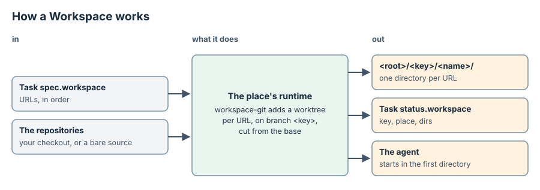

# Workspace



## What it is for

A Workspace is the set of directories that a Task's agent works in. It is
not a stored kind: a [Task](task.md) asks for it in `spec.workspace`, and
TaskController records it in `status.workspace`.

- **What it is.** One directory per URL in `spec.workspace`, in the same
  order. The agent starts in the first directory. It can also read and
  write the others.
- **Who makes it.** The runtime of the Task's place makes it, before the
  session starts. For a git URL, `runtime-mux` runs `workspace-git`. That
  program adds a git worktree on a new branch. The branch name is the
  session key, `<task name>.<task uid>`, unless the URL gives `?branch=`.
  The base is the URL's `#fragment`. Without a fragment, the base is the
  remote's default branch, as a fetch just before shows it.
- **Where it lives.** On the place, under the runtime's root:
  `<root>/<key>/<repository name>/`. For `runtime-mux` the default root is
  `~/.local/share/runtime-mux/workspaces`.
- **How a Task gets one.** Each Task gets its own, under its own key. Two
  Tasks never share a git worktree. Two Tasks can name the same `file://`
  directory: the runtime uses that directory as it is.
- **When the Task finishes.** A Concluded Task keeps its session and its
  workspace. Nothing is removed.
- **When you delete the Task.** TaskController releases the session, then
  cleans the workspace. `workspace-git` commits the changes that exist only
  in the worktree, untracked files included, to
  `refs/fleet/preserved/<key>/<name>` in the repository. Then it removes the
  worktree. The branch stays. A later make prunes preserved refs older than
  `preserve.days` (30 by default), and the branches of a bare source that
  the remote already has. It never deletes a branch of your checkout.
- **Multi-repo.** Yes: give several URLs. Each one becomes a directory under
  the same key.

```text
repository (your checkout, or a bare source of the remote)
   └── branch <task name>.<task uid>, cut from the base (#fragment or origin/HEAD)
          └── worktree  <root>/<key>/<name>/   ◀── the agent of the Task works here
```

## When you write one

You do not write a Workspace. You write its URLs in a Task's
`spec.workspace`. Write `[]` to let the agent start in the runtime's
default directory, with no workspace.

## Example

A Task that spans two repositories and a notes directory:

```json
{
  "apiVersion": "fleet/v1alpha1",
  "kind": "Task",
  "metadata": {"name": "api-and-client"},
  "spec": {
    "harness": "claude-code",
    "host": "local",
    "brief": "Add the export endpoint and call it from the client.",
    "workspace": [
      "git+https://github.com/example/api.git#main",
      "git+https://github.com/example/client.git?branch=export-call",
      "file:///home/me/notes"
    ],
    "dispatch": false
  }
}
```

The agent starts in the `api` worktree. The `client` worktree is on the
branch `export-call`. `/home/me/notes` is used as it is.

## Spec

A Workspace has no spec of its own. `spec.workspace` of the Task is a list
of absolute URLs, `<scheme>://…`. Fleet checks that shape, and nothing else:
the runtime reads the scheme, the query and the fragment.

| URL | What `workspace-git` makes |
| --- | --- |
| `git+https://host/org/repo.git` | A worktree on a new branch, from the default branch. |
| `git+https://host/org/repo.git#v2` | The same, from `v2`. |
| `git+ssh://git@host/org/repo.git?branch=feat-x#main` | A worktree on `feat-x`, made from `main` when it does not exist. |
| `git+file:///home/me/app?branch=feat-x#main` | A worktree of that checkout itself, on its own `feat-x`. |
| `git+file:///home/me/app#refs/fleet/preserved/<key>/app` | A worktree on work that an earlier release preserved. |
| `file:///home/me/notes` | Nothing: the directory, as it is. |

A remote URL gets a bare source of its own under `<root>/.sources/`. A
`git+file` URL to a local checkout gets a worktree of that checkout, so a
commit in the worktree is in the checkout at once. A branch that is already
checked out somewhere else gets `<branch>-2`, `<branch>-3` and so on. The
runtime's manifest lists the schemes it handles. A Task with any other URL
waits with `WorkspaceUnsupported`.

## Status

TaskController is the only writer of `status.workspace`.

| Field | Meaning |
| --- | --- |
| `key` | The workspace key, the same as the session key. |
| `host` | The place whose runtime made it. |
| `dirs` | One directory per URL, in the Task's order. The session starts in the first. |

The field is absent for an empty list, until the runtime made the
workspace, and after the clean.

## Lifecycle

```text
Task dispatched ─▶ Materialize ─▶ Spawn ─▶ … ─▶ Concluded (kept)
                   (workspace)    (start in the first dir)
fleet delete ─▶ Release (stop) ─▶ CleanWorkspace (stop with release) ─▶ finalizer off
                                   preserve the work, remove the worktrees, keep branches
```

- `Materialize` is the runtime's `workspace` call, at most 3 attempts. A
  call with the same key answers the same directories, so a lost answer is
  settled by asking again.
- `CleanWorkspace` is the runtime's `stop` with `release`. A clean is safe
  to repeat: it runs again after each wait, and three failures raise
  `NeedsAttention/CleanFailed`.
- A runtime never removes a `file://` directory, and never deletes a
  branch on release.

## Related kinds

- A [Task](task.md) owns at most one Workspace, and its one
  [Session](session.md) runs in it.
- A [Conversation](conversation.md) on a route with a `{base}` workspace
  gives each Task of the thread `file://<base>/<conversation name>`. The
  manager makes that directory, and removes it when the thread retires.
- [Runtimes](../../runtime/README.md#workspaces) say how each runtime
  makes a workspace, and how to customize one.
