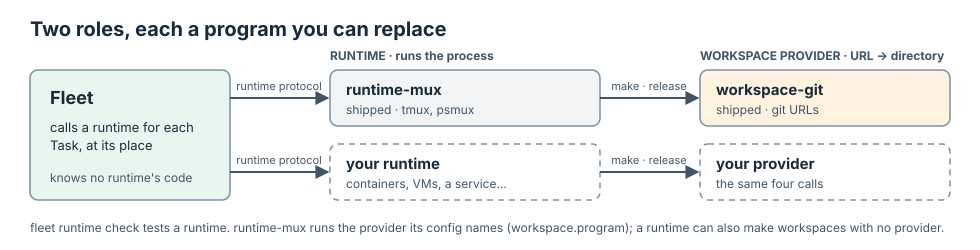
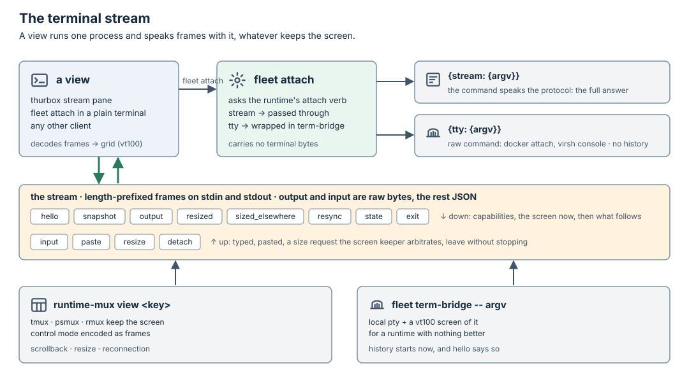
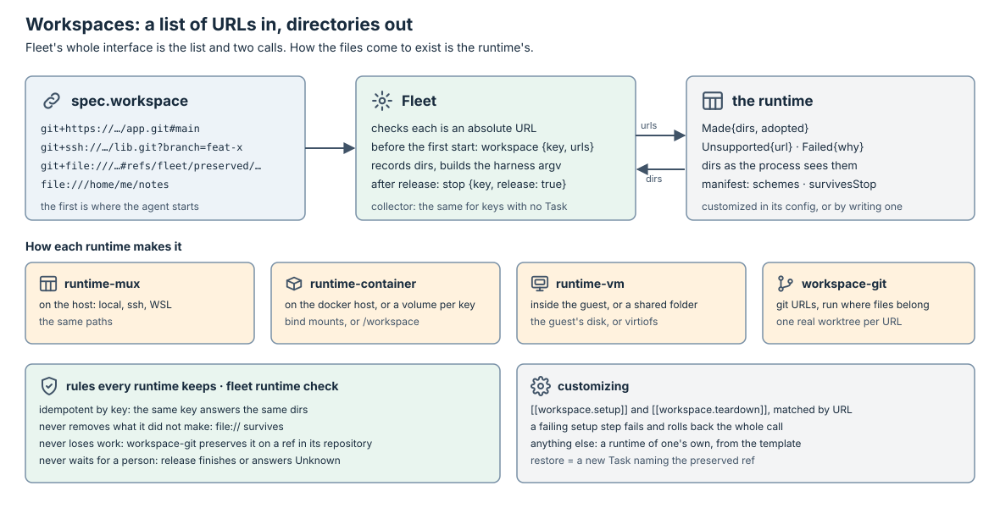

# Runtimes

A runtime is any program that runs one keyed process at a place and tells
Fleet about it.
Fleet reaches every session through it and links no runtime's code.
`runtime-mux` (`crates/runtime-mux`) is the default runtime. How the runtime fits between thurbox
and Fleet is the [overview](../README.md).
How `runtime-mux` reaches hosts, where psmux differs from tmux, and its
status channel are [runtime-mux.md](runtime-mux.md).

## Two roles



- A **runtime** is a role. Any program that answers
  [the runtime protocol](#the-runtime-protocol) at a place is a runtime.
  `runtime-mux` is the runtime that Fleet ships. It runs sessions in tmux or
  psmux. `examples/runtimes/tmux.sh` is a minimal runtime in a shell script.
  Write your own for containers, VMs or a remote service.
  `fleet runtime check` runs the conformance suite against it.
- A **workspace provider** is a role inside a runtime. It is a program that
  a runtime runs to turn a workspace URL into a directory. `workspace-git` is
  the provider that Fleet ships, for git URLs. Fleet does not see the
  provider: Fleet sees only the runtime's `workspace` verb. `runtime-mux`
  runs the provider that its `workspace.program` setting names. Any program
  that answers the same four calls can replace `workspace-git`
  ([the calls](#workspace-git-the-shipped-workspace-provider)). Another runtime
  can make workspaces without a provider.

This page owns two contracts and one verb:

- [the runtime protocol](#the-runtime-protocol), how Fleet drives a runtime;
- [the terminal stream](#the-terminal-stream), how a view attaches to a
  session on any runtime;
- [workspaces](#workspaces), how a list of URLs becomes the directories a
  session works in.

## The runtime protocol

A runtime is any program. Fleet runs it through `fleet-exec`, one bounded
process per call: `<program> <verb>`, a JSON request on stdin, and on stdout
`{"known": …}` or `{"unknown": {"why": …}}`. Unknown never concludes.

| Verb | Required | Answer |
| --- | --- | --- |
| `manifest` | yes | protocol version, the verbs supported and, from version 2, each place's readiness |
| `start` | yes | adopts the one live process holding the key, else starts `argv` with `env` in the workspace made under that key |
| `inspect` | yes | `None`, `Running{id}`, `Exited{id, code}`, and `Paused` with the `pause` verb |
| `stop` | yes | a process already gone counts as stopped; `release: true` also removes the key's workspace |
| `pause` | no | stops the key's process and keeps the key: `inspect` answers `Paused` until the next `start` or `stop` ([pause](#pause)) |
| `list` | no | every key the runtime holds a process, a pause or a workspace for, for the collector |
| `input` | no | types text, optionally submits |
| `capture` | no | screen text, cursor, foreground process, title |
| `exec` | no | a bounded command, `in: host` or `in: workspace` (inside the place), deadline and output cap |
| `workspace` | no | `{key, urls}` → one directory per URL, as the process sees it ([workspaces](#workspaces)) |
| `attach` | no | `{stream: {argv}}` or `{tty: {argv}}`: how to open a terminal stream ([the terminal stream](#the-terminal-stream)) |
| `shell` | no | `{stream: {argv}}` or `{tty: {argv}}`: how to open a shell beside the key's process, on its place ([the shell](#the-shell)) |
| `browse` | no | a directory's subdirectories on the place, each marked when it is a git checkout ([browse and branches](#browse-and-branches)) |
| `branches` | no | a repository's branches on the place and its default ([browse and branches](#browse-and-branches)) |

Every verb is idempotent by key. The runtime knows no harness, Task or
journal: pause is `pause`, resume and revive are `start` with the harness's
resume argv, idle comes from agent hooks, delivery is proven by the agent's
prompt hook. Fleet reads an agent's state off the `capture` screen with its
own rules, below the hooks; the runtime only returns the screen.

Fleet's config names each runtime in `[runtimes.<name>]`, a `program`, and
its [places](#places-protocol-version-2). A Task's `spec.host` names a place,
`<runtime>/<place>`, so it chooses the program
([configuration](../fleet/configuration.md#runtimes-and-their-places)).

### Protocol version 1

The reference script answers it, `runtime-mux` answers it as well as
[version 2](#places-protocol-version-2), Fleet's `exec` runtime kind speaks
both, and `fleet runtime check` holds both runtimes to it in CI. Fleet calls
`workspace` before a Task's first start, bounded by the runtime's
`workspaceTimeoutMs`. It reads the manifest's `workspace.schemes` first and
refuses a URL whose scheme is not listed, without a call. `fleet attach` asks
`attach` once the runtime's `manifest` declares it.

Every request is a JSON object carrying `"protocol": 1`; `manifest` answers
whatever the request says. A runtime that does not speak the version asked
answers Unknown. An answer is `{"known": …}` or `{"unknown": {"why": …}}`
on stdout, with exit status 0; anything else (a program that is not there, a
non-zero exit, a timeout, output that does not parse) is Unknown to Fleet.
A key is 1 to 128 ASCII letters, digits, `.`, `-` or `_`; any other answers
Unknown.

| Verb | Request (besides `protocol`) | Known answer |
| --- | --- | --- |
| `manifest` | — | `{"protocol": 1, "verbs": [...]}`, and `workspace: {schemes, survivesStop}` with the `workspace` verb |
| `start` | `key`, `argv`, `env` (object), `dir` (absolute, optional) | `{"started": {"id", "adopted"}}`, or `{"failed": {"why"}}` when nothing can have started, such as a missing multiplexer |
| `inspect` | `key` | `"none"`, `{"running": {"id"}}`, `{"exited": {"id", "code"}}`, `code` null for a signal, or `"paused"` |
| `stop` | `key`, `release` (optional) | `"stopped"`, whether or not a process was there |
| `pause` | `key` | `"paused"`, or `"none"` when no process holds the key and the key is not paused |
| `list` | — | `{"keys": [...]}` |
| `input` | `key`, `text`, `submit` | `"sent"`, or `"none"` when no process holds the key |
| `capture` | `key`, `lines` (optional) | `{"screen": {"text", "cursorRow", "cursorCol", "foreground", "title"}}`, or `"none"`; `title` is the one the program set (OSC 0 or 2), and a runtime that cannot read it omits it |
| `exec` | `argv`, `in` (`host`), `dir`, `timeoutMs`, `outputCap` | `{"exited": {"code", "stdout", "stderr"}}`, `{"timedOut": {"stdout", "stderr"}}` or `{"failed": {"why"}}` |
| `attach` | `key` | `{"stream": {"argv"}}`, `{"tty": {"argv"}}`, or `"none"` when no process holds the key |
| `shell` | `key` | `{"stream": {"argv"}}`, `{"tty": {"argv"}}`, or `"none"` when no process holds the key ([the shell](#the-shell)) |
| `workspace` | `key`, `urls` | `{"made": {"dirs", "adopted"}}`, `{"unsupported": {"url"}}` or `{"failed": {"why"}}` ([Workspaces](#workspaces)) |

`runtime-mux` answers every verb above. It runs its windows on a tmux
server of its own, socket `runtime-mux` (`RUNTIME_MUX_SOCKET` names
another), never on thurbox's interface socket: an inherited
`THURBOX_SOCKET` is ignored. On Linux, when a systemd user manager answers
at `$XDG_RUNTIME_DIR/systemd/private`, `runtime-mux` starts that server in
a scope of its own (`systemd-run --user --scope --collect`). The server is
then outside the cgroup of the process that called `runtime-mux`, so a
stop of the Fleet unit does not stop it. `runtime-mux` asks once per
process whether it can have a scope (`systemd-run --user --scope -- true`).
When that probe fails, it starts the server without one. A process is a
window named after its key, and a pane kept after its program exits is
how `inspect` reports the code; a `start` replaces it. A host reboot
takes the server and its windows, so `runtime-mux` also keeps a start
record for each key it starts:

- A `start` writes the record, a file that holds the key's pane id, under
  `${XDG_DATA_HOME:-~/.local/share}/runtime-mux/started/`, which a reboot
  keeps. The record is `<digest>/<server>/key.<key>`. `<digest>` names the
  private directory that holds the server's socket. `<server>` is the
  server's name, `<socket>` or `<socket>@<place>`, in hexadecimal, split
  into directories of at most 128 characters. So no key or place name can
  make two servers share a directory, and a long name still fits the
  filesystem's limit on a file name.
- A `stop` removes the record.
- `inspect` answers `{"exited": {"id", "code": null}}` for a key with a
  record and no window. Fleet then revives the session on its
  conversation.
- `list` names a key with a record.

Starts and stops on one server run one at a time, so
two starts of one key make one window: they hold a kernel lock on a file in
the private directory tmux keeps the socket in (`<TMUX_TMPDIR or
/tmp>/tmux-<uid>`, made `0700` when missing and refused when another user
can write to it), opened without truncating or following a link. A remote
place's server has locks of its own, named after the place, so a slow place
never holds up a start on this machine. `exec` runs `in: host` only, on the
request's place, and kills the command's process group at the deadline. It reads
each stream to its end and keeps `outputCap` bytes, so a long output does
not change how the command ends; a child that left the group and holds a
stream open does not hold the answer past the deadline. The `runtime-mux`
program serves this machine and remote places over ssh and WSL
([runtime-mux's places](#runtime-muxs-places)). It makes workspaces on this
machine by running `workspace-git` there
([its workspaces](#runtime-muxs-workspaces)). A workspace call takes a lock
of its key only, never the server's lock: a first clone or a long setup step
does not hold up a start or a stop of another key. A stop that releases a
workspace takes the key's lock first, then the server's, and lets go of the
server's lock once the process is stopped: the teardown and the release hold
the key only.

thurbox's stream pane (`stream_panes` in its `settings.toml`) is a view: it
opens a local tmux pane through `runtime-mux view --scrollback <lines> --pane
<id>` on its own socket, with its own `scrollback_lines`, and decodes the
frames into the chunks its control-mode pane gives.
Size requests still go to the server through thurbox's own backend.

`runtime-mux` answers `attach` with a `stream`: its own `view` on the key,
naming its socket and `TMUX_TMPDIR`. `runtime-mux view` adopts the key's pane
through its control-mode client, sized by the view's first `resize`, and
encodes what the server sends as frames; a `detach` lets go of the pane and
leaves the process running. On a multiplexer that snapshots a pane in step
with its output (tmux, rmux), the first screen is the first snapshot or
resync, and a `state` frame follows it with the title and modes set before
the view came. On one that cannot (psmux), `hello` names no `snapshot` and
the history and that state arrive as output. The reference script answers `attach` with a raw
tmux client on the key's pane, a `tty` answer. An `attach` argv runs where the view runs, so it names
everything it needs, such as a socket by its path.

What Fleet's `exec` kind does with the answers:

- `start` runs the harness profile's launch argv
  ([harness profiles](../fleet/controllers/task.md#harness-profiles)), with
  `FLEET_SIGNAL_FILE` in `env`;
- a session's id is its key, so it outlives each process started under it;
- readiness, workspace trust and an idle agent come from the agent's signals:
  an agent that reported anything but `blocked` is ready and past any trust
  dialog, and a running agent is at rest once it last reported `idle`. An
  agent that reports nothing before its first turn is read off its
  `capture` screen as its harness profile says
  ([harness profiles](../fleet/controllers/task.md#harness-profiles)).
  Before its first report, a trust dialog on its `capture` is Untrusted, and
  anything else Unknown, so a brief waits;
- delivery is proven by the agent's prompt hook, not by `input`;
- the agent state of a session whose hooks do not say it now is read off its
  `capture` text and title with the harness's screen rules
  ([screen rules](../fleet/controllers/task.md#screen-rules)), at most one
  capture per session every 2 s. A screen state is for a view: readiness,
  rest and delivery still wait for the hooks;
- an `exited` process is lost, since a `stop` leaves `none`: revive is `start`
  with the profile's resume argv on the conversation the hooks reported. Fleet
  first marks the restart in the signal file, so readiness and trust wait for
  the new process's own report;
- `paused` is a paused session, and resume is `start` with the resume argv,
  as for a revive. Fleet pauses a session only on a runtime whose
  `manifest` declares `pause`. On any other runtime, whether a session is
  paused stays Unknown, and Unknown never pauses.

Agent hooks append to the file Fleet passes as `FLEET_SIGNAL_FILE` in `start`
([signals on a remote place](#signals-on-a-remote-place)). Fleet reads it
directly on `local`, so a local runtime needs nothing for signals.

`fleet runtime check -- <program> [args]` is the conformance suite. It prints
one line per case, `ok` or `FAIL` with why, and exits non-zero when any fails:

- `manifest` names protocol 1 or 2 and the four required verbs;
- a protocol mismatch answers Unknown;
- an error (a request that is not JSON, a bad key, an unknown verb) answers
  Unknown, never None;
- `inspect` of an absent key answers None, and a stop of it succeeds;
- concurrent starts with one key leave one process: four at once answer
  one id, and only one of them made it;
- two starts with one key leave one process: the same id, the second
  adopted, and the key once in `list` when the runtime has it;
- a stop ends the process;
- an exited process answers Exited with its code, or None;
- with `workspace` declared: two calls with one key answer the same
  directories, the second adopted, and a release leaves a `file://` directory
  in place;
- with protocol 2: `manifest` reports `local`, the place it was asked about,
  and a request without a place answers Unknown. The other cases name
  `local`;
- with `browse` declared: a directory with a plain subdirectory, a checkout
  and a file lists the two subdirectories, the checkout marked, and a
  missing directory answers `failed`;
- with `branches` declared: a repository with the branches `main` and
  `feat` lists both, in any order, with `main` as its default, and a directory inside a
  checkout answers `failed`. The check makes the repository with this
  machine's `git`;
- with `pause` declared: a pause of a running key answers `paused`, and
  then `inspect` answers `paused` and `list` names the key; a pause again
  answers `paused`; a `start` runs the key again; a pause of a key nothing
  holds answers `none`; and a `stop` of a paused key leaves `none`;
- with `shell` declared: a key no process holds answers `none`, a running
  key answers a `stream` or a `tty` argv on two calls in a row, and after a
  stop the key answers `none`. The check does not open the shell, so it
  does not prove that the second call reaches the same one.

The cases start `sleep` and `sh` in the runtime's place. CI runs it, through
`crates/fleet-cli/tests/e2e_runtime_exec.rs`, against `runtime-mux` and against
[`examples/runtimes/tmux.sh`](../../examples/runtimes/tmux.sh), a reference
runtime in one POSIX `sh` script over tmux and `jq`. It serializes starts and
stops with a kernel lock in tmux's private socket directory, taken with
`flock(1)` or else `perl`, which a killed holder releases.

#### Pause

`pause` stops the key's process and keeps the key, so a later `start`
resumes the session in the same workspace. Fleet uses it to free the memory
and the processor time of an idle agent
([pausing an idle session](../fleet/controllers/task.md#pausing-an-idle-session)).

- After a pause, `inspect` answers `"paused"` and `list` names the key.
  `input`, `capture`, `attach` and `shell` answer `"none"`: no process holds
  the key.
- The workspace stays as it is.
- A `start` of a paused key starts its `argv`, and the key is no longer
  paused. A `stop` of a paused key leaves `none`, and `release: true`
  removes its workspace as for any key.
- A pause of a paused key answers `"paused"`. A pause of a key that no
  process holds answers `"none"`.
- The runtime knows no harness and no conversation: the argv that resumes
  the conversation is Fleet's, in the `start` that follows.

`runtime-mux` pauses a key in three steps:

1. It closes the key's shell.
2. It writes a mark for the key, an empty file
   `${XDG_DATA_HOME:-~/.local/share}/runtime-mux/paused/<digest>/<server>/key.<key>`.
   `<digest>` and `<server>` are the start record's.
3. It stops the agent's window.

A pause takes the server's lock, as a start and a stop do. While the
agent's window is there, it answers for the key, so a pause cut short
before step 3 reads as running. `inspect` answers `paused` for a key with
a mark, no agent window and no shell. A mark with a shell left answers
Unknown, and the next pause closes the shell. A `start` removes the mark after it makes or adopts the
window, and a `stop` removes it after it stops the process. A reboot keeps
the mark, as it keeps the start record, so a paused key reads as paused
after a reboot and never as exited.

An earlier `runtime-mux` wrote the mark as
`runtime-mux-<socket>.paused-<key>` in the private directory tmux keeps the
socket in, which a reboot empties. For a rollback to that version:

- A pause writes the mark in both places.
- A `start`, `stop`, `pause` or `inspect` of a key copies its earlier mark
  to the data directory, under the server's lock. A `list` copies every
  earlier mark. The copy leaves the earlier mark in place.
- A `start` and a `stop` remove both marks.
- An earlier `runtime-mux` removes only its own mark. A key that it starts
  or stops after a rollback keeps its mark in the data directory, and reads
  as paused again after the next update.

### Places (protocol version 2)

The decision is
[ADR-42](../thurbox/architecture.md#adr-42-hosts-belong-to-runtimes).

A place is where a runtime runs a process: this machine, an ssh host, a WSL
distro, a VM. A place's id is `<runtime>/<place>`, with `local` as the short
form of `<runtime>/local` on the default runtime
([configuration](../fleet/configuration.md#runtimes-and-their-places)).

```text
Fleet config                        Fleet                 runtime
[runtimes.mux]                        │                      │
program = "runtime-mux"               │ manifest {places}    │
[runtimes.mux.places.devbox] ────────▶├─────────────────────▶│ checks each place
kind = "ssh"                          │◀─────────────────────┤ each place: ready, why
destination = "me@devbox"             │                      │
                                      │ start {key, place}   │
Task spec.host = "mux/devbox" ───────▶├─────────────────────▶│ runs it on devbox
                                      │ place = {name,config}│
```

Changes from version 1:

- **`place` on every request.** Every request but `manifest` carries
  `place: {name, config}`, so `list` answers for one place. `config` is the
  place's table from Fleet's config, as JSON. Fleet does not read it. The
  runtime trusts it: it comes only from the operator's Fleet config. A
  runtime that gets a place or a config it cannot use answers Unknown with
  why, and so does a version 2 request without a place. The runtime keeps no
  place config of its own.
- **`manifest` reports places.** The request carries `places`, every
  configured place with its config. The answer adds
  `places: [{name, platform, dynamic, ready, why}]`:
  - `platform` is `posix` or `windows`;
  - `dynamic` is true when each key gets a new machine, such as a VM;
  - `ready` is false when the place lacks something, and `why` names it and,
    where the runtime knows it, the command that fixes it;
  - the runtime may add places it discovers, such as WSL distros, with an
    empty config.

  A runtime with no `[runtimes.<name>.places]` table has one place,
  `local`, with an empty config. An unreachable runtime makes its places
  Unknown, never absent.

Fleet asks `manifest` with `"protocol": 2`, which a runtime of either version
answers. Each later request carries the version that manifest named: a
version 1 runtime gets version 1 requests, with no place. Fleet keeps the
version for the life of its process and asks `manifest` again after any
Unknown answer, so a runtime replaced by one of another version is followed.
Each request names the Task's place, with its table from
Fleet's config. A version 1 runtime serves only `local`, with no config: Fleet
sends it nothing for another place, and that place stays Unknown.

#### runtime-mux's places

`runtime-mux` answers both versions. A version 1 request runs at `local`,
this machine, which takes no config. Any other place is a remote place: a
machine over ssh (`kind = "ssh"`) or a WSL distro (`kind = "wsl"`), with the
keys of [its table](../fleet/configuration.md#remote-places-on-runtime-mux).

```text
request.place ──▶ local ─────────▶ this machine's multiplexer
              └─▶ kind = "ssh" ──▶ ssh <destination> tmux -L runtime-mux …
              └─▶ kind = "wsl" ──▶ wsl.exe -d <distro> tmux -L runtime-mux …
```

- `runtime-mux` refuses a place with an unknown key, a missing `kind`, an
  `ssh` place without a `destination`, or a config for `local`. It answers
  Unknown and names what is wrong, and `manifest` reports the place not
  ready.
- `local` is ready when the multiplexer answers. A remote place is ready
  when its launcher reaches it without a prompt, `fleet` is on its `PATH`,
  and its multiplexer answers at tmux 3.2 or newer, or psmux 3.3.8 or
  newer. A WSL place also needs `flock`.
  `why` names what is missing and the command that shows or fixes it.
- `manifest` probes each place on a thread of its own, and waits 8 s for
  all of them together. A place that has not answered by then is not
  ready: its probe timed out. Fleet asks a Task's runtime about the Task's
  own place only, so a place that does not answer never holds up a Task on
  another.
- A remote place's commands get its `PATH`: `path_prepend`, then the place's
  login `PATH`, then the launcher's ([runtime-mux.md](runtime-mux.md)).
  The login `PATH` is read once and cached for 10 minutes beside the locks.
  `exec` reads it inside its own deadline, and runs with `path_prepend`
  alone when it cannot. `start` looks for the agent on that `PATH` first,
  and answers `failed` when it is not there.
- A session's `env`, `FLEET_SIGNAL_FILE` among it, and the place's `PATH`
  reach its window in the `new-window` line itself: `-e` for each variable,
  and the login wrap's `PATH` assignment. The line travels on the stdin of
  the control connection that ssh or `wsl.exe` launches, never in its
  argv. So nothing depends on which of this machine's variables `wsl.exe`
  passes (`WSLENV`).
- A session's `env` can name a `PATH`. Then that `PATH` is the window's
  `PATH`, in its own order. On `local`, `runtime-mux` puts the directory of
  its `thurbox-cli` in front when the `PATH` does not name it. On a remote
  place, the login wrap puts each `path_prepend` directory that the `PATH`
  does not name in front. tmux ignores `-e PATH`, so the `PATH` goes in the
  window command: an `env PATH=…` prefix on `local`, and the login wrap's
  assignment on a remote place.
- On the `local` place, tmux and RMUX make the window with a one-shot
  `new-window`, and every user of the machine can read a client's argv.
  So the client's argv holds at most `has-session` and the session's options,
  then `source-file -`. The `new-window` words, `-e` for each variable
  among them, go on the client's stdin, as one line of tmux's command
  syntax. The server sets each variable in the window: no shell assigns
  one, so a name that a shell keeps read-only, such as `UID`, starts the
  window as any other.
- psmux takes the environment in its window's PowerShell script, as
  `-EncodedCommand`. That argument holds every value, base64-encoded: on a
  psmux place, `env` is in an argv.
- A `start` whose `argv` or `env` names a file in `FLEET_ASSET_DIR`, a
  directory on this machine, copies that directory to
  `~/.local/state/fleet/assets/<key>` on the place. Every word of `argv` and
  every value of `env` that names the directory names the copy instead, so
  a harness's hook file, such as pi's extension, is the place's own. A
  `stop` removes the copy. A launch that names none of its files copies
  nothing.
- A `start` whose `env` names `FLEET_HARNESS_DIR`, the user's harness
  profiles on this machine, copies it to
  `~/.local/state/fleet/harnesses/<key>` on a POSIX place and names the
  copy, so `fleet signal` there reads the profile's own payload fields.
- A `start`'s `dir` is absolute by the place's rules, not by this
  machine's: `/…` on a POSIX place, a drive or UNC path on a Windows one.
- `start`, `inspect`, `stop`, `pause`, `list`, `input`, `capture` and `exec`
  run on the place. A pause mark and a start record of a remote key stay on
  this machine.
- `workspace` and a releasing `stop` run `workspace-git` on the place, from
  the place's `PATH`, over the same launcher. A place without it takes
  `file://` URLs only: directories already there, which a release keeps,
  with no setup steps. A release there of a key that has a directory under
  the root is Unknown until `workspace-git` runs again. A `git+` URL there answers `failed` and names
  `workspace-git`. The workspaces are under
  `~/.local/share/runtime-mux/workspaces` on the place. A `git+` URL gets a
  worktree there, on the key's own branch, with the same `#ref`, preserved
  refs and retention as on `local` ([workspace-git](#workspace-git-the-shipped-workspace-provider)). The
  config's `preserve.days` and its setup and teardown steps apply on the
  place too; its `root` and `program` are this machine's only.
- `browse` and `branches` read the place's folders and repositories with
  one `sh` script over the launcher. A `browse` without `dir` lists the
  place's home.
- `attach` and `shell` answer with `runtime-mux view --place <place>`. The
  view builds that place's backend and reads the pane through its control
  connection over ssh or `wsl.exe`, as the other verbs do.
- A call whose place does not answer is Unknown, and names the place.
- A native-Windows place (`multiplexer = "psmux"` or
  `platform = "windows"`) runs its commands through an encoded PowerShell
  script, with `path_prepend` first on its `Path`.
  - Its readiness looks for `fleet` with `Get-Command`.
  - `exec` and `workspace` start the program as `launch_on_windows` does.
  - A copy of Fleet's files goes through `tar.exe`, which Windows has had
    since Windows 10 1803.
  - `browse`, `branches` and a workspace's setup and teardown steps read the
    place with `sh`, so they answer `failed` there and say why.
  - A window's environment goes, over the stdin of one PowerShell command,
    to a new file under `%LOCALAPPDATA%\runtime-mux`. The file is created
    with an ACL of its own that lets only the user open it, whatever the
    directory allows. The window's script names only that file: it loads
    it, deletes it, then starts the program. So no value is in any process's
    arguments. A failed launch removes the file. A psmux server on this
    machine does the same.
  - `exec` finds its program as PowerShell finds a command, so an npm
    `.cmd` shim or a `.ps1` script runs under `cmd.exe` or `powershell`. A
    shim's arguments are quoted so that `cmd.exe` reads no `&`, `|`, `<`,
    `>`, `^`, `%NAME%` or `!NAME!` in them: Rust std's rules for a batch
    file, under `cmd /v:off`.
- WSL stops a distro, and every process in it, soon after its last
  `wsl.exe` client exits. Each `runtime-mux` call is such a client. So a
  `start` or a `shell` on a WSL place also starts one waiter: a detached
  `wsl.exe` that runs `flock -n` and `tmux wait-for` on the place's server.
  The waiter keeps the distro running while that server runs, and exits
  with it. A second waiter for the same server exits at once. The distro
  needs `flock` (util-linux), and readiness says so when it is missing.

#### Signals on a remote place

An agent's hooks run on its place, and they cannot reach a file on Fleet's
machine. On a place other than `local`:

```text
place:  hook ─fleet signal─▶ ~/.local/state/fleet/signals/<key>.jsonl
Fleet:  runtime exec: fleet signal-read <that file> ──▶ fold ──▶ session state
```

- Fleet passes `FLEET_SIGNAL_FILE=~/.local/state/fleet/signals/<key>.jsonl`.
  The `fleet` on the place expands `~` to its home and makes the directory.
- Fleet reads the file through the runtime's `exec`, over the connection
  the runtime has to the place: `exec` runs `fleet signal-read <file>
  [<length>]`, so the place's own `fleet` reads it, on POSIX and on Windows
  alike. A file not written yet is a session that reported nothing. An
  `exec` that fails is Unknown, and so is a path that is not a regular
  file, such as a FIFO or a symlink: the read neither blocks nor follows it.
- The session's event outbox is beside the signal file, at
  `<that file>.events`. Fleet reads it through `exec` too:
  `fleet signal-read --from <offset> <file>` prints the offset its read
  starts at on a line, then at most 512 KiB from there. It starts at 0
  when the file is shorter than the offset. Each byte that is not part of
  valid UTF-8 is printed as NUL, so every offset stays as it is in the file,
  and the line it is on fails to parse and is skipped. A path that is not a
  regular file, such as a FIFO or a symlink, is refused, and Fleet reads it
  as Unknown. Exit 3 is a file not written
  yet.
- Before a revive or a resume, Fleet reads the file's length through
  `exec` (`fleet signal-read --length <file>`) and keeps it in its own data, `<data dir>/signals/<key>.started`.
  It writes nothing on the place. A state in the file before that length is
  the previous process's: readiness and trust wait for the new process's
  own report. No time is compared, so the place's clock need not agree with
  Fleet's. A file shorter than the kept length was made again, and is read
  whole.
- One read takes the last 256 KiB before that length, for the prompts and
  the conversation, and the last 512 KiB after it, for the state. Both stay
  under `exec`'s 1 MiB cap, so the newest report is never cut. Each range is
  computed from the file's length first and read by seeking to it, so a
  read never scans the whole file.
- A restart on a remote place is three runtime calls: the manifest, the
  length through `exec`, then `start`. The manager's lease covers three
  calls per operation.
- When the length read does not answer, Fleet starts nothing and asks
  again on the next pass. When the runtime cannot read the file at all (no
  `exec`, or a place where `exec` fails, such as native Windows), Fleet
  starts the session and marks the boundary unknown: its state stays
  Unknown until the next restart, and no state the previous process
  reported is taken for the new one's.
- The runtime writes no signal line and knows nothing of their format.

#### The shell

`shell` answers how to open an interactive shell beside the key's process:
on its place, in the directory the process is in. The answer has the shapes
of [`attach`](#the-runtimes-attach), and its argv runs where the view runs.
`fleet shell <task>` asks it, and bridges a `tty` answer as `fleet attach`
does ([contracts](../fleet/contracts.md)). thurbox's companion shell opens
with it, through the session's Fleet, so thurbox needs no route of its own
to the place.

- `"none"` when no process holds the key, as `attach` answers.
- The shell belongs to the key. A second call opens the same shell, so a
  view that leaves and comes back finds what it typed. A `stop` of the key
  closes it.

`runtime-mux` opens the shell in a window of its own, beside the key's, on
the same server. Its program is the machine's shell (`$SHELL`, else
`/bin/sh`; `%COMSPEC%` on Windows). Its directory is the one the key's
process is in now, as the multiplexer reads it. When that directory is
gone, the multiplexer starts the shell in its own home. `runtime-mux` reads
nothing about the directory from its own disk, which need not be the
place's. The answer is a `stream`: `runtime-mux view` on the shell's pane.
The window closes when the shell exits, and the next call opens a new one.
`list` does not name the shell. A `stop` closes every window named as the
key's shell, so two of them never keep a stop from concluding.

#### Browse and branches

Two optional read-only verbs let a creation flow pick a repository on a
place, and the branch a worktree there starts from. Each request carries
`protocol` and, from version 2, `place`.

| Verb | Request | Known answer |
| --- | --- | --- |
| `browse` | `dir` (absolute, optional: the place's home) | `{"listing": {"dir", "entries": [{"name", "repo"}]}}`, or `{"failed": {"why"}}` |
| `branches` | `repo` (absolute) | `{"branches": {"names", "default"}}`, or `{"failed": {"why"}}` |

- **`browse`** lists the subdirectories of `dir`, sorted by name. It follows
  a link to a directory and leaves files out. `repo` is true when the entry
  is the top of a git work tree: a checkout or a linked worktree. A
  directory that cannot be read
  answers `failed`, with why. A relative `dir` answers Unknown.
- **`branches`** lists each local branch of the repository at `repo` and
  each of its `origin/*` branches, as they are: the runtime does not fetch.
  The order is the runtime's. `runtime-mux` lists the local branches first,
  and each group by name.
  `default` is the branch a new one starts from: `origin`'s default
  (`origin/HEAD`, else `origin/main`, else `origin/master`), else the branch
  checked out, else the first, or `null` with no branch. `origin`'s
  branches are told from local ones by their refs: a local branch named
  `origin/main` is local. `repo` must be the top of the work tree: a
  directory inside a checkout answers `failed`.
- A dedicated verb is simpler than `exec` here. An `exec` answer is the text
  of the place's own command, so the reader would need one parser per
  platform. The runtime knows its place, and a VM runtime can answer from
  its own API.

`runtime-mux` answers both at `local`, from this machine's filesystem and
its `git`. The new-session modal still takes a clone URL, whose branches
`git ls-remote` lists on the machine thurbox runs on.

### What a runtime is

A runtime answers one question: run this command, under this key, in this
directory, at this place, and tell me about it. Where and how is its own
business.

`runtime-mux` (`crates/runtime-mux`) runs its processes on this machine, in
tmux, psmux or rmux (ADR-31). A new multiplexer of the tmux family is a
module in `runtime-mux`, not a runtime. A new kind of place is a runtime. No
`runtime-*` crate depends on another; shared code is a crates.io dependency.

Fleet must run a Task on the four required verbs alone, so a runtime without a
terminal is a full runtime:

- the brief reaches the agent at `start`, through the harness profile's argv
  or a file in the workspace, not only by typing;
- state reaches Fleet through `FLEET_SIGNAL_FILE`, not through the screen;
- the optional verbs add features and nothing more: without `input`,
  `fleet send` waits for the next start; without `capture`, no screen
  checks; without `attach`, no live view, and thurbox shows the Task without
  a terminal; without `pause`, an idle session keeps running.

The default install configures `runtime-mux` and nothing else. With no
multiplexer on the machine, Fleet does not fall back to another runtime: the
first `start` answers the missing dependency by name, and other runtimes are opt-in in `[runtimes.<name>]`.

## The terminal stream



A tmux server keeps the screen, accepts several clients and arbitrates their
sizes; a raw interactive command such as `docker attach` does none of that.
"Run this command in a pty" is therefore not an interface: what a view gets
would depend on the runtime.

What a view needs from a live session, whatever runs it:

1. the screen as it is now, on connect and after a dropped stretch;
2. the output that follows, in order, with size changes at their place in it;
3. a way to type, paste and resize;
4. to leave without stopping the process, and to come back;
5. other viewers at the same time, with one rule for who sizes the screen.

### The protocol

A stream is a process. The view starts it and speaks over its stdin and
stdout; it ends when either side closes. A frame is a type byte, the
payload's length as a big-endian 32-bit number, then the payload: `output`,
`state` and `input` are raw bytes, `paste` is UTF-8 text, and every other
payload is a JSON object. The vocabulary is `PaneChunk` (`crates/runtime-mux/src/contract.rs`),
which carries every item in the output's order on one channel:

| Direction | Type | Frame | Payload |
| --- | --- | --- | --- |
| down | `0x01` | `hello` | `{version, capabilities}`, capabilities from `snapshot`, `scrollback`, `viewers`, `resize` |
| down | `0x02` | `snapshot` | `{cols, rows, cursor: [col, row], normal, alternate}`: normal-screen history and rows, alternate rows or null, styled |
| down | `0x03` | `output` | bytes |
| down | `0x04` | `resized` | `{rows, cols}` |
| down | `0x05` | `sized_elsewhere` | `{elsewhere}`: whether another viewer sizes the screen |
| down | `0x06` | `resync` | a snapshot replacing the view's grid after dropped output |
| down | `0x07` | `state` | title and input modes as terminal bytes, to parse but not count as output |
| down | `0x08` | `exit` | `{"known": {code}}`, `code` null for a signal, or `{"unknown": {why}}` |
| up | `0x81` | `input` | bytes, sent as typed |
| up | `0x82` | `paste` | text, bracketed when the program asked for it |
| up | `0x83` | `resize` | `{rows, cols}`: a request the holder of the screen arbitrates |
| up | `0x84` | `detach` | empty: leave; the process keeps running |

A frame of a type the reader does not know, or a payload over 64 MiB, ends the
stream.

A view's first frame is a `resize`: the end that keeps the screen starts the
stream once it knows the size. `snapshot` comes next when the capability is
there, so a view never starts on an empty grid. Sizing follows ADR-27 everywhere: the viewer
being typed into sizes the screen, the others get `sized_elsewhere`.

`term-stream` (`crates/term-stream`) is a crate with only the frame types and
their codec: no process, no runtime, no transport. thurbox, Fleet and every
`runtime-*` may depend on it, as they may on `serde`.

### The runtime's `attach`

`attach` answers how to open a stream, in one of two shapes:

- `{"stream": {"argv": […]}}`: the command speaks the protocol. This is the
  full answer.
- `{"tty": {"argv": […]}}`: a raw interactive command, for a runtime that has
  nothing better (`docker attach`, `virsh console`, `kubectl attach -it`).

`fleet attach` always hands a view a stream. It passes a `stream` answer
through, and wraps a `tty` answer in `fleet term-bridge -- <argv>`, which runs
the command on a pty of its own and relays it as frames. A bridge keeps no
screen: it has nothing from before it started, so its `hello` names no
`snapshot`, and the view's first `resize` sizes the pty the command starts on,
which is what makes a program draw. That is the price of a runtime without a
screen keeper. A `paste` is bracketed when the command's output last asked
for bracketed paste. A `detach` ends the bridged command, such as a
`docker attach` client, and not the process it reached, even after the
command closed its terminal.

### Who keeps the screen

| Runtime | Screen keeper | `attach` answers |
| --- | --- | --- |
| `runtime-mux` | tmux, psmux, rmux | `stream`: `runtime-mux view <key>`, control mode encoded as frames |
| any runtime, minimal | none | `tty`: bridged by Fleet, no history; the reference script answers it |

## Workspaces



Fleet hands a runtime a list of URLs and gets one directory per URL back
([the Fleet side](../fleet/architecture.md#workspaces)). Everything else is
the runtime's: where the files live, how they are made, what is installed,
how work is kept when they go. That is where a workspace is customized, by
configuring a runtime or by writing one.

### The verb

`workspace {key, urls}` answers one of:

| Answer | Meaning |
| --- | --- |
| `Made{dirs, adopted}` | one directory per URL, in order, as the process sees it; `adopted` when the key's workspace already existed |
| `Unsupported{url}` | this runtime does not handle that URL |
| `Failed{why}` | nothing was made, or what was made was rolled back |

`stop {key, release: true}` removes the key's workspace with the process.

A runtime that implements `workspace` holds to these rules, and
`fleet runtime check` tests each:

- **Idempotent by key.** A second call with the same key answers the same
  directories, adopted. A partial workspace is never answered: the next call
  rolls it back and makes it again.
- **Never removes what it did not make.** A `file://` directory is used as it
  is and survives every release.
- **Never loses work on release.** Anything the workspace holds that exists
  nowhere else (uncommitted changes, unpushed commits) is preserved before the
  files go, in a durable place outside the workspace. How is the runtime's
  choice. Files the repository ignores are not work: it declares them
  disposable.
- **Never waits for a person.** Release always finishes or answers Unknown.

The `manifest` declares what Fleet may rely on:

- `workspace.schemes`: the URL schemes the runtime handles, such as
  `git+https`, `git+ssh`, `git+file`, `file`.
- `workspace.survivesStop`: the files outlive the process.

A runtime without `workspace` runs only Tasks with an empty list.

### URLs

The URL is the whole request: Fleet adds nothing to it.

| URL | What `workspace-git` makes |
| --- | --- |
| `git+https://host/org/repo.git` | a worktree on a new branch from the default branch |
| `git+https://host/org/repo.git#v2` | the same, from `v2` |
| `git+ssh://git@host/org/repo.git?branch=feat-x#main` | a worktree on `feat-x`, made from `main` when it does not exist |
| `git+file:///home/me/app?branch=feat-x#main` | a worktree of that checkout itself, on its own `feat-x` |
| `git+file:///home/me/app#refs/fleet/preserved/<key>/app` | a worktree on work an earlier release preserved in that checkout |
| `git+file:///srv/mirrors/repo.git#refs/fleet/preserved/<key>/repo` | a worktree on work an earlier release preserved in a bare repository |
| `file:///home/me/notes` | nothing: the directory, as it is |

Restoring preserved work is therefore a new Task whose URL names the preserved
ref; Fleet needs no verb for it.

### workspace-git, the shipped workspace provider

`workspace-git` is a small program a runtime runs where its files belong. No
runtime links it: each runs the program, so it runs where the runtime's files
are. Its layout:

```text
<root>/<key>/<name>/                  one real worktree per git URL
<root>/<key>/.fleet-workspace.json    written last; without it the workspace is partial
<root>/<key>/.fleet-sources           the checkouts the key's worktrees belong to
<root>/.sources/<digest>.git          a bare source per remote repository, fetched before each make
<root>/.sources/<digest>.lock         one lock per repository a worktree is made from
<root>/.checkouts                     the local checkouts worktrees were made from
```

- A `git+file` URL that names a local checkout, a repository with a working
  tree, gets a worktree of that checkout itself. Nothing is copied, and the
  checkout's `origin` is fetched first, so its `refs/remotes/origin/*` and
  `origin/HEAD` are the upstream's as they are now. A fetch that fails or stalls for 30
  seconds leaves the refs as they were:
  - an existing branch is the checkout's own branch;
  - a new branch is made in the checkout;
  - a commit made in the worktree is in the checkout at once;
  - `git -C <checkout> worktree list` lists the worktree.
- Any other git URL, a remote or a bare repository, gets a bare source of its
  own. A source fetches its remote's branches into `refs/remotes/origin/*`,
  and its tags. A fetch therefore never moves a branch that a worktree has
  checked out. Every branch in a source's `refs/heads/` is one that
  `workspace-git` made.
- Each worktree belongs to its repository, the checkout or the source, so its
  branch and its preserved ref are there.
- One lock per repository orders every make, release, rollback and retention
  on it, across runtimes that share a root.
- With one URL the session starts in `<root>/<key>/<name>`; with several the
  first URL's worktree is still the start, and every worktree is a real
  directory. Two URLs with one name get
  `<name>-2`.
- With no `branch`, the branch is named after the key. An existing branch is
  checked out, and one checked out elsewhere gets `<branch>-<n>`, from 2.
- A fragment names the base: a remote branch, a tag, a branch of the source,
  or a ref or commit as given, in that order. A checkout reads its own
  branches before its remote's, except that `origin/<branch>` always names
  the remote's. A `refs/…` fragment that a fetch
  of branches does not bring, such as preserved work, is fetched by name.
  With no fragment, the base is the remote's default branch (`origin/HEAD`,
  else `origin/main`, else `origin/master`); a checkout with no remote starts
  from the branch it has checked out.
- A `file://` URL takes no query and no fragment, and names an existing
  absolute directory. A `%XX` in a path is decoded.
- A key holds one workspace: the same key with other URLs fails.
- On release, a dirty worktree is committed, untracked files included,
  through a temporary index onto `refs/fleet/preserved/<key>/<name>` in its
  repository; then the worktree goes. The temporary index lives in the key's
  directory, never in a checkout's working tree. A read-only directory in
  the worktree does not stop its removal: once the work is preserved, each
  directory removed gets its owner's write permission, and the removal is
  tried again. Branches are never deleted on release. The release of a key
  that holds no workspace succeeds.
- On each make it prunes its own retention: preserved refs older than
  `preserve.days` (default 30), in sources and in checkouts, and a source's
  branches not checked out whose head the remote already has. A checkout's
  branches are the user's and are never deleted. A repository another call
  holds is left for the next make.
- Git never waits for a person: `GIT_TERMINAL_PROMPT=0`, and ssh runs in
  batch mode unless `GIT_SSH_COMMAND` or `GIT_SSH` names another command.

The program takes one JSON request on stdin and prints one answer:

| Call | Request | Answer |
| --- | --- | --- |
| `workspace-git make` | `{root, key, urls, preserveDays?}` | `{"made": {dirs, adopted}}`, `{"unsupported": {url}}` or `{"failed": {why}}` |
| `workspace-git release` | `{root, key}` | `"released"` |
| `workspace-git discard` | `{root, key}` | `"discarded"`: the worktrees go, nothing is preserved, for a workspace no session worked in |
| `workspace-git inspect` | `{root, key}` | `{"workspace": {urls, dirs}}`, or `"none"` |

Any other answer is `{"unknown": {why}}`, such as a rollback that did not
finish, and the caller concludes nothing from it. `root` is an absolute
path.

### Customizing a workspace

Each runtime offers what fits its places: `runtime-mux` runs setup and
teardown steps ([its workspaces](#runtime-muxs-workspaces)). A need no
configuration covers is a runtime of one's own: a script that answers
the protocol, held to the same rules by `fleet runtime check`.

### runtime-mux's workspaces

`runtime-mux` runs the `workspace-git` program on the session's place, so a
session sees the same paths. On a remote place it is the place's own
`workspace-git`, and the root is `~/.local/share/runtime-mux/workspaces`
there ([runtime-mux's places](#runtime-muxs-places)). Its own config file,
on this machine, holds the settings: the file at
`RUNTIME_MUX_CONFIG`, else `${XDG_CONFIG_HOME:-~/.config}/runtime-mux/config.toml`.
A missing file gives the defaults. An unknown key is refused.

```toml
[workspace]
root = "/home/me/.local/share/runtime-mux/workspaces"
program = "workspace-git"
preserve.days = 30

[[workspace.setup]]
match = "git+https://github.com/acme/app.git"
run = ["npm ci"]
```

| Key | Default | Meaning |
| --- | --- | --- |
| `workspace.root` | `${XDG_DATA_HOME:-~/.local/share}/runtime-mux/workspaces` | where `workspace-git` makes workspaces; an absolute path |
| `workspace.program` | `workspace-git` beside the `runtime-mux` program, else on `PATH` | the program it runs |
| `workspace.preserve.days` | 30 | how long preserved work is kept |
| `workspace.setup`, `workspace.teardown` | none | steps, as above |

- A step matches a URL as written, or the URL without its query and fragment.
  Its commands run in order, through `sh -c`, in the directory made for that
  URL.
- Setup runs in a workspace the call made, and in one it adopted only when
  the mark of a finished setup is proven absent. When the mark cannot be
  read, as on a place that does not answer, the call is Unknown and setup
  does not run.
- A failing command fails the call, naming the command. The workspace is
  released, which preserves any work in it first, as a stop does.
- A place's `browse`, `branches` and `workspace-git` answers may be up to
  8 MiB on a stream. A longer one is an error, never a cut answer.
- `stop {release: true}` stops the process first, then runs the teardown
  steps, then releases the workspace. A failing teardown command does not
  stop the release.
- A `workspace-git` that does not start answers `failed`: nothing was made.
  One that starts and gives no answer is Unknown.
