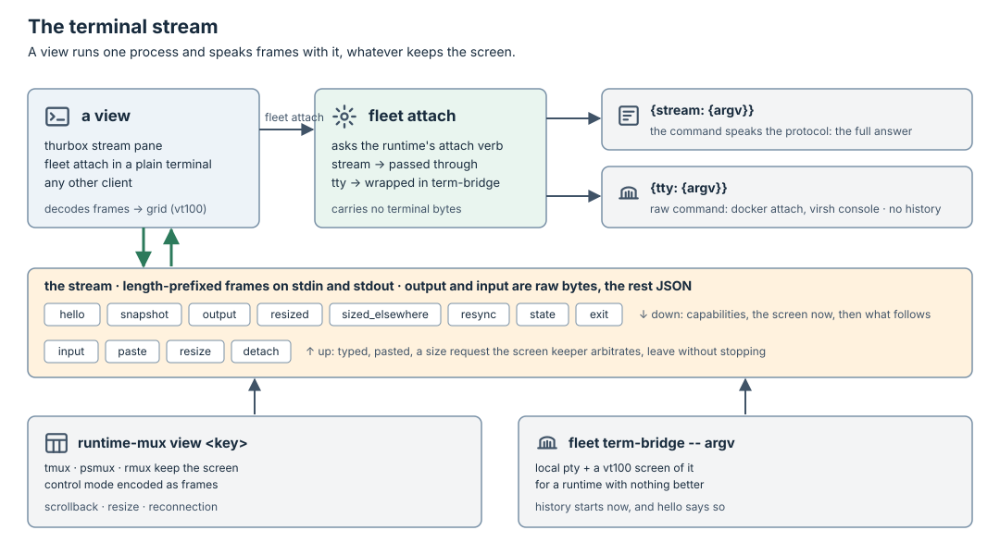

# Runtimes

A runtime is any program that runs one keyed process at a place and tells
Fleet about it: a multiplexer window, a container, a VM, a plain process.
Fleet reaches every session through it, and neither Fleet nor thurbox links
any runtime's code. `runtime-mux`, extracted from thurbox's `src/backend`, is
the first runtime and the default one. How the runtime fits between thurbox
and Fleet is the [overview](../README.md).

This page owns two contracts and one verb:

- [the runtime protocol](#the-runtime-protocol), how Fleet drives a runtime;
- [the terminal stream](#the-terminal-stream), how a view attaches to a
  session on any runtime;
- [`workspace.run`](#workspaces-where-a-recipe-runs), where a workspace recipe
  runs and how the process sees its files.

## The runtime protocol

A runtime is any program. Fleet runs it through `fleet-exec`, one bounded
process per call: `<program> <verb>`, a JSON request on stdin, and on stdout
`{"known": …}` or `{"unknown": {"why": …}}`. Unknown never concludes.

| Verb | Required | Answer |
| --- | --- | --- |
| `manifest` | yes | protocol version and the verbs supported |
| `start` | yes | adopts the one live process holding the key, else starts `argv` with `env` in a workspace a recipe made through this runtime, or in a `{dir}` |
| `inspect` | yes | `None`, `Running{id}`, `Exited{id, code}` |
| `stop` | yes | a process already gone counts as stopped |
| `list` | no | every process key the runtime holds, for the collector |
| `input` | no | types text, optionally submits |
| `capture` | no | screen text, cursor, foreground process |
| `exec` | no | a bounded command, `in: host` or `in: workspace` (inside the place), deadline and output cap |
| `workspace.run` | no | runs a workspace recipe's verb where the workspace's files belong ([where a recipe runs](#workspaces-where-a-recipe-runs)) |
| `attach` | no | `{stream: {argv}}` or `{tty: {argv}}`: how to open a terminal stream ([the terminal stream](#the-terminal-stream)) |

Every verb is idempotent by key. The runtime knows no harness, Task or
journal: pause is `stop`, resume and revive are `start` with the harness's
resume argv, idle comes from agent hooks, delivery is proven by the agent's
prompt hook.

Fleet config moves from one `[runtime]` to named `[runtimes.<name>]`, each a
`program`; a host names its runtime, so a Task's `spec.host` chooses it.

Agent hooks append to the file Fleet passes as `FLEET_SIGNAL_FILE` in `start`.
Fleet reads it directly on a local host and through `exec` on a remote one, so
a runtime needs nothing for signals.

`fleet runtime check -- <program>` is the conformance suite: two starts with
one key leave one process, a stop of an absent process succeeds, an error
answers Unknown and never None, a protocol mismatch answers Unknown. Every
runtime runs it in CI. `examples/runtimes/tmux.sh` is a reference runtime in
one script. A template repository for runtimes written elsewhere ships a
skeleton, the protocol version it targets and that CI.

### What a runtime is

A runtime answers one question: run this command, under this key, in this
directory, at this place, and tell me about it. Where and how is its own
business.

| Runtime | Place | What keeps the terminal | Today |
| --- | --- | --- | --- |
| `runtime-mux` | this machine, ssh hosts, WSL | tmux, psmux, rmux (ADR-31) | `src/backend` |
| `runtime-container` | docker or podman, local or remote | the container's pty, or a holder inside it | to write |
| `runtime-vm` | a VM or microVM | a holder inside the guest | to write |
| `runtime-process` | this machine, no terminal | none | the reference script's sibling |

A new multiplexer of the tmux family is a module in `runtime-mux`, not a
runtime. A new kind of place is a runtime. A runtime may reuse another inside
its place (a container running tmux to keep its screen), but no `runtime-*`
crate depends on another; shared code is a crates.io dependency.

Fleet must run a Task on the four required verbs alone, so a runtime without a
terminal is a full runtime:

- the brief reaches the agent at `start`, through the harness profile's argv
  or a file in the workspace, not only by typing;
- state reaches Fleet through `FLEET_SIGNAL_FILE`, not through the screen;
- the optional verbs add features and nothing more: without `input`,
  `fleet send` waits for the next start; without `capture`, no screen
  checks; without `attach`, no live view, and thurbox shows the Task without
  a terminal.

The default install configures `runtime-mux` and nothing else. With no
multiplexer on the machine, Fleet does not fall back to another runtime: the
first `start` answers the missing dependency by name, as `preflight` does
today, and other runtimes are opt-in in `[runtimes.<name>]`.

## The terminal stream

Attaching to a tmux window is the easy case: the server keeps the screen,
accepts several clients and arbitrates their sizes. A container or a VM has
none of that. `docker attach` replays nothing and shares one size between
every client; `docker exec -it` starts a new process instead of reaching the
agent; a VM offers a serial console or ssh. "Run this command in a pty" is
therefore not an interface: what a view gets would depend on the runtime.

What a view needs from a live session, whatever runs it:

1. the screen as it is now, on connect and after a dropped stretch;
2. the output that follows, in order, with size changes at their place in it;
3. a way to type, paste and resize;
4. to leave without stopping the process, and to come back;
5. other viewers at the same time, with one rule for who sizes the screen.

### The protocol

A stream is a process. The view starts it and speaks over its stdin and
stdout; it ends when either side closes. Frames are length-prefixed, a type
byte then a payload: output and input are raw bytes, every other frame a JSON
object. The vocabulary is thurbox's own `PaneChunk` (`src/backend/contract.rs`),
which already carries every item in the output's order on one channel:

| Direction | Frame | Payload |
| --- | --- | --- |
| down | `hello` | protocol version, capabilities (`snapshot`, `scrollback`, `viewers`, `resize`) |
| down | `snapshot` | cols, rows, cursor, normal-screen history and rows, alternate rows, styled |
| down | `output` | bytes |
| down | `resized` | rows, cols |
| down | `sized_elsewhere` | whether another viewer sizes the screen |
| down | `resync` | a snapshot replacing the view's grid after dropped output |
| down | `state` | title and input modes, to parse but not count as output |
| down | `exit` | the process's code, or Unknown |
| up | `input` | bytes, sent as typed |
| up | `paste` | text, bracketed when the program asked for it |
| up | `resize` | rows, cols: a request the holder of the screen arbitrates |
| up | `detach` | leave; the process keeps running |

`snapshot` comes right after `hello` when the capability is there, so a view
never starts on an empty grid. Sizing follows ADR-27 everywhere: the viewer
being typed into sizes the screen, the others get `sized_elsewhere`.

`term-stream` is a crate with only the frame types and their codec: no
process, no runtime, no transport. thurbox, Fleet and every `runtime-*` may
depend on it, as they may on `serde`.

### The runtime's `attach`

`attach` answers how to open a stream, in one of two shapes:

- `{"stream": {"argv": […]}}`: the command speaks the protocol. This is the
  full answer.
- `{"tty": {"argv": […]}}`: a raw interactive command, for a runtime that has
  nothing better (`docker attach`, `virsh console`, `kubectl attach -it`).

`fleet attach` always hands a view a stream. It passes a `stream` answer
through, and wraps a `tty` answer in `fleet term-bridge -- <argv>`, which runs
the command in a local pty, keeps a `vt100` screen of it and speaks the
protocol. A bridge only knows what it has seen since it started, so its first
snapshot is blank until the program redraws; it asks for one by resizing.
That is the price of a runtime without a screen keeper, and `hello` says so.

### Who keeps the screen

| Runtime | Screen keeper | `attach` answers |
| --- | --- | --- |
| `runtime-mux` | tmux, psmux, rmux | `stream`: `runtime-mux view <key>`, control mode encoded as frames |
| `runtime-container`, `runtime-vm` | `term-holder` inside the place | `stream`: `docker exec -i <ctr> term-holder connect <key>`, or the same over ssh or vsock |
| any runtime, minimal | none | `tty`: bridged by Fleet, no history |

`term-holder` is a small static binary a runtime puts in its place and runs
the agent under: `term-holder serve <key> -- <argv>`. It owns the pty, keeps
the screen and its scrollback, accepts several clients on a local socket and
arbitrates their sizes. `connect` relays one client over stdin and stdout, so
any byte pipe reaches it: `docker exec -i` without `-t`, ssh, vsock,
`kubectl exec -i`. The same binary answers `capture` and `input`
(`term-holder capture <key>`, `term-holder send <key>`), so those verbs are one
`exec` each in a container or a VM. It plays the part tmux plays for
`runtime-mux`, for places with no multiplexer. A runtime may still run tmux in
its place instead.

## Workspaces: where a recipe runs

Fleet decides what a workspace holds and when, a
[recipe](../fleet/architecture.md#workspaces-by-recipe) prepares it, and the
runtime places it.

The runtime decides, with one verb: `workspace.run {recipe, verb, request}`
runs the recipe at the place its files belong to, with
`FLEET_WORKSPACE_ROOT` and `FLEET_DURABLE` set, and returns its answer. The
runtime also makes the recipe's program and `setup` steps available there.
`start` then makes the workspace's paths visible to the process.

| Runtime | Where `workspace.run` runs the recipe | How the process sees the files |
| --- | --- | --- |
| `runtime-mux` | on the host (this machine, ssh, WSL) | same filesystem |
| `runtime-container`, `bind` | on the docker host | bind mounts at the same paths |
| `runtime-container`, `volume` | in a one-shot helper container on the key's volume | the volume at `/workspace` |
| `runtime-vm` | inside the guest, or on the host for a shared folder | the guest's disk, or virtiofs |
| `runtime-process` | this machine | same filesystem |

So a recipe is written once and runs on every runtime that can reach a shell
and its tools: the runtime places it, the recipe prepares. A runtime whose
mechanism has nothing to do with files on a shell (a disk image, a snapshot, a
remote dev environment) ships its own recipe and is configured to use it.

The runtime's `manifest` declares:

- `workspace.survivesStop`: the files outlive the process. When false, Fleet
  never pauses an idle session of that runtime, because pause is stop.
- `workspace.durable`: the place preserved work lands, passed to recipes as
  `FLEET_DURABLE` (the host's mirror or checkout, or a remote). A runtime
  whose files die with the place (a VM disk, a volume) names one outside it.
- `workspace.sharesHost`: the process sees the host's filesystem. Only then
  is a repository named by `path` accepted.

A runtime without `workspace.run` runs `{dir}` Tasks only; a `{repositories}`
Task on it waits with `WorkspaceUnsupported`.
