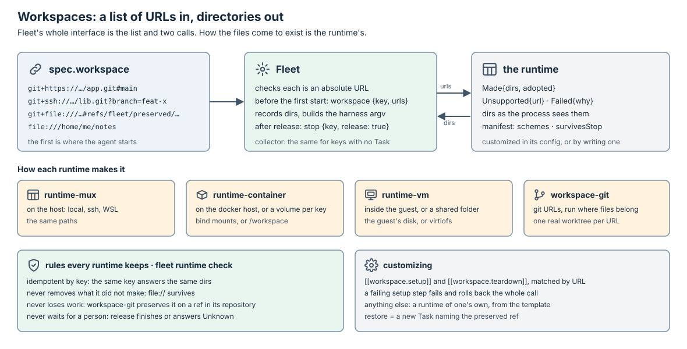

# Runtimes

A runtime is any program that runs one keyed process at a place and tells
Fleet about it: a multiplexer window, a container, a VM, a plain process.
Fleet reaches every session through it, and neither Fleet nor thurbox links
any runtime's code. `runtime-mux` (`crates/runtime-mux`), extracted from thurbox, is
the first runtime and the default one. How the runtime fits between thurbox
and Fleet is the [overview](../README.md).

This page owns two contracts and one verb:

- [the runtime protocol](#the-runtime-protocol), how Fleet drives a runtime;
- [the terminal stream](#the-terminal-stream), how a view attaches to a
  session on any runtime;
- [workspaces](#workspaces), how a list of URLs becomes the directories a
  session works in.

## The runtime protocol

A runtime is any program. Fleet runs it through `fleet-exec`, one bounded
process per call: `<program> <verb>`, a JSON request on stdin, and on stdout
`{"known": …}` or `{"unknown": {"why": …}}`. Unknown never concludes.

| Verb | Required | Answer |
| --- | --- | --- |
| `manifest` | yes | protocol version and the verbs supported |
| `start` | yes | adopts the one live process holding the key, else starts `argv` with `env` in the workspace made under that key |
| `inspect` | yes | `None`, `Running{id}`, `Exited{id, code}` |
| `stop` | yes | a process already gone counts as stopped; `release: true` also removes the key's workspace |
| `list` | no | every key the runtime holds a process or a workspace for, for the collector |
| `input` | no | types text, optionally submits |
| `capture` | no | screen text, cursor, foreground process |
| `exec` | no | a bounded command, `in: host` or `in: workspace` (inside the place), deadline and output cap |
| `workspace` | no | `{key, urls}` → one directory per URL, as the process sees it ([workspaces](#workspaces)) |
| `attach` | no | `{stream: {argv}}` or `{tty: {argv}}`: how to open a terminal stream ([the terminal stream](#the-terminal-stream)) |

Every verb is idempotent by key. The runtime knows no harness, Task or
journal: pause is `stop`, resume and revive are `start` with the harness's
resume argv, idle comes from agent hooks, delivery is proven by the agent's
prompt hook.

Fleet's config names each runtime in `[runtimes.<name>]`, a `program`, and
each host in `[hosts.<name>]`, the runtime serving it, so a Task's
`spec.host` chooses the program ([configuration](../fleet/configuration.md#native-fleet-configuration-fleettoml)).

### Protocol version 1

Built: `runtime-mux` and the reference script answer it, Fleet's `exec`
runtime kind speaks it, and `fleet runtime check` holds both to it in CI.
`workspace` is not built yet: no runtime declares it, and Fleet makes no
call to it. `attach` is built: Fleet asks it in `fleet attach`, once the
runtime's `manifest` declares it, and `runtime-mux` and the reference script
answer it.

Every request is a JSON object carrying `"protocol": 1`; `manifest` answers
whatever the request says. A runtime that does not speak the version asked
answers Unknown. An answer is `{"known": …}` or `{"unknown": {"why": …}}`
on stdout, with exit status 0; anything else (a program that is not there, a
non-zero exit, a timeout, output that does not parse) is Unknown to Fleet.
A key is 1 to 128 ASCII letters, digits, `.`, `-` or `_`; any other answers
Unknown.

| Verb | Request (besides `protocol`) | Known answer |
| --- | --- | --- |
| `manifest` | — | `{"protocol": 1, "verbs": [...]}` |
| `start` | `key`, `argv`, `env` (object), `dir` (absolute, optional) | `{"started": {"id", "adopted"}}`, or `{"failed": {"why"}}` when nothing can have started, such as a missing multiplexer |
| `inspect` | `key` | `"none"`, `{"running": {"id"}}` or `{"exited": {"id", "code"}}`, `code` null for a signal |
| `stop` | `key`, `release` (optional) | `"stopped"`, whether or not a process was there |
| `list` | — | `{"keys": [...]}` |
| `input` | `key`, `text`, `submit` | `"sent"`, or `"none"` when no process holds the key |
| `capture` | `key`, `lines` (optional) | `{"screen": {"text", "cursorRow", "cursorCol", "foreground"}}`, or `"none"` |
| `exec` | `argv`, `in` (`host`), `dir`, `timeoutMs`, `outputCap` | `{"exited": {"code", "stdout", "stderr"}}`, `{"timedOut": {"stdout", "stderr"}}` or `{"failed": {"why"}}` |
| `attach` | `key` | `{"stream": {"argv"}}`, `{"tty": {"argv"}}`, or `"none"` when no process holds the key |

`runtime-mux` answers every verb above. It runs its windows on a tmux
server of its own, socket `runtime-mux` (`RUNTIME_MUX_SOCKET` names
another), never on thurbox's interface socket: an inherited
`THURBOX_SOCKET` is ignored. A process is a window named after its key, and
a pane kept after its program exits is how `inspect` reports the code; a
`start` replaces it. Starts and stops on one server run one at a time, so
two starts of one key make one window: they hold a kernel lock on a file in
the private directory tmux keeps the socket in (`<TMUX_TMPDIR or
/tmp>/tmux-<uid>`, made `0700` when missing and refused when another user
can write to it), opened without truncating or following a link. `exec` runs `in: host` only, on this
machine, and kills the command's process group at the deadline. It reads
each stream to its end and keeps `outputCap` bytes, so a long output does
not change how the command ends; a child that left the group and holds a
stream open does not hold the answer past the deadline. `runtime-mux` runs on this
machine only for now: its ssh and WSL places come with the hosts it reads.

thurbox's stream pane (`stream_panes` in its `settings.toml`) is a view: it
opens a local tmux pane through `runtime-mux view --pane <id>` on its own
socket and decodes the frames into the chunks its control-mode pane gives.
Size requests still go to the server through thurbox's own backend.

`runtime-mux` answers `attach` with a `stream`: its own `view` on the key,
naming its socket and `TMUX_TMPDIR`. `runtime-mux view` adopts the key's pane
through its control-mode client, sized by the view's first `resize`, and
encodes what the server sends as frames; a `detach` lets go of the pane and
leaves the process running. The reference script answers `attach` with a raw
tmux client on the key's pane, a `tty` answer. An `attach` argv runs where the view runs, so it names
everything it needs, such as a socket by its path.

What Fleet's `exec` kind does with the answers:

- `start` runs the harness profile's launch argv
  ([harness profiles](../fleet/controllers/task.md#harness-profiles)), with
  `FLEET_SIGNAL_FILE` in `env`;
- a session's id is its key, so it outlives each process started under it;
- readiness, workspace trust and an idle agent come from the agent's signals:
  an agent that reported anything but `blocked` is ready and past any trust
  dialog. Codex reports nothing until its first turn ends: its empty composer
  on `capture`, Codex in the foreground, makes it ready and, launched with its
  trust override, trusted, and a running agent is at rest once it last reported `idle`. Before
  its first report, a trust dialog on its `capture` is Untrusted, and anything
  else Unknown, so a brief waits;
- delivery is proven by the agent's prompt hook, not by `input`;
- an `exited` process is lost, since a `stop` leaves `none`: revive is `start`
  with the profile's resume argv on the conversation the hooks reported. Fleet
  first marks the restart in the signal file, so readiness and trust wait for
  the new process's own report;
- `none` proves nothing about a pause, so Fleet never pauses a session on this
  kind: version 1 has no stop that keeps the key.

Agent hooks append to the file Fleet passes as `FLEET_SIGNAL_FILE` in `start`.
Fleet reads it directly on a local host, so a local runtime needs nothing for
signals. A session on another host gets no file: reading one back through the
runtime's `exec` is not built yet, so what Fleet would learn from it, such as
an idle agent or a delivered prompt, stays Unknown, and Unknown never
concludes.

`fleet runtime check -- <program> [args]` is the conformance suite. It prints
one line per case, `ok` or `FAIL` with why, and exits non-zero when any fails:

- `manifest` names protocol 1 and the four required verbs;
- a protocol mismatch answers Unknown;
- an error (a request that is not JSON, a bad key, an unknown verb) answers
  Unknown, never None;
- `inspect` of an absent key answers None, and a stop of it succeeds;
- concurrent starts with one key leave one process: four at once answer
  one id, and only one of them made it;
- two starts with one key leave one process: the same id, the second
  adopted, and the key once in `list` when the runtime has it;
- a stop ends the process;
- an exited process answers Exited with its code, or None;
- with `workspace` declared: two calls with one key answer the same
  directories, the second adopted, and a release leaves a `file://` directory
  in place.

The cases start `sleep` and `sh` in the runtime's place. CI's
runtime-protocol job runs it against `runtime-mux` and against
[`examples/runtimes/tmux.sh`](../../examples/runtimes/tmux.sh), a reference
runtime in one POSIX `sh` script over tmux and `jq`. It serializes starts and
stops with a kernel lock in tmux's private socket directory, taken with
`flock(1)` or else `perl`, which a killed holder releases. A template repository
for runtimes written elsewhere ships a skeleton, the protocol version it
targets and that CI.

### What a runtime is

A runtime answers one question: run this command, under this key, in this
directory, at this place, and tell me about it. Where and how is its own
business.

| Runtime | Place | What keeps the terminal | Today |
| --- | --- | --- | --- |
| `runtime-mux` | this machine; ssh hosts and WSL to come | tmux, psmux, rmux (ADR-31) | `crates/runtime-mux`, the `runtime-mux` program |
| `runtime-container` | docker or podman, local or remote | the container's pty, or a holder inside it | to write |
| `runtime-vm` | a VM or microVM | a holder inside the guest | to write |
| `runtime-process` | this machine, no terminal | none | the reference script's sibling |

A new multiplexer of the tmux family is a module in `runtime-mux`, not a
runtime. A new kind of place is a runtime. A runtime may reuse another inside
its place (a container running tmux to keep its screen), but no `runtime-*`
crate depends on another; shared code is a crates.io dependency.

Fleet must run a Task on the four required verbs alone, so a runtime without a
terminal is a full runtime:

- the brief reaches the agent at `start`, through the harness profile's argv
  or a file in the workspace, not only by typing;
- state reaches Fleet through `FLEET_SIGNAL_FILE`, not through the screen;
- the optional verbs add features and nothing more: without `input`,
  `fleet send` waits for the next start; without `capture`, no screen
  checks; without `attach`, no live view, and thurbox shows the Task without
  a terminal.

The default install configures `runtime-mux` and nothing else. With no
multiplexer on the machine, Fleet does not fall back to another runtime: the
first `start` answers the missing dependency by name, as `preflight` does
today, and other runtimes are opt-in in `[runtimes.<name>]`.

## The terminal stream


Attaching to a tmux window is the easy case: the server keeps the screen,
accepts several clients and arbitrates their sizes. A container or a VM has
none of that. `docker attach` replays nothing and shares one size between
every client; `docker exec -it` starts a new process instead of reaching the
agent; a VM offers a serial console or ssh. "Run this command in a pty" is
therefore not an interface: what a view gets would depend on the runtime.

What a view needs from a live session, whatever runs it:

1. the screen as it is now, on connect and after a dropped stretch;
2. the output that follows, in order, with size changes at their place in it;
3. a way to type, paste and resize;
4. to leave without stopping the process, and to come back;
5. other viewers at the same time, with one rule for who sizes the screen.

### The protocol

A stream is a process. The view starts it and speaks over its stdin and
stdout; it ends when either side closes. A frame is a type byte, the
payload's length as a big-endian 32-bit number, then the payload: `output`,
`state` and `input` are raw bytes, `paste` is UTF-8 text, and every other
payload is a JSON object. The vocabulary is thurbox's own `PaneChunk` (`crates/runtime-mux/src/contract.rs`),
which already carries every item in the output's order on one channel:

| Direction | Type | Frame | Payload |
| --- | --- | --- | --- |
| down | `0x01` | `hello` | `{version, capabilities}`, capabilities from `snapshot`, `scrollback`, `viewers`, `resize` |
| down | `0x02` | `snapshot` | `{cols, rows, cursor: [col, row], normal, alternate}`: normal-screen history and rows, alternate rows or null, styled |
| down | `0x03` | `output` | bytes |
| down | `0x04` | `resized` | `{rows, cols}` |
| down | `0x05` | `sized_elsewhere` | `{elsewhere}`: whether another viewer sizes the screen |
| down | `0x06` | `resync` | a snapshot replacing the view's grid after dropped output |
| down | `0x07` | `state` | title and input modes as terminal bytes, to parse but not count as output |
| down | `0x08` | `exit` | `{"known": {code}}`, `code` null for a signal, or `{"unknown": {why}}` |
| up | `0x81` | `input` | bytes, sent as typed |
| up | `0x82` | `paste` | text, bracketed when the program asked for it |
| up | `0x83` | `resize` | `{rows, cols}`: a request the holder of the screen arbitrates |
| up | `0x84` | `detach` | empty: leave; the process keeps running |

A frame of a type the reader does not know, or a payload over 64 MiB, ends the
stream.

A view's first frame is a `resize`: the end that keeps the screen starts the
stream once it knows the size. `snapshot` comes next when the capability is
there, so a view never starts on an empty grid. Sizing follows ADR-27 everywhere: the viewer
being typed into sizes the screen, the others get `sized_elsewhere`.

`term-stream` (`crates/term-stream`) is a crate with only the frame types and
their codec: no process, no runtime, no transport. thurbox, Fleet and every
`runtime-*` may depend on it, as they may on `serde`.

### The runtime's `attach`

`attach` answers how to open a stream, in one of two shapes:

- `{"stream": {"argv": […]}}`: the command speaks the protocol. This is the
  full answer.
- `{"tty": {"argv": […]}}`: a raw interactive command, for a runtime that has
  nothing better (`docker attach`, `virsh console`, `kubectl attach -it`).

`fleet attach` always hands a view a stream. It passes a `stream` answer
through, and wraps a `tty` answer in `fleet term-bridge -- <argv>`, which runs
the command on a pty of its own and relays it as frames. A bridge keeps no
screen: it has nothing from before it started, so its `hello` names no
`snapshot`, and the view's first `resize` sizes the pty the command starts on,
which is what makes a program draw. That is the price of a runtime without a
screen keeper. A `detach` ends the bridged command, such as a `docker attach`
client, and not the process it reached.

### Who keeps the screen

| Runtime | Screen keeper | `attach` answers |
| --- | --- | --- |
| `runtime-mux` | tmux, psmux, rmux | `stream`: `runtime-mux view <key>`, control mode encoded as frames (built) |
| `runtime-container`, `runtime-vm` | `term-holder` inside the place | `stream`: `docker exec -i <ctr> term-holder connect <key>`, or the same over ssh or vsock |
| any runtime, minimal | none | `tty`: bridged by Fleet, no history (built; the reference script answers it) |

`term-holder` is a small static binary a runtime puts in its place and runs
the agent under: `term-holder serve <key> -- <argv>`. It owns the pty, keeps
the screen and its scrollback, accepts several clients on a local socket and
arbitrates their sizes. `connect` relays one client over stdin and stdout, so
any byte pipe reaches it: `docker exec -i` without `-t`, ssh, vsock,
`kubectl exec -i`. The same binary answers `capture` and `input`
(`term-holder capture <key>`, `term-holder send <key>`), so those verbs are one
`exec` each in a container or a VM. It plays the part tmux plays for
`runtime-mux`, for places with no multiplexer. A runtime may still run tmux in
its place instead.

## Workspaces



Fleet hands a runtime a list of URLs and gets one directory per URL back
([the Fleet side](../fleet/architecture.md#workspaces)). Everything else is
the runtime's: where the files live, how they are made, what is installed,
how work is kept when they go. That is where a workspace is customized, by
configuring a runtime or by writing one.

### The verb

`workspace {key, urls}` answers one of:

| Answer | Meaning |
| --- | --- |
| `Made{dirs, adopted}` | one directory per URL, in order, as the process sees it; `adopted` when the key's workspace already existed |
| `Unsupported{url}` | this runtime does not handle that URL |
| `Failed{why}` | nothing was made, or what was made was rolled back |

`stop {key, release: true}` removes the key's workspace with the process.

A runtime that implements `workspace` holds to these rules, and
`fleet runtime check` tests each:

- **Idempotent by key.** A second call with the same key answers the same
  directories, adopted. A partial workspace is never answered: the next call
  rolls it back and makes it again.
- **Never removes what it did not make.** A `file://` directory is used as it
  is and survives every release.
- **Never loses work on release.** Anything the workspace holds that exists
  nowhere else (uncommitted changes, unpushed commits) is preserved before the
  files go, in a durable place outside the workspace. How is the runtime's
  choice. Files the repository ignores are not work: it declares them
  disposable.
- **Never waits for a person.** Release always finishes or answers Unknown.

The `manifest` declares what Fleet may rely on:

- `workspace.schemes`: the URL schemes the runtime handles, such as
  `git+https`, `git+ssh`, `git+file`, `file`.
- `workspace.survivesStop`: the files outlive the process. When false, Fleet
  never pauses an idle session on that runtime, because pause is stop.

A runtime without `workspace` runs only Tasks with an empty list.

### URLs

The URL is the whole request: Fleet adds nothing to it.

| URL | What `workspace-git` makes |
| --- | --- |
| `git+https://host/org/repo.git` | a worktree on a new branch from the default branch |
| `git+https://host/org/repo.git#v2` | the same, from `v2` |
| `git+ssh://git@host/org/repo.git?branch=feat-x#main` | a worktree on `feat-x`, made from `main` when it does not exist |
| `git+file:///srv/mirrors/repo.git#refs/fleet/preserved/<key>/repo` | a worktree on work an earlier release preserved |
| `file:///home/me/notes` | nothing: the directory, as it is |

Restoring preserved work is therefore a new Task whose URL names the preserved
ref; Fleet needs no verb for it.

### How each runtime makes one

| Runtime | Where the files are | How the process sees them |
| --- | --- | --- |
| `runtime-mux` | on the host (this machine, ssh, WSL) | the same paths |
| `runtime-container` | on the docker host, or in a volume per key | bind mounts at the same paths, or the volume at `/workspace` |
| `runtime-vm` | inside the guest, or on the host for a shared folder | the guest's disk, or virtiofs |
| `runtime-process` | this machine | the same paths |

### workspace-git, the default for git URLs

`workspace-git` is a small program a runtime runs where its files belong: on
the host, against a volume, inside a guest. `runtime-mux` and
`runtime-process` use it directly, and the others inside their own places.
Its layout:

```text
<root>/<key>/<name>/                  one real worktree per git URL
<root>/<key>/.fleet-workspace.json    written last; without it the workspace is partial
<root>/.sources/<digest>.git          a bare mirror per repository, fetched before each make
```

- With one URL the session starts in `<root>/<key>/<name>`; with several the
  first URL's worktree is still the start, and every worktree is a real
  directory, so thurbox's symlink workspace goes.
- With no `branch`, the branch is named after the key; an existing branch is
  checked out, and one checked out elsewhere gets `<branch>-<n>`.
- On release, a dirty worktree is committed, untracked files included,
  through a temporary index onto `refs/fleet/preserved/<key>/<name>`; that ref
  and the branch are pushed to the mirror; then the worktree goes. Branches
  are never deleted on release.
- On each call it prunes its own retention: preserved refs older than
  `preserve.days` (default 30), and branches whose head a remote already has.

### Customizing a workspace

Each runtime offers what fits its places. `runtime-mux` and
`runtime-process` take steps to run in the workspace once it is whole, and
before release, matched by URL:

```toml
[[workspace.setup]]
match = "git+https://github.com/acme/app.git"
run = ["cp ~/.config/app/.env .env", "npm ci"]

[[workspace.teardown]]
match = "git+https://github.com/acme/app.git"
run = ["docker compose down"]
```

A failing setup step fails the whole `workspace` call, which rolls back. A
need no configuration covers is a runtime of one's own: a script that answers
the protocol, starting from the runtime template, held to the same rules by
`fleet runtime check`.
