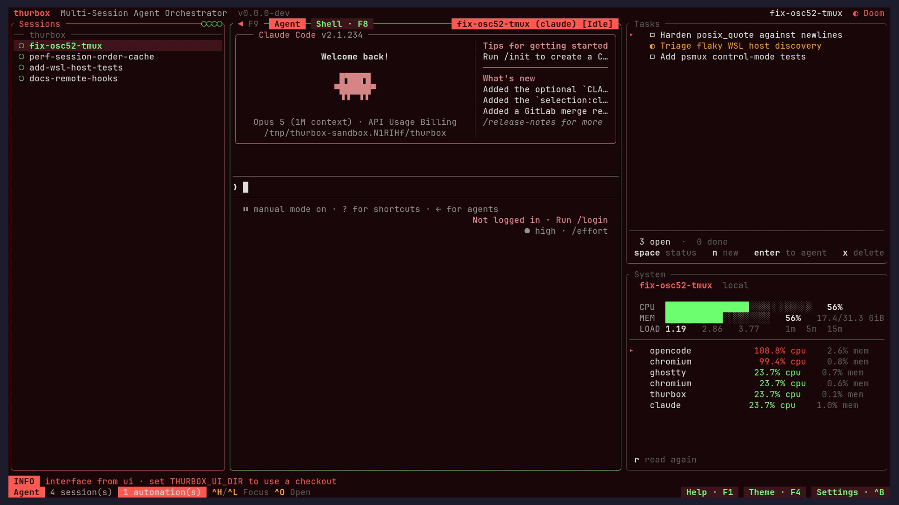
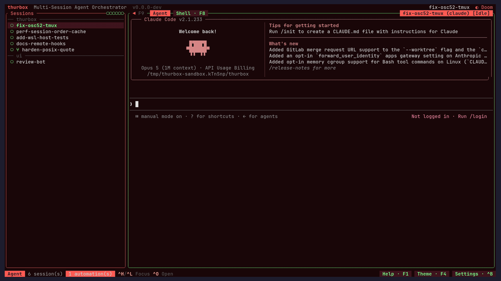

# Feature Decisions

Design rationale for user-facing behavior.
For architectural choices, see [architecture.md](architecture.md).

> **Read this first.** Much of the reasoning below was written while the interface
> was Rust (v1). The interface is now a Lua plugin kernel (ADR-23), so a section may
> describe a surface that exists only in a plugin rather than in `src/ui`. Sections
> about such a surface say so at the top; the *rationale* is kept, because it is
> what a plugin rebuilding that surface needs and it is not recoverable from the
> code.
>
> Sessions are Fleet's (ADR-41): every session is a Fleet Task, read through
> `fleet watch` and changed through Fleet's command line. The sections below
> describe the interface over those Tasks and the files thurbox keeps itself.

---

## Session Sidebar

### Single session list

The left sidebar holds a single flat list of sessions — there is no
project grouping layer above it. Each session is a Fleet Task, identified
by the Task's name, and labeled with its name, agent and cwd.

**Why no projects?**

- An earlier design grouped sessions under projects (one project →
  many sessions, with shared repos). In practice users tended to
  create one session per task, so the project layer was pure
  overhead: an extra navigation level, an extra creation step, and
  an extra deletion guard.
- Without the project layer, each session owns its own configuration:
  it picks its own agent and repository at creation time.

**Why a sidebar at all instead of a popup?**

- Sessions are persistent context, not transient selections. An
  always-visible list shows each session's status and live agent
  activity at a glance — useful for monitoring multiple parallel
  agent sessions.
- The sidebar fits cleanly into the existing 3-tier responsive
  layout (`<80`, `>=80`, `>=120`); a popup would require its own
  open/close keybinding and dismissal logic.

### Context menu (right-click)

A right-click on a session row selects it and opens a menu of that session's
actions where the pointer is: Open, Rename, Open in editor, Move up, Move down,
Delete, and Delete + worktree, each showing the chord bound to it. `j`/`k` or
the arrows move, `enter` or a click runs the entry, and `esc` or a click
anywhere else closes it.

A right-click on empty space is about no session, so it opens the column's
general menu instead: New session, Sort by name and Hide panel. Both menus
also offer Collapse all when a host or repo group is expanded, and Expand all
when one is folded. These actions save both host and repo folds. Sort is offered
only when there are visible sessions: an entry that would do nothing is left
out rather than shown dead.
A right-click on a host or repo row toggles its fold, just like a left-click.
The general menu remains available on blank space.

**Why run the pane's own actions?** Each entry uses the same action path as a
bound chord, so the menu cannot drift from the keyboard: Delete still asks
first, and a rebound chord shows up in the menu. Sort and the panel toggle are
left out of the row menu because neither is about the session that was pressed.

**Why can other plugins add to a row's menu?** A plugin that owns a
per-session action would otherwise reach it only through `Ctrl+P` or a chord of
its own. It leaves its entries in `store["sessions.menu_extra"]` under its own
name, and they follow the pane's own entries after a rule. An entry whose
action nothing declares is dropped, the same rule that keeps Sort out when it
would do nothing. Its owner reads the pressed row from
the action's `args.session_id`, so it acts on the row that was clicked even if
the cursor moved. The contract is *Adding entries to the sessions menu* in
`docs/thurbox/plugins.md`.

**Why opened at the pointer, and closed by a click elsewhere?** That is what a
context menu is. The kernel supplies only the mechanism — the pressed cell on
`hit`, `float.at`, and `on_outside` for the float holding the pointer — so the
menu itself stays a plain Lua float (`ui/plugins/64_menu.lua`) that any pane can
fill. A terminal that keeps the right button for itself never sends the press;
see *The right button* in `docs/thurbox/plugins.md`.

### Fuzzy search

Searching is unified into the **global search** (`Ctrl+/`) — see the
*Global Search* section below. There is no separate per-list `/`
filter; instead the global strip highlights matches live across the
session list at once. Sessions are matched on name, agent, branch and
repository, and on every line their terminals still hold.

**Why all four fields?** Users remember sessions by whichever
attribute is most distinctive — sometimes the branch name, often
the agent ("the codex one"), occasionally the repo path. Indexing
all four makes the search hit on the first attempt without forcing
the user to remember which field to type into.

### Live status & "needs attention"

Each row is a single line: `<status-dot> <name> [<status>]`, indented to show
where it sits (see *Session list hierarchy* below). The agent's current action —
the OSC `0`/`1`/`2` title the agent sets on its own terminal, with a leading
`✳` or `*` activity prefix dropped — stays after the session name at every panel
width, truncated to the remaining space. At 100 columns and above, it uses a
column aligned just past the longest title.
What explains the dot — a blocked agent's question, why a host is unreachable,
a failed command, a driver's `ui.note` — is kept at every width. A session
waiting for you (`blocked`) has its whole row tinted in the status colour and
its title bold in it; `done` needs no answer and is not lit. The repo/branch and
agent live in the info panel, not the list row.

The `show_window_title` setting (settings → Sessions, off by default) shows the
agent's terminal title in place of the session name, on every row whose agent
set one. It is the title thurbox already reads off the pane, not a separate
query of tmux's `window_name`.

The colored **status dot** is Fleet's. Each agent's own hooks report through
`fleet signal` (Fleet's harness profiles, `crates/fleet-api/src/harness.rs`),
Fleet derives the Task's `status.sessionState` from them, and the snapshot maps
that onto a `SessionState` (`kernel::snapshot::fleet::row_of`):

| `sessionState` | State | Colour | Glyph |
|----------------|-------|--------|-------|
| `Running` | `running` | accent | `◉`, a spinner while its pane prints |
| `Idle` | `idle` | green | `○` |
| `Paused` | `stopped` | green | `○` |
| `Lost`, `Gone` | `failed` | `status_error` (red) | `✗` |
| anything else, or none | `unreported` | muted grey | `◌` |

`unreported` is drawn apart from `idle` on purpose: `idle` says *the agent
reported that it is at rest*, and `unreported` says nothing has reported at
all. `stopped` is a paused Task, at rest by definition, so it draws the idle
dot.

`SessionState` also names the agent's own hook words (`working`, `blocked`,
`background`, `done`) and `unreachable` and `uncovered`, so a plugin can tell
them apart. A row the snapshot builds from a Task carries none of them.

Status only **recolors** the dot — the manual order is never disturbed (see
*Smart ordering* below). Headless, the same fact is the Task's
`status.sessionState` (`fleet get task <name>`).

Thurbox installs no hooks into an agent's own config: Fleet's harness
profiles pass each harness its status hooks at launch
(`docs/thurbox/agents.md` → *Status hooks*).

### Smart ordering & repo groups

The list is **grouped by repository** under subtle headers
(`── webapp ─────`), and within a group sessions follow their **manual
order** (`display_order`, see *Manual ordering* below). Manual order is
authoritative: once a row has been placed, a status change only
**recolors its dot**, it never moves the row. Sessions that were never
moved fall back to creation order:

- Sessions with no manual order render after ordered ones in stable
  insertion order. Ordering is a pure function of *manual order* and
  *stable order*, never of live timing — so the list never re-sorts
  itself, even when a session needs attention or exits.
- Groups are ordered by their **lowest member `display_order`**, then by name
  for determinism — so moving a session to the top of its group can pull the
  whole group up, but a status change never reshuffles the groups.
- The group key is the **set of repos a session spans** (order-independent), so
  a multi-repo session forms its own group with a combined repo row
  (`webapp + infra`) rather than being filed arbitrarily under one repo;
  sessions touching the same set cluster together. Sessions with no repo share a
  `(no repo)` group.
- With `group_by_host` on (settings → Sessions, on by default), local sessions
  stay at the top under a `local` host row. Remote hosts follow in their own
  rows. Every host row can be folded with `h`, unfolded with `l`, or toggled by
  clicking it with either mouse button or pressing Enter. A double-click
  toggles once. A folded row shows the session and active counts; `!` marks
  sessions needing attention beside the host name. Up/down navigation skips the hidden sessions. Searching
  temporarily reveals them; Esc restores the fold, while accepting a hit
  unfolds its host so the selected session stays visible.
  Folded host names are saved in the `sessions.folded_hosts` plugin setting, so
  they survive a restart. A host row is a band: tinted with the theme's
  `accent` over its background, its arrow, mark and name in `accent`, bold.
  This machine is `⌂ local`; any other host is `@ <name>` (`@ WSL <name>` for a
  WSL distro), on Windows and POSIX alike. Other reachability states put their
  status glyph, in its theme colour, beside the arrow. A local-only list also
  has a foldable host row.
  When the terminal's default background cannot be mixed into a tint, host and
  blocked-session bands use the theme's `modal_bg` role instead.
- With `group_by_repo` on, each repo set has a selectable row within its host.
  Its fold state is independent of the host fold and of the same repo on another
  host. `h` and `l` act on a selected repo row; Enter, a click (a double-click
  toggles once) and a right-click toggle it. Search
  temporarily reveals folded sessions, and accepting a result unfolds its repo.
  Folded repo identities are saved in `sessions.folded_repos`. A repo row is a
  separator rather than a level: its name in `accent` followed by a dotted
  `╌╌╌` rule, one column in from its host's arrow, and a long multi-repo name
  is cut with `…`. Folded, it shows its session count at the end.
- A **parent session** (one with children in its group) carries its own fold
  arrow in front of its dot and a bold title. Left folds it (or, on a child,
  selects its parent), Right unfolds it or steps to its first child, and a click
  on the arrow toggles it. A folded parent shows `+N` for what it holds, and a
  child waiting for you (`blocked`) stays visible under it. If clicking the
  arrow hides the selected child, the folded parent becomes selected; a selection
  that stays visible is preserved. When a selected blocked descendant resumes
  work, its folded ancestors unfold to keep it selected. Folded parents are
  saved in `sessions.folded_parents`; focusing a hidden descendant unfolds its ancestors.
- With host rows off, the top row of each tree that runs on another machine
  shows `@` after its dot; its children do not repeat it.

### Session list hierarchy

Hosts are bands, repositories are separators, and sessions are indented under
them — the structure is read from the indentation alone, so a row carries no
`└` connector and no `⇅`/`⑂` marks, and the border carries no status-dot strip:
every row has its own dot.

```text
 ▾ @ buildbox  !1 ────── 3 sessions   host: column 1, a tinted band
  ▾ thurbox ╌╌╌╌╌╌╌╌╌╌╌╌╌╌╌╌╌╌╌╌╌╌╌   repo: column 2, a dotted separator
   ▾ ● lead                            parent: fold arrow in column 3
       ○ worker-a                      child: 2 more columns per level
       ◆ worker-b                      blocked: the whole row tinted
     ○ solo                            dot lines up with the parent's dot
```

Every session row has a two-column fold slot in front of its dot, filled by a
parent's arrow and blank otherwise, so siblings' dots line up whichever of them
is a parent. Sessions are indented from the host row, not the repo row: the repo
row is a separator, and giving it a level of its own would spend two more
columns of a narrow sidebar on every row. Each group row above a session moves
it one step in: with no group rows the sessions start at the panel's edge
(column 1), under a host row alone they take the repo rows' column (2), and
under a repo row they start from column 3.

**Why the host row sits left of its repo rows.** The arrow column is what reads
as the nesting: a host handle in column 1, its repo rows in column 2, and its
sessions from column 3 (column 2 when repo grouping is off). A host row is set
apart by a rule that runs up to its right-aligned counts. To keep the rule,
the row first drops the active count and shows only the session total. When
even that leaves no room for a rule, the total trails the label as on any
other row: cut short with `…` when it does not fit, and dropped when fewer than
four columns are left. Aligning costs the host row one column, so a very narrow
panel loses its counts sooner than before.

**Why local has a host row.** Local work can be folded by the same gesture as
remote work. It stays first, and the cursor initially selects the first session
instead of the host handle. A creation in flight also gets its host handle.

**Why a second switch and not one choice row.** `none / repo / host / host then
repo` would read as one decision, and the settings modal cannot render it: a
plugin's values are `Bool`, `Number` and `Text`, and a `Text` row is free text
you type into — cycling a fixed set is wired to the core rows' one enum, not
declared. So the row would be a box where a misspelling silently means "none",
and it would first need a choice type in the registry, in the Lua declaration
and in the modal. The two switches are independent axes rather than two
spellings of one: all four combinations render — one flat list, repos, hosts,
and repo groups inside hosts — so no pair of values contradicts.

**Why group by repo?** With several parallel agents the dominant question
is "which project is this?" — clustering same-repo sessions answers it at a
glance, and a stable manual order means a row stays where you put it (a
blinking status dot still flags urgency without yanking the row around). A
single comparator (`ui/lib/session_model.lua`, which orders exactly as v1's
`ui::project_list::compute_session_order` did) drives both
rendering and `Ctrl+J`/`Ctrl+K` navigation, so the keyboard always steps
through the exact order shown.

### Manual ordering & alphabetical sort

The list is manually orderable. With the session list focused,
`Shift+J`/`Shift+K` move the selected session one row down/up
(the `sessions.move_down`/`sessions.move_up` actions, rebindable in
`ui.json`). A move swaps two
adjacent **blocks** — a row plus its nested children, so a parent drags
its whole subtree: root rows swap within their repo group, the **whole
group** swaps past a group edge, and nested children move among their
siblings only. `Shift+S` (`sessions.sort`, rebindable the same way)
sorts every group's sessions alphabetically by name in one shot,
preserving group order and parent/child nesting.

**A session being created is a row with no name to sort by.** The
placeholder the list draws while a creation is in flight is its own root
block carrying the command, not a session, so `Shift+S` holds it out of
the comparison and puts it back at its group's end — where the list
already draws it, and where the real row appears once the creation
lands. Ordering it under an empty name instead would pull it above every
session it is queued behind, and reading a name off it at all is what
crashed the pane the moment a group held both a session and a
placeholder.

**A group never moves onto another machine.** With the host axis on, the group
below the last of one host's belongs to the next host, and `Shift+J` there is
refused rather than swapping them. The swap would be accepted, persisted, and
then undone by the next build re-clustering each group under its own host —
the same shape as the `group_by_repo` mistake below. Here it cannot be argued
for either way: which machine a session runs on is `backend_type`, grouping is
a view, and a view never moves a session between them. With `group_by_host`
off there are no host edges to refuse at, exactly as `group_by_repo` off
leaves no repo edges.

**With grouping off there are no group edges.** The session list's
`group_by_repo` setting (settings → Sessions) is not a label switch: off
means the list is genuinely one flat group ordered by `display_order`
alone, so `Shift+J`/`Shift+K` move a row one place anywhere in the list
and `Shift+S` sorts the whole thing. Suppressing only the header line
and keeping the clustering was the first shape and it was wrong — a move
that carried a session past a repo boundary was accepted, persisted, and
then undone by the next build re-clustering it under its own repo, with
the headers that would have explained it turned off. Parent/child
nesting is unaffected either way: it is not a repo property.

Both paths send the whole list, top to bottom, as one `order` command, and
the interface keeps it in `interface.json` beside `settings.toml` (ADR-41:
Fleet keeps Tasks, and the order a person sorted them in is not a fact about
any Task). The snapshot lays the file over Fleet's rows as `display_order`,
each session's place in the list; a session the file does not name sorts
after every one it does. The order survives a restart. A second interface
on the same config directory reads the file when it starts. The pure helpers
(`order.move_block` / `order.sorted_within_groups` in `ui/lib/order.lua`)
back the session pane's actions.

**Why manual order wins over status.** Earlier the list re-sorted itself
by status, which meant a row jumped around under your cursor every time
an agent finished or started thinking. Letting the user pin the order —
and only recoloring the status dot in place — keeps the list a stable
spatial map you can build muscle memory against.

---

## Session Creation



`Ctrl+N` walks through a series of modals to configure a new
session. Each step has a sensible default and can be skipped when
not applicable.

1. **Host picker** — choose where the session runs: `local`, or any
   SSH or WSL host defined in `hosts.toml`. Skipped entirely when no
   remote hosts are configured. The session's Task runs on the Fleet
   host of that name, which Fleet's own config must define: a host it
   does not define is refused, naming the hosts it has. For a remote
   host the repo picker shows the repos previously used *on that host*
   (bookmarks are host-scoped) and every remote filesystem touch — the
   path browser's listings, Enter validation, `Alt+P` parent scans and
   their periodic re-scan — runs on a worker, never blocking the UI on a
   host round trip.
2. **Repo picker** — fuzzy-searchable list of bookmarked repo
   paths. `Space` toggles selection, `Alt+D` (or `Delete`) deletes the
   bookmark — chords rather than letters, because the step types every
   letter into its search — and a path-input field
   adds new bookmarks: `Tab` accepts the inline autocomplete
   suggestion, or — with nothing to complete — opens a **path
   browser** dropdown listing the typed directory (git repos marked
   `●git`; `Enter` selects any existing directory, `Tab` opens the
   highlighted directory, `Esc` closes it, listings are cached per picker).
   A refused addition shows its reason inside the modal and restores the
   path for correction.
   Remote paths expand `~` against the remote home and are verified
   (exists + is-it-git, one round trip, async with a `checking…`
   spinner) on Enter; git-ness is kept per bookmark so it's learned
   once. The selected repo becomes the Task's workspace directory.

   **A folder imported with `Alt+P` is a scan, not a snapshot.** Its
   members are whatever it holds *now*, so a repository cloned into
   it appears and one deleted from it stops being offered, with no
   re-import. A **local** folder is scanned on every bookmark read
   (a `readdir`, so free). A **remote** one is scanned on its host
   every 30 s while the picker is open, on a worker, and what it
   finds is written back to the bookmarks — which is what the
   folder still shows across a restart and while the host is
   unreachable. A scan that *fails* changes nothing: an unreachable
   host, or a folder that can't be read, leaves it holding what it
   last held rather than emptying it. A folder that reads as *empty*
   is empty — the same answer as deleting the last repository in it,
   which is half of what the rescan is for. So a folder imported from
   a mount point goes empty while its drive is unmounted (an unmounted
   mount point is a readable empty directory) and refills when it
   comes back.
3. **Session name** — free text identifier shown in the sidebar. The
   Task's name is derived from it (lowercase letters, digits, `-` and
   `.`), and the name as typed is the Task's `thurbox.dev/name` label.
4. **Agent picker** — choose which coding agent runs in this
   session, from the harnesses Fleet offers (`fleet version --json`).
   Skipped when Fleet offers one. Until Fleet answers, the list is
   unknown and the step waits for it, so no Task is ever created
   without a harness. Fleet launches the agent from its own harness
   profile, so a harness Fleet does not have is refused at create,
   naming the harnesses Fleet runs.

Creating applies an interactive Task with `fleet apply --create-only`, so two
names that make one Task name (`Review`, `review`) are refused rather than
merged. The flow may also ask for a multiplexer, a worktree branch or further
repositories. The multiplexer is dropped, and a branch, a base branch, an
existing worktree or a second repository is refused: Fleet makes a Task's
workspace, and its runtime runs the terminal.

**The flow says what is missing before you commit.** thurbox starts with no
agent installed — that is deliberate, and browsing and configuring keep
working. A missing agent is stated on the step that offers it. Never a modal
that blocks — a `command` may still be launchable (a shell function, or
something installed a second later), so the answer is a warning on the choice,
not a refusal of it. The empty session list carries the same line, since that is
the one screen a first run always reaches, and `thurbox-cli doctor` answers the
whole question directly. See
[config.md](config.md#what-happens-when-it-is-not-installed) for the cost model
(a `stat` walk on the kernel's schedule behind a 10-second window — never on a
render, a keystroke or a list row) and for why a remote host or a relative
`command` is reported as *unknown* rather than missing.

**Creating a session moves nothing — unless you ask it to.** By default the new
row appears in the list and waits to be picked; the selection, the pane showing
it and the keyboard all stay where they were. Creation is a command that
finishes on a worker seconds after the flow closed, so the moment it lands is
not a moment the user chose — steering the view then would interrupt whatever
they had gone back to reading, and make creating three sessions in a row a
fight with the cursor. Selection is still *steerable*, by the two requests that
are deliberate: a clicked notification and
`thurbox-cli ui action session.focus --session <id>`, both through
`focus_session`, which the list follows by id rather than by row number.

**A session appearing or going away moves nothing either.** The selection is
the **session**, not its row: `ui.cursor` writes down which item is selected and
re-derives the row from it on every build. A row *number* would let a session
opening or closing *above* the cursor renumber every row below it and slide a
different session under the highlight and into the agent pane. Nothing has to
be created *by this interface* for that to happen, which is why a fleet —
opening and closing sessions constantly and without warning — would hit it
hardest.

The row number is kept for exactly one case, the selected session no longer being
in the list, and then the cursor lands on **whatever now occupies that
position** — the neighbour below it, or the list's last row once the list is
shorter than the cursor. Not the top, which is a second theft of the same kind,
and not nothing, which would blank the agent pane over a session the operator
never closed. It is also the answer the model already assumed: a row dropped by
`session_model.build` is dropped before anything is grouped or ordered, so that
the cursor lands on the next row.

Not having to hunt for the row you just asked for is worth that interruption to
some people, so it is **a setting rather than a decision**: the session list's
`focus_new_session` (settings → Sessions, off by default) makes a create select
the new session and give the agent pane the keyboard, exactly as `Enter` on its
row would. It is the *list's* setting rather than a core one because the list
owns the selection — it subscribes to `session.post_create` and does there what
`Enter` does. That event fires only for a create **this interface** performed,
which is what keeps an automation or a second instance from taking the keyboard
out from under you; and the cursor only *follows* the new id, so moving it
yourself in the meantime wins.

A session is fully described by its repos and agent. There is no
per-session model selection, permissions, prompt, tool, or skill
configuration — those concerns belong to the agent CLI itself,
which runs with its own default config.

**Why per-session repo selection?** Each session is its own context,
so it makes sense to pick the repo at creation time rather than
inheriting it from a parent grouping.

**Why per-session agent?** Different tasks suit different agents.
Choosing the agent at creation time keeps each session
self-describing and lets you mix agents across the sidebar
(Claude here, Codex there) with no shared global configuration.

**Why a bookmark list rather than a path picker every time?** Users
work on the same handful of repos repeatedly. Bookmarks make the
common case a 2-keystroke selection while still allowing arbitrary
paths via the input field. Bookmark deletion (`Alt+D`) keeps the list
from accumulating stale entries.

### Agent definitions

The agents are Fleet's harness profiles (ADR-41). thurbox keeps no agent
registry: the picker offers the harnesses `fleet version --json` lists, read on
the Fleet watch's worker thread, and a session's Task names its harness. Fleet
launches, resumes and watches the agent from that profile. An `agents.toml`
left from 2.x is not read. Adding an agent is adding a harness profile to
Fleet ([agents.md](agents.md)).

### Remote SSH & WSL sessions

Like agents, off-local hosts are **data**. A session can run on a
remote machine over SSH, or inside a local **WSL distro**, while the
TUI stays local. Hosts are declared in
`~/.config/thurbox/hosts.toml` (seeded commented-out, so a fresh
install has none) — **and WSL distros
are auto-discovered** (`wsl.exe -l -q`), so they need no entry at all.
Running thurbox *inside* a distro discovers its siblings but not the
distro itself: that one is this machine, and its sessions are plain
local ones.

```toml
[[hosts]]
name = "devbox"            # selectable as backend "ssh:devbox"
destination = "me@devbox"  # resolved via ~/.ssh/config
ssh_opts = ["-o", "ControlMaster=auto", "-o", "ControlPersist=10m"]

# Only needed to override an auto-discovered WSL distro's defaults:
[[hosts]]
name = "ubuntu"            # selectable as backend "wsl:ubuntu"
kind = "wsl"
distro = "Ubuntu-22.04"    # defaults to `name`
```

Each `[[hosts]]` entry (`session::HostDef`) — the seeded `hosts.toml`
documents each field inline:

| Field | Required | Default | Meaning |
|-------|----------|---------|---------|
| `name` | yes | — | unique id; registers the backend `ssh:<name>` / `wsl:<name>` and is what `--host` expects |
| `kind` | no | `ssh` | transport: `ssh` (remote machine) or `wsl` (local distro) |
| `destination` | for ssh | — | ssh target (`user@host` or a `~/.ssh/config` alias) |
| `distro` | no | `name` | WSL distro name (`kind = "wsl"` only) |
| `ssh_opts` | no | `[]` | extra `ssh` flags, one token per array element; no `~` expansion (use absolute paths) |
| `socket` | no | `thurbox` | host `tmux -L` socket name |
| `session` | no | `thurbox` | host tmux session name |
| `worktrees_dir` | no | — | accepted and has no effect since 3.0: Fleet makes worktrees on this machine only |

Each host becomes a route named `ssh:<name>` / `wsl:<name>`. A session
created on it is a Task whose `spec.host` is `<name>`, which must be a host
Fleet's own config defines: Fleet runs the agent there. thurbox's own use of
the host is the companion shell (see *Shell Pane Toggle*), which runs in a
window of the host's multiplexer. For **SSH**, thurbox shells out to the
system `ssh` binary, so authentication, keys, and connection multiplexing
come from your `~/.ssh/config` — thurbox never handles credentials. A **WSL
distro** is reached with `wsl.exe -d <distro>` (no credentials, no network);
`wsl.exe` forwards whitespace-free tokens to the in-distro shell like `ssh`
does, so the *same* tmux control-mode protocol and POSIX quoting apply —
only the launch prefix differs (multi-word `sh -c` scripts go through
`wsl.exe --exec`, which hands argv over verbatim). `wsl.exe` is started off
the interface's terminal, or an attached WSL session takes the keyboard —
ADR-13. The session list says where a session runs with its host row, or,
with host rows off, with an `@` after the dot of the top row of its tree.

**Why a config file rather than ad-hoc destinations?** Named hosts
give the picker stable, readable entries, and a host's name is the one
Fleet's config and thurbox's both use for the same machine.

**Why lean on `~/.ssh/config`?** Re-implementing SSH auth, agent
forwarding, and ControlMaster multiplexing would be a large, fragile
surface. Deferring to the system `ssh` keeps thurbox out of the
credential path and inherits whatever the user already configured.

---

## Keybinding Design

### Philosophy: Ctrl = global, everything else = PTY

When the terminal panel is focused, **all keys are forwarded to the
PTY** except those with a `Ctrl` modifier (intercepted as global
commands) and `Shift+arrow/page` / `Alt+page` keys (intercepted for
scrollback).

**Why Ctrl, not Alt?**

- Coding-agent CLIs and shell programs heavily use Alt-key
  combinations. Intercepting Alt would break readline, vim, and the
  agent's own keybindings.
- Ctrl has well-established precedent for "meta" actions in
  terminal multiplexers (tmux uses `Ctrl+B`, screen uses `Ctrl+A`).
- Ctrl combos are easier to type one-handed, which matters for a
  tool used alongside other terminals.

### Keybinding Table

> **v1's table.** The chords in force are what the `F1` help renders from
> the registry (`src/kernel/registry.rs` plus each pane's `keys`), and the
> rationale below is why they are what they are. Panes that went with
> `src/ui` took their chords with them: the tasks pane (`Ctrl+W` / `F5`)
> is now the unshipped example `examples/panes/tasks`, code review
> (`Ctrl+X` / `F7`) and the info panel (`Ctrl+B` / `F2`) are out-of-tree
> plugins, and the file viewer (`F3`) is gone. The repo picker's letter
> keys became chords (`Alt+W` worktree, `Alt+D` / `Delete` forget, `Alt+P`
> import, `Ctrl+Enter` / `Alt+Enter` confirm) because the step types every
> letter into its search; the terminal scrolls with plain `PageUp` /
> `PageDown` on the agent tab (ten rows a press, `ui/plugins/20_agent.lua`),
> and the F1 editor's own keys are `j`/`k`, `Enter`/`r`, `d`, `Shift+D` and
> `Esc` as listed.

All global keybindings use `Ctrl` and follow Vim conventions where
applicable: `h/j/k/l` for navigation, semantic letters for actions
(`D`=delete, `N`=new, `Q`=quit).

| Key | Context | Action | Mnemonic |
|-----|---------|--------|----------|
| `Ctrl+Q` | Global | Quit Thurbox (detach sessions) | **Q**uit |
| `Ctrl+N` | Global | New session (opens repo picker) | **N**ew |
| `Ctrl+C` | Terminal | Copy selection, or send SIGINT if none | **C**opy |
| `Ctrl+V` | Terminal | Paste from clipboard into PTY | Paste |
| `Ctrl+P` | Global | Command palette — every action, filtered as you type | **P**alette |
| `Ctrl+/` | Global | Global search across every scope | **/** = search |
| `Ctrl+T` / `F8` | Global | Toggle shell pane alongside the agent session | **T**erminal |
| `Ctrl+X` / `F7` | Global | Toggle the native code-review view | Review |
| `Ctrl+H` | Global | Focus previous pane (cycle backward) | Vim: **h** = left |
| `Ctrl+J` | Global | Select next session | Vim: **j** = down |
| `Ctrl+K` | Global | Select previous session | Vim: **k** = up |
| `Ctrl+L` | Global | Focus next pane (cycle forward) | Vim: **l** = right |
| `Ctrl+D` | Session list | Delete selected session | Vim: **d** = delete |
| `Ctrl+O` | Global | Open active session's worktrees in editor | **O**pen |
| `Ctrl+Y` / `F4` | Global | Pick TUI theme | Color **Y**oke |
| `Ctrl+,` / `F6` | Global | Settings panel (edit settings.toml) | **,** = preferences |
| `F1` / `Ctrl+G` | Global | Keybindings help + interactive editor | Universal help |
| `Ctrl+B` / `F2` | Global | Toggle info panel | **B**rowse info |
| `Ctrl+E` | Global (passthrough) | Rename selected session | **E**dit the name |
| `F3` | Global | Toggle file viewer | Files |
| `Shift+J` | Session list | Move selected session down | Reorder |
| `Shift+K` | Session list | Move selected session up | Reorder |
| `Shift+S` | Session list | Sort sessions alphabetically within repo groups | **S**ort |
| `j` / `k` | F1 editor | Select action to rebind | |
| `Enter` / `r` | F1 editor | Capture a new chord for the selected action | **R**ebind |
| `d` | F1 editor | Reset selected action to its default chord(s) | **D**efault |
| `Shift+D` | F1 editor | Reset all actions to their defaults | Reset all |
| `Esc` | F1 editor | Close (or cancel an in-progress capture) | |
| `j` / `Down` | Lists | Next item | |
| `k` / `Up` | Lists | Previous item | |
| `Up` / `Down` | Global search | Previous / next result, previewed in place | |
| `PageUp` / `PageDown` | Global search | A page of results up / down | |
| `Tab` | Global search | Search everything → terminal text → names | |
| `Enter` / click | Global search | Open the result, scrolled to the line | |
| `Esc` | Global search | Close search and put back what was on screen | |
| `Enter` | Session list | Focus terminal | |
| `Enter` / click / right-click | Host or repo row | Toggle fold (double-click toggles once) | |
| `Left` | Session list | Fold an expanded host or repo row; otherwise select the row's parent (session → repo → host) | Tree navigation |
| `Right` | Host or repo row | Unfold it; if expanded, select its first child (host → repo → session) | Tree navigation |
| `h` / `l` | Session list | Fold / unfold the selected host or repo | |
| `H` / `L` | Session list | Fold / unfold all host and repo groups | |
| `Home` / `g`, `End` / `G` | Session list | First / last visible row | Skip folded children |
| `PgUp` / `PgDn` | Session list | Previous / next page of visible rows | Skip folded children |
| `[` / `]` | Session list | Previous / next host row (wraps) | |
| `n` | Session list | Next session needing attention, revealing its host and repo | |
| `j` / `Down` | Repo picker | Next repo | |
| `k` / `Up` | Repo picker | Previous repo | |
| `Space` | Repo picker | Toggle repo selection | |
| `w` | Repo picker | Toggle worktree mode for repo | |
| `d` | Repo picker | Delete bookmark | |
| `Tab` | Repo picker | Switch to path input | |
| `Tab` | Repo picker input | Accept suggestion, else open the path browser | |
| `↑`/`↓` | Repo picker browser | Move the dropdown selection | |
| `Enter` | Repo picker browser | Descend into a dir / pick a git repo | |
| `Esc` | Repo picker browser | Close the dropdown (modal stays open) | |
| `Alt+P` | Repo picker | Import typed path as a parent folder (local + remote) | |
| `Enter` | Repo picker | Confirm selection | |
| `Esc` | Repo picker | Cancel | |
| `Shift+Up` | Focused terminal | Scroll up 1 line | |
| `Shift+Down` | Focused terminal | Scroll down 1 line | |
| `Shift+PageUp` / `Alt+PageUp` | Focused terminal | Scroll up half page | |
| `Shift+PageDown` / `Alt+PageDown` | Focused terminal | Scroll down half page | |
| Mouse wheel | Terminal under the pointer | Scroll its scrollback (agent or shell tab) | |
| Click | Session row | Select the row; the keyboard stays in the list | |
| Double-click | Session row | Open it: select the row and focus the agent pane, like `Enter` | |
| Click | Task/automation/file row | Select the row and focus its pane | |
| Click | Any pane | Focus the pane under the cursor | |
| Click / drag | Terminal scrollbar | Jump to, or drag to, a place in the scrollback | |
| Click | Picker modal row | Select and confirm (Enter; repo picker: Space toggle) | |
| Hover | Clickable rows | Underline the row a click would hit | |
| All other keys | Focused terminal | Forwarded to PTY (snaps to bottom if scrolled) | |

### Customizing shortcuts

The session-list keys are scoped to that pane. Left and Right remain terminal
input while an agent pane has focus. Their navigation actions call the same
`sessions.collapse_host` and `sessions.expand_host` actions as `h` and `l`.
Those fold actions, and `sessions.toggle_host`, accept an optional `host`
argument through `thurbox-cli ui action`; omit it to act on the selected row,
or pass `--arg host=` for the local group. A host named `local` still means the
remote host of that name.
`ui state` projects the session pane's selected row and host, whether its host
and repo are collapsed, and the saved folded-host count under `plugin_state`.
Notification focus, accepted search results, attention navigation and a created
session selected by `focus_new_session` reveal the host and repo they target.

Nearly every shortcut can be remapped, including copy/paste, file-viewer
navigation, session-list navigation, and terminal scroll. The F1 panel doubles
as a live editor: select an action with `j`/`k`, press `Enter`/`r`, then press
the chord you want — the next physical keypress (including chords like
`Ctrl+Q`) becomes that action's sole binding. `d` restores the selected
action's defaults, and `Shift+D` resets every action at once (removing the
override file). If the chord conflicts it is reassigned from the other action
and a status toast reports the move. Changes persist immediately to
`ui.json`'s `bindings` (action id → one chord, e.g.
`{ "sessions.delete": "ctrl+x" }`; see `docs/thurbox/config.md`) and take
effect on the next keystroke — no restart. The file can also be hand-edited
directly.

**Context-scoped keys.** Each action belongs to a scope — `global`, or
`plugin`, which fires only while the declaring pane holds focus
(`kernel::registry::Scope`). Global
actions fire anywhere; scoped actions fire only while their pane is focused, so
the same single-letter key (e.g. `j`) can drive the session list and another
pane independently while the terminal still forwards
it to the shell. Conflicts are only flagged between actions whose scopes
overlap. A handful of keys stay fixed (shown in the F1 panel under
*Fixed (not rebindable)*): the reserved chords (`Ctrl+Q`, `Ctrl+H`/`Ctrl+L`,
`F10`, `F12` — `registry::RESERVED`), the modal selectors
(`j`/`k`/`Enter`/`Esc`) and the terminal's catch-all PTY forwarding.

**Readline editing in modal text fields.** Thurbox's own text inputs
(session name, repo-picker path & search, automation editor)
accept the standard emacs/readline
line-editing chords, so the muscle memory that works in a terminal works
there too: `Ctrl+A`/`Ctrl+E` (line start/end), `Ctrl+B`/`Ctrl+F` (move
by char), `Ctrl+H`/`Ctrl+D` (delete before/under the cursor),
`Ctrl+W` (delete word), `Ctrl+U`/`Ctrl+K` (kill to line start/end). The
dispatch lives in one place (`ui/lib/textinput.lua`, as v1's
`modals::apply_ctrl_line_edit` over the `LineEdit` trait did), and
**every** `Ctrl`+letter is consumed (mapped or
swallowed) so a bare control letter never leaks into the field.

### macOS

Ctrl chords pass through macOS terminals unchanged (raw mode disables
flow control; the `Ctrl+Y` DSUSP quirk is why the `F4` alternate
exists). Beyond that:

- **Cmd as a modifier.** Thurbox enables the kitty keyboard protocol
  when the terminal supports it, so the Command key is a first-class
  modifier: rebind an action onto `cmd+j` from the F1 editor (`super`,
  `command`, and `win` parse as aliases; `cmd` is canonical). Supported
  by iTerm2 3.5+, kitty, WezTerm, and Ghostty; Terminal.app lacks the
  protocol, so Cmd chords never arrive there (everything else degrades
  gracefully). Note the emulator consumes its own Cmd shortcuts
  (`Cmd+Q/W/N/T/C/V`, `Cmd+K` clear, `Cmd+H` hide, `Cmd+digit` tabs)
  before Thurbox can see them — only unclaimed chords are bindable.
- **macOS default alternates.** One pair, appended after the Ctrl
  primaries on macOS builds (Linux defaults are otherwise identical):
  `Cmd+C` / `Cmd+V` copy and paste, because `Ctrl+C` in a terminal is
  the interrupt. The pattern is "Cmd mirrors the Ctrl primary". These
  are two of the chords an emulator commonly claims for itself, so
  whether they arrive is the emulator's decision — see *Text Selection
  and Copy-Paste* below. v1 also shipped `Cmd+J`/`Cmd+L` alternates for
  session and pane movement; they went with v1's key table, and pane
  focus has no binding to alternate — it is a reserved chord
  (`Ctrl+H`/`Ctrl+L`).
- **Unbound Cmd chords are swallowed**, never forwarded to the PTY:
  injecting the bare letter into the agent would corrupt its input.
- **F-keys** (the `F1`/`F4`/`F6`/`F8`/`F9` alternates, `F10`, `F12`)
  require `Fn` on Mac laptops
  unless function keys are set to standard; `Cmd+V` already pastes
  through the terminal's native paste → bracketed paste path.

### Windows

- **AltGr is not a chord.** The Windows console reports an AltGr press
  as left-`Ctrl` plus right-`Alt`, so every character a layout hides
  behind AltGr (`\` and `|` on AZERTY; `@`, `[`, `]`, `{`, `}` and `~`
  on QWERTZ) arrives carrying two modifiers. Thurbox drops that pair
  before anything looks at the keystroke
  (`coordinator::input::resolve_altgr`), so the character is typed into
  a field and sent to the agent as itself rather than being swallowed as
  an unbound chord or wrapped in an `ESC`. The pair is dropped only for
  a character no key produces unmodified — punctuation, or a non-ASCII
  letter (`ą`, `€`) — so a real `Ctrl+Alt`+letter/digit chord still
  resolves as one. Off Windows, AltGr is a level-3 shift the terminal
  composes before thurbox sees it, and `Ctrl+Alt`+punctuation stays
  bindable.

---

## Session Lifecycle

A session is a Fleet Task (ADR-41), and Fleet owns its lifecycle. The
interface changes a Task through Fleet's command line
(`kernel::command::fleet`):

| Action | Fleet command |
|--------|---------------|
| Create (`Ctrl+N`) | `fleet apply --create-only` of an interactive Task |
| Send | `fleet send <task> <text>` |
| Rename (`Ctrl+E`) | `fleet label task <task> thurbox.dev/name=<name>` |
| Delete (`Ctrl+D`) | `fleet delete task <task>` |

Fleet has no undo window, so a delete takes effect at once. Fleet revives a
lost session itself. Restore, restart, fork and sync no longer exist: a plugin
that issues one gets `unknown command`.

### Session Rename (`Ctrl+E`)

`Ctrl+E` on the session list, or `command("rename", { session = id, text =
name })` from a plugin. A session's name is its Task's `thurbox.dev/name`
label (ADR-41): the rename runs `fleet label task <task>
thurbox.dev/name=<name>`, which sets that label and changes nothing else of
the Task. `fleet apply` would not do: it refuses a manifest carrying the labels
only Fleet writes, which a Task a Conversation made has. The Task's own name,
which every command addresses, never changes.

- **The name's rules.** The name is held to `validate_safe_name` (1-64 bytes,
  no `/`, `\` or `..`, no leading `.`), as a created session's name is.
- **The field says why.** The interface's float stays up until the command
  answers, so a refused name is explained beside the text that caused it.
  The rules live only in Rust; the float keeps no copy of them.
- **Why `Ctrl+E`.** It fits the list's scheme of global, passthrough
  `Ctrl+<letter>` session chords: in a focused terminal it stays readline's
  end-of-line. `F2`, the other conventional rename key, is bound by the info
  panel that is maintained out of tree.
- **Headless.** `fleet label task <task> thurbox.dev/name=<name>` does the
  same from a script.

---

## Editor Integration (`Ctrl+O`)

`Ctrl+O` opens the active session's working directories in a
configured external editor. The editor command is kept in
`interface.json` (`editor_command`); `thurbox-cli editor` reads and sets it.

**Terminal editors are first-class.** A terminal editor (vim, nano,
`ttt`, helix, micro, …) needs a controlling TTY, which the old
fire-and-forget detached spawn did not provide. So `Ctrl+O` now runs
terminal editors with a real TTY: when thurbox is **inside tmux** the
editor floats in a `tmux display-popup` (the TUI keeps running
underneath, the popup closes on editor exit), and when it is **not**
the TUI is suspended and the editor inherits the terminal (the
git/sudoedit pattern — the TUI resumes on editor exit). GUI editors
(`code`, `zed`, …) keep spawning detached as before, so they still pop
their own window while the TUI stays interactive.

**Auto detection + override.** In the default `auto` mode the launch
path is chosen from the command name (curated terminal/GUI lists;
`emacs -nw` and `--tty`-style flags force the terminal path). Force it
explicitly with `thurbox-cli editor mode terminal` (TTY path for every
editor) or `gui` (detached spawn for every editor — the pre-terminal
behavior).

**Why a configurable command rather than just `$EDITOR`?** A separate
setting lets users point at `code`, `cursor`, `idea`, etc. without
disrupting their shell environment; `$VISUAL`/`$EDITOR` are still
honored as the fallback when no command is set.

---

## Code Review

> **Not in the binary.** The review view is the out-of-tree plugin
> [`thurbox-code-review`](https://github.com/Thurbeen/thurbox-code-review), which
> claims `Ctrl+X` / `F7` and installs with
> `thurbox-cli plugin install git+https://github.com/Thurbeen/thurbox-code-review`.

What it builds on is in the binary: `kernel::diff` computes each session's diff
on a worker and publishes it as `thurbox.diffs`, and `session::review` holds the
pure diff types and `parse_unified_diff`. The plugin keeps its own comments and
marks.

---

## Automations

An automation is a named, scheduled run. When it fires it does one of three
things:

- **send**: queue its prompt for a session, `fleet send <task> <prompt>`;
- **spawn**: create a session in a repository, an interactive Task applied
  with `fleet apply --create-only` and named after the automation and the
  second it fired, then queue its prompt for it;
- **exec**: run a command headlessly on this machine (`sh -c`, `cmd /C` on
  Windows), in its `--cwd` or the home directory, with its `--env` variables
  and `THURBOX_AUTOMATION_NAME`. It runs as the leader of a process group (in
  a job object on Windows), and the whole group is killed once it exits or its
  deadline passes, so a child it left in the background does not outlive the
  run. Each stream is read to its end, so a command that prints a lot still
  runs to its end; its exit code and the last 4096 characters of its output
  are the run's detail.

`edit` moves the next run only when it changes when the automation fires (its
trigger, timezone, or enabled state): an edit of the prompt, command or
deadline never cancels a run that is due. `--time` and `--weekday` say when
within a `--trigger` preset, so either one without a trigger is refused.

The trigger is a preset (`hourly`, `daily`, `weekdays`, `weekly`, with
`--time HH:MM` and `--weekday`), `cron:"<expr>"` or `at:<unix millis>`,
evaluated in `--timezone` or the system's own. A preset is stored as the cron
expression it spells.

```bash
thurbox-cli automation create --name nightly --trigger daily --time 03:00 \
  --session review-main --prompt "review what landed today"
thurbox-cli automation create --name sync --trigger hourly --command "make sync"
thurbox-cli automation list
thurbox-cli automation show nightly          # its schedule and its last 20 runs
thurbox-cli automation edit nightly --disable
thurbox-cli automation run sync              # fire now, answer with the run
thurbox-cli automation tick                  # fire whatever is due
thurbox-cli automation remove sync
```

### Where they live, and who fires them

Fleet has no schedule kind (ADR-41), so automations are thurbox's: one plain
file, `automations.json` beside `settings.toml`, holding each automation's
definition and its schedule state (last and next run, recent runs). Only what a
fire does to a session goes through Fleet.

Two firers share the file:

- the interface ticks every 15 seconds while it runs, with
  `[features] automations` on (the default);
- `thurbox-cli automation tick` is the same tick for an OS timer (a cron line,
  a systemd timer), so a schedule keeps firing with no interface open.

A fire is **claimed in the file before it runs**: under the lock every process
takes for the file, the tick records the run as running and moves the next run
on, then releases the lock, runs, and records the outcome under the lock again.
Two firers therefore never fire one occurrence twice, and the lock is never
held while a run takes its time. A run still marked running past its deadline
(its firer hung or died) is recorded as timed out by the next tick. Fires in
one tick run one after another. A missed occurrence while nothing ticked is
not caught up: the next tick fires once and schedules the occurrence after it.

A file that does not parse is an error rather than an empty list: a tick that
read it as empty and wrote it back would lose every automation.

---

## Global Search

> **Rebuilt as a plugin.** The strip is `ui/plugins/65_search.lua` and no longer
> floats: it is a full-width slot the arrangement carves above the chrome bands,
> because it highlights matches *inside* the panes it is searching and a modal
> would cover the thing it is pointing at. Sessions is the only scope with a pane
> today; the tasks, automations and files scopes went with their panes. The
> rationale below is kept because it is what a scope being added back needs.

`Ctrl+/` (the near-universal "search" chord) opens a **non-modal strip** that
searches every scope with a pane. The opener is rebindable like every other
chord, through the registry the F1 help renders.

### Scopes

- **Sessions** — name, agent, branch and repo.
- **Terminal text** — every line each session's terminals still hold: the agent
  pane **and** its companion shell, **scrollback included**, not only what is on
  screen. This is the half that finds a prompt you typed an hour ago, or the
  error that scrolled past: until it read the scrollback, a line that had
  scrolled off could not be found at all.

A result carries the pane it belongs to, so a returning surface is a scope added
and nothing else changed. `Tab` cycles what is searched: everything, terminal
text only, names only.

What is **not** searched, and why: an agent's own transcript on disk (a Claude
Code `.jsonl`, a Codex session log). thurbox is agent-neutral — it knows how to
launch a CLI, not where each one keeps its history or in what format — and a hit
there could not be opened *on the line*, which is the point of a text result.
What the terminal held is what can be scrolled to. The reach is the
`scrollback_lines` setting (1000 rows per terminal by default); raise it to
search further back. A full-screen program on the alternate screen keeps no
scrollback, so only its current screen is searched.

### The query

Parsed once, by `lib.fuzzy.query`, and shared with the session list so the strip
and the rows it lights cannot disagree; the kernel parses the terms the same way
(`kernel::search::Query`).

| You type | It means |
|---|---|
| `flake login` | Every word must match, **in any order** — on one line of terminal text, or across a session's fields |
| `cnfg` | A word matches as a **substring** first, and failing that as a **subsequence** — `cnfg` finds `config`. On terminal text the subsequence must be tight (within twice the word's length), or a three-letter word would match most lines on a screen |
| `"run the tests"` | A **phrase**: verbatim, substring only |
| `/fn \w+_test/` | A **regular expression** (Rust `regex` syntax), terminal text only |
| `Login` | **Smart case**: case is ignored until the query holds a capital letter |
| `in:api` | Only sessions whose name contains `api` |
| `repo:thurbox` | Only sessions whose repository contains `thurbox` |

**Ranking**: a result where every term matched exactly (substring, phrase or
regex) ranks above any that needed a subsequence; then by score — a word
standing alone (`err` in `err: …`) above one inside another (`stderr`), and a
line containing the whole query as typed above one with the words apart; then
the session that printed most recently; then the line nearest the bottom. The
strip counts what it shows and what it found (`text 200 of 8,631`).

There is deliberately **no recency filter**: recency is the ranking's third key,
and a filter would hide exactly the old prompt this search exists to find.

### Off the render thread

Terminal text is a **want**, not a standing cost: on every change of the query
the pane leaves it in `store` under `want_content` (and any `in:`/`repo:`
narrowing, as session ids, under `want_content.sessions`), and the kernel answers
as `thurbox.search` a frame or two later (`kernel::search`). There is no
debounce: a run the query has moved past gives up before its next terminal. An
open strip with nothing typed asks with an empty query, which reads every
history into the cache and matches nothing, so the first keystroke is matched
against text already read. The loop only hands a worker each terminal's parser
handle; the worker reads each history under that parser's own lock a chunk of
rows at a time, so a session's reader and paint never wait on a search for more
than about a millisecond, caches it until the pane prints again and then reads
only what was printed, and matches on up to four threads. A terminal printing
re-runs the same query at most once a second. Caps: 50 hits per session, 200 in
all, each line windowed to 160 characters around its first hit. Measured
numbers are in `docs/thurbox/performance.md`.

### Live preview, open & cancel

The selected result is **previewed** in place the moment it is selected —
whether `↑`/`↓`/`PageUp`/`PageDown` moved the cursor or typing landed it on the
first result: the session list's cursor follows, and for a text result the
terminal **scrolls back to the line** and **marks** that row (drawn reversed)
while focus stays in the strip. A hit is a position, and an agent that prints
or repaints moves it; the re-run search hands the same result back at its new
position, and the preview follows it there, so the mark stays on the line
rather than on the row it used to occupy. `Enter` (or a click) opens it: the
strip closes and focus lands in the terminal, still scrolled to the line and
marked until you scroll or type. `Esc` puts back
the selection and scrolls a previewed terminal back to the bottom.

The scroll is a request to the agent pane, not something search does to it: it
leaves `"<surface> <offset> <row>"` in `store` under `terminal.reveal` and runs
that pane's `terminal.reveal` action (a palette row too: "scroll back to the last
search result").

### Live in-place highlighting

As you type, matches highlight **where they live**: the session list highlights
the matched characters on matching rows and **dims** the rows that don't match.
Which rows matched is the strip's answer, published as `store["search.matches"]`,
so a session found only by its terminal text stays lit.

### What the strip says

The line under the query says what was searched and how it went — `names 1 ·
text 3 in 20,552 lines of 20 sessions (4.8ms)` — so an empty result is an answer
("no match for … in the names or terminal text of 20 sessions (20,552 lines)")
rather than a blank. While the terminals are being read it says `searching…`,
and an invalid regex says why. Below 40 columns a text result drops its session
column and keeps the line.

### One deliberate divergence from v1

v1 also took `Ctrl+P`/`Ctrl+N` inside the strip, because its search focus captured
input ahead of the keybinding table. Here every chord goes through one registry
where a plugin-scoped claim does not outrank a global one, so declaring them would
take `Ctrl+N` from new-session everywhere. Recorded in `tests/keymap.rs`.

---

## Feature Flags (`[features]` in settings.toml)

> `code_review`, `file_viewer`, `info_panel` and `tasks` gate surfaces the interface
> does not draw. They are accepted and preserved so
> an existing file does not fail `thurbox-cli config validate`, and are not listed
> in the settings panel, since a row that gates nothing reads as broken.

Whole features can be switched off declaratively:
`automations`, `file_viewer`, `global_search`, `info_panel`,
`shell_pane`, `code_review`, `perf_hud`, `mouse`, `notifications` — all
default `true`.
A 2.x file's `tasks` and `soft_delete` still load, and neither does
anything: there is no tasks panel, and Fleet has no undo window, so every
delete is `fleet delete task`. Two flags reach the network and
both default on:
`version_check` (the "update available" badge +
`thurbox-cli version --check`) and `auto_update` (silent self-update on
startup + `thurbox-cli update`). See `docs/thurbox/config.md`.

**Decision: flags are UI-level gates, not data switches.** A disabled
feature hides its pane, consumes its keybinding with an explanatory
status toast (the chord never reaches the PTY), and contributes no
global-search results — but its data and the `thurbox-cli` surface
stay fully functional, so flipping a flag back on is lossless. The one
deliberate exception is `automations = false`, which also stops the
interface ticking due schedules —
"disable automations" should actually stop scheduled work, not just
hide a list. Explicit `thurbox-cli automation` commands, `automation tick`
from an OS timer included, keep working, because typing a command is unambiguous
intent. `mouse = false` is similarly a hard gate at the boundary:
terminal mouse capture is never enabled (so the terminal keeps its
native selection/URL handling) and any stray mouse event is dropped
before dispatch.

The F1 help panel intentionally keeps disabled actions listed: hiding
rows would break the selection-index contract with
`Action::rebindable_in_order()`, and the toast already explains why a
chord did nothing.

---

## Settings Panel (`Ctrl+,` / `F6`)

> Now `kernel::modals::settings` — kernel-owned chrome that plugins contribute rows
> to. Core settings still write `settings.toml` through `toml_edit`, and whether a
> row applies live is *asked of* `Settings::restart_only_differs` rather than
> recorded beside the field. The rows show `Config::on_disk` — the file — because a
> restart-only change lives only there until the next launch; drafting from what is
> in force made every later save revert it.

`Ctrl+,` (rebindable `Action::OpenSettings`; `F6` alternate) opens a
centered Settings modal that views and edits **all of settings.toml** —
the `[features]` toggles, the `[notifications]` knobs, and the scalars —
without hand-editing the file.

**Why apply-on-save, not live preview.** The modal edits a working-copy
`draft` and writes it back only on `Ctrl+S` (`Esc` discards). Persistence
stays in `settings.toml`, written through a `toml_edit::DocumentMut` so
the seed's documentation comments survive the round-trip.

**Why some rows take effect immediately and others need a restart.** The
feature flags that gate UI panels are read every frame, and `[clipboard]` at
every copy, so a save takes them into force and they apply at once. Everything
else is read once at startup from a write-once `OnceLock` that can't be
re-applied in-process; those rows are marked `⟳`, and a save that touches
one toasts "some changes apply after restart". Which is which is one table,
`session::settings::FIELDS`, and both what a reload takes into force and
`Settings::restart_only_differs` are derived from it, so the two never
disagree.

**Why live-reload the file too.** `settings.toml` is watched by mtime:
an external edit — a
hand-edit, or the panel in another instance — re-applies the live feature
flags and toasts (noting a restart when only restart-only fields
differ). The panel's own write marks the file saved so the poll doesn't
re-toast it.

---

## Update Notifications & Auto-Update

Two `[features]` flags (on by default since 1.0, although they reach the
network — see *Feature Flags*) cover staying current:

- **`version_check`** adds an "update available" badge in the TUI header
  and the `thurbox-cli version --check` query. The latest release is
  fetched from GitHub and cached for 24 h, so it costs at most one
  request a day.
- **`auto_update`** adds a silent self-update on TUI startup and the
  `thurbox-cli update` command, which downloads, checksum-verifies, and
  replaces the installed binaries with the latest release. `--force`
  bypasses the up-to-date and dev-build guards. On Windows the artifact is
  a zip, and a running `thurbox.exe` cannot be renamed over, so the swap
  there moves the old binary aside as `.thurbox.exe.old` first, and rolls
  both binaries back if either fails — see `[features]` in `docs/thurbox/config.md`.

Both are on by default for 1.0 so a fresh install stays current on its
own; set them to `false` if you'd rather make no network calls or have
thurbox never mutate its own binary unless you ask.

Self-update stages downloads in
`.update-<pid>-<token>` directories under the instance's data directory.
Normal returns remove staging, including download failures. An allocation
also recovers staging left by a process that exited without destructors.
Every condition below is required:

| Condition | Recovery rule |
|-----------|---------------|
| Name | Canonical decimal PID and token; older releases' sequence tokens still qualify |
| Directory | Ordinary directory, never a link or Windows reparse point; on Unix, both it and its parent must belong to the effective user |
| Age | Directory modification time is at least one hour old; unknown or future timestamps are preserved |
| Owner | The OS confirms the PID has exited; live PIDs, reused PIDs and uncertain probes are preserved |

Age alone never authorizes deletion. Recovery stays inside that directory, never sweeps
the system temp fallback, and unlinks nested links without following them. Failed cleanup
does not block an update. New staging uses an exclusive
directory creation with a random numeric token, preventing an update from adopting another
allocation's path. Recovery runs when staging is allocated, rather than on checks that
skip downloading.

---

## Error Handling UX

### Rule: never crash, never modal

Errors are shown in the status bar footer as transient messages.
They do not block interaction, do not require dismissal, and
auto-clear after a timeout or on the next successful action.

**Why non-modal?**

- Modal error dialogs in a TUI are jarring — they steal focus from
  the terminal where the user is working.
- Most errors are recoverable (session failed to start, PTY read
  error). Showing them passively lets the user decide when to act.
- Fatal errors (can't initialize terminal) are the only case where
  the app exits, and those happen before the TUI is even rendered.

---

## Responsive Layout

> Breakpoints are no longer compiled in: `ui/layout.lua` decides the arrangement and
> may branch on width however it likes. The tiers below are what the shipped
> `layout.lua` still does, so they remain what a user sees.

The info panel (`Ctrl+B`) and file viewer (`Ctrl+E`) are the
optional columns that appear at wider widths:

### Breakpoint Rationale

| Width | Layout | Why |
|-------|--------|-----|
| `<80` | Terminal only | Sidebar would leave <60 cols — too narrow |
| `>=80` | Sidebar + terminal | 20-col sidebar + 60-col terminal min |
| `>=120` | Sidebar + terminal + info | Terminal still gets ~70+ cols |

### Why not user-configurable?

Configurable breakpoints add UI, storage, and edge-case complexity
for minimal gain. The fixed values cover standard terminal sizes
(80, 120, 160+). If a user resizes their terminal, the layout
adapts instantly. Custom breakpoints can be added later if real
demand emerges.

---

## Parent Sessions (Lead/Worker)

A Task can name its parent in the `gateway.fleet.dev/parent` label, which the
snapshot reads as the session's parent (`kernel::snapshot::fleet::row_of`).
The session list nests a child under its parent.

### Why informational-only (no cascade)

The link is metadata, not a lifecycle contract. Deleting a parent
does **not** delete or orphan-block its children — workers routinely
outlive the lead that spawned them (the lead finishes orchestrating
while workers keep coding). A dangling parent id is harmless: the
child simply renders as a top-level session again.

### Why nesting stays inside repo groups

The session list's primary grouping is the repo set, and that stays
authoritative: children nest under their parent **within** a repo group,
because a lead and its workers usually share a repo. A child whose parent
renders in a different group keeps its natural position — reordering across
repo groups would break the "one header per repo" invariant and make rows
jump between groups. Navigation (`Ctrl+J`/`Ctrl+K`) shares the same ordering
function, so it walks the tree exactly as rendered.

---

## Sending to a Session

The interface's `send` command runs `fleet send <task> <text>`, which queues
the text in the Task's inbox (`status.inbox`). Fleet hands it to the agent.
thurbox keeps no mailbox of its own.

---

## Terminal Scrollback

### Scrollback buffer

The terminal uses vt100's built-in 1000-line scrollback buffer.
`Screen::scrollback()` returns the current offset (0 = at bottom),
and `Screen::set_scrollback(n)` moves the viewport. When the offset
is non-zero and new output arrives, vt100 auto-increments the
offset to keep the view pinned at the same history position. When
the offset is 0, new output naturally stays at the bottom.

### Scroll keybindings

`PageUp`/`PageDown` scroll the agent tab ten rows a press
(`terminal.scroll_up`/`terminal.scroll_down` in `ui/plugins/20_agent.lua`,
pane-scoped so the shell tab leaves them to the pty), and the mouse wheel
scrolls a line per report — three per notch on most terminals. v1's
`Shift+Up/Down`, `Shift+Page` and `Alt+Page` pairs went with its key
table; the `Alt+Page` pair existed because
Terminal.app and iTerm2 claim `Shift+Page` for their own scrollback,
so on macOS those chords never reach Thurbox (`Fn+Option+Up/Down`
on a Mac laptop).
Any other keypress while scrolled up snaps back to the bottom
before forwarding to the PTY. This matches the mental model of
"I'm reading history, and when I start typing I'm back in the
present."

**Why Shift, not Ctrl (v1)?**

Ctrl-prefixed keys are reserved for Thurbox global commands.
Shift+arrow and Shift+Page are the conventional scrollback
keybindings in most terminal emulators (GNOME Terminal, Kitty,
Alacritty) and do not conflict with the agent CLI or shell readline.

### Scrollbar widget

A ratatui `Scrollbar` overlays the right edge of the terminal
panel (inside the border). It only appears when there is scrollback
content. The thumb position is inverted from the offset (offset 0
= thumb at bottom, max offset = thumb at top) to match visual
expectations. When scrolled up, the block title shows a `[N↑]`
indicator and the PTY cursor is hidden to avoid visual noise in
historical output.

---

## Theme System



All UI colors are centralized via a semantic palette:
`theme` holds the presets and the user's overrides,
`kernel::theme::Themes` resolves one and publishes **roles** to Lua
(`ui/lib/theme.lua`). A plugin asks for `theme.accent` or `theme.muted`
rather than a colour, which is what lets one plugin look right under all
thirty-six palettes and the whole interface be re-skinned by swapping the
active one.

Thurbox ships thirty-six built-in presets — twenty-eight dark
(Default, Catppuccin Mocha, Tokyo Night, Gruvbox Dark, Doom, Nord,
Dracula, One Dark, Rosé Pine Moon, Everforest, Kanagawa, Solarized
Dark, Monokai, Ayu Dark, Ayu Mirage, Material, Rosé Pine, Oxocarbon,
GitHub Dark, Nightfox, Sonokai, Melange, Zenburn, Iceberg, Vesper,
Synthwave, Nightfly, Tomorrow Night) and eight light (Catppuccin
Latte, Tokyo Night Day, Gruvbox Light, Solarized Light, Ayu Light,
One Light, Rosé Pine Dawn, GitHub Light). Press `Ctrl+Y` (or `F4`,
which avoids terminals that
intercept `Ctrl+Y` as DSUSP) to pick one. The choice is persisted
in `interface.json` beside `settings.toml` and survives restarts;
other Thurbox processes pick it up when they next start.

### The picker at this list length

Thirty-six presets (plus any custom themes) is far more than fits on
one screen, so the picker (`ui::theme_picker_modal`) is built around
the long list rather than scrolling a flat one:

- **Filter behind `/`.** The picker keeps the shared selector keys —
  `j`/`k` (plus `↑`/`↓`, `PageUp`/`PageDown`, `g`/`G`, `Home`/`End`)
  select, and `Ctrl+N`/`Ctrl+P` are accepted as alternates. Only `/`
  opens a filter sub-mode, in which letters append to a query matched
  against each theme's display name *and* its stable id (so both `rose`
  and `rose-pine-dawn` find the same entry). This mirrors the file
  viewer's and code review's find rather than swallowing every letter,
  so no key means something different here than in the other pickers.
  `PageUp`/`PageDown` step by the list's *rendered* height, fed back
  from the view each frame (`App::theme_picker_page`).
- **Two `Esc` levels.** While filtering, `Esc` closes just the filter
  and restores the full list — keeping the cursor on the theme it was
  on, so leaving the sub-mode never jumps the preview elsewhere. A
  second `Esc` cancels the picker. The header line shows the live query
  (with a block cursor) or, in navigation mode, a `/ filter themes`
  hint; either way it carries a `matched/total themes` count, so a
  query that narrows to nothing is legible instead of an unexplained
  empty list.
- **`Dark` / `Light` section headers.** Emitted at the first entry of
  each run, so filtering away every light theme also drops the `Light`
  header. Headers are rendering decoration drawn *within* their entry's
  row, which keeps selection indices, click hitboxes, and the scrollbar
  all in plain entry space — a header is never separately selectable.
- **Filtered-space selection.** `ThemePickerModal::index` indexes the
  *match* list, not the full entry list, and every consumer resolves it
  through `matches`. Refining a query keeps the cursor on the same
  *theme* when it survives the filter, so narrowing can never silently
  apply a different palette than the one previewed.
- The modal grows with its content up to ~85% of the frame, then
  scroll-windows with a scrollbar. The live swatch also previews text,
  diff, border and modal-background colours, not just the accent.

### Why centralized?

- ~50 color references were scattered across 13+ widget files.
  Changing the accent color required editing every file.
- Semantic names (accent, status, border) make the intent clear at
  each call site.
- A single palette enables user-selectable themes without touching
  widget code.

### Color categories

| Category | Purpose |
|----------|---------|
| Accent | Focused borders, selected items, highlights |
| Status | Session status indicators (busy/waiting/idle/error) |
| Text | Three-level text hierarchy (primary/secondary/muted) |
| Borders | Panel border states (focused/unfocused) |
| Domain | Semantic colors for agent name, branch name |
| Hints | Keybinding and interactive hints |

---

## Focus Levels

> **Reshaped.** The kernel owns one focus ring over whatever panes are loaded, and
> the trap it has to keep apart is `is_drawn` vs `can_focus`: a `switch` slot draws
> one occupant, so focusing an alternate is *what brings it forward*, and gating
> focus on "is it drawn?" makes an alternate unreachable. The `Ctrl+H`/`Ctrl+L`
> cycle is the other side of that: it stops once per switch slot, on its default
> occupant, so walking the columns never swaps the terminal for an alternate; one is
> opened by its own key or pill. See `docs/thurbox/kernel.md`.

Panels use a tri-state focus system (`Focused`, `Active`,
`Inactive`), mapped in `ui/lib/chrome.lua`. The kernel publishes one `focused`
boolean per pane; `chrome.level` turns it into `Focused` or `Inactive`.

| Level | Border | Title | Meaning |
|-------|--------|-------|---------|
| `Focused` | Thick, `border_focused` | ` ▸ Title `, bold badge | Receiving input |
| `Active` | Rounded, `accent` | `accent` text | Lit without focus (no bundled pane uses it) |
| `Inactive` | Rounded, `border_unfocused` | `text_secondary` text | Everything else |

Focus is a **shape and a mark before it is a colour**: the thick border and the
` ▸ ` survive a monochrome terminal, a colour-blind reader and a low-contrast
palette, where two border colours alone would leave only a bold title to tell
the panes apart. Every unfocused pane is quiet on purpose: one accented frame
on screen is the one with the keys. A live terminal adds a fourth cue —
`PseudoTerminal` paints its cursor block only on the surface the keys go to,
the focused pane's first live one (`Terminals::cursor_on`), so a terminal
nothing can type into — in an unfocused pane, second in a pane, or in a float
— shows no cursor.

---

## Status Messages

Status messages have a severity level and auto-dismiss after 5
seconds.

| Level | Badge | Text color | Use case |
|-------|-------|------------|----------|
| `Error` | Red `ERROR` | Red | Validation failures, operation errors |
| `Warning` | Yellow `WARN` | Yellow | Non-blocking issues |
| `Info` | Cyan `INFO` | Gray | Success feedback ("Session saved") |

---

## OS Notifications

Status messages are in-app and transient; OS notifications are the
out-of-app analog for the one event a user must not miss — a session
that **needs them**. When a session's state turns `blocked`, thurbox fires
an OS desktop notification. An opt-in `also_on_waiting` adds the edge into
`done` (a finished turn), except straight from `blocked`. A row built from a
Fleet Task is never `blocked` or `done` (see *Live status*), so a Fleet session
raises neither; `thurbox-cli notify send` is the scripted path.

### Why the transition is observed in one place

The edge is detected once per tick in `kernel::notify` — reading the very
`SessionState` the list draws — so the notification rule
can never drift from the status dot shown in the list. It is
deduplicated per session by `min_interval_secs`, and the session you
are currently viewing is skipped by default (`suppress_for_active`),
since you don't need an alert for the pane you're already watching.

### Delivery backend (auto-detected)

The concrete backend is resolved by `detect_backend` from the configured
`[notifications] backend` (default `auto`) plus host probing. `auto`
picks **dbus** on a normal Linux desktop (a session-bus
`org.freedesktop.Notifications` socket answers), the native **macOS**
banner, and — the case the doc previously omitted — a **Windows toast**
under WSL when no dbus daemon answers (`/proc/version` carries the
Microsoft marker and `powershell.exe` is on PATH; we shell out a WinRT
toast script). The WSL path fixed a silent-failure bug: the dbus path
used to error on connect there but only log a `warn!`, so the user saw
nothing. Delivery errors now land in a process-wide slot surfaced by
`thurbox-cli notify`.

### Click-to-focus (Linux), passive banner (macOS / WSL)

On Linux the dbus action callback, a thread of the interface's own process,
leaves the session id in a process-wide slot; the loop takes it on its next
tick (`notifications::take_focus_request`) and switches to that session.
macOS and the WSL Windows toast show the banner
but ignore clicks — modern `UNUserNotificationCenter` actions require a
signed app bundle (which thurbox is not), and a Windows toast can't call
back into WSL. **Terminal window-raising is
deliberately not implemented**: thurbox runs inside an arbitrary
terminal emulator it doesn't own, and per-emulator window control is
fragile (especially on Wayland), so the session is merely pre-selected
and the user alt-tabs back themselves.

### TUI-only lifecycle and gating

The edge is detected on the interface's snapshot, so session-state
notifications fire only while the interface runs. What does notify headlessly
is explicit:
`thurbox-cli notify send` (a script or an Exec automation asks for it). It
delivers synchronously, honours the same switches, and deduplicates a key
through `notify-dedupe.json` under a file lock, so a repeat is dropped across
processes; see
[config.md → Scripted notifications](config.md#scripted-notifications).
The dispatcher thread (`crate::notifications::start`) starts only when
`[features] notifications = true`, so the feature is zero-overhead when
disabled. Knobs live in the `[notifications]` block of `settings.toml`
(`also_on_waiting` / `suppress_for_active` / `sound` /
`min_interval_secs` / `backend`) — see [config.md](config.md). `backend`
forces the delivery path (`auto` / `dbus` / `windows`;
`session::settings::NotificationBackend` has no `macos` value — `auto` is
what picks the native banner there) or
silently drops everything (`off`, a soft switch distinct from the
`[features]` flag, which stops the dispatcher thread entirely).

---

## Empty Terminal State

When the active session has no terminal content yet, the terminal
panel shows a centered hint box:

```text
┌───────────────────────────────┐
│ No active sessions            │
│                               │
│   Ctrl+N  New session         │
│   F1      Help                │
└───────────────────────────────┘
```

The session list is empty until the first session is created; the
active terminal can also briefly be empty during spawn.

---

## Info Panel Separators

> **Not in the binary.** The info panel went with `src/ui` and was rebuilt as
> [`thurbox-info-panel`](https://github.com/Thurbeen/thurbox-info-panel), which
> reproduces the grouping this section argues for. Kept because that is the reason
> it argues for it.

Section boundaries in the info panel use styled `──────` separator
lines instead of blank lines, improving visual structure.

---

## Text Selection and Copy-Paste

Mouse drag selects text in the terminal panel. The selection is
confined to the active pane bounds.

- **Mouse drag**: Select text (anchor at press, cursor follows
  drag). Dragging past the top/bottom edge scrolls the grid, so a
  selection can extend beyond one screenful. A press that never
  moves is a click, not a selection — so clicking into a shell to
  focus it leaves `Ctrl+C` as the shell's interrupt — and any key
  press or wheel tick drops a selection (the key still does its job).
- **Copy on select** (`[clipboard] copy_on_select`, on by default):
  releasing a drag copies the selection, with no key pressed — as
  Herdr, Zellij and WezTerm do. It is the one copy gesture no
  terminal emulator can intercept, which is what makes copying work
  on macOS where the emulator keeps `Cmd+C` for itself. A click
  copies nothing, a selection of only blanks copies nothing, and
  `provider = "none"` turns it off with the rest of copying (silently:
  a drag is not a request for a toast). The highlight **stays** after
  the copy, so you see what was copied and a pane reading
  `thurbox.selection` still has it; the next key, click or wheel tick
  drops it. Herdr clears it instead — keeping it costs nothing,
  because `Ctrl+C` no longer copies (next bullet). Every drag
  replaces the clipboard; set `copy_on_select = false` if that is not
  what you want.
- **`Shift`+drag**: Bypasses thurbox entirely and uses your
  **terminal's own** selection. Most emulators reserve Shift for this
  while an application holds the mouse; use it when you want the
  terminal's native copy behaviour (including its own clipboard
  integration) instead of thurbox's.
- **`Ctrl+C`** with copy-on-select on: always forwarded to the
  terminal as SIGINT. The release already copied, so the chord drops
  the selection like any other key and is the interrupt (Herdr's
  rule).
- **`Ctrl+C`** with `copy_on_select = false`: copies an active
  selection (see the transport section below); with no selection it
  is forwarded to the terminal as SIGINT.
- **`Ctrl+V`**: Pastes from the local clipboard. When a modal text
  input (session name, repo-picker path or search,
  automation editor) or an in-pane editor (automation) is
  focused, the text is inserted into that field instead of the PTY
  (`try_paste_into_modal_input`; single-line inputs strip embedded
  newlines). While **any**
  modal is open the paste is swallowed so it can never leak into the
  terminal in the pane behind the overlay; otherwise it pastes into
  the active PTY. The rule is about the **press**: a press made while
  an overlay is up never had a pane to name. An answer owed to a press
  made *before* the overlay went up is still delivered where that press
  was aimed — see "Pasting images".
- **`Ctrl+V` with an image on the clipboard**: handed to the agent in
  the pane instead of pasted — see "Pasting images" below.
- **`Ctrl+Shift+V`** (your terminal's paste): the way to paste when
  thurbox runs over SSH — see "Pasting over SSH" below.
- **`Cmd+C` / `Cmd+V`** (macOS): the same two actions, declared beside the
  Ctrl pair because `Ctrl+C` in a terminal means interrupt — see *Copying
  on macOS* below for which emulators let them through.
- **Both pairs are ordinary bindings** (`kernel::clipboard`), listed in `F1`
  and rebindable — they were literal key arms in the loop, matched ahead of the
  registry, which is why help used to list them as *Fixed*.
- Any other keypress clears the selection.

Selection is highlighted in the terminal render buffer in the theme's
selection colours.

### Copying on macOS

Copy-on-select is the reliable path, because the emulator sees every
key before thurbox does and a Cmd chord reaches thurbox only when the
emulator lets it through. These were read from each emulator's source,
not checked on a Mac:

- **Cmd chords need the kitty keyboard protocol.** thurbox pushes it
  at startup; Terminal.app has none and delivers no Cmd chord.
- **Ghostty** binds `performable:super+c=copy_to_clipboard`: with no
  selection of its own (the usual case, since thurbox holds the mouse)
  it acts as if the key were unbound and forwards it, so thurbox's
  `Cmd+C` works.
- **kitty** binds `cmd+c` to `copy_or_noop`, which passes the key
  through when kitty has no selection, so thurbox's `Cmd+C` works.
- **WezTerm** binds `SUPER+c` to `CopyTo(Clipboard)` and consumes the
  key whether or not it has a selection, and leaves the kitty keyboard
  protocol off by default. thurbox never sees the chord, and pressing
  it can overwrite the clipboard copy-on-select just filled with
  WezTerm's own empty selection. To hand `Cmd+C` to thurbox, add to
  `wezterm.lua`:

  ```lua
  config.enable_kitty_keyboard = true
  config.keys = {
    { key = 'c', mods = 'CMD', action = wezterm.action.DisableDefaultAssignment },
  }
  ```

- **iTerm2 and Terminal.app** keep `Cmd+C` as a menu shortcut.
- **`Cmd+V` usually never arrives as a key.** The emulator pastes on
  its own and thurbox receives the text as a bracketed paste
  (`Event::Paste`), routed exactly as `Ctrl+V` is. Because no key
  arrives, an image-only clipboard does nothing on `Cmd+V`; `Ctrl+V`
  is the chord that hands an image to the agent.

### What gets copied

For a selection in the **terminal pane**, the text is read from the
session's vt100 grid rather than the painted cells
(`selection::extract_text_from_screen`). Two consequences:

- **Scrollback is selectable.** The grid resolves through the current
  scroll offset, so text you scrolled back to copies correctly.
- **Soft-wrapped lines are rejoined.** A line longer than the pane is
  stored as several rows with a wrap flag; those are one logical line,
  so they copy without a newline at the pane edge. A wrapped URL or
  code line pastes intact.

Trailing whitespace is trimmed per logical line; interior spacing is
preserved so column alignment survives. A wide character (CJK, most
emoji) fills two cells, and the second is a continuation the grid
leaves empty; it is skipped, so `漢字` copies as typed rather than
with a space inside it. Real spaces and combining marks are kept. Other panes (session list,
info panel) have no grid behind them and are read from the frame
buffer as before.

### Copying over SSH (OSC 52)

Copy uses two transports, in order — configured by `[clipboard]
provider` in settings.toml (`auto` | `native` | `osc52` | `none`):

1. **Native** (`arboard`) — the local display server. Reports real
   success or failure, but only exists on the machine holding the
   clipboard. The handle is kept alive for the app lifetime to avoid
   Linux-specific "dropped too quickly" issues.
2. **OSC 52** — an escape sequence your *terminal emulator*
   interprets, so it reaches the clipboard of whoever is looking at
   the screen regardless of how many SSH hops are in between. Written
   to `/dev/tty` rather than stdout, because a multiplexer intercepts
   OSC 52 arriving on a child's stdout.

`auto` writes to **both**: native for the local case, OSC 52 for
whoever is actually looking at the screen. There is deliberately **no**
`$SSH_TTY` check — those vars are frequently stale under tmux (the
server daemonizes with its first client's environment), and Neovim
shipped SSH detection here and removed it in 0.11.

It used to *stop* at a successful native write, on the reasoning that
trying the local clipboard answers "is there one?" directly. That
holds only where a native clipboard is absent when nobody is at the
machine — X11 and Wayland, where a headless SSH session has no display
and `arboard` fails. Windows has no such property: the clipboard of a
session nobody is looking at accepts writes and reports success, so a
copy from a Windows host over SSH landed there, said `copied 15
line(s)`, and never reached the person who pressed the key. Writing
both costs one escape sequence a terminal either uses or ignores, and
removes the platform difference rather than adding a branch.

The toast names the transport only when OSC 52 was the *only* path that
ran (`copied 8 line(s) (OSC 52)`), so a terminal that silently ignores
the sequence is diagnosable while an ordinary copy stays quiet. Text
over ~74 KB skips OSC 52 — tmux discards an oversized sequence
**entirely** — and is an error only when the native write did not
carry it either.

### Copies an app makes (OSC 52)

An app inside a session — an agent's `/copy`, Neovim's OSC 52 provider,
lazygit — copies by printing OSC 52 into its pane. thurbox reads every
pane's output itself (tmux control mode hands it the raw bytes, and never
hands a control-mode client a selection), so it is the process that puts
that copy on your clipboard, through the same native → OSC 52 path as
`Ctrl+C`, with an `app copied N line(s)` toast.

Only the **focused** session may do it — the pane your keystrokes go to,
and not while a modal, a float or a field has the keys instead. If an app
writes several times between two frames, the newest valid copy wins.
A session working off screen, local or on a remote host, cannot replace
what you just copied, and a write it made while hidden is not released
when you bring it forward: the clipboard belongs to the machine you sit
at, not to whatever host an agent runs on. A write is ignored unless it
targets the clipboard (`c`), is valid base64, decodes to non-empty UTF-8
text, and fits in one OSC 52 (~74 KB). A focused program pane a plugin
opened is not a session and does not write the clipboard either.

No app can **read** the clipboard. thurbox never answers an OSC 52 `?`,
and it sets `set-clipboard external` on its own tmux server
(the tmux adapter's `Tmux::session_config`) so tmux does not either. Under `on`, tmux
kept every app's copy as a paste buffer and answered any app's read with
the newest one, so a session could read what another had copied;
`get-clipboard off` only exists from tmux 3.7, and `external` closes it
on every tmux from the 3.2 floor up. `external` still forwards tmux's own
copy-mode yanks to a terminal attached to the server directly, which is
what the `*:clipboard` entry in `terminal-features` is for. That entry is
written at a fixed index (`terminal-features[100]`), and only while that
slot is empty, rather than appended: the config is re-applied on every
spawn and the server outlives thurbox, so appending grew the list by one
duplicate a run, and a slot your `~/.tmux.conf` already set is
yours. Duplicates an older thurbox left are not removed; they are
harmless and go with the server.

### What a terminal receives from a paste

`Ctrl+V` and the terminal's own paste reach a session the same way, and two
rules hold for both:

- **Bracketed only for an app that asked.** The multiplexer frames the paste in
  `ESC[200~ … ESC[201~` only when the pane's app enabled bracketed paste (mode
  2004): tmux through `set-buffer` and `paste-buffer -p`, psmux through its own
  `send-paste`. `cat`, a `read` prompt or a REPL without readline gets the bare
  text, not stray `^[[200~` markers. The multiplexer decides because it is the
  one that knows: a pane adopted after thurbox restarts turned the mode on
  before this interface ever saw its output.
- **No control characters but tab, line feed and carriage return.** ESC, the
  other C0 controls, DEL and C1 are **removed** before the paste is sent
  (`paste_safe`). A clipboard holding `ESC[201~` would otherwise end the paste
  early, and the carriage return after it would run whatever followed as a
  command. `Ctrl+V` reads the native clipboard directly, with no terminal to
  filter it first. Text, Unicode and line breaks arrive byte for byte.

A paste the multiplexer cannot take is dropped with a warning in the log, never
typed out key by key, where every carriage return is Enter.

### Pasting over SSH

Paste never uses OSC 52. Terminals disable clipboard *reads* by
default (a remote host could exfiltrate your clipboard), and probing
for one can stall for seconds. When no local clipboard is reachable,
`Ctrl+V` shows a hint pointing at your terminal's own paste
(usually **`Ctrl+Shift+V`**), which delivers the text as an ordinary
bracketed paste that thurbox routes exactly like `Ctrl+V`.

### Pasting images

thurbox pastes text. An image on the clipboard is handed to the **agent**
instead: `Ctrl+V` is sent to the pane as-is, and a CLI that knows how to read
the clipboard itself picks the image up from there (Claude Code shells out to
`xclip`/`wl-paste`, or to PowerShell under WSL). Swallowing the press instead
is what used to make pasting a screenshot do nothing at all.

**Inside WSL this needs asking Windows.** WSLg bridges the clipboard's *text*
only: copy a screenshot in Windows and the Linux side is not updated — it keeps
handing out whatever text was copied before, so a paste inserts something stale
rather than the image. thurbox therefore asks `powershell.exe` whether the
Windows clipboard holds an image before deciding what `Ctrl+V` means. The call
costs about 0.4 s, so it runs **on a worker**: the interface keeps drawing and
the paste lands when the answer does — in the pane the press was aimed at, not
whichever one is focused by then. One question runs at a time (a held `Ctrl+V`
would otherwise start a PowerShell per repeat), presses made while it is out are
answered by a question of their own, and a question that has not come back in
five seconds is abandoned — an unanswerable question is handed to the agent, not
read as "no image", because the text it would paste instead is the stale one.
Nothing is asked off WSL, where the local clipboard is the one being copied
into, and nothing is asked on a distro where no `powershell.exe` could be found
twice running — there is nobody to answer, and every paste would pay the wait.

**A late answer still goes where the press was aimed.** No question is asked
while a modal or a float owns typed input, so an overlay stops pastes starting
underneath it. An overlay that goes up *after* the press, while the question is
out, does not redirect or cancel it: the pane was named when the key was pressed,
and a paste that vanished because someone opened a float for a third of a second
would be the silent loss this path exists to end. Because that delivery can land
out of sight, it says so on screen.

**On macOS the byte is synthesised.** `Cmd+V` is the paste binding there, and a
`Cmd` chord has no pty encoding at all — handing it on by declining it would
drop it — so thurbox sends the literal `Ctrl+V` byte the agent watches for.
Written from the encoding rules rather than from a Mac: the decision is covered
by a test, the round trip on real hardware is not.

**A dropped image on a remote session is refused.** A terminal
delivers a dropped file as a paste of its local path, which names nothing on
the machine a remote Task runs on, and neither the runtime protocol (its
`exec` takes no input) nor Fleet's command line carries a file to a Task's
host. So a paste that is nothing but absolute paths with an image extension,
on either surface of a session whose Task runs on another host, is not typed:
the error line says "image drop isn't supported for remote sessions yet". A
local session takes the paths as typed.
The decision reads the text alone and never the filesystem: it runs on the
paste, and a mount that does not answer must not hold the interface.

**What the agent reads, thurbox has not seen.** This is the one paste path where
what you copied reaches the agent as content it fetches itself, rather than as
text thurbox brackets and sends — and an image carries instructions as readily
as text does. The press is yours, but the content arrives unread.

### Pasting on Windows

A Windows terminal reports no paste at all — crossterm delivers one there as
ordinary key presses, so a multi-line prompt used to submit itself a line at a
time. thurbox rebuilds the paste from that key stream before it is dispatched,
by timing: characters arriving faster than anyone can type are gathered, and a
gathered run that carries a line break is handed over as one paste (so an agent
shows it as a paste, not as typing). Everything else is left exactly as it was
— every editing key passes straight through, ordinary typing is untouched, and
a line you type and submit with `Enter` still submits. Rationale: ADR-4 in
`docs/thurbox/architecture.md`.

---

## Mouse Navigation

> The per-frame click registry named below (`App::click_targets`,
> `ClickAction`, `RowHitbox`) is v1's. The kernel now hit-tests the node tree
> a pane returns and delivers the press as `hit` (`docs/thurbox/plugins.md` → Clicks);
> the rules below — wheel folding, double-click, drag, modal swallowing — are
> what that path keeps. `F9` toggles the session column
> (`sessions.toggle_panel`), the agent pane offers its shell as a tab on its
> own border (`Ctrl+T` / `F8`), and the action band's pills are declared by
> the panes (`docs/thurbox/plugins.md`).

The whole TUI is clickable. Every list renderer reports the screen
rect of each row it draws; `App::view` records them per frame in a
click registry (`App::click_targets`, mirroring `scrollbar_hits`)
that the mouse handler hit-tests — first match wins, with rows
recorded before their pane's whole-rect focus fallback.

- **Click a row** (session list, tasks panel, automations pane,
  file viewer): selects it. A session row leaves the keyboard in the
  list and opens on a double-click (below); the other panes take
  focus on the click. A session-list group header only focuses the
  column. File rows also activate (toggle a directory, open a file in
  the editor). Clicking into another pane while an in-pane editor has unsaved
  edits discards them, exactly like `Esc`/`Ctrl+H`.
- **Click a pane**: focuses it; terminal and session-list clicks
  still arm drag-selection on the same press.
- **Click a picker row** (theme, agent, host, branch,
  automations list, F1 editor): selects and confirms it in
  one click (Enter-equivalent — F1 starts chord capture). The repo
  picker is the exception: a row click toggles/folds (Space), since
  Enter there confirms the whole modal.
- **Clicks are swallowed by modals**: anywhere else on (or outside)
  an open modal does nothing — a stray click can never discard
  typed input or fall through to the panes beneath. Clicks are also
  ignored while the F1 editor is capturing a chord and while the
  global-search strip is open.
- **Hover**: the clickable row under the pointer is underlined
  (driven by mouse-move events; applied post-render from the same
  click registry).
- **The pane is asked first**: a tick over a pane reaches it as a
  tick (`on_scroll`), and only what it declines becomes a
  synthesized `up`/`down` keystroke. The hook is there for the one
  pane that cannot take the keystroke: the terminal pane hands every
  unclaimed key to the agent, so declaring `up` would take the arrow
  keys from whatever is running in it — and the wheel therefore did
  nothing at all over a live terminal unless the program inside had
  asked for the mouse, which is what made it look like a fault only
  some people had. Both terminal tabs scroll, each keeping its own
  place in its own scrollback, and any key forwarded to the pty
  snaps the view back to the live bottom.
- **One notch, one step**: a wheel *notch* is not one report. A
  terminal turns a detent into its line-scroll count — three, for
  ghostty, kitty and xterm — and under mouse reporting sends that
  many reports back to back, so one flick of the wheel used to walk
  the session list through three sessions and open each one on the
  way. Reports closer together than a person can turn a wheel
  (20 ms) are folded into the notch that started them, and a
  direction change always steps. That folding is the *keystroke*
  path's, so it applies to the panes that step a selection. A tick
  **forwarded to a pty**, and one taken by `on_scroll`, are
  deliberately left whole: there the three reports are the three
  lines the terminal means to scroll.
- **A program that asked for the mouse gets the tick**: a live
  terminal whose program turned on mouse reporting is sent the wheel
  (SGR, or xterm's original encoding for a program that asked for
  no better one) rather than scrolled locally — it is almost
  certainly on the alternate screen, which keeps no scrollback for
  thurbox to move. Scrolling such a session is then the program's
  own job; Claude Code, vim and htop are all in this class.
- **Modal scrolling**: while a modal is open the wheel steps its
  selection (one row per notch, like `j`/`k`) — except in help
  (`F1`), which is mostly read: there each report scrolls the text a
  line, as a terminal scrolls a document, down to the end of the
  events list below the last selectable row, and a press or drag on
  its scrollbar moves the text to that point of the track; the next
  key brings the view back to the selection. Overflowing picker
  lists window around the selection and draw a draggable scrollbar
  (`ScrollTarget::Modal`) in their rightmost column. Drag replays
  Up/Down through the modal's own key handler, so clamping and side
  effects (e.g. theme live preview) match keyboard navigation. Pane
  scrollbars beneath an overlay are never grabbable.

Dispatch order on click: modal (swallowing what misses its rows) →
chrome band button → float (swallowing what misses it) →
`Ctrl+Click` URL → click targets → text selection arming.

- **Double-click**: a second left press on the same node within 400 ms
  reaches the pane as a click with `hit.clicks = 2`; every other press
  is `1`, and a third quick press starts over so an "open on 2" pane
  opens once. Same node means same `id`, so the `selected` class the
  first press adds does not break the pair, and a press anywhere else in
  between makes the next one a first again. The session list reads it: a single click selects the
  row and leaves the keyboard in the column, so `Ctrl+D` and the other
  list chords act on the session just pointed at; a double-click is
  Enter, and hands focus to the agent pane.
- **Dragging a control**: a node declaring `role = "drag"` takes hold
  of the pointer for the length of the press — no text selection is
  armed over it, and every move until release is delivered to it as a
  further click carrying `dragging`, clamped to the rect it was
  pressed in (a drag that wanders off a scrollbar is still that
  scrollbar's). The kernel only routes; what the movement means is the
  pane's, which is what lets a scrollbar exist at all given four node
  kinds. The terminal pane's bar is the one in the bundled interface:
  press the track to jump, drag the thumb to travel, and the thumb is
  picked up where you grabbed it rather than jumping its own length
  under the pointer.

The whole subsystem is gated by `[features] mouse` in settings.toml
(default `true`): when disabled, mouse capture is never enabled, so
the terminal keeps its native mouse behavior.

**Giving the terminal back.** The escapes that turn reporting on are undone by
`restore_terminal` on every exit thurbox can see: a clean `Ctrl+Q`, a panic, and
— since the signal handler in `coordinator::boot` — a `SIGHUP`, `SIGTERM` or
`SIGINT`, which the process used to die on with the default action and no
cleanup, leaving the shell that came next printing `\x1b[<64;12;30M` on every
wheel notch (thurbox asks for `?1003`, so every pointer *move* reported too).
The exit status is the shell's `128 + signal`, so a wrapper can tell the two
apart. What no handler can fix is a **dropped ssh connection** to a remote
thurbox: the `?1003l` has no pty left to travel down, so the local emulator is
left reporting exactly as a killed remote `vim` leaves it on the alternate
screen. Type `reset` there (or `printf '\e[?1000l\e[?1003l\e[?1006l\e[?2004l\e[?1049l'`),
or run the ssh session inside a local tmux, which owns the outer terminal's
modes and puts them back on detach.

---

## Shell Pane Toggle

`Ctrl+T` (or `F8`) toggles between the agent session and a shell pane
(plain bash/zsh) for the active session. The shell runs in a
separate tmux pane alongside the agent pane.

Unlike the other readline-shadowing `Ctrl+<letter>` chords (`Ctrl+B`/`D`/`E`/
`F`/`O`/`P`/`R`/`S`/`U`/`W`), `Ctrl+T` is **not** passed through to the agent PTY
when a terminal is focused: it still toggles the shell. This is a deliberate
exception — readline's transpose-chars (`Ctrl+T`) is rarely used, and the
convenient shell toggle wins. `F8` is the equivalent alternate, matching the
other panel toggles' F-keys.

- **Status bar**: Shows "Shell" label when viewing the shell pane.
- **Per-session state**: which of the two the centre pane is showing is kept
  per session, so flipping to the shell on one does not flip it on the next.
  That is the pane's own state, not the kernel's — see the section below.
- Input reaches the pane the surface names, `<id>#shell` or the bare id.
- **A shell that has ended is replaced.** `exit`, or its window closing from
  outside, ends the shell's stream while the agent runs on; the next raise of
  the tab spawns a fresh shell rather than showing the dead one, whose grid —
  once dropped off screen after `hidden_terminal_secs` — has no pane left to be
  rebuilt from and would stay blank. For the same reason a restart does not
  re-adopt a recorded shell id the multiplexer's listing no longer has.
- **Remote/WSL sessions**: the shell pane opens the host user's own
  interactive **login shell** — the same environment an `ssh <host>` login
  gives you (rc files, prompt, aliases, `PATH`), not a bare `/bin/sh`. It
  bootstraps through the always-present `/bin/sh -l` (which exports `$SHELL`)
  and then `exec "$SHELL" -l`, falling back to `/bin/sh -l` if `$SHELL` is
  unset. A psmux (Windows SSH) host keeps its native `powershell` pane.

### The shell is a surface, not a second view of the agent

A session's shell is addressed as `<session id>#shell` and is a **surface of its
own**: the kernel keeps its rect, the size it has told the multiplexer, its
scrollback, its links and its share of the mouse apart from the agent's. So an
arrangement that gives the shell a slot of its own — `layout.lua` is the
operator's file, and any legal arrangement has to work — puts two panes on
screen at two sizes, each drawing itself and neither reading the other's
geometry.

While the two shared one per-session rect and size memo, every frame resized
both panes to whichever of them painted last: the agent rendered at the shell's
dimensions, opening the shell reflowed the agent, the shell drew its own screen
at the agent's width, and the two repainted each other continuously.
The bundled centre pane still offers the two as tabs, which is a choice that
pane makes about the slot it was given — not one the kernel imposes on anyone
else's arrangement.

### Where the shell runs, and how a restart finds it

A Fleet session's agent pane is the stream `fleet attach` names (ADR-41), and
a stream opens no windows. The shell is therefore a window of thurbox's own
multiplexer on the Task's machine: this machine's for a local Task, else the
route of the `hosts.toml` host the Fleet host is named as, so a WSL host keeps
its `wsl:` place. Every shell operation (open, adopt, resize, hide, kill) goes
to that multiplexer, and every agent operation goes to the stream.

The shell outlives the interface in its window. The interface keeps one record
per shell, in `interface.json` under the session's id: the route of its
multiplexer, its pane and the id its window is stamped with. The loop holds the
records in memory, and a worker's answer is matched against the record in
memory. One worker writes each change, a session at a time, into the file as
it is then, under the lock every writer of the file takes, so the loop never
waits on that lock and two interfaces on one config directory keep each
other's shells. A clean exit writes what is still queued after the last
frame.

- **A restart adopts it again**, once the agent's pane is attached, so what ran
  in the shell is still there. Only a window that still carries the recorded
  stamp on the recorded route is adopted: a restarted server reissues pane ids,
  and an id alone would adopt whatever window holds it now.
- **A pane that went** while the interface was closed (a multiplexer restart, a
  kill from outside) is not adopted: raising the Shell tab opens a new one. A
  pane found gone is remembered for its session until that session's record
  changes.
- **Deleting the Task closes its shell.** When a session leaves the snapshot,
  its shell window is killed (again only where the stamp still matches) and
  its record dropped. Closing the interface keeps every shell.

---

## Clickable URLs

`Ctrl+Click` in the terminal pane opens the link under the cursor.
Two kinds resolve, and an **OSC 8 hyperlink wins** where both cover
a cell (`Terminals::url_at` in `kernel::terminal::links`, v1's
`App::url_at_click`):

- **OSC 8 hyperlinks** — an agent renders a markdown link as
  `OSC 8 ; ; <url>` + label + `OSC 8 ; ;`, so the screen holds only
  the label (`Github`, never `https://github.com`) and the URL exists
  *solely* in the escape, which `vt100` discards. The parser callbacks
  capture each run instead (`backend::osc8` → `session::hyperlink`): the
  label is read off the screen between the cursor position at the open
  and the one at the close (the closing escape arrives after its label
  printed), and stored with its **start column**, not its row — the row
  moves every time the transcript scrolls, the printed glyphs and their
  column survive it. A click resolves only if that label is still on
  screen at that column, so a row whose content has moved on resolves
  to nothing rather than to a stale URL. A run the screen scrolled
  under mid-print is dropped for the same reason (agents redraw and
  re-emit the escape); a run long enough to wrap contributes one entry
  per row. The table is bounded at 512 runs per session.
- **Plain-text URLs** (`https://`, `http://`, `file://`) are scanned
  out of the rendered rows at click time (`kernel::terminal::links`). Trailing
  punctuation (`.`, `,`, `;`, `:`, `)`, `]`) is stripped.
  Display-width column offsets keep positioning correct on rows with
  wide (CJK/emoji) glyphs.

### Handing links back to the outer terminal

thurbox re-renders the agent's screen through ratatui, which has no
notion of a hyperlink — so the terminal **thurbox itself runs in** only
ever receives a plain label and can't offer its own open-link gesture.
That gesture matters: no escape sequence says "open this URL", so a
terminal-side click is the *only* way a thurbox on a remote host can open
a browser on the machine the user is sitting at.

So after each frame is flushed, `App::paint_outer_hyperlinks`
re-prints the visible runs wrapped in OSC 8 — the same glyphs with the
same styles, read back out of the drawn frame, so nothing changes
visually and only the terminal's hyperlink state is added. Windows
Terminal, kitty, WezTerm and iTerm2 then underline the label on hover and
open the user's own browser on Ctrl/Cmd+Click.

**Both kinds of link ride it**, not only the escapes. A plain-text URL is
what an agent prints far more often than an OSC 8 run, and leaving it out
made the common case the broken one: a thurbox reached over ssh handed the
local terminal nothing to open, while the one gesture thurbox answers
itself (`Ctrl+Click`) can only copy on a host with no browser. The URLs
come from the list `App::refresh_links` already maintains for
`thurbox.links`, so the pass adds no scan to the frame.

That list is **stale by an unbounded amount**, and the pass is built
around it rather than around a hoped-for freshness. `refresh_links` is
gated on a surface's *output* stamp, so a wheel-scrolled pane keeps its
pre-scroll positions for as long as the agent stays quiet — "up to one
scan interval old" holds only while something is printing. Every entry is
therefore checked against the cells the frame actually drew, and matching
the URL's glyphs is not enough on its own: a stale target can be a
*prefix* of what the row now reads (the scan caught `…/build/1`, the
agent has since printed `…/build/12`), which matches glyph for glyph and
would hand the terminal a link to the wrong page. So the cell one past
the end is read too, and the run is taken only where the URL genuinely
ends — at a terminator, or flush with a pane edge the row did not
soft-wrap under. A URL the row *did* wrap under is dropped: `detect_urls`
reads one row at a time, so it finds such a URL as its truncated first
half, and linking that would offer a target that goes somewhere else.

The two legs need no tag to tell them apart, which matters because
`Terminals::links` returns both kinds as a bare `(url, row, col)`. A
plain-text URL is its own label — it was found by reading the glyphs — so
matching the target against the drawn cells accepts it, while an OSC 8
run's label is usually not its target and the same match declines it. The
exception is the **autolink**, `OSC 8 ; ; <url>` wrapped around the URL
itself, which is how an agent renders a bare markdown link: there label
and target are equal and the match accepts it. What stops it being
printed twice is that the OSC 8 leg runs first and the plain leg skips
any position *overlapping* the columns it claimed — an overlap rather
than an equal start, because a run opened part-way through printed URL
text starts to the right of the bare text underneath it.

**An interface pane rides the same pass**, via the `url:<link>` click verb
(`ClickVerb::Url`). It has to: a plugin returns cells and the kernel paints
them, so nothing in that path can put an escape on the wire — the identical
text in a pane was not Ctrl+Click-able while an agent's transcript was, and
on a remote host the outer terminal is the only leg with a browser to reach.
The verb's nodes are read out of the drawn frame like a session's runs, and
`docs/thurbox/plugins.md` has the authoring side.

Three properties keep this safe and cheap:

- **Bracketed in DECSC/DECRC**: the draw places the caret last and leaves it
  *shown*, so re-printing walks it away — a focused text field's caret was left
  wherever the final run ended, and the forced-redraw floor put it back and took
  it away again several times a second. That reads as a cursor blinking in the
  wrong place, which is why it looked like a rendering fault rather than a moved
  cursor. The pass saves and restores the position itself instead of leaving it
  to the next `draw`: any number of frames may pass before that one, and every
  one of them is a frame with a stray caret.
- **Validated against what was drawn** (`kernel::terminal::links::drawn_label_cells`): a
  candidate is emitted only if the frame's cells still print that label
  there, so a covering overlay, a scrolled pane, or a repainted row
  yields nothing instead of escapes written over current content. A label
  clipped by the pane's right edge is linked as far as it is visible.
  A `url:` node has no label to match — its text lives in the plugin's
  tree, already through wrapping, alignment and scroll — so the covering
  surfaces are checked directly instead (`App::link_paint_obscured`: a
  modal owns the screen, a float owns its rect). Without it a modal over
  such a node would link the modal's own glyphs. Blank cells either side
  of the node's glyphs are trimmed, since the rect a node is given is
  wider than the text in it.
- **Off the hot path when unused**: the pass bails on
  `HyperlinkTable::is_empty()` *and* an empty scanned-URL list before
  computing layout or reading the grid, so a session showing no link of
  either kind pays one check per frame. Only the newest
  `VISIBLE_SCAN_LIMIT` (128) runs are scanned, and the plain-text leg
  never walks a grid at all — it validates an already-scanned position
  against the drawn frame, reading only the cells the URL covers. Its own
  `SCANNED_LINK_LIMIT` (128) bounds it for the reason its mirror does,
  but on the *output*: every accepted position is re-printed in full,
  over the ssh link this pass exists to serve.
- **Sent once per change, not once per frame**: what a link costs is not
  the validation but the wire, and a settled screen is the common case.
  OSC 8 binds the URL to the *cells*, so the escapes only have to go out
  again when those cells are re-printed; the pass keeps what it last sent
  and says nothing when the frame matches. Measured on a real pty, twenty
  bare URLs on a screen that has stopped moving: **65kB/s, forever**,
  against 100 bytes a second for the same screen with no URL on it — and
  100 bytes a second with the comparison in. Two moments must send
  identical paints anyway, and both are the same thing: cells reprinted
  where nothing changed. A **reflow** forces a full repaint (`App::draw`
  clears the memo), and **returning from an external editor** clears the
  screen outright (`open_requested_editor` clears it). A reprinted cell
  carries none of the hyperlinks the terminal had attached to it.

The URL is stripped of control characters before it goes out
(`hyperlink::osc8_open`): it is agent-controlled text being written back
to the user's terminal, and an embedded `ESC` would end the sequence
early and let the rest be interpreted as escapes of its own.

**Caveat:** while thurbox has mouse capture on (`[features] mouse`), a
terminal that forwards Ctrl+Click to the application instead of handling
its own hyperlink will land on thurbox's own click path (which opens, or
falls back to copying, per below). Setting `mouse = false` gives all
clicks back to the terminal.

There is no escape sequence that hands a press *back*: once the terminal
has reported it, the application has it and cannot decline. So on a host
with no browser the link gesture that opens a page is the terminal's own
— the hover or modified click each emulator defines for an OSC 8 run,
which is why every link is now offered as one. `Ctrl+Click` stays
thurbox's, and on such a host it carries the URL to the clipboard and
says so, which is the most it can do from a machine with nothing to open.

### Where the URL goes

The click **always toasts its outcome**, so a resolved link that
couldn't be acted on is never indistinguishable from a click on plain
text (it used to be: the opener was spawned with its result discarded).

`coordinator::chrome::open_url` hands the URL to the platform opener — `open` on
macOS, `cmd /C start` on Windows, `xdg-open` elsewhere. On Linux/BSD it
first checks there is something to open *into* (`DISPLAY`,
`WAYLAND_DISPLAY`, or a `BROWSER` the user set): a thurbox running on a
headless or SSH host has none, where spawning `xdg-open` either fails or
— worse — succeeds and does nothing.

With no browser reachable the URL goes to the **clipboard** instead
(`App::open_or_copy_link` → `clipboard::copy`, the same native → OSC 52
path `Ctrl+C` uses).
That is what makes the feature work over SSH at all: the OSC 52 leg
travels to the terminal the user is sitting at, so the URL lands in
*their* clipboard, ready to paste into a real browser. The toast names
the route (`(OSC 52)`) so a terminal that drops the sequence is
diagnosable.

---

## Planned Features

Directional intent, not commitments. These may change as the
project evolves.

- **Multi-session orchestration**: Broadcast input to multiple
  agent sessions simultaneously.
- **Task delegation**: Split a task across multiple sessions with
  dependency tracking.
