# Thurbox tutorial: your first sessions

A walk through the first ten minutes of thurbox: from an empty screen to a
coding agent running on its own git worktree, and the handful of keys you will
use every day.

Every screenshot below is the real TUI, captured by driving it through this
exact sequence (`scripts/demo/record-tutorial.sh`). The paths in them
(`/tmp/tutorial-home/…`) come from the throwaway sandbox the capture runs in;
yours will be your own home.

**Contents**

- [Before you start](#before-you-start)
- [1. Launch it](#1-launch-it)
- [2. Pick a place](#2-pick-a-place)
- [3. Add a repository](#3-add-a-repository)
- [4. Give it a worktree](#4-give-it-a-worktree)
- [5. Name it and pick an agent](#5-name-it-and-pick-an-agent)
- [6. You have a session](#6-you-have-a-session)
- [7. The second session is faster](#7-the-second-session-is-faster)
- [Everyday keys](#everyday-keys)
- [The same thing from the command line](#the-same-thing-from-the-command-line)
- [Where to go next](#where-to-go-next)

## Before you start

Install thurbox. The installer puts `thurbox`, `thurbox-cli`, `fleet` and
`runtime-mux` in `~/.local/bin`:

```bash
curl -fsSL https://raw.githubusercontent.com/Thurbeen/thurbox/main/scripts/install.sh | sh
```

On Windows:
`irm https://raw.githubusercontent.com/Thurbeen/thurbox/main/scripts/install.ps1 | iex`.

You also need:

- **tmux ≥ 3.2** (or [psmux ≥ 3.3.8](https://github.com/psmux/psmux) on native
  Windows). Fleet's runtime runs your agents in it, so they keep running when
  thurbox is closed.
- **git**
- **at least one coding-agent CLI** that Fleet has a harness profile for
  ([agents.md](agents.md)): Claude Code, Codex, opencode and others.

`thurbox-cli doctor` checks all of this and prints a fix for each missing
piece.

## 1. Launch it

Fleet manages every session, and its manager, `fleet up`, runs as a user
service. Set Fleet up and start that service once
([the unit](../where-sessions-run.md#2-laptop-thurbox-fleet-on-a-remote-box)):

```bash
fleet init
systemctl --user start fleet.service
thurbox
```

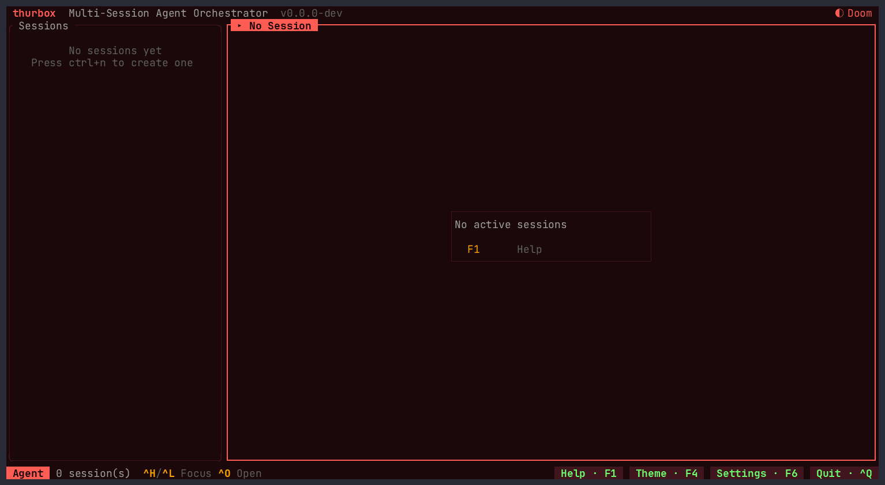

Two panes between two bars: the **session list** on the left, the **agent
terminal** on the right, and the keys you need on the footer. There are no
sessions yet, so the list says so.

thurbox never starts, restarts or sets up Fleet. While no manager runs, the
status line says `Fleet not running · systemctl --user start fleet.service`
(`Fleet not running · fleet up` where no unit is installed), or
`no Fleet config · fleet init` before `fleet init` ran.
[Configuration](config.md#a-working-setup) has the three files involved,
should you want to change them.

## 2. Pick a place

Press **`Ctrl+N`**. The creation flow first asks **where the session runs**: a
place of Fleet's runtime. A fresh setup has one, `local`, which is this
machine.

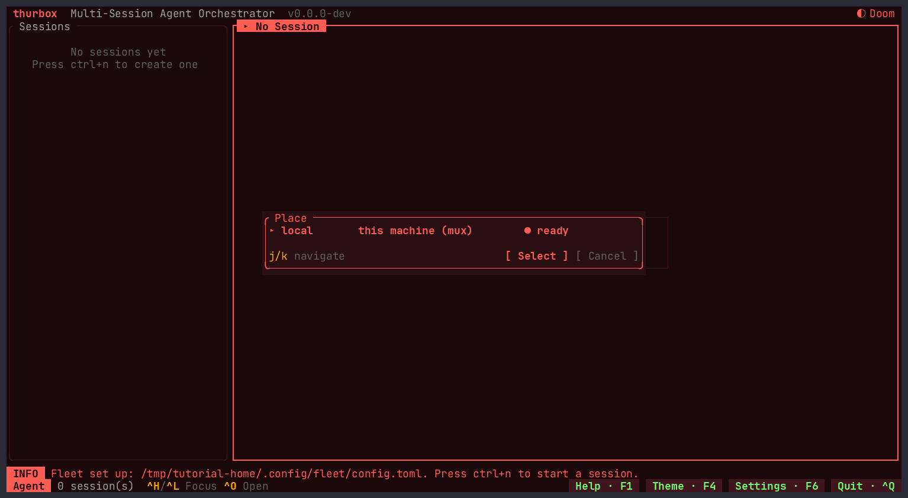

With several Fleets in `settings.toml`, a Fleet step comes before this one.
[Where sessions run](../where-sessions-run.md) explains Fleets and places.
`Enter` takes the place.

## 3. Add a repository

The repo step opens with its search focused: type any part of a repository's
path and the list narrows to the fuzzy matches, best first.

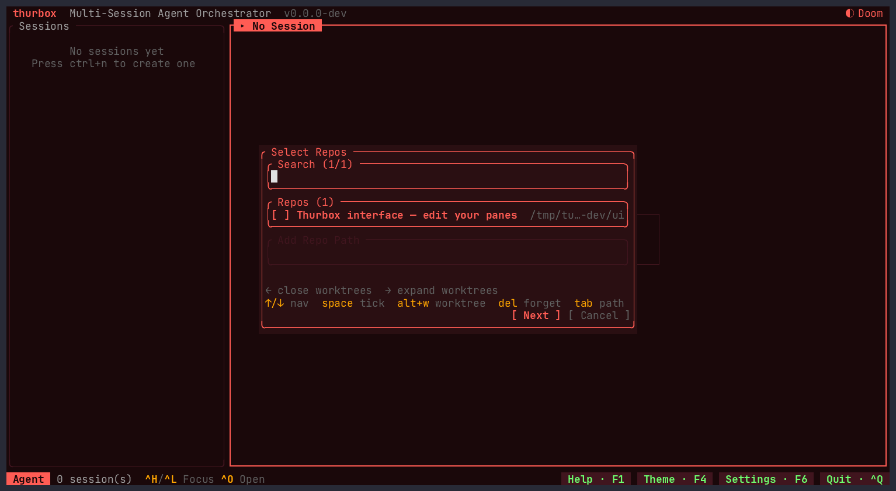

The list is thurbox's **repo memory**: the repositories you have used before.
On a fresh install it holds one row you did not add: your own interface
directory, offered because editing the panes is a thing you might want a session
for.

To add a repository, press **`Tab`** to move to the **Add Repo Path** field and
type a path. `~` is expanded for you. The field starts at the deepest directory
all your remembered repositories share (home, while there are none), so a bare
name lands next to them; typing `/` or `~` first replaces it with a path of
your own:

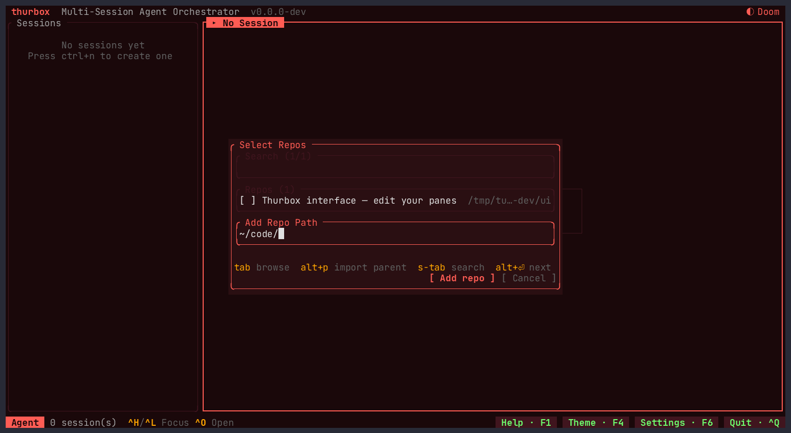

Two ways to finish from here:

- **`Enter`** adds the path you typed, if it is a repository. A folder that
  does not exist yet reads **Create folder** instead: `Enter` then asks what goes
  into it (a new git repository, a clone of an existing one, or nothing), makes
  it, and adds it.
- **`Tab`** browses instead: a listing of that directory, marking which
  subdirectories are git repositories.

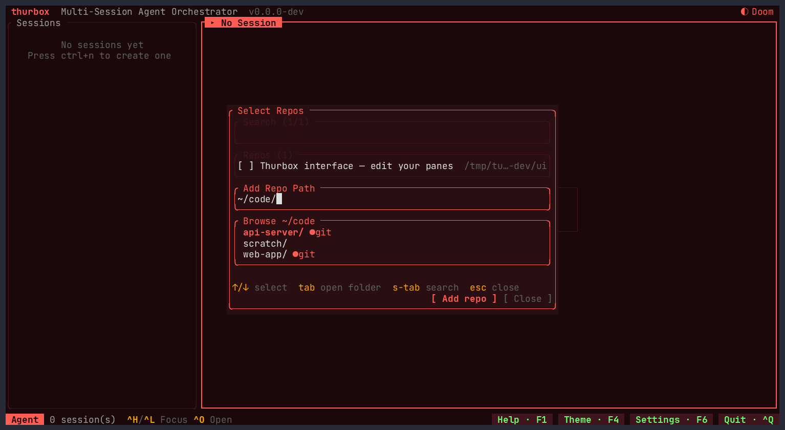

`↑`/`↓` move, `Enter` on a `●git` row picks it (`Enter` on a plain folder
descends into it). Either way the repository lands in memory, ticked, and stays
there for next time:

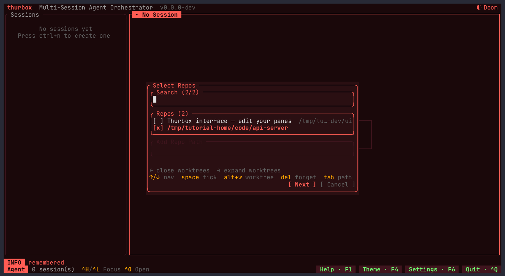

The footer names the rest of what this step does. Letters always go to the
search, so the list's own keys are ones you cannot type:

| Key | What it does |
|---|---|
| `↑`/`↓` | move the cursor |
| `Del` / `Alt+D` | forget a remembered repository (with the caret at the end of the search) |
| `Space` | tick the repository under the cursor (`[x]`); every ticked one goes into the session |
| `Alt+W` | give it a **worktree of its own** (`[wt]`) |
| `→` / `←` | open or close a repository's existing worktrees (`↳`) |
| `Enter` | go on with the ticked repositories, or the one under the cursor |
| `Ctrl+Enter` / `Alt+Enter` | the same, from the path field too (`Ctrl+Enter` needs a terminal with the kitty keyboard protocol) |
| `Esc` | clear the search; a second `Esc` closes the flow |
| `Alt+P` | import a **folder of repositories** at once: type a parent path, press `Alt+P`, and every git subdirectory is added under one header |
| `Tab` / `Shift+Tab` | move between the search and the path field |

## 4. Give it a worktree

A ticked repository runs as it is unless you press **`Alt+W`** on it. Then it
gets a **git worktree of its own** (`[wt]`), and the agent never works in your
checkout:

![The repository marked [wt]](../../media/tutorial/07-worktree-mode.png)

With a worktree, two more questions follow. **Base Branch** asks what the new
branch starts from, with the repository's default branch under the cursor:

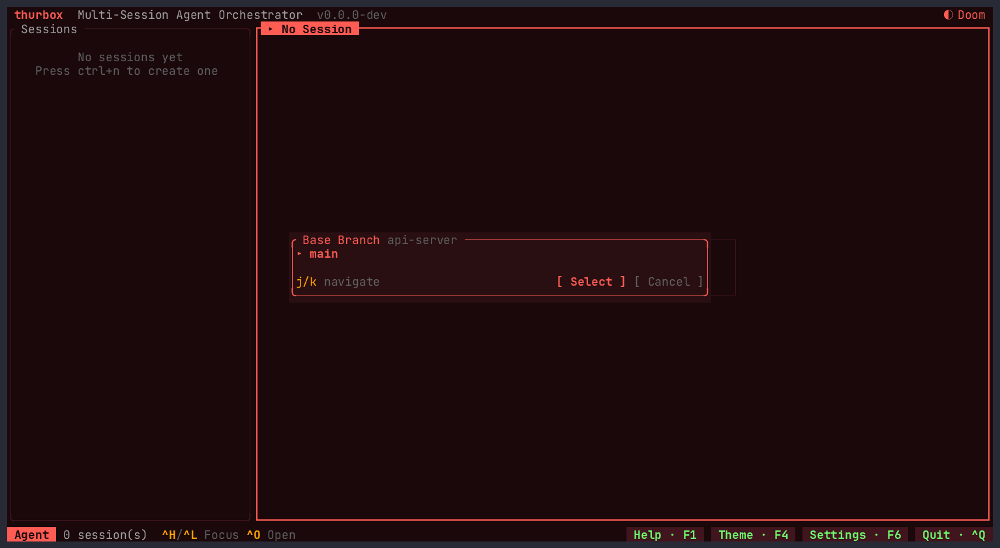

**Branch Name** comes after the session's name, prefilled from it
(`Fix tooltips` becomes `fix-tooltips`). A branch that exists is checked out.

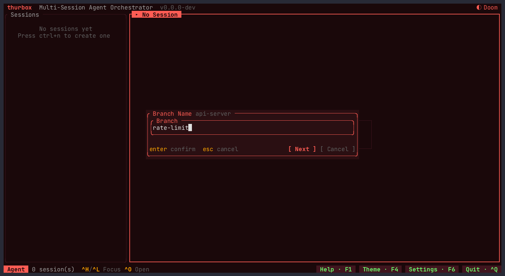

Tick several repositories and the session spans them all, one worktree each on
the same branch. `→` on a repository lists the worktrees it already has, and
`Enter` on one runs the session in that checkout. Fleet's runtime makes each
worktree on the place, so there is nothing to configure. A directory that is no
git repository runs as it is.

## 5. Name it and pick an agent

Name the session after the **work**, not the tool: the list then reads as a
backlog. `Enter` on an empty field accepts the suggested name (the repository's
own), so you can press straight through.


Then the agent: the harnesses the Fleet offers (`fleet version --json` lists
them). Pick one whose CLI is installed where the session runs.

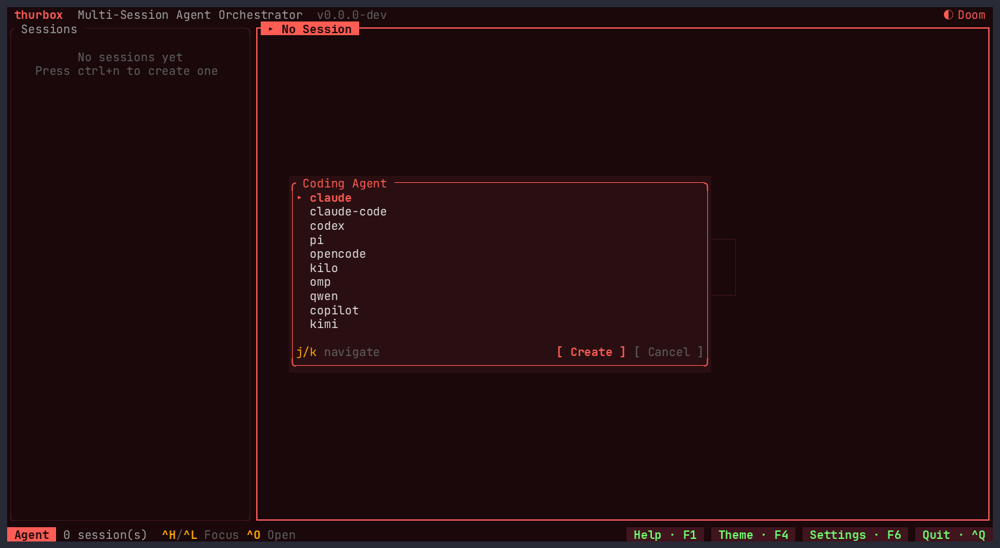

`Enter` creates the session: a Fleet Task. Fleet's runtime makes the worktree
and starts the agent in it.

## 6. You have a session

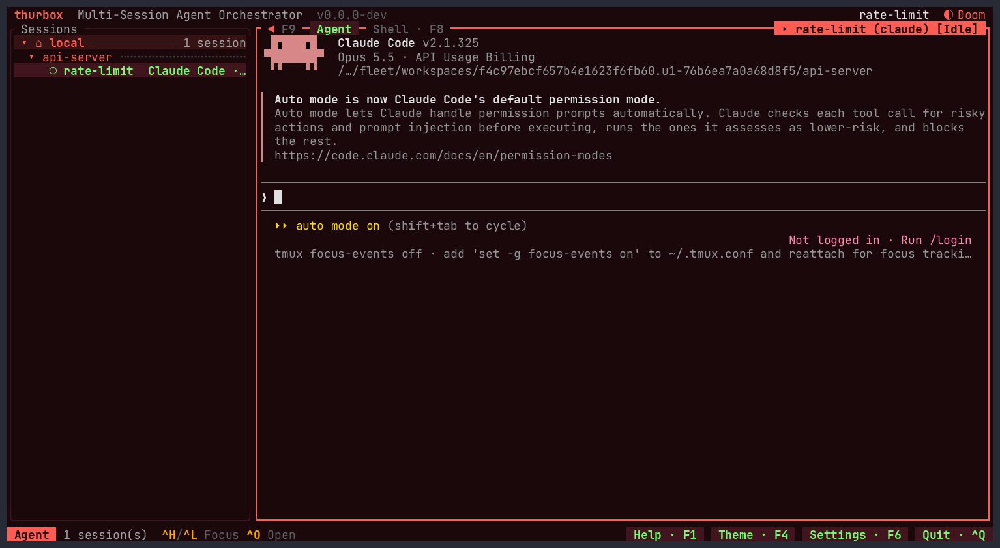

What you are looking at:

- the session row, under its place (`local`) and its **repository**
  (`api-server`), with its status dot
- the **agent terminal** on the right: a real terminal. Everything you type
  goes to the agent; `Ctrl+O` opens the worktree in your editor, and
  `Ctrl+T`/`F8` gives you a shell in the same directory
- the status dot tracks the agent through **working / blocked / idle**,
  reported by the agent's own hooks through Fleet rather than guessed

Press **`Ctrl+Q`** whenever you like: it detaches. Fleet keeps every agent
running, and relaunching `thurbox` puts you back where you were, after a crash
or a week away. After a reboot, Fleet revives the sessions of unfinished Tasks
once `fleet up` runs again.

## 7. The second session is faster

`Ctrl+N` again. The repository is in memory now, so there is nothing to type:
take the place, move to the repository, `Enter`, and through the same steps.

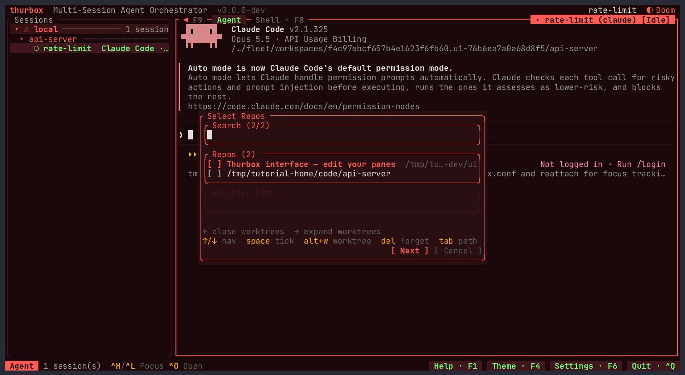

That is the shape of a working day: one session per piece of work, each on its
own branch, all alive at once.

## Everyday keys

The authoritative list is **`F1`** (or `Ctrl+G`), which renders the live key
registry, so it can never drift from what is actually bound. Every chord in it
is rebindable from that screen.

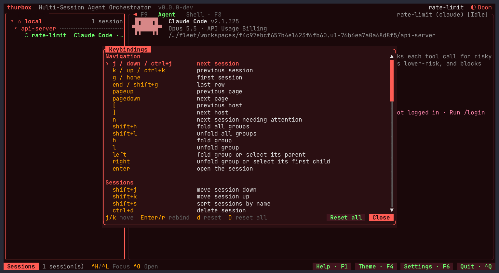

The ones worth knowing on day one:

| Key | Action |
|---|---|
| `Ctrl+N` | New session |
| `Ctrl+J` / `Ctrl+K` | Select the next / previous session |
| `Ctrl+H` / `Ctrl+L` | Move focus between panes (the way out of a focused agent) |
| `Ctrl+/` | Search sessions **and the text on their screens** |
| `Ctrl+O` | Open the session's directory in your editor |
| `Ctrl+T` / `F8` | A shell in the session's directory |
| `Ctrl+E` | Rename the session (with the list focused; in a terminal it is end-of-line) |
| `Ctrl+D` | Confirm deleting the session (for good: Fleet keeps no undo) |
| `Ctrl+Y` / `F4` | Theme picker |
| `Ctrl+,` / `F6` | Settings; `]` for the Interface tab |
| `F10` | Reload the interface from disk |
| `Ctrl+Q` | Quit, leaving every agent running |

With the mouse, a click on a session **selects** it and leaves the keyboard in
the list, so `Ctrl+D` asks about the one you pointed at; a **double-click**
opens it, moving the keyboard into its agent pane like `Enter`. The badge at the
bottom-left always names the pane that has the keyboard.

`Ctrl+/` is the one to remember when the list gets long: it matches names,
agents, branches and repositories, and the text on each session's screen, which
is how you find the session with the error in it. Matches highlight **inside**
the panes rather than being reprinted:

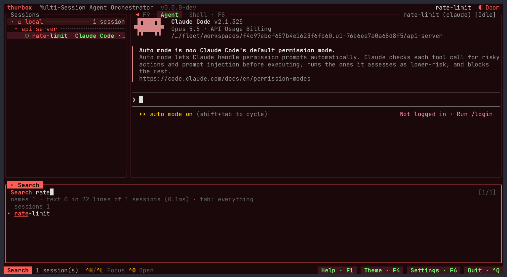

## The same thing from the command line

Every session is a Fleet Task, so `fleet` drives the same sessions with no
TUI, against the same store. Anything you do here shows up in a running
thurbox within a tick, and the other way round. Each command prints JSON.

```bash
# What is running
fleet list task
fleet get task docs                        # one Task, its spec and status

# Start one headlessly: an interactive Task over a directory
echo '{"apiVersion":"fleet/v1alpha1","kind":"Task",
  "metadata":{"name":"docs","labels":{"thurbox.dev/name":"docs"}},
  "spec":{"harness":"claude-code","host":"local",
          "workspace":["file:///home/me/code/web-app"],"dispatch":true}}' \
  | fleet apply --create-only -f -

# Talk to one
fleet send docs "run the tests and fix what fails"

# Clean up
fleet delete task docs
```

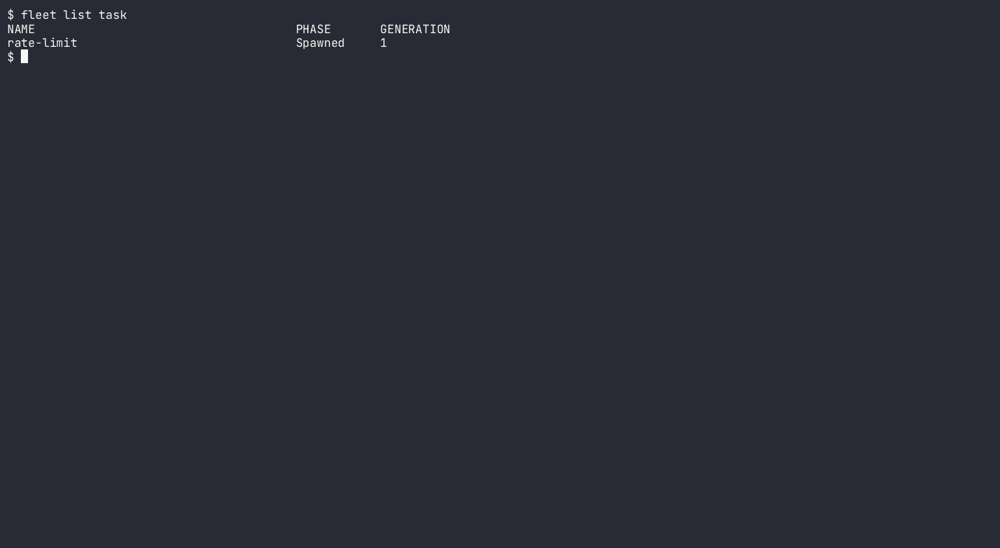

`thurbox-cli` keeps what is the interface's own: `thurbox-cli doctor` checks
the setup, `thurbox-cli config show` prints every resolved path,
`thurbox-cli plugin dir` prints the interface directory, and
`thurbox-cli --help` lists the rest.

## Where to go next

- **Make it yours**: every pane is a Lua file in a directory you own. Ask an
  agent in any session to change it, or read [plugins.md](plugins.md).
  `Ctrl+,` then `]` lists every pane and turns one off; `F10` reloads.
- **Run several agents on one job**: [orchestration.md](orchestration.md).
- **Run sessions on another machine**: give your Fleet an ssh or wsl place,
  or put a Fleet there and list it in `settings.toml` `[fleets]`; its
  sessions run there while the TUI stays here
  ([Where sessions run](../where-sessions-run.md)). Pick that place in the
  place step, and the repository and branch steps browse its folders and
  branches there.
- **Configure it**: [config.md](config.md) starts with a working setup and
  lists every config file, environment variable and setting;
  [features.md](features.md) says why each one behaves the way it does.

Regenerate every screenshot on this page with:

```bash
scripts/demo/record-tutorial.sh
```
